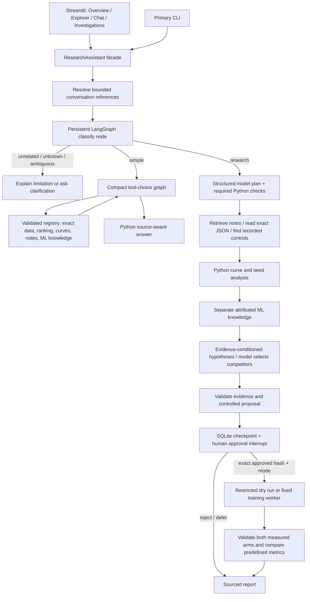

# ML Experiment Detective — Final Project Master Context

## Architecture and purpose

This is the complete local experiment research application. It supports experiment exploration, conversational analysis, retrieval-augmented investigation, competing hypotheses, controlled proposals and explicitly approved bounded execution. Original measurements/notes remain intact. Full live training remains unverified pending explicit approval; final demonstrations execute dry runs only.



### Responsibility and source boundaries

Qwen selects tools, optional plan steps and bounded competing hypotheses. Python resolves exact references, corrects explicit argument constraints, enforces scope, computes all numbers, validates configurations/citations, builds evidence-conditioned candidate wording, renders measured claims and enforces approval. LangGraph controls branching/checkpoints; it does not create scientific truth. User decisions alone authorize live resource use. Every fallback is labeled APP POLICY or APP FILTER.

Structured `runs/*.json` supplies exact settings/measurements. Original `notes/*.md` supplies discovery observations. Runtime-derived summaries are labeled DERIVED_ANALYSIS and point to JSON. Local `knowledge/*.md` supplies attributed general mechanisms, never proof of what caused a run. Hypotheses are labeled HYPOTHESIS. Tests use TEST_FIXTURE provenance and never create real run measurements.

### Main data flow and memory

`ResearchAssistant.ask` captures question/session state, resolves straightforward references and routes through `Investigator.start`. Simple requests reach the compact graph with the shared tool registry. Research creates a structured plan, collects exact snapshots, analyzes differences, retrieves knowledge, validates hypotheses/proposals and interrupts. The same database persists plan/status, tool history, hypotheses, proposal hashes, decision audit and graph checkpoints.

The conversation `SessionState` remembers four compact turns, a single focused run and the last comparison pair. The UI keeps a bounded visible chat list. A reset does not delete experiments or investigations. SQLite snapshots record what is known; checkpoints record where execution can resume. The model sees a bounded prompt/schema, not the full durable database. No embedding model is used for reference memory.

### Permission and execution

Approval is tied to proposal ID, canonical JSON hash and dry/live mode. Changing a proposal invalidates permission. The executor revalidates the trainer hash/configuration, atomically consumes approval and prevents concurrent live jobs. It accepts no model-written shell command. The fixed worker calls the original `phase0.run_training` with downloads disabled and exclusive output creation. The official test partition is excluded.

The supported intervention is a two-arm learning-rate comparison using shared fresh seeds, existing Fashion-MNIST MLP, fixed split/batch/hidden settings, at most five epochs per arm, two CPU threads and a 600-second total parent budget. Cancellation is cooperative between batches. Completed partial outputs survive; uncertain running work after restart is marked interrupted rather than relaunched. There is no hard OS RAM quota or automatic process reattachment.

### Retrieval algorithms and mathematics

Keyword overlap counts shared normalized tokens while preserving negation. MiniLM produces 384-dimensional vectors; cosine is `(a·b)/(||a|| ||b||)`. Reciprocal Rank Fusion is `sum_m 1/(60+rank_m)`. The primary source policy computes within-source ranks, prioritizes human notes for broad behavior search, exposes derived summaries separately and honors exact run IDs. Optional cross-encoder reranking retains source/identifier constraints. Retrieval scores are not probabilities. At this collection size documents are encoded for a request; the model object is cached, but no persistent vector database or ANN index is used.

### Numerical and scientific rules

Target-minus-baseline accuracy change is `100*(target_fraction-baseline_fraction)` in percentage points. Maximum positive loss rise is `max(0,L[t+1]-L[t])`. Best epoch, final epoch, minimum loss, recovery patterns and available train/validation gaps are calculated in Python. Changed settings, missing controls, different horizons, incomplete metrics and missing architecture/software provenance remain visible. Recorded seed blocks are deduplicated; a small descriptive mean is not a causal proof or confidence interval.

Higher-rate loss-rise ordering tests H1's predefined prediction; seed-dependent accuracy variation is a different hypothesis. General knowledge can suggest a mechanism but cannot establish the cause of an individual run. Fresh seed proposals respect recorded configurations and reserved legacy plans. One matched block does not establish general causation.

## Actual directory/file map

| File | Responsibility |
|---|---|
| `simple_agent.py` | Original native tool-using educational reference |
| `legacy_ui.py` | Earlier educational UI and compatibility checks |
| `assistant.py` | Primary facade and shared conversation entry |
| `ui.py` | Recommended four-area Streamlit interface |
| `investigate.py` | Persistent investigation CLI entry point |
| `app.py` | Primary interactive/single-question CLI and educational mode switches |
| `experiment_data.py` | Exact JSON read/filter/compare boundary |
| `note_retrieval.py` | Shared MiniLM encoding and baseline text/vector operations |
| `v2_retrieval.py` | Preserved baseline hybrid/reranker and local knowledge corpus loader |
| `v2_tools.py` | Shared allowlisted tool schemas and dispatcher |
| `v2_agent.py` | Shared turn preparation, policy, tool observation and manual reference loop |
| `v2_state.py` | Bounded conversation and reference resolution |
| `v2_answers.py` | Deterministic source-aware conversational answer renderer |
| `v2_analysis.py` | Reusable measured ranking, curve summaries and descriptive heuristics |
| `graph_agent.py` | Compact reactive graph reused for simple questions |
| `v3/planner.py` | Request classification and bounded model planning/hypothesis choices |
| `v3/investigation_state.py` | SQLite snapshots, proposals, audit history and atomic execution permission |
| `v3/analysis.py` | Investigation-specific validation, controlled comparisons and seed blocks |
| `v3/retrieval.py` | Primary source-aware note retrieval and guarded knowledge retrieval |
| `v3/hypothesis.py` | Evidence registry, competing candidates and reference validation |
| `v3/experiment_designer.py` | Machine-readable controlled learning-rate proposals and independent validator |
| `v3/experiment_executor.py` | Only approved bounded execution and measured result interpretation |
| `v3/training_worker.py` | Fixed worker calling the original trainer |
| `phase0.py` | Original Fashion-MNIST model, evaluation and callable training implementation |
| `v3/investigation_graph.py` | Primary durable graph with explicit conditional scientific workflow |
| `v3/service.py` | Shared UI/CLI lifecycle operations for saved investigations |
| `v3/report.py` | Grounded persistent research report renderer |
| `v3/ui.py` | Investigation plan/evidence/hypothesis/approval/execution/report controls |
| `v3/cli.py` | Explicit persistent research operation CLI |
| `evaluate_final.py` | Combined deterministic scenario runner |
| `evaluate_final_retrieval.py` | Frozen relevance labels and separate exact-ID coverage benchmark |
| `demonstrate_final.py` | Six requested user journeys and real investigation artifact producer |
| `validate_final_ui.py` | Integrated UI widget and result verification |
| `tests/test_final.py` | Integrated final user journeys and failure-boundary scenarios |
| `tests/test_v3.py` | Preserved scientific workflow, approval, persistence and fixture scenarios |
| `verify_final.py` | Final data, artifact, document and launch acceptance check |

Data directories: runs (measured JSON), notes (original observations), knowledge (attributed references), investigations (ignored runtime SQLite/logs/exports), reports/final (executed reviewable outputs), .model_cache and data (ignored local assets), docs (final learning package plus preserved historical guides), tests (core and integrated scenarios).

## Exact commands and study operation

```powershell
cd "D:\Agentic_ai_rag projects"
.\.venv\Scripts\streamlit.exe run ui.py
.\.venv\Scripts\python.exe app.py --question "What experiments do we have?"
.\.venv\Scripts\python.exe app.py --offline --lexical --question "Investigate why lr_01_seed3 underperformed."
.\.venv\Scripts\python.exe investigate.py list
.\.venv\Scripts\python.exe investigate.py show INV-A2B6989CC1
.\.venv\Scripts\python.exe investigate.py resume INV-A2B6989CC1
.\.venv\Scripts\python.exe investigate.py export INV-A2B6989CC1
```

The recorded demonstration is dry-run completed; resume does not retrain it. Start a new objective in the UI for a new pending proposal. Inspect its exact parameters and hash before deciding. A decision template for a new pending proposal is:

```powershell
.\.venv\Scripts\python.exe investigate.py decide "INV-ID-FROM-LIST" approved --hash "EXACT-HASH-FROM-SHOW" --mode dry_run
.\.venv\Scripts\python.exe investigate.py cancel "INV-ID-FROM-LIST"
```

Replace quoted placeholders with the displayed ID/hash. `rejected`/`deferred` are alternative decisions. `--mode live` is a distinct explicit authorization for the displayed workload; no live-training command was run during final development. Editing uses `modify ID proposal.json` or the UI, invalidates approval and requires review again. Completed proposals cannot be repurposed through another execution; create a new proposal/investigation.

The installed environment/caches permit local/offline operation. Primary `--offline --lexical` avoids Ollama and embedding imports; ordinary operation uses localhost and local-only model weights. Fresh setup requires internet for Python packages and initial Ollama/MiniLM weights; the optional reranker has its own explicit download. The restricted executor refuses missing datasets rather than downloading them. README gives the exact new-install setup and D: environment configuration.

```powershell
.\.venv\Scripts\python.exe evaluate_final.py
.\.venv\Scripts\python.exe validate_final_ui.py
.\.venv\Scripts\python.exe evaluate_final_retrieval.py
.\.venv\Scripts\python.exe demonstrate_final.py --live
.\.venv\Scripts\python.exe docs\build_final_docs.py
```

The educational references remain `app.py --agent manual`, `--agent graph`, `--agent simple`, and `legacy_ui.py`. The main application no longer requires selecting a historical version. Follow the learning guide's 30 chapters, then open the walkthrough beside source, then follow the complete runtime trace, then reproduce selected checks. Development is complete within the stated bounded scope; the next activity is study.

## Installed models and dependencies

```json
{
  "python": "3.12",
  "packages": {
    "torch": "2.14.1",
    "torchvision": "0.29.1",
    "sentence-transformers": "6.1.0",
    "streamlit": "1.65.0",
    "langgraph": "1.2.12",
    "langgraph-checkpoint-sqlite": "3.1.2"
  },
  "ollama_executable": "D:\\Ollama\\ollama.exe",
  "ollama_models": "D:\\Ollama\\models",
  "embedding_cache": "D:\\Agentic_ai_rag projects\\.model_cache",
  "pip_cache": "D:\\Agentic_ai_rag projects\\.pip_cache",
  "dataset_cache": "D:\\Agentic_ai_rag projects\\data",
  "new_model_or_dataset_downloaded": false
}
```

## Exact tool and decision schemas

### Current read/analysis tool registry

```json
[
  {
    "type": "function",
    "function": {
      "name": "rank_experiments",
      "description": "Rank saved experiments by final accuracy, validation loss, or largest validation-loss rise. Exact filters remain separate from semantic matching.",
      "parameters": {
        "type": "object",
        "properties": {
          "sort_by": {
            "type": "string",
            "enum": [
              "accuracy",
              "loss",
              "spike"
            ]
          },
          "learning_rate": {
            "type": "number"
          },
          "train_size": {
            "type": "integer"
          },
          "dropout": {
            "type": "number"
          },
          "top_k": {
            "type": "integer"
          }
        },
        "required": [],
        "additionalProperties": false
      }
    }
  },
  {
    "type": "function",
    "function": {
      "name": "get_experiment",
      "description": "Read one saved experiment. Use only for a question about one run; for two run IDs, use compare_experiments instead.",
      "parameters": {
        "type": "object",
        "properties": {
          "run_id": {
            "type": "string",
            "description": "Exact saved run ID"
          }
        },
        "required": [
          "run_id"
        ],
        "additionalProperties": false
      }
    }
  },
  {
    "type": "function",
    "function": {
      "name": "compare_experiments",
      "description": "Preferred tool whenever a question mentions two run IDs. Compare their recorded settings and final metrics. Use baseline_run_id for the reference and target_run_id for the run being explained; differences are target minus baseline.",
      "parameters": {
        "type": "object",
        "properties": {
          "baseline_run_id": {
            "type": "string",
            "description": "Reference run ID"
          },
          "target_run_id": {
            "type": "string",
            "description": "Run ID being compared with the reference"
          }
        },
        "required": [
          "baseline_run_id",
          "target_run_id"
        ],
        "additionalProperties": false
      }
    }
  },
  {
    "type": "function",
    "function": {
      "name": "search_runs",
      "description": "Filter saved JSON by exact learning_rate, train_size or dropout; do not use for behavior wording.",
      "parameters": {
        "type": "object",
        "properties": {
          "learning_rate": {
            "type": "number"
          },
          "train_size": {
            "type": "integer"
          },
          "dropout": {
            "type": "number"
          }
        },
        "required": [],
        "additionalProperties": false
      }
    }
  },
  {
    "type": "function",
    "function": {
      "name": "search_notes",
      "description": "Hybrid keyword and MiniLM search over experiment notes. Returns run IDs and visible ranking stages; inspect a returned run for exact metrics.",
      "parameters": {
        "type": "object",
        "properties": {
          "query": {
            "type": "string"
          },
          "top_k": {
            "type": "integer"
          },
          "rerank": {
            "type": "boolean"
          }
        },
        "required": [
          "query"
        ],
        "additionalProperties": false
      }
    }
  },
  {
    "type": "function",
    "function": {
      "name": "summarize_run_curve",
      "description": "Compute best validation accuracy, minimum loss, largest rise and recoveries for one run.",
      "parameters": {
        "type": "object",
        "properties": {
          "run_id": {
            "type": "string"
          }
        },
        "required": [
          "run_id"
        ],
        "additionalProperties": false
      }
    }
  },
  {
    "type": "function",
    "function": {
      "name": "find_overfitting_candidates",
      "description": "Flag saved intervals where post-epoch training loss fell while validation loss rose. This is only a candidate rule.",
      "parameters": {
        "type": "object",
        "properties": {},
        "required": [],
        "additionalProperties": false
      }
    }
  },
  {
    "type": "function",
    "function": {
      "name": "compare_run_group",
      "description": "Describe counts and accuracy statistics for two exact learning-rate groups; no causal claim.",
      "parameters": {
        "type": "object",
        "properties": {
          "learning_rate_a": {
            "type": "number"
          },
          "learning_rate_b": {
            "type": "number"
          }
        },
        "required": [
          "learning_rate_a",
          "learning_rate_b"
        ],
        "additionalProperties": false
      }
    }
  },
  {
    "type": "function",
    "function": {
      "name": "plot_run_metrics",
      "description": "Return epoch, post-epoch train loss, validation loss and validation accuracy for a chart.",
      "parameters": {
        "type": "object",
        "properties": {
          "run_id": {
            "type": "string"
          }
        },
        "required": [
          "run_id"
        ],
        "additionalProperties": false
      }
    }
  },
  {
    "type": "function",
    "function": {
      "name": "search_ml_knowledge",
      "description": "Search the separate offline corpus of general ML documentation. It cannot prove a specific run's cause.",
      "parameters": {
        "type": "object",
        "properties": {
          "query": {
            "type": "string"
          },
          "top_k": {
            "type": "integer"
          }
        },
        "required": [
          "query"
        ],
        "additionalProperties": false
      }
    }
  }
]
```

### Actual planning and hypothesis menus in this run

```json
{
  "type": "function",
  "function": {
    "name": "create_investigation_plan",
    "description": "Objective: Investigate why lr_01_seed3 performed worse than lr_005_seed3. Search notes, check previous experiments, retrieve ML knowledge, and propose a controlled follow-up.. Known mentioned runs: ['lr_01_seed3', 'lr_005_seed3']. Choose useful optional research tools. Choose compare_seed_pairs to check replication/counterevidence; search_notes to find previous observations; retrieve_knowledge for mechanisms. Return a topic from the menu.",
    "parameters": {
      "type": "object",
      "properties": {
        "steps": {
          "type": "array",
          "items": {
            "type": "string",
            "enum": [
              "search_notes",
              "compare_seed_pairs",
              "retrieve_knowledge"
            ]
          },
          "maxItems": 3
        },
        "knowledge_topic": {
          "type": "string",
          "enum": [
            "high learning rate optimization instability",
            "dropout overfitting validation loss",
            "training validation loss curves"
          ]
        }
      },
      "required": [
        "steps",
        "knowledge_topic"
      ],
      "additionalProperties": false
    }
  }
}
```

```json
{
  "type": "function",
  "function": {
    "name": "select_hypotheses",
    "description": "Select and order competing hypotheses for the objective. These are candidate mechanisms, never facts. [{'hypothesis_id': 'H1', 'statement': 'A higher learning rate may contribute to larger validation-loss rises through unstable optimization.', 'supporting_experiment_evidence': ['PAIR:0', 'PAIR:1', 'PAIR:2', 'PAIR:3'], 'contradicting_experiment_evidence': []}, {'hypothesis_id': 'H2', 'statement': 'Seed-dependent training variability may contribute to differences in final validation accuracy.', 'supporting_experiment_evidence': ['PAIR:0', 'PAIR:1', 'PAIR:2', 'PAIR:3'], 'contradicting_experiment_evidence': []}, {'hypothesis_id': 'H3', 'statement': 'The short recorded training horizon may leave the final-epoch ranking sensitive to transient behavior.', 'supporting_experiment_evidence': ['RUN:lr_005_seed3', 'RUN:lr_01_seed3', 'RUN:lr_005_gap_001', 'RUN:baseline_001', 'RUN:lr_005_seed2', 'RUN:lr_01_seed2'], 'contradicting_experiment_evidence': []}, {'hypothesis_id': 'H4', 'statement': 'A generalization gap may contribute during intervals where training loss improves and validation loss rises.', 'supporting_experiment_evidence': ['PAIR:2'], 'contradicting_experiment_evidence': []}]",
    "parameters": {
      "type": "object",
      "properties": {
        "hypothesis_ids": {
          "type": "array",
          "items": {
            "type": "string",
            "enum": [
              "H1",
              "H2",
              "H3",
              "H4"
            ]
          },
          "minItems": 2,
          "maxItems": 4
        }
      },
      "required": [
        "hypothesis_ids"
      ],
      "additionalProperties": false
    }
  }
}
```

The workflow's approval/execution methods are intentionally not in this LLM menu. A Python graph calling a function is distinct from the model requesting a native tool call. The planner's schema-constrained JSON choice is also distinguished from native hypothesis tool requests in the saved events.

## Actual data formats and persistence

### Exact representative run JSON

```json
{
  "config": {
    "run_id": "lr_01_seed3",
    "dataset": "FashionMNIST",
    "source_partition": "train",
    "preprocessing": "ToTensor",
    "train_size": 10000,
    "val_size": 2000,
    "validation_start": 10000,
    "split_seed": 42,
    "shuffle_seed": 243,
    "model_seed": 244,
    "batch_size": 128,
    "hidden_units": 128,
    "dropout": 0.0,
    "optimizer": "SGD",
    "learning_rate": 0.1,
    "epochs": 5
  },
  "metrics": [
    {
      "epoch": 1,
      "train_loss_during_epoch": 1.2794325910568238,
      "train_loss_after_epoch": 0.9111308251380921,
      "train_accuracy_after_epoch": 0.6495,
      "val_loss": 0.8865399732589722,
      "val_accuracy": 0.6645
    },
    {
      "epoch": 2,
      "train_loss_during_epoch": 0.7691367017745971,
      "train_loss_after_epoch": 1.0264610683441162,
      "train_accuracy_after_epoch": 0.6864,
      "val_loss": 1.0251937484741211,
      "val_accuracy": 0.6875
    },
    {
      "epoch": 3,
      "train_loss_during_epoch": 0.6635693133354187,
      "train_loss_after_epoch": 0.8690615137100219,
      "train_accuracy_after_epoch": 0.6762,
      "val_loss": 0.8684509625434875,
      "val_accuracy": 0.674
    },
    {
      "epoch": 4,
      "train_loss_during_epoch": 0.6114804370880127,
      "train_loss_after_epoch": 0.6598312929391861,
      "train_accuracy_after_epoch": 0.7469,
      "val_loss": 0.6828413162231445,
      "val_accuracy": 0.732
    },
    {
      "epoch": 5,
      "train_loss_during_epoch": 0.5592419065475464,
      "train_loss_after_epoch": 0.8131413830757142,
      "train_accuracy_after_epoch": 0.7162,
      "val_loss": 0.810864956855774,
      "val_accuracy": 0.7145
    }
  ]
}
```

### Original human note

```text
# lr_01_seed2

Source: [run record](../runs/lr_01_seed2.json)
Provenance: This note paraphrases saved metrics; it is not an independent log.

Observation: With alternate model and shuffle seeds, validation loss rose from 0.7136 at epoch 3 to 0.8142 at epoch 4, then fell to 0.6793 at epoch 5. Final validation accuracy was 76.35%.
```

### All attributed local knowledge records

#### knowledge/dropout.md

```text
Title: torch.nn.Dropout
URL: https://docs.pytorch.org/docs/stable/generated/torch.nn.Dropout
Topic: dropout regularization
Source-Type: official documentation (PyTorch)
Text:
During training, dropout randomly sets some input elements to zero with the configured probability. During evaluation, the dropout module acts as an identity operation. Therefore a saved dropout setting affects training behavior, while evaluation uses the model in its evaluation mode; comparing runs still requires checking all other recorded settings.
```

#### knowledge/experimental_design.md

```text
Title: Common pitfalls and recommended practices
URL: https://scikit-learn.org/stable/common_pitfalls.html
Topic: experimental design, data leakage and generalization
Source-Type: official documentation (scikit-learn), paraphrase verified 2026-10-28
Text:
Data leakage can make estimated model performance overly optimistic. Split data before learning preprocessing parameters, fit transformations on training data, and apply the learned transformations consistently to held-out data. Test data should not guide model choices. Control randomness deliberately and record how data and models were configured. Our application therefore uses one recorded validation split from the training partition and keeps the official test partition outside proposal selection. Repeated validation-guided choices can still adapt to that validation set; a controlled pair alone does not establish a general causal explanation.
```

#### knowledge/learning_rates.md

```text
Title: Linear regression: Hyperparameters
URL: https://developers.google.com/machine-learning/crash-course/linear-regression/hyperparameters
Topic: learning rates and optimization
Source-Type: official educational material (Google Machine Learning Crash Course)
Text:
The learning rate controls the size of a gradient-descent parameter update. A rate that is too high can make optimization bounce around a minimum or fail to converge; a rate that is too low can make progress slow. The useful rate depends on the model and data. This general mechanism does not establish why any specific Fashion-MNIST run changed.
```

#### knowledge/optimization.md

```text
Title: Optimizing Model Parameters
URL: https://docs.pytorch.org/tutorials/beginner/basics/optimization_tutorial.html
Topic: SGD, loss, and weight updates
Source-Type: official documentation (PyTorch)
Text:
Optimization changes model parameters to reduce error. In PyTorch's training loop, zero_grad clears accumulated gradients, backward computes gradients of loss, and optimizer.step updates parameters. The SGD optimizer receives a learning-rate setting. A saved validation-loss curve records outcomes after those updates; it does not reveal every internal step.
```

#### knowledge/overfitting.md

```text
Title: Validation curves: plotting scores to evaluate models
URL: https://scikit-learn.org/stable/modules/learning_curve.html
Topic: overfitting and validation behavior
Source-Type: official documentation (scikit-learn)
Text:
Training and validation scores together can help identify possible overfitting. A high training score paired with a lower validation score is a warning that performance may not generalize as well to unseen data. A pattern in one short saved curve is only a candidate signal; other explanations and repeated checks remain possible.
```

#### knowledge/random_seeds.md

```text
Title: Reproducibility
URL: https://docs.pytorch.org/docs/stable/notes/randomness.html
Topic: random seeds and reproducibility
Source-Type: official documentation (PyTorch), paraphrase verified 2026-10-28
Text:
Random seeds control pseudo-random choices such as initialization and data order. Seeding PyTorch and other random-number generators can reduce variability in a fixed environment. Identical seeds do not guarantee identical results across all devices, releases, or operations. Repeated seed blocks help assess sensitivity to randomness. In this project split, model, and shuffle seeds have separate jobs; a matched-seed comparison is not a statistical proof or a guarantee of identical training trajectories at different learning rates.
```

#### knowledge/validation.md

```text
Title: Overfitting: Interpreting loss curves
URL: https://developers.google.com/machine-learning/crash-course/overfitting/interpreting-loss-curves
Topic: training and validation loss curves
Source-Type: official educational material (Google Machine Learning Crash Course)
Text:
Loss curves can oscillate or rise for several reasons. Reducing a learning rate can be useful when debugging an oscillating training-loss curve. When training loss improves but validation loss rises, overfitting is one possible interpretation. These are general diagnostic ideas, not proof of a cause for any particular saved run.
```

### Stored research summary

```json
{
  "investigation_id": "INV-A2B6989CC1",
  "objective": "Investigate why lr_01_seed3 performed worse than lr_005_seed3. Search notes, check previous experiments, retrieve ML knowledge, and propose a controlled follow-up.",
  "status": "dry_run_completed",
  "plan": [
    {
      "id": "collect",
      "description": "Read exact experiment evidence",
      "tool": "get_experiment",
      "depends_on": [],
      "status": "completed",
      "proposed_by": "PYTHON"
    },
    {
      "id": "notes",
      "description": "Find earlier experiment observations",
      "tool": "search_notes",
      "depends_on": [],
      "status": "completed",
      "proposed_by": "LLM"
    },
    {
      "id": "analyze",
      "description": "Compute curves, controls and seed comparisons",
      "tool": "analyze_experiments",
      "depends_on": [
        "collect"
      ],
      "status": "completed",
      "proposed_by": "PYTHON"
    },
    {
      "id": "knowledge",
      "description": "Retrieve possible general mechanisms",
      "tool": "search_ml_knowledge",
      "depends_on": [
        "analyze"
      ],
      "status": "completed",
      "proposed_by": "LLM"
    },
    {
      "id": "hypotheses",
      "description": "Select competing evidence-backed hypotheses",
      "tool": "select_hypotheses",
      "depends_on": [
        "analyze"
      ],
      "status": "completed",
      "proposed_by": "PYTHON"
    },
    {
      "id": "validate",
      "description": "Validate citations and hypothesis evidence",
      "tool": "validate_evidence",
      "depends_on": [
        "hypotheses"
      ],
      "status": "completed",
      "proposed_by": "PYTHON"
    },
    {
      "id": "design",
      "description": "Design a new controlled experiment",
      "tool": "design_followup",
      "depends_on": [
        "validate"
      ],
      "status": "completed",
      "proposed_by": "PYTHON"
    },
    {
      "id": "approval",
      "description": "Wait for an exact human decision",
      "tool": "human_approval",
      "depends_on": [
        "design"
      ],
      "status": "completed",
      "proposed_by": "APP POLICY"
    },
    {
      "id": "execute",
      "description": "Execute only an approved configuration",
      "tool": "restricted_executor",
      "depends_on": [
        "approval"
      ],
      "status": "completed",
      "proposed_by": "APP POLICY"
    },
    {
      "id": "outcome",
      "description": "Analyze new measured outcomes",
      "tool": "analyze_outcome",
      "depends_on": [
        "execute"
      ],
      "status": "skipped",
      "proposed_by": "PYTHON",
      "detail": "No complete new measured pair; dry runs contain no measurements"
    },
    {
      "id": "report",
      "description": "Save sourced investigation report",
      "tool": "render_report",
      "depends_on": [
        "validate"
      ],
      "status": "completed",
      "proposed_by": "PYTHON"
    }
  ],
  "proposal_id": "INV-A2B6989CC1-P1",
  "uncertainties": [
    "Independent replication and optimizer-step/gradient measurements are absent.",
    "Validation-loss rises cannot directly demonstrate overshooting; gradients and optimizer trajectories were not recorded.",
    "A small number of observed seed blocks cannot establish a distribution or separate all sources of randomness.",
    "Longer independently approved training and predeclared stopping criteria are unavailable.",
    "This interval rule is a diagnostic candidate, not proof of overfitting."
  ],
  "conversation_before": {
    "focused_run_id": null,
    "referenced_run_ids": [],
    "comparison_run_ids": [],
    "recent_turns": [],
    "history_bound": 4
  },
  "conversation_after_question": {
    "focused_run_id": null,
    "referenced_run_ids": [
      "lr_01_seed3",
      "lr_005_seed3"
    ],
    "comparison_run_ids": [
      "lr_005_seed3",
      "lr_01_seed3"
    ],
    "recent_turns": [
      {
        "question": "Investigate why lr_01_seed3 performed worse than lr_005_seed3. Search notes, check previous experiments, retrieve ML knowledge, and propose a controlled follow-up.",
        "resolved_question": "Investigate why lr_01_seed3 performed worse than lr_005_seed3. Search notes, check previous experiments, retrieve ML knowledge, and propose a controlled follow-up.",
        "tool_decisions": [],
        "run_ids": [
          "lr_01_seed3",
          "lr_005_seed3"
        ]
      }
    ],
    "history_bound": 4
  }
}
```

# Complete beginner-first learning guide

# ML Experiment Detective — Complete Learning Guide

This book explains the implemented local application from basic ML through retrieval, tools, planning, durable investigations and human approval. Examples labeled **illustrative** teach mathematics; examples labeled **measured** come from saved JSON or executed evaluation artifacts. Real code excerpts are inserted from the working source by `docs/build_final_docs.py`; no excerpt is invented.

Read in chapter order. Keep the app open beside the book, starting with Overview and Experiment Explorer. You need basic Python, but no previous knowledge of RAG or agents. The application combines the completed experiment tools and research workflow in one interface.

## Chapter 1 — What problem are we solving?

Training a model produces a number, but understanding that number requires context. Was the data split the same? Did dropout change? Was accuracy measured after the same number of epochs? Is a validation-loss increase a persistent effect or a temporary fluctuation? A folder of results becomes difficult to question reliably from memory.

The Detective makes those records inspectable. It lists and filters experiments, plots curves, compares measured outcomes, retrieves related notes, considers explanations and proposes a controlled test. It saves investigations so closing a window does not erase the research question. Training requires a separate explicit decision.

An LLM is useful because users describe objectives in language: “Have we seen unstable behavior?” does not specify a filename. Qwen can select a tool or choose useful planning options. It is not needed to multiply accuracy by 100 or subtract two losses. Python supplies those operations because a fluent sentence is not evidence of correct arithmetic.

**Concrete example:** “Which run was best?” invokes measured ranking. “Show its curve” uses conversation focus. “Investigate why it underperformed” can require retrieval, matched comparisons, knowledge and competing hypotheses. The same interface supports all three levels of effort. A reactive lookup should not create a full scientific plan unnecessarily.

The facade `ResearchAssistant.ask` connects resettable conversation state to the durable investigator. `question` is the user's text, `resolved` is the text after reference resolution, and `context` records what resolution occurred. It checks unknown IDs, calls the graph and remembers the successful result. Its output is a dictionary containing answer, trace, status and, for research, an investigation ID.


Actual source: `assistant.py:15`–`46`; excerpt of `ask` (remaining lines, if any, are not reproduced here).

```python
    def ask(self, question, session=None, *, offline=False, semantic=True, rerank=False):
        session = session if session is not None else SessionState()
        before = session.snapshot()
        try:
            resolved, memory = session.resolve(question)
        except ValueError as exc:
            return {"answer": str(exc), "trace": [{"kind": "APP POLICY", "data": {"clarification": str(exc)}}],
                    "status": "clarification_needed", "tool_results": []}
        unknown = unknown_run_ids(resolved)
        if unknown:
            ids = sorted(p.stem for p in RUNS_DIR.glob("*.json"))
            alternatives = {x: get_close_matches(x, ids, n=3, cutoff=0.3) for x in unknown}
            answer = f"Unknown experiment ID(s): {', '.join(unknown)}. Available alternatives: {alternatives}. Browse Experiment Explorer to choose a saved run."
            return {"answer": answer, "status": "invalid_request", "tool_results": [],
                    "trace": [{"kind": "APP POLICY", "data": {"unknown_ids": unknown, "alternatives": alternatives}}]}
        context = {"original_question": question, "resolved_question": resolved,
                   "conversation_before": before, "reference_resolution": memory,
                   "explicit_run_ids": mentioned_run_ids(resolved)}
        state = self.investigator.start(resolved, model_enabled=not offline, semantic=semantic,
                                        direct_mode="policy" if offline else "graph", context=context, rerank=rerank)
        answer = state.get("answer") or state.get("report") or state.get("last_error", "No evidence was collected.")
        results = state.get("tool_results", [])
        calls = [{"tool": e["data"]["tool"], "arguments": e["data"].get("arguments", {}), "origin": e["kind"]}
                 for e in state["trace"] if e["kind"] in {"AGENT", "APP POLICY"}
                 and isinstance(e["data"], dict) and "tool" in e["data"]]
        session.remember(question, resolved, answer, calls, results)
        comparisons = state.get("analysis", {}).get("comparisons", [])
        if comparisons:
            session.comparison_run_ids = [comparisons[0]["baseline_run_id"], comparisons[0]["target_run_id"]]
        state["conversation_after"] = session.snapshot()
        state["answer"] = answer
        state["trace"].append({"kind": "STATE UPDATE", "origin": "PYTHON", "data": state["conversation_after"]})
```


The next chapter establishes where the evidence comes from. The assistant cannot be more trustworthy than its experiment records.

## Chapter 2 — How experiment data is generated

Fashion-MNIST contains grayscale clothing images and category labels. An image is a grid of 28×28 values; `ToTensor` makes the grid available to PyTorch with a grayscale channel. A batch has shape `[B,1,28,28]`. Flattening changes each image into a vector of 784 inputs without discarding pixels.

The project takes a reproducible random permutation of the official **training** partition. With split seed 42, the first 10,000 positions form the training pool and positions 10,000–11,999 form validation. A smaller training-size experiment takes fewer images from the same training pool; it does not shift validation into newly available positions. The official test partition is excluded from proposal selection and follow-up analysis.

The MLP computes `h = ReLU(W1 x + b1)` and `z = W2 Dropout(h) + b2`. The hidden width is 128. Each output `z_j` is a logit, not a probability. Softmax converts logits to `p_j = exp(z_j) / sum_k exp(z_k)`. Cross-entropy for the correct class `y` is `L = -log(p_y)`; a confident wrong answer has high loss. Accuracy is `correct / total` and ignores how confident incorrect predictions were. Thus accuracy can improve while loss rises.


Actual source: `phase0.py:14`–`25`; excerpt of `SimpleMLP` (remaining lines, if any, are not reproduced here).

```python
class SimpleMLP(nn.Module):
    def __init__(self, hidden_units, dropout):
        super().__init__()
        self.hidden = nn.Linear(28 * 28, hidden_units)
        self.output = nn.Linear(hidden_units, 10)
        self.dropout = nn.Dropout(dropout)

    def forward(self, images):
        pixels = images.flatten(start_dim=1)
        hidden = torch.relu(self.hidden(pixels))
        hidden = self.dropout(hidden)
        return self.output(hidden)
```


An epoch processes the chosen training subset once. A batch is a smaller group used for one optimizer update. With 10,000 images and batch size 128, `ceil(10000/128)=79` batches are needed; the final batch has 16 images. Ten thousand images are not reduced to 128 images.

Backpropagation computes gradients describing how parameters affect loss. SGD uses `theta_next = theta - learning_rate * gradient`. **Illustrative scalar example:** if a parameter is 2, gradient 0.4 and rate 0.1, the update is `2 - 0.1×0.4 = 1.96`. Increasing the rate changes the update distance, but this alone does not prove the cause of a particular validation pattern.

`optimizer.zero_grad()` clears gradients from the previous batch; `loss.backward()` computes current gradients; `optimizer.step()` updates parameters. `model.train()` activates training behavior such as dropout; `model.eval()` changes that behavior for evaluation. `torch.no_grad()` avoids building a gradient graph when measuring results.

The evaluator multiplies each batch's average loss by its actual sample count, adds those totals, then divides by the whole dataset size. Averaging batch means without weights would give a short final batch too much influence. `train_loss_during_epoch` averages losses while the model changes; `train_loss_after_epoch` evaluates one fixed final-epoch model. They answer different questions.


Actual source: `phase0.py:28`–`39`; excerpt of `evaluate` (remaining lines, if any, are not reproduced here).

```python
def evaluate(model, loader, loss_fn):
    model.eval()
    total_loss = 0.0
    correct_predictions = 0
    with torch.no_grad():
        for images, labels in loader:
            logits = model(images)
            loss = loss_fn(logits, labels)
            total_loss += loss.item() * len(labels)
            correct_predictions += (logits.argmax(dim=1) == labels).sum().item()
    count = len(loader.dataset)
    return total_loss / count, correct_predictions / count
```


Split, shuffle and model seeds control different pseudo-random choices. Sharing them helps control a comparison; it does not guarantee identical trajectories when learning rates differ, or identical results across every software/hardware environment. These details are saved as configuration, which makes the next chapter's structured data useful.

## Chapter 3 — Structured and unstructured data

Structured data has explicit fields with defined meanings. A run JSON contains `config` and `metrics`. `config.learning_rate` is directly filterable; `metrics[4].val_accuracy` is the recorded epoch-five fraction. New approved runs can also include provenance identifying the proposal, investigation, approved hash and executor.

Unstructured text is written for reading. A note can say that validation loss rose and recovered. That description helps a user discover the experiment without remembering its ID. It is not an independent new measurement: the original notes explicitly say they paraphrase saved metrics. Counting a note and its source JSON as two independent experiments would exaggerate evidence.

Metadata describes the record: a path, run ID, source category or configuration field. Provenance describes where it came from. A derived summary is generated by Python from JSON and labeled `DERIVED_ANALYSIS`; original observations remain `EXPERIMENT_NOTE`. General ML documents use `ML_KNOWLEDGE`. A hypothesis is labeled `HYPOTHESIS`, even if its prose sounds persuasive.


Actual source: `experiment_data.py:13`–`25`; excerpt of `load_run` (remaining lines, if any, are not reproduced here).

```python
def load_run(run_id: str) -> dict:
    if not isinstance(run_id, str) or not RUN_ID.fullmatch(run_id):
        raise ValueError(f"Invalid run ID: {run_id!r}")
    path = RUNS_DIR / f"{run_id}.json"
    if not path.is_file():
        raise ValueError(f"Unknown run ID: {run_id}")
    record = json.loads(path.read_text(encoding="utf-8"))
    if record["config"].get("run_id") != run_id:
        raise ValueError(f"Run ID does not match JSON record: {run_id}")
    epochs = [row["epoch"] for row in record["metrics"]]
    if not epochs or epochs != list(range(1, len(epochs) + 1)):
        raise ValueError(f"Epochs are missing or not consecutive in {run_id}")
    return record
```


`load_run` restricts the identifier format, constructs a path under `runs`, checks that the file exists and verifies consecutive epochs and matching IDs. Those checks prevent a misspelled identifier or path-like argument from becoming a guessed answer. More detailed analysis checks required numeric metrics before calculating differences.

**Measured example:** both seed-three JSONs record the same split, subset, model/shuffle seeds, hidden width, optimizer, batch size and horizon; learning rate changes. Exact architecture implementation history is not fully recorded in old JSON, so the report still names missing provenance. Known settings are not proof that every possible condition was controlled.

The system needs all three data types: JSON for numbers, notes for behavior discovery and attributed knowledge for mechanisms. Retrieval begins with the simplest text method.

## Chapter 4 — Keyword retrieval

Keyword retrieval compares literal words. Tokenization turns text into comparable units. `words` lowercases and finds letters/digits; the primary `tokens` function removes common words while retaining negation and configuration numbers. The historical keyword scorer uses set overlap: `score(query,document)=|tokens(query) intersect tokens(document)|`.


Actual source: `note_retrieval.py:43`–`50`; excerpt of `keyword_rank` (remaining lines, if any, are not reproduced here).

```python
def keyword_rank(query, notes):
    query_words = words(query)
    matches = []
    for path, observation in notes:
        shared_words = query_words & words(observation)
        if shared_words:
            matches.append((len(shared_words), path, sorted(shared_words), observation))
    return sorted(matches, key=lambda match: (-match[0], match[1].stem))
```


Actual source: `v3/retrieval.py:15`–`17`; excerpt of `tokens` (remaining lines, if any, are not reproduced here).

```python
def tokens(text):
    # Preserve negation ('no', 'not') and configuration numbers.
    return words(text) - STOPWORDS
```


**Illustrative example:** query tokens `{validation, loss, recovery}` and a note with `{validation, loss, rose, fell}` share two words, so the overlap score is 2. A note sharing only `loss` scores 1. Sorting chooses the larger overlap first; tied scores have a stable run-ID order so repeated queries do not randomly reorder.

Stopwords such as “the” and “we” can otherwise reward an irrelevant note. Negation is different: “without dropout” and “with dropout” mean different things, so `without`, `no` and `not` are retained. Exact numeric filters are handled by JSON, not by assuming that text overlap understands a condition like learning rate 0.05.

The real note `lr_005_gap_001` says validation loss decreased in each of five epochs. A query saying “steadily declining held-out error” may share few exact words despite referring to the same idea. Keyword matching also cannot reliably distinguish a number in the primary run from a number mentioned about a matched run. These are reasons to add semantic retrieval, not reasons to discard exact matching.

The final policy retains the historical scorer for comparison and uses normalized tokens in the primary investigator. Technical run IDs get explicit exact-match handling rather than being left entirely to embeddings. The next component addresses paraphrases.

## Chapter 5 — Embeddings

An embedding represents text as a list of real numbers. Texts with related meanings tend to point in related directions in the model's learned space. The coordinates are not manually assigned labels such as “coordinate 7 means overfitting.” The model learns internal features from training objectives and examples, and individual coordinates generally have no stable human interpretation.

The cached `all-MiniLM-L6-v2` encoder produces 384-dimensional vectors. Its local configuration was inspected. The project does not train this language model. The sentence-transformers wrapper tokenizes text, applies the pretrained transformer and its configured pooling into a sentence-level representation. Query and document vectors use the same encoder, making them comparable.


Actual source: `note_retrieval.py:54`–`62`; excerpt of `_embedding_model` (remaining lines, if any, are not reproduced here).

```python
def _embedding_model(local_only):
    from sentence_transformers import SentenceTransformer

    return SentenceTransformer(
        MODEL_ID,
        revision=MODEL_REVISION,
        cache_folder=str(PROJECT_DIR / ".model_cache"),
        local_files_only=local_only,
    )
```


`MODEL_ID` identifies the encoder; `MODEL_REVISION` pins the cached revision; `cache_folder` puts its files under the project on D:. `local_files_only=True` makes normal searches use installed weights rather than silently downloading another model. `lru_cache` reuses the loaded model object within a Python process.

**Illustrative two-dimensional teaching vectors:** give “loss oscillates” vector `[1,1]` and “validation error fluctuates” vector `[2,2]`. Their directions match even though lengths differ. These vectors are invented only to teach geometry; the real 384 coordinates are computed by MiniLM and are not these manually assigned values.

Many dimensions let the learned representation express more variation than a two-axis drawing can show. More dimensions do not automatically mean a better model or better evidence. A relevant vector match can still point to a note about a different seed or configuration. Embeddings identify candidate text; JSON inspection verifies measurements.

The question is now how to compare two vectors. That requires cosine similarity.

## Chapter 6 — Cosine similarity

For vectors `a` and `b`, the dot product is `a·b = sum_i a_i b_i`. The Euclidean norm is `||a|| = sqrt(sum_i a_i²)`. Geometry gives `a·b = ||a|| ||b|| cos(theta)`, so dividing by both lengths gives `cosine(a,b) = (a·b)/(||a|| ||b||)`.

**Illustrative calculation:** let `a=[1,2]`, `b=[2,1]`. The dot product is `1×2+2×1=4`. Both norms are `sqrt(5)`, so cosine is `4/(sqrt(5)×sqrt(5))=4/5=0.8`. For `c=[-2,1]`, `a·c=-2+2=0`, giving cosine 0. The first document direction is closer to the query direction.

Scaling `b` by ten changes its length but not its cosine. This is useful because semantic closeness should not simply reward a larger vector magnitude. Cosine is bounded by -1 and 1 for nonzero vectors. A cosine of 0.8 does **not** mean an 80% probability that a causal explanation is true.


Actual source: `note_retrieval.py:71`–`74`; excerpt of `cosine_similarity` (remaining lines, if any, are not reproduced here).

```python
def cosine_similarity(first, second):
    import numpy as np

    return float(np.dot(first, second) / (np.linalg.norm(first) * np.linalg.norm(second)))
```


`np.dot` computes the numerator; `np.linalg.norm` computes each length; `float` converts the numerical library's scalar into an ordinary Python number for JSON. The code assumes nonzero valid encoder output. The real model normally produces nonzero vectors; the project is not a general vector-processing library with arbitrary zero-vector inputs.

The angle for cosine 0.8 is approximately 36.87 degrees. Orthogonal vectors have a 90-degree angle and cosine 0; same-direction vectors have angle 0 and cosine 1; opposite directions have angle 180 degrees and cosine -1. These geometric examples explain ranking, not scientific confidence.

A similarity score is a ranking instrument, not a calibration of truth. We next apply this calculation to every candidate document.

## Chapter 7 — Semantic retrieval

The semantic search steps are: load candidate notes; encode the query and note texts; calculate one cosine per note; sort by descending cosine; return the top `k` candidates. `k` is how many candidates to inspect, not how many experiments exist.


Actual source: `note_retrieval.py:65`–`68`; excerpt of `encode_queries_and_notes` (remaining lines, if any, are not reproduced here).

```python
def encode_queries_and_notes(queries, notes, *, local_only=False):
    return _embedding_model(local_only).encode(
        queries + [observation for _, observation in notes]
    )
```


Actual source: `note_retrieval.py:77`–`82`; excerpt of `semantic_rank` (remaining lines, if any, are not reproduced here).

```python
def semantic_rank(query_embedding, note_embeddings, notes):
    matches = [
        (cosine_similarity(query_embedding, embedding), path, observation)
        for (path, observation), embedding in zip(notes, note_embeddings)
    ]
    return sorted(matches, key=lambda match: (-match[0], match[1].stem))
```


`encode_queries_and_notes` returns vectors with the query vectors first and note vectors after them. `semantic_rank` zips each note path/text with its vector. The paths remain attached during sorting, preventing a high similarity from being accidentally assigned to the wrong source. A stable secondary sort on file stem handles ties.

Indexing means organizing documents and their searchable representations. At this collection size, the implementation reads the small corpus and computes embeddings for a request. It caches the encoder object, not a permanent vector index. There is no approximate-nearest-neighbor database hidden in the code. The work is roughly proportional to the number of candidates times vector dimension, in addition to encoding cost.

**Real query to inspect:** “Have we seen unstable validation-loss behavior before?” The saved journey contains the actual search results, cosine values and the subsequent `get_experiment` result. The agent cannot treat a retrieved note as enough to invent the exact current loss; it follows the returned run ID into JSON.

At millions of documents, repeated encoding and exhaustive comparison would be expensive. A persistent embedding index could then be justified. Eleven saved runs and a handful of notes do not demonstrate that need. The chosen implementation favors explicit, inspectable operations.

Semantic retrieval handles paraphrases, while keyword retrieval preserves exact terminology. Combining their rankings is the next step.

## Chapter 8 — Hybrid retrieval and RRF

Keyword and semantic methods can disagree usefully. A technical identifier may match exactly while meaning-oriented wording matches another observation. Reciprocal Rank Fusion combines **rank positions**, avoiding the need to pretend an overlap count and a cosine share the same scale.

For document `d`, `RRF(d)=sum_m 1/(K+rank_m(d))`. This project uses `K=60`. A method that does not return the document contributes zero. The constant reduces the dominance of tiny top-rank differences; it is not the requested top-k result count.

**Illustrative worked example:** A has keyword rank 1 and semantic rank 3, giving `1/61+1/63≈0.032266`. B has ranks 2 and 1, giving `1/62+1/61≈0.032522`. B ranks ahead because it is well placed by both signals. Raw cosine 0.8 is never added directly to overlap count 2.


Actual source: `v3/retrieval.py:57`–`88`; excerpt of `search_notes` (remaining lines, if any, are not reproduced here).

```python
def search_notes(query, top_k=3, *, include_derived=True, normalized=True, filters=None, semantic=True, source_policy="human_first", rerank=False):
    if not isinstance(query, str) or not query.strip() or type(top_k) is not int or not 1 <= top_k <= 11:
        raise ValueError("Search needs a nonempty query and top_k between 1 and 11")
    docs = documents(include_derived, filters)
    pairs = [(x["path"], x["text"]) for x in docs]
    if not docs:
        return {"matches": [], "stages": {}, "mode": "empty"}
    if normalized:
        kw = [(len(tokens(query) & tokens(text)), path, [], text) for path, text in pairs]
        kw = sorted([x for x in kw if x[0]], key=lambda x: (-x[0], x[1].stem))
    else:
        kw = keyword_rank(query, pairs)
    mode = "keyword + cached MiniLM RRF"
    sem = []
    if semantic:
        try:
            embeddings = encode_queries_and_notes([query], pairs, local_only=True)
            sem = semantic_rank(embeddings[0], embeddings[1:], pairs)
        except (OSError, RuntimeError, ImportError) as exc:
            mode = f"APP POLICY: keyword fallback; MiniLM unavailable: {type(exc).__name__}"
    else:
        mode = "deterministic lexical fixture mode (no embeddings)"
    kr = {x[1].stem: i for i, x in enumerate(kw, 1)}
    sr = {x[1].stem: i for i, x in enumerate(sem, 1)}
    cos = {x[1].stem: float(x[0]) for x in sem}
    if source_policy not in {"human_first", "mixed"}:
        raise ValueError("Unknown source policy")
    if source_policy == "human_first":
        # Keep within-source ranks: adding derived documents must not perturb human-note order.
        groups = {d["run_id"]: d["source_type"] for d in docs}
        def within_source(ranks):
            counts, result = {}, {}
```


Read `kr` as keyword rank and `sr` as semantic rank. `rows` joins scores, source categories, paths and observation text. The final policy calculates ranks within source types, prioritizes original notes for broad behavior discovery, exposes derived summaries separately, and gives exact run-ID matches priority. This source policy is part of ranking; it is not plain RRF alone.

The complete trace contains an automatically calculated table of actual note ranks and their `1/(60+rank)` contributions. Compare the formula with `rrf_score`, allowing for display rounding. Generated summaries may be useful but cannot be counted as independent human observations.

Hybrid retrieval is not guaranteed to beat semantic retrieval. A noisy keyword ranking can pull an irrelevant candidate upward. During retrieval development, flat mixing of derived summaries reduced performance on the old labels. The measured source-priority policy was retained instead. The final expanded benchmark reports its misses and does not repeatedly tune to force a perfect score.

The next stage can reconsider candidate text jointly with the query, at additional cost.

## Chapter 9 — Reranking

A bi-encoder independently maps the query and each document into vectors. Their representations can be reused, making candidate search efficient. A cross-encoder reads the query and document together and predicts a relevance score for that pair. Joint attention can model interactions that separate vectors miss, but it requires a separate inference for each candidate pair.


Actual source: `v2_retrieval.py:18`–`25`; excerpt of `_reranker` (remaining lines, if any, are not reproduced here).

```python
def _reranker():
    if not (RERANKER_DIR / "config.json").is_file():
        raise FileNotFoundError(f"Reranker is not cached at {RERANKER_DIR}")
    from sentence_transformers import CrossEncoder

    return CrossEncoder(
        str(RERANKER_DIR), local_files_only=True, device="cpu",
    )
```


The optional cached model is `cross-encoder/ms-marco-MiniLM-L2-v2`. `predict([(query,text), ...])` produces scores used to reorder candidates. These are relevance signals, not measurements, probabilities of a hypothesis, or permission to ignore source types. The final implementation preserves exact-ID and source-priority constraints when reranking.

The historical five-query results favored leaving reranking off: Recall@2 0.80 and MRR@2 0.70 for the historical reranked path, versus 0.90/0.90 for historical hybrid. Final results are reported separately because the corpus/policy and benchmark have expanded. A model trained for web-style relevance need not improve this small scientific-note collection.

The UI exposes reranking in Advanced settings. If weights are absent, the tool retains hybrid ordering and records that fallback instead of downloading weights during a normal query. Reranking is a candidate refinement stage; it does not solve missing experiment metadata.

These retrieval components become RAG only when they supply evidence to the answer workflow.

## Chapter 10 — What exactly is RAG?

Retrieval-Augmented Generation combines retrieval of relevant external information with producing an answer conditioned on that information. Retrieval finds candidates. Augmentation puts selected evidence into a model's context. Generation produces a response. Grounding means the response is tied to appropriate evidence rather than relying on plausible remembered text alone.

In conventional RAG, the application often always retrieves passages, builds one prompt, and asks a model to write an answer. The Detective uses retrieval as an agent tool: the model can ask for notes, observe returned IDs, request exact JSON and ask for ML knowledge. Python renders factual numbers. That is a retrieval-augmented tool workflow rather than an unrestricted model paraphrase of everything retrieved.


Actual source: `v2_agent.py:191`–`222`; excerpt of `execute_call` (remaining lines, if any, are not reproduced here).

```python
def execute_call(state: dict, name: str, arguments: dict, *, origin: str) -> None:
    available = available_tool_names(state)
    if name not in available:
        raise ValueError(f"{name} was not in the offered tool menu: {available}")
    corrected = dict(arguments)
    if name in {"rank_experiments", "get_experiment", "compare_experiments", "search_runs", "compare_run_group", "plot_run_metrics", "summarize_run_curve"}:
        if name == "get_experiment" and any(tool == "search_notes" for tool, _ in state["tool_results"]):
            search = next(result for tool, result in reversed(state["tool_results"]) if tool == "search_notes")
            returned_ids = [item["run_id"] for item in search["matches"]]
            expected = {"run_id": returned_ids[0]} if returned_ids and corrected.get("run_id") not in returned_ids else {}
        else:
            expected = _fallback_arguments(name, state)
        # Match only constraints/IDs explicitly present in the question.
        if expected and corrected != expected:
            corrected = expected
    if name == "search_notes":
        corrected["rerank"] = state["rerank"]
    if name == "find_overfitting_candidates":
        corrected = {}
    if name in {"search_notes", "search_ml_knowledge"} and not re.search(r"\btop\s*[1-5]\b", state["question"], re.I):
        if corrected.get("top_k", 2) > 2:
            corrected["top_k"] = 2
    if name == "search_ml_knowledge" and any(
        run_id in str(corrected.get("query", "")) for run_id in mentioned_run_ids(state["resolved_question"])
    ):
        corrected = _fallback_arguments(name, state)
    if corrected != arguments:
        state["trace"].append({"kind": "APP FILTER", "data": {"from": arguments, "to": corrected}})
    state["trace"].append({"kind": origin, "data": {"tool": name, "arguments": corrected}})
    state["decisions"].append({"origin": origin, "tool": name, "arguments": corrected})
    try:
        if state.get("final_tools") and name == "search_notes":
```


The dispatcher validates a permitted call, executes Python, records a tool result and appends a `role='tool'` message. `model_result` can be compact while the visible trace retains full results. This matters because the model's context window is limited; an audit trace and an LLM prompt need not contain the same amount of data.

A hallucination is an unsupported invented claim, such as a run ID that was never saved. A citation alone does not fix it: a real source can fail to support the attached claim. The system limits IDs, verifies measurements, distinguishes source types and uses a deterministic renderer. It still does not prove that every qualitative statement is a statistically valid explanation.

**Concrete example:** a note says loss spiked, JSON verifies the epochs and values, a general reference describes high learning-rate behavior, and the report says instability is a possible mechanism. The reference cannot turn “possible” into “this caused that run's failure.” Next we examine that separate knowledge corpus.

## Chapter 11 — External ML knowledge RAG

Experiment RAG asks “What happened in our runs?” Knowledge RAG asks “What general mechanisms might be relevant?” These questions use different sources. A general dropout reference does not contain the final accuracy of a locally trained Fashion-MNIST run.


Actual source: `v2_retrieval.py:109`–`123`; excerpt of `_knowledge_chunks` (remaining lines, if any, are not reproduced here).

```python
def _knowledge_chunks() -> list[dict]:
    chunks = []
    for path in sorted((PROJECT_DIR / "knowledge").glob("*.md")):
        metadata, text = path.read_text(encoding="utf-8").split("Text:\n", 1)
        fields = dict(line.split(": ", 1) for line in metadata.splitlines() if ": " in line)
        chunks.append({
            "id": path.stem,
            "path": f"knowledge/{path.name}",
            "source_title": fields["Title"],
            "source_url": fields["URL"],
            "topic": fields["Topic"],
            "source_type": fields["Source-Type"],
            "text": text.strip(),
        })
    return chunks
```


Actual source: `v3/retrieval.py:130`–`148`; excerpt of `knowledge` (remaining lines, if any, are not reproduced here).

```python
def knowledge(query, *, semantic=True):
    covered = re.search(r"learning.?rate|optimiz|gradient|sgd|dropout|overfit|validation|loss curve|seed|reproduc|experimental design|data leakage|generalization", query, re.I)
    if not covered:
        return {"matches": [], "limitation": "This topic is not covered by the small local ML knowledge base."}
    if semantic:
        try:
            result = search_ml_knowledge(query, top_k=2)
            result["matches"] = [dict(x, source_type="ML_KNOWLEDGE") for x in result["matches"]
                                 if tokens(query) & tokens(x["text"] + " " + x["topic"])]
            return result
        except (OSError, RuntimeError, ImportError) as exc:
            reason = f"APP POLICY: lexical knowledge fallback: {type(exc).__name__}"
    else:
        reason = "deterministic lexical fixture mode (no embeddings)"
    from v2_retrieval import _knowledge_chunks
    chunks = _knowledge_chunks()
    chunks.sort(key=lambda x: -len(tokens(query) & tokens(x["text"] + " " + x["topic"])))
    return {"matches": [dict(x, source_type="ML_KNOWLEDGE") for x in chunks
                        if tokens(query) & tokens(x["text"] + " " + x["topic"])][:2], "mode": reason}
```


Each knowledge file supplies a title, URL, topic, source type and a short attributed paraphrase. The corpus includes the original five topics plus final notes about seeds and experimental design/data leakage. The two additional references were checked against primary PyTorch and scikit-learn documentation. Those URLs record provenance; ordinary questions search local text and do not browse the internet.

`knowledge` checks whether the question is covered, reuses the existing MiniLM/RRF search, and can use a transparent lexical fallback. A transformer-attention question is recognized as ML-related but outside this small local corpus; the assistant says that it cannot provide a grounded answer from available sources.

**Example:** a learning-rate comparison produces measured loss changes. Retrieved optimization/validation material can explain why rates, gradients and generalization might matter. The report puts measured observations, retrieved mechanisms, possible interpretation and uncertainty in separate sections. A missing knowledge result remains missing; the app does not silently fill it with unmarked model knowledge.

The model that chooses these tools is distinct from the models that retrieve text, which is the next chapter's focus.

## Chapter 12 — LLMs and Ollama

An LLM is a trained language model that predicts and generates token sequences conditioned on an input context. It can follow instructions and generate structured choices, but a likely token sequence is not automatically a true statement or a correctly executed function.

Ollama is the local inference server/runtime. `qwen3:1.7b` is the installed generative model served by it. MiniLM is a separate sentence encoder used for retrieval. The optional cross-encoder is a separate relevance model. Installing Ollama does not itself create embeddings, and an embedding model does not replace the text model.


Actual source: `v2_agent.py:159`–`174`; excerpt of `ask_ollama` (remaining lines, if any, are not reproduced here).

```python
def ask_ollama(messages: list[dict], available_tools: list[dict]) -> dict:
    body = {
        "model": MODEL, "stream": False, "think": False,
        "messages": messages, "tools": available_tools,
        "options": {"temperature": 0, "num_ctx": 4096, "num_predict": 400},
    }
    request = Request(
        "http://127.0.0.1:11434/api/chat",
        data=json.dumps(body).encode("utf-8"),
        headers={"Content-Type": "application/json"}, method="POST",
    )
    with urlopen(request, timeout=300) as response:
        result = json.load(response)
    if not result.get("done") or result.get("done_reason") != "stop":
        raise RuntimeError("Ollama did not complete its response")
    return result["message"]
```


The request goes to localhost `/api/chat`, includes messages and offered tool schemas, disables streaming/thinking output, and uses temperature zero for repeatable choices where the runtime permits. `num_ctx=4096` bounds the configured context window; `num_predict=400` bounds output length. Tokens are model units, not one-to-one words. A long trace can exceed a useful prompt size, so the app sends compact evidence for choices.

The research planner uses a JSON-schema completion; hypothesis selection uses native tool calling. Both are actual local model outputs recorded in the trace. Python validates those outputs. If a local model is unavailable or emits a malformed request, the primary graph records a bounded policy fallback. Offline mode deliberately uses Python choices and must not be presented as an LLM decision.

No paid API or larger replacement model is required. Model files remain on D:. With that distinction clear, we can examine how a tool request becomes Python work.

## Chapter 13 — Tools and function calling

A tool is an application function described to the model through a schema. The schema supplies a name, description, argument properties and required fields. The model returns structured arguments; it does not directly invoke Python or gain a shell.


Actual source: `v2_tools.py:12`–`25`; excerpt of `_schema` (remaining lines, if any, are not reproduced here).

```python
def _schema(name, description, properties, required=()):
    return {
        "type": "function",
        "function": {
            "name": name,
            "description": description,
            "parameters": {
                "type": "object",
                "properties": properties,
                "required": list(required),
                "additionalProperties": False,
            },
        },
    }
```


Actual source: `v2_tools.py:71`–`92`; excerpt of `execute_tool` (remaining lines, if any, are not reproduced here).

```python
def execute_tool(name: str, arguments: dict) -> dict:
    if name not in HANDLERS:
        raise ValueError(f"Tool is not allowed: {name}")
    schema = PARAMETERS[name]
    if not isinstance(arguments, dict):
        raise ValueError("Tool arguments must be an object")
    allowed, required = set(schema["properties"]), set(schema["required"])
    if not required <= set(arguments) or set(arguments) - allowed:
        raise ValueError(f"{name} requires {sorted(required)} and allows only {sorted(allowed)}")
    for key, value in arguments.items():
        if "enum" in schema["properties"][key] and value not in schema["properties"][key]["enum"]:
            raise ValueError(f"Unsupported {key}: {value}")
        kind = schema["properties"][key]["type"]
        if kind == "string" and (not isinstance(value, str) or not value.strip()):
            raise ValueError(f"{key} must be nonempty text")
        if kind == "integer" and (not isinstance(value, int) or isinstance(value, bool) or value < 1):
            raise ValueError(f"{key} must be a positive integer")
        if kind == "number" and (not isinstance(value, (int, float)) or isinstance(value, bool) or not math.isfinite(value)):
            raise ValueError(f"{key} must be a finite number")
        if kind == "boolean" and not isinstance(value, bool):
            raise ValueError(f"{key} must be true or false")
    return HANDLERS[name](**arguments)
```


The registry maps allowed names to handlers. Validation rejects unsupported names, unexpected fields, absent required arguments, wrong types, invalid enum values, non-finite numbers and invalid ranges enforced by handlers. A run ID is also validated when opening its JSON. Booleans are explicitly excluded from integer/number arguments because Python otherwise treats `True` as an integer.

**Example input:** `get_experiment` with `{'run_id':'lr_01_seed3'}` returns measured configuration and metrics. `{'run_id':'../secret'}` fails ID validation. A request named `shell` is not in the menu and cannot turn a string into a command. Exact constraints stated in the question can correct model arguments with an `APP FILTER` trace.

The final application adds `rank_experiments` to the same registry. It ranks saved accuracy, loss or maximum positive loss rises and supports exact filters. It does not infer causes from ranking. Its numbers are calculated in Python and passed to the renderer.

The complete master reference includes the exact current tool schemas and actual planner/hypothesis menus. Scientific workflow functions executed by Python are labeled as such; they are not falsely listed as autonomous model calls. Tool requests, tool execution and results form the next chapter's loop.

## Chapter 14 — What is an AI agent?

An agent uses observations to choose actions toward a goal. A fixed workflow always follows prescribed steps. A single tool call adds an action to a language-model interaction. A multi-step agent can choose a tool, inspect its result and decide whether another action is needed.


Actual source: `v2_agent.py:298`–`321`; excerpt of `run_manual` (remaining lines, if any, are not reproduced here).

```python
def run_manual(question: str, session: SessionState | None = None, *, rerank: bool = False) -> dict:
    state = prepare_turn(question, session, rerank=rerank)

    # The educational manual loop: decide -> execute -> observe -> decide again.
    for _ in range(MAX_TOOL_CALLS + 1):
        names = available_tool_names(state)
        state["trace"].append({"kind": "TOOL MENU", "data": names})
        message = ask_ollama(state["messages"], tool_menu(names))
        calls = message.get("tool_calls") or []
        if not calls:
            needed = policy_call(state)
            if needed and state["tool_count"] < MAX_TOOL_CALLS:
                execute_call(state, needed[0], needed[1], origin="APP POLICY")
                continue
            if not state["tool_results"]:
                raise RuntimeError("The model stopped before evidence was collected")
            return finish_turn(state)
        if state["tool_count"] >= MAX_TOOL_CALLS:
            raise RuntimeError("Tool agent reached its tool-call limit")
        # Reconsider the menu after each observation; a multi-call model response
        # cannot assume that later calls still belong to the next menu.
        function = calls[0]["function"]
        execute_call(state, function["name"], function["arguments"], origin="AGENT")
    raise RuntimeError("Tool agent did not stop within its step limit")
```


The educational manual loop makes choose → act → observe explicit. The tool menu changes after evidence: a behavior search is followed by exact inspection; a question asking why can then retrieve general knowledge. A bounded call count prevents an endless tool loop. The primary graph uses the same state, dispatcher and renderer with additional visible recovery for model failure.

The Detective is intentionally a bounded agent. Python narrows the menu, enforces IDs and requires some evidence steps. The LLM chooses within that menu. Calling a deterministic routing rule an autonomous decision would hide how the system actually works. Conversely, a graph does not become non-agentic merely because important safety boundaries are prescribed.

**Example:** “Have we seen unstable validation before?” first searches notes. The result identifies candidate runs. The model can request a returned run and then stop or ask for a relevant mechanism when the question needs it. Its next context contains the previous tool's observation, which is the key difference from a single isolated function call.

Simple questions can finish with a direct tool result. Complex research benefits from a plan, which the next chapter adds.

## Chapter 15 — Agent planning

A plan is structured intended work, not just a paragraph saying “I will investigate.” The project stores step IDs, tools, dependency lists, status and decision origin. Planning is useful when an objective requires several kinds of evidence and a later human decision. It is wasteful for a request asking for one saved accuracy.


Actual source: `v3/planner.py:77`–`108`; excerpt of `make_plan` (remaining lines, if any, are not reproduced here).

```python
def make_plan(state):
    ids = mentioned_run_ids(state["objective"])
    unknown = unknown_run_ids(state["objective"])
    if unknown:
        raise ValueError(f"Unknown run IDs: {unknown}")
    optional = ["search_notes", "compare_seed_pairs", "retrieve_knowledge"]
    fallback = {"steps": optional, "knowledge_topic": "high learning rate optimization instability"}
    topics = ["high learning rate optimization instability", "dropout overfitting validation loss", "training validation loss curves"]
    def validate(args):
        if not isinstance(args["steps"], list) or len(args["steps"]) != len(set(args["steps"])) or set(args["steps"]) - set(optional):
            raise ValueError("Invalid or repeated plan steps")
        if args["knowledge_topic"] not in topics:
            raise ValueError("Unknown knowledge topic")
    choice, origin = select(state, "create_investigation_plan",
        f"Objective: {state['objective']}. Known mentioned runs: {ids}. Choose useful optional research tools. "
        "Choose compare_seed_pairs to check replication/counterevidence; search_notes to find previous observations; "
        "retrieve_knowledge for mechanisms. Return a topic from the menu.",
        {"steps": {"type": "array", "items": {"type": "string", "enum": optional}, "maxItems": 3},
         "knowledge_topic": {"type": "string", "enum": topics}}, fallback, validate)
    prescribed_steps = []
    if not ids and "search_notes" not in choice["steps"]:
        choice["steps"].insert(0, "search_notes")
        prescribed_steps.append("search_notes")
        event(state, "APP POLICY", "Search is required to discover run IDs absent from the question")
    for phrase, required in ((r"retrieve.*knowledge|ml knowledge", "retrieve_knowledge"),
                             (r"previous experiments|across seeds|seed blocks", "compare_seed_pairs"),
                             (r"search.*notes|retrieve.*notes", "search_notes")):
        if re.search(phrase, state["objective"], re.I) and required not in choice["steps"]:
            choice["steps"].append(required)
            prescribed_steps.append(required)
            event(state, "APP POLICY", {"required_by_objective": required})
    state["selected_steps"] = choice["steps"]
```


The model can select optional note search, seed comparisons and ML-knowledge retrieval, plus a covered topic. Python prescribes exact measurements, scientific validation and the permission boundary. `optional_step_origins` records a model choice separately from a step inserted to honor the user's explicit request. A missing run ID requires discovery; “search notes” in the objective requires that step even if the model omits it.

Observation can revise the concrete plan. For a single-run underperformance investigation, the collection node finds a corresponding saved run whose recorded changes are limited to learning rate. For a no-ID design request, retrieval discovers candidates and Python selects a fully recorded controlled pair when one exists. The trace records `REPLANNING` with the actual IDs and policy reason.

Replanning is bounded: it is not autonomous code writing or an unlimited research loop. The initial choice has at most two model attempts, the graph has a finite route and recursion bound, and training is never the automatic consequence of a plan.

To continue a plan later, intended work and observations need durable state.

## Chapter 16 — Memory and state

Conversation memory helps interpret language; investigation state preserves work. A source corpus is neither of those. A context window contains only what a particular LLM request sees. Treating all four as one vague “memory” makes errors hard to diagnose.


Actual source: `v2_state.py:28`–`59`; excerpt of `resolve` (remaining lines, if any, are not reproduced here).

```python
    def resolve(self, question: str) -> tuple[str, dict]:
        """Resolve simple singular references using an explicit, visible focus ID."""
        found = mentioned_run_ids(question)
        resolved = question
        used = None
        if not found and self.comparison_run_ids and re.search(r"\b(difference|comparison|those runs|these runs|explanations|additional evidence|test next|hypothesis)\b", question, re.I):
            resolved = f"Compare {self.comparison_run_ids[0]} with {self.comparison_run_ids[1]}. {question}"
            return resolved, {"resolved_question": resolved, "resolved_reference": list(self.comparison_run_ids),
                              "recent_turns": len(self.turns), "explicit_run_ids": found}
        if re.search(r"\b(that run|this run|its|it)\b", question, re.I) and not self.focused_run_id:
            raise ValueError("Which run do you mean? Select a run or name one; the current conversation has no unambiguous single-run focus.")
        if self.focused_run_id and re.search(r"\b(that run|this run|its|it)\b", question, re.I):
            resolved = re.sub(
                r"\b(that run|this run|its|it)\b",
                self.focused_run_id,
                question,
                count=1,
                flags=re.I,
            )
            used = self.focused_run_id
        if self.focused_run_id and re.search(r"corresponding|matched", question, re.I):
            rate = re.search(r"learning[- ]rate\s*[-=:]?\s*(\d+(?:\.\d+)?)", question, re.I)
            if rate:
                from v3.analysis import matched_runs
                matches = matched_runs(self.focused_run_id, float(rate[1]))
                if len(matches) != 1:
                    raise ValueError(f"The corresponding run is ambiguous or unavailable. Candidates: {matches or 'none'}")
                resolved = f"Compare {self.focused_run_id} with {matches[0]}."
                used = self.focused_run_id
        return resolved, {
            "focused_run_id_before": self.focused_run_id,
            "explicit_run_ids": found,
```


`focused_run_id` supplies a clear single-run referent. `comparison_run_ids` preserves the pair used by “the difference.” A corresponding learning-rate request searches saved configurations rather than asking embeddings to guess a partner. A fresh/reset session with “it” asks which run the user means. After a comparison, an ambiguous singular reference is not silently assigned to either member.

The last four conversation turns supply bounded summaries; the UI retains a bounded visible chat list. Reset clears conversational focus and history while leaving runs and saved investigations intact. An explicit research objective is saved with its resolved question and conversation snapshot, so a later report can show what was actually asked.


Actual source: `v3/investigation_state.py:62`–`66`; excerpt of `save` (remaining lines, if any, are not reproduced here).

```python
    def save(self, state):
        with self.connection() as db:
            db.execute("INSERT OR REPLACE INTO investigations VALUES (?,?,?,?,?)",
                       (state["investigation_id"], state["objective"], state["status"],
                        now(), json.dumps(state, allow_nan=False)))
```


SQLite stores application snapshots, proposal configurations and decision audit events. LangGraph checkpoints store progress and suspended tasks. These are different responsibilities even though they share a database. The store closes each connection, which matters on Windows because open SQLite handles can keep files locked.

The next chapter explains how graph checkpoints control resumption rather than merely storing a transcript.

## Chapter 17 — LangGraph

State is the information passed among graph nodes. A node is a Python function reading state and returning an update. An edge chooses the next node; a conditional edge chooses among routes based on state. A tool node executes validated functions. `START` and `END` describe entry and termination.


Actual source: `graph_agent.py:47`–`56`; excerpt of `build_graph` (remaining lines, if any, are not reproduced here).

```python
def build_graph():
    builder = StateGraph(GraphState)
    builder.add_node("agent", agent_node)
    builder.add_node("tools", tools_node)
    builder.add_node("final", final_node)
    builder.add_edge(START, "agent")
    builder.add_conditional_edges("agent", route_after_agent, {"tools": "tools", "final": "final"})
    builder.add_edge("tools", "agent")
    builder.add_edge("final", END)
    return builder.compile()
```


The retained compact graph implements agent → tools → agent → final. The investigator graph adds classify, plan, collect, analyze, knowledge, hypotheses, validate, design, approval, execute, outcome and report nodes. Simple questions route directly to the compact tool graph. Unrelated questions return a scope limitation. A proposal failure routes to a report without training.

An interrupt suspends the graph at a checkpoint. It differs from simply returning “please approve”: a new process can reopen the same thread ID and supply a resume command. `SqliteSaver` makes the checkpoints durable. The investigation ID is the graph thread ID; it is not an embedding search key.


Actual source: `v3/service.py:39`–`53`; excerpt of `resume` (remaining lines, if any, are not reproduced here).

```python
    def resume(self, identifier):
        d = self.store.load(identifier)
        with investigation_graph(self.store) as graph:
            snapshot = graph.get_state(self._config(identifier))
            if not snapshot.next:
                return d
            interrupted = any(t.interrupts for t in snapshot.tasks)
            if interrupted:
                p = self.store.proposal(d["proposal_id"])
                if p["status"] not in {"approved", "rejected", "deferred"}:
                    return d  # Loading/resuming does not imply approval.
                graph.invoke(Command(resume={"proposal_id": p["id"], "hash": p["hash"]}), self._config(identifier))
            else:
                graph.invoke(None, self._config(identifier))
        return self.store.load(identifier)
```


`get_state` reveals pending nodes and interrupts. Loading a pending proposal is not approval. Only a persisted decision allows `Command(resume=...)`. The interrupted node executes again from its beginning, so work before `interrupt` must not launch training or consume an execution permission. Terminal results can be returned without rerunning the trainer.

LangGraph was introduced to make branching, pause/resume and workflow inspection explicit. A while loop remains a useful teaching reference. The framework itself does not supply scientific judgment; node functions and the model/policy decisions do. Next we examine the numerical reasoning those nodes perform.

## Chapter 18 — Deterministic analysis

For two comparable runs, define target minus baseline so the sign is unambiguous. Accuracy fractions are converted to percentages before reporting percentage-point differences. **Measured seed-three example:** `100×(0.7145−0.7590)=−4.45 pp`. Loss difference from full-precision JSON rounds to `+0.1303`. A percentage-point change is not a relative percentage change.


Actual source: `v3/analysis.py:68`–`89`; excerpt of `compare_records` (remaining lines, if any, are not reproduced here).

```python
def compare_records(baseline, target):
    a, b = baseline["config"], target["config"]
    differences = {k: {"baseline": a.get(k), "target": b.get(k)}
                   for k in sorted(set(a) | set(b)) if k != "run_id" and a.get(k) != b.get(k)}
    unknown = [k for k in (*CONTROLS, "learning_rate") if k not in a or k not in b]
    ca, cb = curve(baseline), curve(target)
    result = {"baseline_run_id": a["run_id"], "target_run_id": b["run_id"],
              "sources": [f"runs/{a['run_id']}.json", f"runs/{b['run_id']}.json"],
              "source_type": "DERIVED_ANALYSIS", "changed_settings": differences,
              "missing_controls": unknown, "curves": {a["run_id"]: ca, b["run_id"]: cb},
              "matching_scope": "All recorded configuration fields; hidden_units and dropout describe architecture settings, not complete architecture provenance.",
              "missing_provenance": ["Exact model-class/trainer revision was not recorded in historical JSON.",
                                     "Hardware and software versions were not recorded in historical JSON."],
              "controlled_learning_rate_pair": not unknown and set(differences) == {"learning_rate"},
              "confounded": any(k != "learning_rate" for k in differences)}
    if "incomplete" not in ca and "incomplete" not in cb and ca["final_epoch"] == cb["final_epoch"]:
        result.update(accuracy_delta_pp=round(100 * (target["metrics"][-1]["val_accuracy"] - baseline["metrics"][-1]["val_accuracy"]), 2),
                      loss_delta=round(target["metrics"][-1]["val_loss"] - baseline["metrics"][-1]["val_loss"], 6),
                      rise_delta=round(largest_rise(target["metrics"])[0] - largest_rise(baseline["metrics"])[0], 6))
    else:
        result["missing_metrics"] = "Final deltas unavailable: incomplete records or different final epochs"
    return result
```


For losses `L1,...,LT`, the maximum positive one-epoch rise is `max(0, L2−L1, ..., LT−L(T−1))`. **Illustrative curve:** `[0.8,1.0,0.7]` has largest rise 0.2 and a rise/recovery pattern across all three epochs. Recovery is descriptive; it does not erase the earlier increase or identify its cause.

Best accuracy is the maximum saved validation accuracy; final accuracy is the last saved value. Choosing the best epoch after inspecting validation is a selection decision, not an independent test-set result. The system reports both where relevant. A generalization-loss gap is `validation_loss−post_epoch_training_loss` when both exist. A falling training loss with rising validation loss flags a candidate interval, not a definitive overfitting diagnosis.

The comparison examines the union of configuration fields, explicit missing controls and provenance limitations. Different horizons or incomplete required metrics suppress final deltas. Seed-group summaries deduplicate repeated configurations; multiple filenames from the same conditions are not automatically independent replications. Means and population standard deviations describe observed blocks and are not confidence intervals.

These calculations establish observations. Hypotheses add possible mechanisms without changing those observations into causal proof.

## Chapter 19 — Hypothesis generation

An observation describes what was measured. A hypothesis proposes why it might happen. An assumption states what must hold for an interpretation to be useful. Confounding means multiple relevant variables changed, leaving their effects hard to separate. Missing evidence identifies what the current records cannot decide.


Actual source: `v3/hypothesis.py:29`–`60`; excerpt of `generate` (remaining lines, if any, are not reproduced here).

```python
def generate(state):
    registry = state["evidence"]
    pairs = [(k, v["value"]) for k, v in registry.items() if k.startswith("PAIR:")]
    ml = [k for k in registry if k.startswith("ML:")]
    rate_pairs = [(k, p) for k, p in pairs if set(p["changed_settings"]) == {"learning_rate"} and "rise_delta" in p]
    # All comparisons here are reoriented from lower to higher rate before assigning evidence signs.
    oriented = []
    for key, p in rate_pairs:
        change = p["changed_settings"]["learning_rate"]
        sign = 1 if change["target"] > change["baseline"] else -1
        oriented.append((key, p, sign))
    common = {"source_type": "HYPOTHESIS", "relevant_ml_knowledge": ml,
              "assumptions": ["Recorded configurations and epoch metrics accurately describe the runs."],
              "missing_evidence": ["Independent replication and optimizer-step/gradient measurements are absent."],
              "status": "Inconclusive"}
    def candidate(identifier, statement, support, opposing, missing, test):
        return {**common, "hypothesis_id": identifier, "statement": statement,
                "supporting_experiment_evidence": list(dict.fromkeys(support)),
                "contradicting_experiment_evidence": list(dict.fromkeys(opposing)),
                "missing_evidence": common["missing_evidence"] + missing,
                "proposed_test": test,
                "status": "Consistent with current evidence" if support and not opposing else "Inconclusive"}
    candidates = []
    if oriented:
        candidates.append(candidate("H1", "A higher learning rate may contribute to larger validation-loss rises through unstable optimization.",
            [k for k, p, s in oriented if s * p["rise_delta"] > 0],
            [k for k, p, s in oriented if s * p["rise_delta"] <= 0],
            ["Validation-loss rises cannot directly demonstrate overshooting; gradients and optimizer trajectories were not recorded."],
            "Compare maximum positive consecutive-epoch validation-loss rises under matched new seeds and different learning rates."))
        signs = {1 if s * p["accuracy_delta_pp"] > 0 else -1 if s * p["accuracy_delta_pp"] < 0 else 0 for _, p, s in oriented}
        candidates.append(candidate("H2", "Seed-dependent training variability may contribute to differences in final validation accuracy.",
            [k for k, _, _ in oriented] if len(signs) > 1 else [], [],
```


Python constructs candidate statements conditioned on measured comparisons. H1 considers higher-rate loss-rise instability; H2 considers seed-dependent accuracy variation; H3 considers short-horizon sensitivity; H4 appears when an explicit train/validation interval rule is observed. When a rate comparison is unavailable, the candidate wording changes to a qualified configuration/unrecorded-condition explanation.

Ollama selects and orders at least two competing candidates through a tool schema. It does not freely invent measured evidence or write arbitrary causal conclusions. The candidate's `statement_origin` and `selected_by` fields make that distinction visible. An evidence registry links supporting/opposing references to exact JSON, derived calculations, notes or general knowledge.

**Measured counterevidence:** the higher-rate final accuracy changes direction across recorded seed blocks. This opposes “higher learning rate always lowers accuracy.” It does not automatically oppose the separate claim that the higher-rate arms showed larger maximum loss rises in those blocks. Different hypotheses need different predicted observations.

A status such as “consistent with current evidence” is descriptive and carries no arbitrary numerical confidence percentage. General ML material can support considering a mechanism; it cannot prove a local run's cause. The next step turns a hypothesis into a testable proposal.

## Chapter 20 — Controlled experiment design

A controlled comparison changes a specified variable while keeping relevant conditions matched. If learning rate and train size both change, a difference cannot be attributed specifically to rate. Matching recorded conditions reduces confounding but cannot account for every unrecorded condition.


Actual source: `v3/experiment_designer.py:49`–`69`; excerpt of `validate_proposal` (remaining lines, if any, are not reproduced here).

```python
def validate_proposal(proposal, *, check_duplicates=True):
    if proposal.get("changed_variable") != "learning_rate" or len(proposal.get("runs", [])) != 2:
        raise ValueError("Only a two-run, single learning-rate intervention is supported")
    if proposal.get("training_code_sha256") != trainer_hash():
        raise ValueError("Training code changed; regenerate and approve the proposal again")
    if proposal.get("limits") != {"max_total_seconds": 600, "max_runs": 2, "cpu_threads": 2}:
        raise ValueError("Execution resource limits cannot be increased")
    a, b = proposal["runs"]
    for config in (a, b):
        validate_config(config)
    if a["run_id"] == b["run_id"] or not a["learning_rate"] < b["learning_rate"]:
        raise ValueError("Require distinct IDs and lower-rate control followed by higher-rate intervention")
    if any(a[k] != b[k] for k in CONTROLS):
        raise ValueError("All recorded controls, including both seeds, must match")
    existing = saved_configs()
    for config in (a, b):
        if (RUNS_DIR / f"{config['run_id']}.json").exists():
            raise ValueError("A proposed run ID already exists; overwriting is forbidden")
        if check_duplicates and any(all(old.get(k) == v for k, v in config.items() if k != "run_id") for old in existing):
            raise ValueError("Duplicate recorded/planned configuration")
    return {"valid": True, "checks": ["single_variable", "matched_controls", "new_configurations", "resource_limits", "trainer_hash", "unique_run_ids"]}
```


The executable designer supports one concrete family: two Fashion-MNIST MLP runs with different learning rates and matched other settings. It uses a complete saved reference configuration, records shared fresh model/shuffle seeds, checks existing run IDs/configurations and reserved legacy plans, and enforces resource limits. The paused legacy seed-four branch is not automatically resumed.

Matching seeds makes the arms comparable under one randomness block. Replication means repeating the intervention under another independent block. A single successful block is evidence about that block, not a general population theorem. Same seeds also do not force identical parameter trajectories at different rates.

The primary metric is predeclared: compare each arm's maximum positive validation-loss rise. A larger higher-rate rise is consistent with the directional prediction; a smaller rise opposes it; equality is inconclusive. Final accuracy and loss are secondary. This prevents choosing whichever post-hoc metric tells the nicest story.

The proposal is machine-readable and independently validated before becoming eligible for approval. Candidate hypotheses about dropout, long horizons or arbitrary model families can need designs the restricted executor does not support; the report states that limitation. The next chapter addresses who may authorize the supported proposal.

## Chapter 21 — Human-in-the-loop agents

Human-in-the-loop means a person makes a required decision inside the workflow. Here that boundary protects time/resources and keeps a proposed experiment distinct from an authorized experiment. An LLM request cannot stand in for the user's consent.


Actual source: `v3/investigation_state.py:130`–`138`; excerpt of `claim_execution` (remaining lines, if any, are not reproduced here).

```python
    def claim_execution(self, proposal_id, expected_hash, mode):
        with self.connection() as db:
            db.execute("BEGIN IMMEDIATE")
            row = db.execute("SELECT * FROM proposals WHERE id=?", (proposal_id,)).fetchone()
            if not row or row["hash"] != expected_hash or row["status"] != "approved" or row["mode"] != mode:
                raise PermissionError("Execution requires unused approval for this exact proposal hash and mode")
            if mode == "live" and db.execute("SELECT id FROM proposals WHERE status='running' AND mode='live' AND id<>?", (proposal_id,)).fetchone():
                raise PermissionError("Another live experiment is already active; inspect it before starting another")
            db.execute("UPDATE proposals SET status='running' WHERE id=?", (proposal_id,))
```


Actual source: `v3/investigation_graph.py:168`–`196`; excerpt of `approval_node` (remaining lines, if any, are not reproduced here).

```python
    def approval_node(s):
        d = s["doc"]
        p = store.proposal(d["proposal_id"])
        try:
            validate_proposal(p["payload"])
        except ValueError as exc:
            event(d, "APP POLICY", {"proposal_ineligible_for_approval": str(exc), "reject_or_modify": True})
        d["status"] = "awaiting_approval"
        mark(d, "approval", "waiting")
        event(d, "APPROVAL REQUEST", {"proposal_id": p["id"], "hash": p["hash"], "payload": p["payload"]}, "APP POLICY")
        d["report"] = render_report(d, p, store.decisions(p["id"]))
        store.save(d)
        # LangGraph persists this suspension. A resume token alone cannot grant permission.
        token = interrupt({"proposal_id": p["id"], "hash": p["hash"], "message": "Inspect the proposal and explicitly approve dry_run/live, reject, modify, or defer."})
        p = store.proposal(d["proposal_id"])
        if not isinstance(token, dict) or token.get("proposal_id") != p["id"] or token.get("hash") != p["hash"]:
            raise PermissionError("Resume token does not match the current proposal")
        if p["status"] not in {"approved", "rejected", "deferred"}:
            raise PermissionError("No persisted human decision is available")
        d["status"] = p["status"]
        if p["status"] == "approved":
            validate_proposal(p["payload"])
        decision = store.decisions(p["id"])[-1]
        event(d, "USER DECISION", decision, "USER" if decision["actor"] == "user" else "DEVELOPMENT_DRY_RUN")
        mark(d, "approval")
        if p["status"] != "approved":
            mark(d, "execute", "skipped", f"User decision: {p['status']}")
            mark(d, "outcome", "skipped", "No training executed")
        return save(d)
```


The proposal hash is SHA-256 over canonical JSON with sorted keys. Approval stores the proposal ID, exact hash, execution mode, actor, reason and timestamp. A changed payload invalidates the earlier approval. Dry-run approval cannot authorize live execution. The training-code hash is checked as part of the proposal, so a changed trainer requires review again.

The graph interrupt saves the waiting state. Resume checks its token and the persisted decision; the token itself is not permission. The executor atomically changes approved to running inside a SQLite transaction, so approval is consumed once. A second live workload is blocked while another is running. Tests try pending, rejected, stale-hash, wrong-mode, repeated and model-origin bypasses.

Development demos explicitly use `development_dry_run`. They do not claim that the user clicked a live-training button. This is a trusted local application boundary, not multi-user authentication or protection against someone who can edit Python and the database. Stale proposals can still be rejected even when code changes make them ineligible for approval.

After an authorized decision, execution must remain restricted and observable.

## Chapter 22 — Experiment execution

The executor accepts a validated proposal, not an arbitrary shell string. A dry run validates permission/configuration, records planned runs and stops without launching a trainer or inventing metrics. Live mode requires its own explicit exact approval.


Actual source: `v3/experiment_executor.py:39`–`70`; excerpt of `execute` (remaining lines, if any, are not reproduced here).

```python
def execute(store, proposal_id, expected_hash, mode):
    row = store.proposal(proposal_id)
    proposal = row["payload"]
    if digest(proposal) != expected_hash or row["hash"] != expected_hash:
        raise PermissionError("Proposal hash mismatch")
    validate_proposal(proposal)
    store.claim_execution(proposal_id, expected_hash, mode)
    result = {"status": "running", "mode": mode, "started": now(), "run_ids": [], "logs": [], "ingested": []}
    store.execution_result(proposal_id, result)
    try:
        if mode == "dry_run":
            result.update(status="dry_run_completed", planned_configs=proposal["runs"],
                          message="Approval and resource checks passed. No trainer was launched; no metrics or run files were created.")
        elif mode == "live":
            data = ROOT / "data" / "FashionMNIST" / "raw"
            if not all((data / name).is_file() for name in ("train-images-idx3-ubyte", "train-labels-idx1-ubyte")):
                raise FileNotFoundError("Cached Fashion-MNIST training partition is unavailable; downloads are disabled")
            folder = store.path.parent / "executions" / proposal_id
            folder.mkdir(parents=True, exist_ok=True)
            cancel_path = folder / "cancel.requested"
            started = time.monotonic()
            for config in proposal["runs"]:
                if cancel_path.exists():
                    raise RuntimeError("Training cancelled by user")
                remaining = proposal["limits"]["max_total_seconds"] - (time.monotonic() - started)
                if remaining <= 0:
                    raise TimeoutError("Total approved execution time exhausted")
                output = ROOT / "runs" / f"{config['run_id']}.json"
                if output.exists():
                    raise FileExistsError("Existing experiment cannot be overwritten")
                payload_path = folder / f"{config['run_id']}.input.json"
                payload_path.write_text(json.dumps({"config": config, "output_path": str(output), "cancel_path": str(cancel_path),
```


The fixed subprocess argument list invokes `v3.training_worker` with a JSON input path and `shell=False`. That worker reuses `phase0.run_training`. It restricts output to the run-ID-derived location, disables dataset downloads, uses the fixed training-partition split and records provenance. Exclusive file creation prevents overwriting old experiments.

The parent enforces a 600-second total budget, at most two runs and two CPU threads; the worker checks elapsed time and cancellation between training batches. Limits also cap epochs, subset size, batch size and hidden width. There is no OS-level RAM quota, and cancellation is cooperative rather than an instant guarantee during a native operation.

The UI runs explicitly approved live work in a background thread so execution status/cancel controls remain available. Logs and partial completed records are retained. A CLI cancellation request writes the fixed proposal cancellation marker. A worker failure, timeout or cancellation is recorded instead of being converted into a successful result.

After both arms complete, their configurations and metrics are checked, predefined comparisons are calculated and the report/hypothesis status can update. A restart that finds uncertain running work does not silently launch it again. Full live training was not run in final development; this integration is verified through dry runs, mocks and labeled ingestion fixtures. That distinction is part of the result, not a footnote to hide.

## Chapter 23 — Answer generation and grounding

The LLM selects bounded work; Python supplies measured facts. The final renderer groups observations, relevant ML knowledge, possible interpretation, limitations and sources. This is deliberately less flexible than letting a small local model freely compose numerical claims.


Actual source: `v2_answers.py:4`–`35`; excerpt of `render_answer` (remaining lines, if any, are not reproduced here).

```python
def render_answer(question: str, tool_results: list[tuple[str, dict]]) -> str:
    by_name = {}
    for name, result in tool_results:
        by_name.setdefault(name, []).append(result)
    observations = []
    experiment_sources = set()
    knowledge_sources = {}

    for result in by_name.get("rank_experiments", []):
        observations.append(f"- Saved experiments ranked by **{result['sort_by']}** ({result['total_matches']} matching records).")
        for row in result["matches"]:
            observations.append(f"  - **{row['run_id']}**: accuracy {row['final_validation_accuracy_percent']:.2f}%; loss {row['final_validation_loss']:.4f}; largest validation-loss rise {row['largest_loss_rise']:.6f}.")
            experiment_sources.add(row["source"])

    for result in by_name.get("compare_experiments", []):
        changes = ", ".join(
            f"{key}: {values['baseline']} -> {values['target']}"
            for key, values in result["changed_settings"].items()
        ) or "none recorded"
        observations.append(
            f"- **{result['baseline_run_id']} -> {result['target_run_id']}** at epoch {result['final_epoch']}: "
            f"validation accuracy {result['baseline_validation_accuracy_percent']:.2f}% -> "
            f"{result['target_validation_accuracy_percent']:.2f}% "
            f"({result['accuracy_change_target_minus_baseline_pp']:+.2f} percentage points); "
            f"validation loss {result['baseline_validation_loss']:.4f} -> "
            f"{result['target_validation_loss']:.4f} "
            f"({result['loss_change_target_minus_baseline']:+.4f}). "
            f"Changed recorded settings: {changes}."
        )
        experiment_sources.update((result["baseline_source"], result["target_source"]))

    inspections = {item["run_id"]: item for item in by_name.get("get_experiment", [])}
```


`tool_results` contains successful handler outputs. The renderer extracts accuracy, loss, curve patterns and rankings directly from those objects, attaches source paths and distinguishes general-reference URLs. It never asks the model to subtract two decimal values or invent a citation title. Source categories remain visible in research reports.

Exact argument constraints stated by the user can correct a model's request through a visible `APP FILTER`. A malformed/unavailable model call can use `APP POLICY` recovery. These interventions must not be called `AGENT CHOICE`. Failed tools stop bounded progress and produce an evidence limitation rather than a plausible invented result.

Unknown IDs get saved alternatives. Unrelated questions are rejected before irrelevant retrieval. Unsupported ML topics identify the small knowledge corpus's limitation. Ambiguous references ask for clarification. These behaviors protect the meaning of the answer as much as a mathematical check does.

A grounded answer is traceable, not infallible. Scientific validity and tool behavior require evaluation, the next chapter's subject.

## Chapter 24 — Evaluation

Evaluation compares behavior with explicit expectations. Retrieval labels say which notes are relevant to a query. `Recall@K = number of relevant items in top K / total relevant items`. With two relevant notes and one returned in top two, Recall@2 is 1/2. `RR@K` is the reciprocal rank of the first relevant result within K, or zero if none; if the first relevant note is second, RR@2 is 1/2. MRR averages reciprocal ranks across queries.

**Illustrative two-query example:** query A has first relevant rank 1, query B rank 2; MRR=(1+0.5)/2=0.75. Recall can differ because it counts all relevant items, while reciprocal rank only uses the first relevant item. Neither metric says whether a causal explanation is true.


Actual source: `evaluate_final_retrieval.py:23`–`25`; excerpt of `score` (remaining lines, if any, are not reproduced here).

```python
def score(ids, relevant):
    return {"recall_at_2":len(set(ids[:2])&set(relevant))/len(relevant),
            "mrr_at_2":next((1/i for i,r in enumerate(ids[:2],1) if r in relevant),0)}
```


The final benchmark preserves the five historical labels, adds twelve frozen note-relevance judgments and six explicit unnoted-run coverage checks. The subsets are reported separately. Exact-ID coverage is easier than open-ended semantic relevance, so its success must not be advertised as general semantic accuracy. New labels are local judgments, not an independent hidden test set.

Deterministic tests cover numbers, invalid tools, memory, ambiguity, hypotheses, proposals, approval bypass, recovery and cancellation. Live Ollama journeys are reported separately. Streamlit AppTest exercises real widget paths without claiming browser screenshot inspection. A simulated trainer failure tests error handling; it is not a real measured training run.

The measured result tables are inserted below from executed artifacts. No unrestricted natural-language unsupported-claim percentage was measured. Passing finite scenarios does not establish correctness for every possible user question.

## Chapter 25 — Streamlit UI

Streamlit reruns the script when widgets change. `st.session_state` keeps per-session conversation objects and visible entries across those reruns. The durable investigation store lives outside that browser-session lifetime. A local page refresh is not approval and a conversation reset is not deletion of saved experiments.

The navigation presents Overview, Experiment Explorer, AI Chat and Investigations. Overview gives counts, local-model status and examples. Explorer lets users find IDs through tables/filters, inspect exact configuration/epoch data and compare two curves. Chat retains references and displays tool-produced charts. Investigations exposes plans, hypotheses, review/approval, execution and reports.


Actual source: `ui.py:53`–`66`; excerpt of `draw_run` (remaining lines, if any, are not reproduced here).

```python
def draw_run(run_id):
    record = load_run(run_id)
    st.caption(f"Exact source: runs/{run_id}.json")
    last = record["metrics"][-1]
    left, right = st.columns(2)
    left.metric("Final validation accuracy", f"{100*last['val_accuracy']:.2f}%")
    right.metric("Final validation loss", f"{last['val_loss']:.4f}")
    points = pd.DataFrame(plot_run_metrics(run_id)["points"])
    st.line_chart(points, x="epoch", y=["train_loss", "validation_loss"])
    st.line_chart(points, x="epoch", y="validation_accuracy_percent")
    with st.expander("Configuration and epoch measurements"):
        st.json(record["config"])
        st.dataframe(pd.DataFrame(record["metrics"]), hide_index=True, width="stretch")
    st.caption("Training loss is measured after each epoch when available; missing historical metrics remain blank.")
```


`draw_run` gets its metrics from saved JSON and its chart points from `plot_run_metrics`. Percent accuracy uses a separate chart from loss because the scales have different units. Missing old training measurements remain blank. A changed setting is displayed rather than being silently treated as controlled.

Optional “Explain how the AI worked” expanders reveal resolved questions, available menus, actual model requests, policy/filter actions, results, retrieval stages and state changes. Ordinary users do not need to understand RRF or LangGraph to browse a table or reject a proposal.

The preserved older UI is an educational reference in `legacy_ui.py`; the recommended entry is `streamlit run ui.py`. There is no need to select a legacy runner before doing useful work. The next chapter follows one complete run through these layers.

## Chapter 26 — Complete end-to-end execution

The verified demonstration uses a real question asking why `lr_01_seed3` performed worse than `lr_005_seed3`, requests notes and ML knowledge, checks earlier experiments and proposes a controlled follow-up. `demonstrate_final.py --live` records actual local model requests, tool results and policy actions. It explicitly demonstrates only dry-run execution.


Actual source: `demonstrate_final.py:14`–`45`; excerpt of `main` (remaining lines, if any, are not reproduced here).

```python
def main():
    parser=argparse.ArgumentParser()
    parser.add_argument("--live",action="store_true",help="use installed Ollama and cached MiniLM; training still dry-run only")
    args=parser.parse_args()
    out=ROOT/"reports/final"
    out.mkdir(exist_ok=True,parents=True)
    app=ResearchAssistant()
    session=SessionState()
    results=[]
    def ask(journey,question):
        started=time.monotonic()
        r=app.ask(question,session,offline=not args.live,semantic=args.live)
        assert r["status"]!="failed",r.get("last_error")
        results.append({"journey":journey,"question":question,"status":r["status"],"answer":r["answer"],
                        "elapsed_seconds":round(time.monotonic()-started,3),"trace":r["trace"]})
        print("PASS",journey,question,r["status"],flush=True)
        return r
    ask("1 Exploration","What experiments do we have?")
    ask("1 Exploration","Which had the best final validation accuracy?")
    curves=ask("1 Exploration","Show its training and validation curves.")
    assert curves["tool_results"][0][0]=="plot_run_metrics"
    session.clear()
    ask("2 Conversation","Tell me about lr_01_seed3.")
    ask("2 Conversation","Compare that run with lr_005_seed3.")
    mechanism=ask("2 Conversation","Why might the difference exist?")
    assert "Relevant ML knowledge" in mechanism["answer"]
    session.clear()
    rag=ask("3 RAG","Have we seen unstable validation-loss behavior before?")
    assert {name for name,_ in rag["tool_results"]}>={"search_notes","get_experiment"}
    session.clear()
    investigation=ask("4 Investigation",INVESTIGATION)
    assert investigation["status"]=="awaiting_approval",investigation.get("last_error")
```


Follow the records in `FINAL_END_TO_END_TRACE.md`: input and conversation snapshot enter `ResearchAssistant.ask`; reference resolution produces a concrete question; `Investigator.start` creates a durable ID; classification chooses research; the planner selects optional steps; collection reads notes and JSON; analysis computes controls/curves/seed evidence; knowledge retrieval supplies general material; hypothesis selection chooses candidates; evidence validation checks references; design creates a validated proposal; the approval node interrupts.

The demo verifies that pending and rejected proposals cannot execute, then records a separate development dry-run authorization. Resume checks that decision, the executor records a dry-run result and the report is updated. No artificial metrics are inserted as “new experiment results.”

The trace document contains exact schemas, arguments, ranking contributions, source data, hypotheses, proposal, decision, report and final state. Where Python prescribed a step, it says so. If a model failed to choose a step and policy inserted it, that event remains visible. Use the actual event order, not an imagined idealized diagram, when explaining the demonstration.

## Chapter 27 — Problems encountered during development

The project evolved because specific failures taught useful constraints. Free-form local-model answers could invent numbers, motivating deterministic evidence extraction and rendering. Early behavior questions needed semantic note discovery, followed by exact JSON inspection. Conversation references needed structured focus rather than another embedding search.

Investigator testing found a Windows SQLite connection leak: transactions alone did not close connections, leaving files locked during cleanup. Connections now close explicitly. Seed grouping initially mixed learning-rate ranges; analysis now restricts the relevant comparison and deduplicates recorded blocks. Tool-call planning sometimes returned no call; schema-constrained planning and bounded visible fallbacks made the behavior explicit.

Flat mixing of generated summaries degraded the old retrieval labels. Source-priority ranking and separate supplementary summaries were measured instead. This demonstrates why a more elaborate algorithm is not automatically an improvement.

Final integration exposed fragmented navigation, missing ranked discovery, comparison-reference gaps and a one-run investigation that could miss its control. The final interface/facade and matched-run lookup address those concrete gaps. Stale proposals also needed to remain rejectable even when trainer changes made approval invalid. The audit and final evaluation artifacts document what was tested after these changes.

Historical examples remain in the repository for study. Their presence does not mean the primary application launches every old script or requires every earlier workflow. Current architecture and historical learning material should be distinguished.

## Chapter 28 — Limitations and engineering trade-offs

The collection is small, uses one validation split and contains repeated configurations and incomplete old metadata. Observed seed blocks do not establish general causal laws. Repeatedly choosing experiments against the same validation data can adapt to that validation set even without touching the official test set.

The model selects from bounded plan/hypothesis menus. It is not an unrestricted research scientist inventing arbitrary interventions. The executor supports one deliberately limited learning-rate comparison using the original MLP. Other scientific questions can yield useful reports while requiring a different, not-yet-supported executable design.

The small local knowledge base cannot answer arbitrary ML or general-world questions. Keyword scope/routing rules and limited reference patterns can miss unusual phrasing. Search relevance is imperfect, reranking may hurt and model output can fail. The trace and explicit limitations make those failures inspectable rather than claiming they disappear.

SQLite and background threads are suitable for a single local laptop. They are not a production distributed job scheduler, multi-user authorization service or robust process-reattachment system. Live training was integrated but not run during development. Cancellation is cooperative; no hard memory quota is implemented. UI verification uses AppTest, not full browser visual testing.

There is no measured need for a vector database, multi-agent system, cloud infrastructure or larger model here. Keeping the data flow visible supports the user's learning objective. Development ends after validation/documentation; the next phase is understanding this implementation.

## Chapter 29 — Final mental model

Think of the application as a research desk. JSON is the measurement ledger. Notes are index cards helping locate relevant behavior. Embeddings and keyword matches find candidate cards. RRF combines their rankings. The optional reranker reads candidate pairs more closely. ML references are a separate bookshelf explaining possible mechanisms.

The LLM is a bounded selector and organizer at the desk. The tool dispatcher checks what it asks to do. Python is the calculator, record reader and factual report writer. Conversation memory identifies “that run”; persistent state keeps the investigation folder; LangGraph keeps the workflow position; a checkpoint marks where work can resume.

The hypothesis sheet separates observations from possible explanations and missing evidence. The experiment proposal declares what will change and how outcomes will be judged. Human approval authorizes the exact sheet and mode. The executor is a restricted instrument, not a shell available to the LLM. A dry run checks that path without creating scientific data.

An answer is useful when the user can trace it from a claim to the appropriate source and understand its limits. A new experiment is useful when it discriminates plausible explanations rather than merely adding another number. These principles connect the mathematics, architecture and interface.

## Chapter 30 — Explaining the project to an interviewer

Describe the problem first: saved ML experiments contain measurements but are awkward to discover, compare and investigate through ordinary language. Explain the three workflows: exploration, evidence-backed investigation and explicitly approved controlled follow-up.

Then trace the architecture: Streamlit → conversation/reference resolution → conditional LangGraph route → validated tools → structured JSON or note/knowledge retrieval → deterministic analysis and source-aware answer. Research adds a structured plan, competing hypotheses, proposal validation, durable approval interrupt and restricted execution.

Explain one actual technical decision and its evidence. For example, source-priority hybrid retrieval was retained after flat mixing of derived summaries hurt old labels; reranking remains optional. Show the actual final benchmark rather than presenting a tiny local score as universal performance. Explain cosine/RRF arithmetic and why Python, not the LLM, supplies numerical comparisons.

Be precise about agency: the model selects bounded options and tools; Python enforces scope, scientific checks, exact constraints and permission. State that hypotheses have descriptive statuses, not invented confidence percentages. Mention real local-model journeys, deterministic failure scenarios and UI checks as different kinds of evidence.

End with the important limits: one small experiment corpus/validation split, incomplete historical provenance, restricted intervention family and full live training unverified pending explicit approval. Do not claim production scale, causal proof or autonomous research. The meaningful achievement is an integrated, inspectable local research assistant whose decisions and evidence can be studied end to end.

# Executed results and operation

## Actual final evaluation

Deterministic suite: **81/81 passed**, 0 failures/errors. UI checks: **10 passed**. Final journeys used **live Ollama and cached MiniLM; dry-run execution**. Separate compatibility/process-restart sample: **4/4 passed**. These are different evaluation scopes, not one blended model success rate.

### Original five labels under current methods

| Method | Recall@2 | MRR@2 |
|---|---:|---:|
| keyword | 0.9000 | 0.8000 |
| semantic | 1.0000 | 0.9000 |
| hybrid | 1.0000 | 0.9000 |
| reranked | 0.8000 | 0.7000 |

Historical hybrid on those labels was 0.90 Recall@2 and 0.90 MRR@2; its separate archived artifacts remain intact.

### Additional twelve local relevance labels

| Method | Recall@2 | MRR@2 |
|---|---:|---:|
| keyword | 0.7917 | 0.7500 |
| semantic | 0.9167 | 0.8333 |
| hybrid | 0.9583 | 0.9167 |
| reranked | 0.8750 | 0.8333 |

### All seventeen note-relevance labels

| Method | Recall@2 | MRR@2 |
|---|---:|---:|
| keyword | 0.8235 | 0.7647 |
| semantic | 0.9412 | 0.8529 |
| hybrid | 0.9706 | 0.9118 |
| reranked | 0.8529 | 0.7941 |

Exact unnoted-ID coverage: 6/6 found first. This is a separate identifier-coverage task, not semantic-relevance accuracy. Reranking remains off by default. Labels were frozen before scoring; no endless tuning was done after the expanded evaluation.

### Observed primary-retrieval misses

```json
[
  {
    "id": "heldout_paraphrase",
    "query": "Did validation loss increase and subsequently recover?",
    "relevant": [
      "baseline_gap_001",
      "lr_01_seed2"
    ],
    "hybrid": {
      "recall_at_2": 0.5,
      "mrr_at_2": 1.0,
      "top_ids": [
        "baseline_gap_001",
        "lr_005_gap_001"
      ]
    }
  }
]
```

No unrestricted natural-language unsupported-claim percentage was measured. Structured grounding and approval checks are scenario assertions; live training remains untested. AppTest is UI execution, not browser visual inspection. An initial compatibility attempt encountered an unavailable Ollama server. The initial final investigation also used policy fallbacks for planning and hypotheses; that trace is preserved in reports/final/initial_investigation_fallback.json and initial_journeys.json. Ollama was restarted with its existing D: models. The final rerun recorded actual LLM planning and hypothesis selections, and compatibility passed separately. A server outage or fallback is not labeled as a successful model choice.

### Measured journey timings

| Journey | Question | Seconds | Status |
|---|---|---:|---|
| 1 Exploration | What experiments do we have? | 6.125 | completed |
| 1 Exploration | Which had the best final validation accuracy? | 0.968 | completed |
| 1 Exploration | Show its training and validation curves. | 1.016 | completed |
| 2 Conversation | Tell me about lr_01_seed3. | 1.031 | completed |
| 2 Conversation | Compare that run with lr_005_seed3. | 1.594 | completed |
| 2 Conversation | Why might the difference exist? | 39.375 | completed |
| 3 RAG | Have we seen unstable validation-loss behavior before? | 4.578 | completed |
| 4 Investigation | Investigate why lr_01_seed3 performed worse than lr_005_seed3. Search notes, check previous experiments, retrieve ML knowledge, and propose a controlled follow-up. | 5.500 | awaiting_approval |
| 6 Error handling | Who won the football World Cup? | 0.141 | completed |
| 6 Error handling | Show lr_01_seed33 | 0.000 | invalid_request |
| 6 Error handling | Plot it. | 0.000 | clarification_needed |

These are observed local request durations for this run, not a controlled latency benchmark; caching, model startup and contention affect timing.

### Final artifact acceptance

```json
{
  "status": "COMPLETE",
  "checks": {
    "original_data_unchanged": true,
    "main_application_health": true,
    "deterministic_scenarios_pass": true,
    "unified_ui_checks_pass": true,
    "compatibility_and_process_restart_pass": true,
    "all_six_journeys_recorded": true,
    "real_local_model_trace": true,
    "dry_run_completed": true,
    "no_new_training_records": true,
    "all_four_documents_exist": true,
    "thirty_learning_chapters": true,
    "master_begins_with_architecture": true,
    "actual_core_sources_embedded": true,
    "actual_core_source_hashes_match": true,
    "no_unexpanded_code_placeholders": true
  },
  "scope": "Completed local application and learning package; live training explicitly unverified pending user approval.",
  "deterministic_passed": 81,
  "ui_checks_passed": 10,
  "live_training_verified": false,
  "browser_visual_inspection_performed": false,
  "investigation_id": "INV-A2B6989CC1"
}
```

## Exact commands and study operation

```powershell
cd "D:\Agentic_ai_rag projects"
.\.venv\Scripts\streamlit.exe run ui.py
.\.venv\Scripts\python.exe app.py --question "What experiments do we have?"
.\.venv\Scripts\python.exe app.py --offline --lexical --question "Investigate why lr_01_seed3 underperformed."
.\.venv\Scripts\python.exe investigate.py list
.\.venv\Scripts\python.exe investigate.py show INV-A2B6989CC1
.\.venv\Scripts\python.exe investigate.py resume INV-A2B6989CC1
.\.venv\Scripts\python.exe investigate.py export INV-A2B6989CC1
```

The recorded demonstration is dry-run completed; resume does not retrain it. Start a new objective in the UI for a new pending proposal. Inspect its exact parameters and hash before deciding. A decision template for a new pending proposal is:

```powershell
.\.venv\Scripts\python.exe investigate.py decide "INV-ID-FROM-LIST" approved --hash "EXACT-HASH-FROM-SHOW" --mode dry_run
.\.venv\Scripts\python.exe investigate.py cancel "INV-ID-FROM-LIST"
```

Replace quoted placeholders with the displayed ID/hash. `rejected`/`deferred` are alternative decisions. `--mode live` is a distinct explicit authorization for the displayed workload; no live-training command was run during final development. Editing uses `modify ID proposal.json` or the UI, invalidates approval and requires review again. Completed proposals cannot be repurposed through another execution; create a new proposal/investigation.

The installed environment/caches permit local/offline operation. Primary `--offline --lexical` avoids Ollama and embedding imports; ordinary operation uses localhost and local-only model weights. Fresh setup requires internet for Python packages and initial Ollama/MiniLM weights; the optional reranker has its own explicit download. The restricted executor refuses missing datasets rather than downloading them. README gives the exact new-install setup and D: environment configuration.

```powershell
.\.venv\Scripts\python.exe evaluate_final.py
.\.venv\Scripts\python.exe validate_final_ui.py
.\.venv\Scripts\python.exe evaluate_final_retrieval.py
.\.venv\Scripts\python.exe demonstrate_final.py --live
.\.venv\Scripts\python.exe docs\build_final_docs.py
```

The educational references remain `app.py --agent manual`, `--agent graph`, `--agent simple`, and `legacy_ui.py`. The main application no longer requires selecting a historical version. Follow the learning guide's 30 chapters, then open the walkthrough beside source, then follow the complete runtime trace, then reproduce selected checks. Development is complete within the stated bounded scope; the next activity is study.

## Verified model/environment inventory

```json
{
  "python": "3.12",
  "packages": {
    "torch": "2.14.1",
    "torchvision": "0.29.1",
    "sentence-transformers": "6.1.0",
    "streamlit": "1.65.0",
    "langgraph": "1.2.12",
    "langgraph-checkpoint-sqlite": "3.1.2"
  },
  "ollama_executable": "D:\\Ollama\\ollama.exe",
  "ollama_models": "D:\\Ollama\\models",
  "embedding_cache": "D:\\Agentic_ai_rag projects\\.model_cache",
  "pip_cache": "D:\\Agentic_ai_rag projects\\.pip_cache",
  "dataset_cache": "D:\\Agentic_ai_rag projects\\data",
  "new_model_or_dataset_downloaded": false
}
```

# Detailed actual code walkthrough

# Final Code Walkthrough

Open a source file beside this reference. Line numbers and excerpts are generated from the actual final files; they are not invented examples. The learning guide explains the concepts; this document explains responsibilities and control flow. Static call names below are syntactic references, not proof that every branch ran in the real trace.

## simple_agent.py

**Absolute path:** `D:\Agentic_ai_rag projects\simple_agent.py`

**Purpose:** Original native tool-using educational reference.

Shows the original bounded native-tool loop and its smaller allowed menu. Its semantic search reuses the shared encoder and its exact reads use experiment_data. It remains a reference CLI mode; the final primary application adds stronger scope, memory, graph/persistence and model-failure handling.

**Dependencies:** `import argparse`; `import json`; `import math`; `import re`; `from urllib.request import Request, urlopen`; `from experiment_data import PROJECT_DIR, compare_experiments, get_experiment, search_runs`; `from note_retrieval import MODEL_ID, encode_queries_and_notes, load_notes, semantic_rank`.

**Main symbols and input contracts:**

- `search_notes(query: str, top_k: int=2)` — source line 80.
- `execute_tool(name: str, arguments: dict)` — source line 114.
- `explicit_run_filters(question: str)` — source line 144.
- `ask_ollama(messages: list[dict], available_tools: list[dict])` — source line 159.
- `render_answer(tool_results: list[tuple[str, dict]])` — source line 181.
- `answer_question(question: str, *, trace: bool=True)` — source line 300.

**Who references this selected routine:** legacy_ui.py.

**What the selected routine calls:** `', '.join`, `(PROJECT_DIR / 'runs').glob`, `RuntimeError`, `ValueError`, `any`, `ask_ollama`, `bool`, `dict.fromkeys`, `execute_tool`, `explicit_run_filters`, `json.dumps`, `len`, `list`, `message.get`, `messages.append`, `next`, `print`, `question.lower`, `question.strip`, `range`, `re.findall`, `re.search`, `render_answer`, `reversed`, `str`, `tool_results.append`.

**Error/control boundaries:** `RuntimeError('Agent did not produce a final answer within the step limit')`; `RuntimeError('Agent reached its tool-call limit')`; `RuntimeError('Ollama did not complete its response')`; `RuntimeError('The model stopped without collecting experiment evidence')`; `ValueError('Question must not be empty')`; `ValueError('Run IDs must be strings')`; `ValueError('Search query must be nonempty text')`; `ValueError('Search query must not be empty')`; `ValueError('top_k must be an integer from 1 to 5')`; `ValueError('train_size must be a positive integer')`; `ValueError(f'Tool is not allowed: {name}')`; `ValueError(f'{key} must be a finite number')`; `ValueError(f'{name} requires {sorted(required)}; optional: {sorted(optional)}')`.

Actual source: `simple_agent.py:300`–`339`; excerpt of `answer_question` (remaining lines, if any, are not reproduced here).

```python
def answer_question(question: str, *, trace: bool = True) -> str:
    if not question.strip():
        raise ValueError("Question must not be empty")
    saved_ids = {path.stem for path in (PROJECT_DIR / "runs").glob("*.json")}
    mentioned_ids = list(dict.fromkeys(
        token for token in re.findall(r"[A-Za-z0-9_-]+", question) if token in saved_ids
    ))
    id_context = ", ".join(mentioned_ids) if mentioned_ids else "none"
    structured_question = not mentioned_ids and bool(
        re.search(r"\b(learning[- ]rate|train[- ]size|dropout)\b", question.lower())
    )
    if len(mentioned_ids) >= 2:
        first_tools = [tool for tool in TOOLS if tool["function"]["name"] == "compare_experiments"]
    elif len(mentioned_ids) == 1:
        first_tools = [tool for tool in TOOLS if tool["function"]["name"] == "get_experiment"]
    elif structured_question:
        first_tools = [tool for tool in TOOLS if tool["function"]["name"] == "search_runs"]
    else:
        first_tools = [tool for tool in TOOLS if tool["function"]["name"] == "search_notes"]
    messages = [
        {
            "role": "system",
            "content": (
                "You are ML Experiment Detective. Use a tool before answering a question about saved runs. "
                "For a behavior question without a run ID, search_notes first, then inspect one or "
                "more returned run IDs with get_experiment. Do not guess a run ID. "
                "For a question asking which runs match an exact learning rate, train size, or "
                "dropout value, use search_runs with that numeric filter. "
                "For a question about two runs, call compare_experiments first, with the reference "
                "as baseline and the run being explained as target. Example: 'Why was runB worse "
                "than runA?' requires compare_experiments(baseline_run_id='runA', "
                "target_run_id='runB'). Do not replace that call with two get_experiment calls. "
                "Use get_experiment for "
                "questions about one run. Use only measured facts returned by tools. "
                "Never call a changed setting the cause, explanation, primary factor, or reason "
                "for a metric difference. State only that it is the recorded setting that differs; "
                "these runs do not establish a cause. For accuracy differences, say percentage "
                "points (pp), never percent (%). In the final answer, report the final "
                "validation accuracy and loss of both runs, then the measured difference. "
                "Do not add general machine-learning theory. Cite source JSON paths from the tool result. "
```

**How to follow it:** identify inputs at the function boundary, follow the called routines above, compare the returned dictionary/state with the saved tool result, and inspect the caller's next branch. Argument/state keys are contracts between these components; changing a key requires corresponding callers and tests to change. See the complete guide for mathematical meaning and the real trace for executed inputs/outputs.

## legacy_ui.py

**Absolute path:** `D:\Agentic_ai_rag projects\legacy_ui.py`

**Purpose:** Earlier educational UI and compatibility checks.

Keeps the older chat/run view and manual/graph/simple selection used by historical UI checks. It is not the recommended entry point. The current ui.py replaces its navigation with one coherent application while reusing the actual tools and investigation workspace.

**Dependencies:** `import re`; `import pandas as pd`; `import streamlit as st`; `from experiment_data import RUNS_DIR, get_experiment`; `from v2_agent import run_manual`; `from v2_analysis import plot_run_metrics`; `from v2_state import SessionState`.

**Main symbols and input contracts:**

- `display_answer(text: str)` — source line 17.
- `render_v2()` — source line 22.

**Who references this selected routine:** Entry-point/framework callbacks or method dispatch; inspect the runtime trace for the actual caller.

**What the selected routine calls:** `RUNS_DIR.glob`, `SessionState`, `answer_question`, `chosen['config'].get`, `display_answer`, `get_experiment`, `len`, `pd.DataFrame`, `plot_run_metrics`, `run_graph`, `run_ids.index`, `run_manual`, `sorted`, `st.button`, `st.caption`, `st.chat_input`, `st.chat_message`, `st.checkbox`, `st.columns`, `st.dataframe`, `st.divider`, `st.error`, `st.expander`, `st.json`, `st.line_chart`, `st.markdown`, `st.metric`, `st.radio`, `st.rerun`, `st.selectbox`, `st.session_state.chat_entries.append`, `st.session_state.detective_session.clear`, `st.session_state.detective_session.snapshot`, `st.spinner`, `st.subheader`, `st.tabs`, `st.title`, `st.write`.

**Error/control boundaries:** Delegated exceptions propagate to the service/UI/CLI boundaries described above; absence of an explicit raise is not absence of failure.

Actual source: `legacy_ui.py:22`–`61`; excerpt of `render_v2` (remaining lines, if any, are not reproduced here).

```python
def render_v2():
    if "detective_session" not in st.session_state:
        st.session_state.detective_session = SessionState()
    if "chat_entries" not in st.session_state:
        st.session_state.chat_entries = []

    run_ids = sorted(path.stem for path in RUNS_DIR.glob("*.json"))
    with st.sidebar:
        st.title("Experiment Detective")
        st.caption("Local learning interface")
        st.metric("Saved run records", len(run_ids))
        mode = st.radio("Agent", ("manual", "graph", "simple"), help="Both modes use the same Python tools.")
        rerank = st.checkbox("Optional cross-encoder reranking", value=False,
                            help="Hybrid order is the default. The reranker can make some searches worse.")
        selected = st.selectbox("Inspect a saved run", run_ids, index=run_ids.index("lr_01_seed3") if "lr_01_seed3" in run_ids else 0)
        chosen = get_experiment(selected)
        st.caption("Selected run settings")
        st.json({key: chosen["config"].get(key) for key in
                 ("learning_rate", "train_size", "epochs", "batch_size", "dropout", "split_seed", "shuffle_seed", "model_seed")})
        st.markdown("**Try asking**")
        st.caption("Have we seen unstable validation behavior before?\n\nCompare that run with lr_005_seed3.\n\nWhy might a high learning rate create unstable training?")
        if st.button("Clear conversation", width="stretch"):
            st.session_state.detective_session.clear()
            st.session_state.chat_entries = []
            st.rerun()

    st.title("ML Experiment Detective")
    st.caption("Ask about saved runs and general ML ideas. Expand a response to see memory, tool calls, retrieval stages, and sources.")

    for entry in st.session_state.chat_entries:
        with st.chat_message("user"):
            st.write(entry["question"])
        with st.chat_message("assistant"):
            st.markdown(display_answer(entry["answer"]))
            with st.expander("How did the agent answer this?"):
                for event in entry["trace"]:
                    if event["kind"] == "FINAL":
                        continue
                    st.markdown(f"**{event['kind']}**")
                    st.json(event["data"])
```

**How to follow it:** identify inputs at the function boundary, follow the called routines above, compare the returned dictionary/state with the saved tool result, and inspect the caller's next branch. Argument/state keys are contracts between these components; changing a key requires corresponding callers and tests to change. See the complete guide for mathematical meaning and the real trace for executed inputs/outputs.

## assistant.py

**Absolute path:** `D:\Agentic_ai_rag projects\assistant.py`

**Purpose:** Primary facade and shared conversation entry.

Captures the original/resolved question, checks ambiguous/unknown IDs, calls the durable investigator, records actual results in bounded conversation memory, and returns answer/trace/status. Inputs are text and SessionState; outputs are a result dictionary. Invalid references return helpful clarification/alternatives before evidence calls.

**Dependencies:** `from difflib import get_close_matches`; `from experiment_data import RUNS_DIR`; `from v2_state import SessionState, mentioned_run_ids`; `from v3.planner import unknown_run_ids`; `from v3.service import Investigator`.

**Main symbols and input contracts:**

- `ResearchAssistant` — source line 11.

**Who references this selected routine:** app.py, demonstrate_final.py, tests/test_final.py, ui.py.

**What the selected routine calls:** `', '.join`, `RUNS_DIR.glob`, `SessionState`, `e['data'].get`, `get_close_matches`, `isinstance`, `mentioned_run_ids`, `self.investigator.start`, `self.investigator.store.save`, `session.remember`, `session.resolve`, `session.snapshot`, `sorted`, `state.get`, `state.get('analysis', {}).get`, `state['trace'].append`, `str`, `unknown_run_ids`.

**Error/control boundaries:** Delegated exceptions propagate to the service/UI/CLI boundaries described above; absence of an explicit raise is not absence of failure.

Actual source: `assistant.py:15`–`48`; excerpt of `ask` (remaining lines, if any, are not reproduced here).

```python
    def ask(self, question, session=None, *, offline=False, semantic=True, rerank=False):
        session = session if session is not None else SessionState()
        before = session.snapshot()
        try:
            resolved, memory = session.resolve(question)
        except ValueError as exc:
            return {"answer": str(exc), "trace": [{"kind": "APP POLICY", "data": {"clarification": str(exc)}}],
                    "status": "clarification_needed", "tool_results": []}
        unknown = unknown_run_ids(resolved)
        if unknown:
            ids = sorted(p.stem for p in RUNS_DIR.glob("*.json"))
            alternatives = {x: get_close_matches(x, ids, n=3, cutoff=0.3) for x in unknown}
            answer = f"Unknown experiment ID(s): {', '.join(unknown)}. Available alternatives: {alternatives}. Browse Experiment Explorer to choose a saved run."
            return {"answer": answer, "status": "invalid_request", "tool_results": [],
                    "trace": [{"kind": "APP POLICY", "data": {"unknown_ids": unknown, "alternatives": alternatives}}]}
        context = {"original_question": question, "resolved_question": resolved,
                   "conversation_before": before, "reference_resolution": memory,
                   "explicit_run_ids": mentioned_run_ids(resolved)}
        state = self.investigator.start(resolved, model_enabled=not offline, semantic=semantic,
                                        direct_mode="policy" if offline else "graph", context=context, rerank=rerank)
        answer = state.get("answer") or state.get("report") or state.get("last_error", "No evidence was collected.")
        results = state.get("tool_results", [])
        calls = [{"tool": e["data"]["tool"], "arguments": e["data"].get("arguments", {}), "origin": e["kind"]}
                 for e in state["trace"] if e["kind"] in {"AGENT", "APP POLICY"}
                 and isinstance(e["data"], dict) and "tool" in e["data"]]
        session.remember(question, resolved, answer, calls, results)
        comparisons = state.get("analysis", {}).get("comparisons", [])
        if comparisons:
            session.comparison_run_ids = [comparisons[0]["baseline_run_id"], comparisons[0]["target_run_id"]]
        state["conversation_after"] = session.snapshot()
        state["answer"] = answer
        state["trace"].append({"kind": "STATE UPDATE", "origin": "PYTHON", "data": state["conversation_after"]})
        self.investigator.store.save(state)
        return state
```

**How to follow it:** identify inputs at the function boundary, follow the called routines above, compare the returned dictionary/state with the saved tool result, and inspect the caller's next branch. Argument/state keys are contracts between these components; changing a key requires corresponding callers and tests to change. See the complete guide for mathematical meaning and the real trace for executed inputs/outputs.

## ui.py

**Absolute path:** `D:\Agentic_ai_rag projects\ui.py`

**Purpose:** Recommended four-area Streamlit interface.

Reads exact run data into tables/charts, displays local status and examples, retains chat state, and delegates research controls to v3.ui. Streamlit reruns the script on interaction; session state persists objects. UI errors become readable messages; API results remain inspectable in expanders.

**Dependencies:** `import re`; `from urllib.request import urlopen`; `import json`; `import pandas as pd`; `import streamlit as st`; `from assistant import ResearchAssistant`; `from experiment_data import RUNS_DIR, PROJECT_DIR, load_run`; `from v2_analysis import rank_experiments, plot_run_metrics`; `from v2_state import SessionState`; `from v3.analysis import compare_records`.

**Main symbols and input contracts:**

- `display_answer(text)` — source line 18.
- `model_status()` — source line 23.
- `draw_run(run_id)` — source line 53.

**Who references this selected routine:** Entry-point/framework callbacks or method dispatch; inspect the runtime trace for the actual caller.

**What the selected routine calls:** `left.metric`, `load_run`, `pd.DataFrame`, `plot_run_metrics`, `right.metric`, `st.caption`, `st.columns`, `st.dataframe`, `st.expander`, `st.json`, `st.line_chart`.

**Error/control boundaries:** Delegated exceptions propagate to the service/UI/CLI boundaries described above; absence of an explicit raise is not absence of failure.

Actual source: `ui.py:53`–`66`; excerpt of `draw_run` (remaining lines, if any, are not reproduced here).

```python
def draw_run(run_id):
    record = load_run(run_id)
    st.caption(f"Exact source: runs/{run_id}.json")
    last = record["metrics"][-1]
    left, right = st.columns(2)
    left.metric("Final validation accuracy", f"{100*last['val_accuracy']:.2f}%")
    right.metric("Final validation loss", f"{last['val_loss']:.4f}")
    points = pd.DataFrame(plot_run_metrics(run_id)["points"])
    st.line_chart(points, x="epoch", y=["train_loss", "validation_loss"])
    st.line_chart(points, x="epoch", y="validation_accuracy_percent")
    with st.expander("Configuration and epoch measurements"):
        st.json(record["config"])
        st.dataframe(pd.DataFrame(record["metrics"]), hide_index=True, width="stretch")
    st.caption("Training loss is measured after each epoch when available; missing historical metrics remain blank.")
```

**How to follow it:** identify inputs at the function boundary, follow the called routines above, compare the returned dictionary/state with the saved tool result, and inspect the caller's next branch. Argument/state keys are contracts between these components; changing a key requires corresponding callers and tests to change. See the complete guide for mathematical meaning and the real trace for executed inputs/outputs.

## investigate.py

**Absolute path:** `D:\Agentic_ai_rag projects\investigate.py`

**Purpose:** Persistent investigation CLI entry point.

Delegates start/list/show/resume/decide/modify/export/cancel to the tested research CLI. It preserves exact proposal hash/mode checks and existing stored investigations.

**Dependencies:** `from v3.cli import main as research_cli`.

**Main symbols and input contracts:**

- `main(argv=None)` — source line 4.

**Who references this selected routine:** app.py, demonstrate_final.py, evaluate_final.py, evaluate_final_retrieval.py, phase0.py, tests/test_final.py, tests/test_v3.py, v3/cli.py, v3/training_worker.py, validate_final_ui.py, verify_final.py.

**What the selected routine calls:** `research_cli`.

**Error/control boundaries:** Delegated exceptions propagate to the service/UI/CLI boundaries described above; absence of an explicit raise is not absence of failure.

Actual source: `investigate.py:4`–`5`; excerpt of `main` (remaining lines, if any, are not reproduced here).

```python
def main(argv=None):
    return research_cli(argv)
```

**How to follow it:** identify inputs at the function boundary, follow the called routines above, compare the returned dictionary/state with the saved tool result, and inspect the caller's next branch. Argument/state keys are contracts between these components; changing a key requires corresponding callers and tests to change. See the complete guide for mathematical meaning and the real trace for executed inputs/outputs.

## app.py

**Absolute path:** `D:\Agentic_ai_rag projects\app.py`

**Purpose:** Primary interactive/single-question CLI and educational mode switches.

Argparse selects the integrated assistant by default; manual/graph/simple/research aliases remain. Interactive clear resets only conversation memory. --offline and --lexical bound dependencies for the primary assistant. Errors print an evidence/application limitation.

**Dependencies:** `import argparse`; `from simple_agent import answer_question as answer_simple`; `from v2_agent import print_trace, run_manual`; `from v2_state import SessionState`.

**Main symbols and input contracts:**

- `main()` — source line 10.

**Who references this selected routine:** demonstrate_final.py, evaluate_final.py, evaluate_final_retrieval.py, investigate.py, phase0.py, tests/test_final.py, tests/test_v3.py, v3/cli.py, v3/training_worker.py, validate_final_ui.py, verify_final.py.

**What the selected routine calls:** `ResearchAssistant`, `ResearchAssistant().ask`, `SessionState`, `answer_simple`, `argparse.ArgumentParser`, `input`, `input('\n> ').strip`, `parser.add_argument`, `parser.parse_args`, `print`, `print_trace`, `question.lower`, `research_cli`, `run_graph`, `run_manual`, `session.clear`.

**Error/control boundaries:** Delegated exceptions propagate to the service/UI/CLI boundaries described above; absence of an explicit raise is not absence of failure.

Actual source: `app.py:10`–`49`; excerpt of `main` (remaining lines, if any, are not reproduced here).

```python
def main() -> None:
    parser = argparse.ArgumentParser(description="Ask questions about saved ML experiments")
    parser.add_argument("--question", help="ask one question and exit")
    parser.add_argument("--no-trace", action="store_true", help="hide tool requests and results")
    parser.add_argument("--agent", choices=("assistant", "manual", "graph", "simple", "research"), default="assistant")
    parser.add_argument("--offline", action="store_true", help="primary assistant uses visible Python fallbacks without Ollama")
    parser.add_argument("--lexical", action="store_true", help="primary assistant searches without embedding imports")
    parser.add_argument("--rerank", action="store_true", help="opt in to the cached cross-encoder reranker")
    args = parser.parse_args()

    if args.agent == "research":
        from v3.cli import main as research_cli
        if args.question:
            research_cli(["start", args.question])
        else:
            print('Use: python investigate.py start "Investigate ..."; list/show/resume/decide/export manage saved work.')
        return

    print(f"ML Experiment Detective ({args.agent} agent, local evidence)")
    if args.question is None:
        print("Ask about runs, observations, or ML knowledge. Type clear to reset memory; exit to quit.")
    session = SessionState()

    while True:
        if args.question is not None:
            question = args.question
        else:
            try:
                question = input("\n> ").strip()
            except (EOFError, KeyboardInterrupt):
                print("\nGoodbye.")
                return
            if question.lower() in {"exit", "quit"}:
                print("Goodbye.")
                return
            if question.lower() == "clear":
                session.clear()
                print("Session memory cleared.")
                continue
            if not question:
```

**How to follow it:** identify inputs at the function boundary, follow the called routines above, compare the returned dictionary/state with the saved tool result, and inspect the caller's next branch. Argument/state keys are contracts between these components; changing a key requires corresponding callers and tests to change. See the complete guide for mathematical meaning and the real trace for executed inputs/outputs.

## experiment_data.py

**Absolute path:** `D:\Agentic_ai_rag projects\experiment_data.py`

**Purpose:** Exact JSON read/filter/compare boundary.

Validates IDs and epoch ordering, reads source records, filters explicit settings and computes final deltas. Paths are derived under runs; source IDs and file metadata are never supplied by unvalidated generated prose.

**Dependencies:** `import json`; `import re`; `from pathlib import Path`.

**Main symbols and input contracts:**

- `load_run(run_id: str)` — source line 13.
- `largest_rise(metrics: list[dict])` — source line 28.
- `loss_recoveries(metrics: list[dict])` — source line 37.
- `get_experiment(run_id: str)` — source line 49.
- `compare_experiments(baseline_run_id: str, target_run_id: str)` — source line 71.
- `search_runs(learning_rate=None, train_size=None, dropout=None)` — source line 104.

**Who references this selected routine:** tests/test_final.py, tests/test_v3.py, ui.py, v2_analysis.py, v3/analysis.py, v3/experiment_designer.py, v3/investigation_graph.py, v3/retrieval.py.

**What the selected routine calls:** `RUN_ID.fullmatch`, `ValueError`, `isinstance`, `json.loads`, `len`, `list`, `path.is_file`, `path.read_text`, `range`, `record['config'].get`.

**Error/control boundaries:** `ValueError('Cannot compare final metrics from different epochs')`; `ValueError(f'Epochs are missing or not consecutive in {run_id}')`; `ValueError(f'Invalid run ID: {run_id!r}')`; `ValueError(f'Run ID does not match JSON record: {run_id}')`; `ValueError(f'Unknown run ID: {run_id}')`.

Actual source: `experiment_data.py:13`–`25`; excerpt of `load_run` (remaining lines, if any, are not reproduced here).

```python
def load_run(run_id: str) -> dict:
    if not isinstance(run_id, str) or not RUN_ID.fullmatch(run_id):
        raise ValueError(f"Invalid run ID: {run_id!r}")
    path = RUNS_DIR / f"{run_id}.json"
    if not path.is_file():
        raise ValueError(f"Unknown run ID: {run_id}")
    record = json.loads(path.read_text(encoding="utf-8"))
    if record["config"].get("run_id") != run_id:
        raise ValueError(f"Run ID does not match JSON record: {run_id}")
    epochs = [row["epoch"] for row in record["metrics"]]
    if not epochs or epochs != list(range(1, len(epochs) + 1)):
        raise ValueError(f"Epochs are missing or not consecutive in {run_id}")
    return record
```

**How to follow it:** identify inputs at the function boundary, follow the called routines above, compare the returned dictionary/state with the saved tool result, and inspect the caller's next branch. Argument/state keys are contracts between these components; changing a key requires corresponding callers and tests to change. See the complete guide for mathematical meaning and the real trace for executed inputs/outputs.

## note_retrieval.py

**Absolute path:** `D:\Agentic_ai_rag projects\note_retrieval.py`

**Purpose:** Shared MiniLM encoding and baseline text/vector operations.

Loads original observations, tokenizes baseline words, caches the installed encoder object and computes cosine ranking. Encoder arrays stay associated with document paths during sorting. Model revision/cache location are explicit; current queries use local-only weights.

**Dependencies:** `import json`; `import re`; `from functools import lru_cache`; `from pathlib import Path`.

**Main symbols and input contracts:**

- `words(text)` — source line 12.
- `load_notes()` — source line 16.
- `filter_notes(notes, *, dropout=None, train_size=None, run_id=None)` — source line 25.
- `keyword_rank(query, notes)` — source line 43.
- `_embedding_model(local_only)` — source line 54.
- `encode_queries_and_notes(queries, notes, *, local_only=False)` — source line 65.
- `cosine_similarity(first, second)` — source line 71.
- `semantic_rank(query_embedding, note_embeddings, notes)` — source line 77.

**Who references this selected routine:** Entry-point/framework callbacks or method dispatch; inspect the runtime trace for the actual caller.

**What the selected routine calls:** `float`, `np.dot`, `np.linalg.norm`.

**Error/control boundaries:** Delegated exceptions propagate to the service/UI/CLI boundaries described above; absence of an explicit raise is not absence of failure.

Actual source: `note_retrieval.py:71`–`74`; excerpt of `cosine_similarity` (remaining lines, if any, are not reproduced here).

```python
def cosine_similarity(first, second):
    import numpy as np

    return float(np.dot(first, second) / (np.linalg.norm(first) * np.linalg.norm(second)))
```

**How to follow it:** identify inputs at the function boundary, follow the called routines above, compare the returned dictionary/state with the saved tool result, and inspect the caller's next branch. Argument/state keys are contracts between these components; changing a key requires corresponding callers and tests to change. See the complete guide for mathematical meaning and the real trace for executed inputs/outputs.

## v2_retrieval.py

**Absolute path:** `D:\Agentic_ai_rag projects\v2_retrieval.py`

**Purpose:** Preserved baseline hybrid/reranker and local knowledge corpus loader.

Loads note/knowledge metadata, applies historical ranking for baseline comparisons and supplies the cached optional cross-encoder. New primary note policy reuses its encoder/reranker rather than introducing another embedding implementation.

**Dependencies:** `from functools import lru_cache`; `from pathlib import Path`; `from note_retrieval import PROJECT_DIR, MODEL_ID, encode_queries_and_notes, keyword_rank, load_notes, semantic_rank`.

**Main symbols and input contracts:**

- `_reranker()` — source line 18.
- `hybrid_search_notes(query: str, top_k: int=2, rerank: bool=False)` — source line 28.
- `_knowledge_chunks()` — source line 109.
- `search_ml_knowledge(query: str, top_k: int=2)` — source line 126.

**Who references this selected routine:** Entry-point/framework callbacks or method dispatch; inspect the runtime trace for the actual caller.

**What the selected routine calls:** `ValueError`, `_reranker`, `_reranker().predict`, `dict`, `encode_queries_and_notes`, `enumerate`, `float`, `keyword_by_id.get`, `keyword_rank`, `load_notes`, `query.strip`, `round`, `row.get`, `rows.append`, `rows.sort`, `semantic_rank`, `status.startswith`, `zip`.

**Error/control boundaries:** `FileNotFoundError(f'Reranker is not cached at {RERANKER_DIR}')`; `ValueError('Search query must not be empty')`; `ValueError('top_k must be from 1 to 5')`; `ValueError(f'top_k must be from 1 to {len(chunks)}')`.

Actual source: `v2_retrieval.py:28`–`67`; excerpt of `hybrid_search_notes` (remaining lines, if any, are not reproduced here).

```python
def hybrid_search_notes(query: str, top_k: int = 2, rerank: bool = False) -> dict:
    if not query.strip():
        raise ValueError("Search query must not be empty")
    if not 1 <= top_k <= 5:
        raise ValueError("top_k must be from 1 to 5")
    notes = load_notes()
    if not notes:
        return {"query": query, "matches": [], "stages": {}, "rerank_status": "no notes"}

    keyword = keyword_rank(query, notes)
    embeddings = encode_queries_and_notes([query], notes, local_only=True)
    semantic = semantic_rank(embeddings[0], embeddings[1:], notes)
    keyword_by_id = {
        path.stem: {"rank": rank, "score": score, "shared_words": shared}
        for rank, (score, path, shared, _) in enumerate(keyword, 1)
    }
    semantic_by_id = {
        path.stem: {"rank": rank, "cosine": round(score, 4)}
        for rank, (score, path, _) in enumerate(semantic, 1)
    }
    rows = []
    for path, observation in notes:
        kw = keyword_by_id.get(path.stem)
        sem = semantic_by_id[path.stem]
        score = (1 / (RRF_K + kw["rank"]) if kw else 0) + 1 / (RRF_K + sem["rank"])
        rows.append({
            "run_id": path.stem,
            "note_source": f"notes/{path.name}",
            "run_source": f"runs/{path.stem}.json",
            "observation": observation,
            "keyword_rank": kw["rank"] if kw else None,
            "keyword_score": kw["score"] if kw else 0,
            "keyword_shared_words": kw["shared_words"] if kw else [],
            "semantic_rank": sem["rank"],
            "cosine_similarity": sem["cosine"],
            "hybrid_score": round(score, 6),
        })
    rows.sort(key=lambda row: (-row["hybrid_score"], row["run_id"]))
    for rank, row in enumerate(rows, 1):
        row["hybrid_rank"] = rank
```

**How to follow it:** identify inputs at the function boundary, follow the called routines above, compare the returned dictionary/state with the saved tool result, and inspect the caller's next branch. Argument/state keys are contracts between these components; changing a key requires corresponding callers and tests to change. See the complete guide for mathematical meaning and the real trace for executed inputs/outputs.

## v2_tools.py

**Absolute path:** `D:\Agentic_ai_rag projects\v2_tools.py`

**Purpose:** Shared allowlisted tool schemas and dispatcher.

Checks names, required/extra fields, types, enum membership, finite numeric values and booleans before calling a handler. The registry includes ranking and existing read/search/analysis tools; it offers no approval or arbitrary execution tool to the model.

**Dependencies:** `import math`; `from experiment_data import compare_experiments, get_experiment, search_runs`; `from v2_analysis import compare_run_group, find_overfitting_candidates, plot_run_metrics, summarize_run_curve, rank_experiments`; `from v2_retrieval import hybrid_search_notes, search_ml_knowledge`.

**Main symbols and input contracts:**

- `_schema(name, description, properties, required=())` — source line 12.
- `execute_tool(name: str, arguments: dict)` — source line 71.
- `tool_menu(names: list[str])` — source line 95.

**Who references this selected routine:** simple_agent.py, tests/test_final.py, tests/test_v3.py, v2_agent.py.

**What the selected routine calls:** `HANDLERS[name]`, `ValueError`, `arguments.items`, `isinstance`, `math.isfinite`, `set`, `sorted`, `value.strip`.

**Error/control boundaries:** `ValueError('Tool arguments must be an object')`; `ValueError(f'Tool is not allowed: {name}')`; `ValueError(f'Unsupported {key}: {value}')`; `ValueError(f'{key} must be a finite number')`; `ValueError(f'{key} must be a positive integer')`; `ValueError(f'{key} must be nonempty text')`; `ValueError(f'{key} must be true or false')`; `ValueError(f'{name} requires {sorted(required)} and allows only {sorted(allowed)}')`.

Actual source: `v2_tools.py:71`–`92`; excerpt of `execute_tool` (remaining lines, if any, are not reproduced here).

```python
def execute_tool(name: str, arguments: dict) -> dict:
    if name not in HANDLERS:
        raise ValueError(f"Tool is not allowed: {name}")
    schema = PARAMETERS[name]
    if not isinstance(arguments, dict):
        raise ValueError("Tool arguments must be an object")
    allowed, required = set(schema["properties"]), set(schema["required"])
    if not required <= set(arguments) or set(arguments) - allowed:
        raise ValueError(f"{name} requires {sorted(required)} and allows only {sorted(allowed)}")
    for key, value in arguments.items():
        if "enum" in schema["properties"][key] and value not in schema["properties"][key]["enum"]:
            raise ValueError(f"Unsupported {key}: {value}")
        kind = schema["properties"][key]["type"]
        if kind == "string" and (not isinstance(value, str) or not value.strip()):
            raise ValueError(f"{key} must be nonempty text")
        if kind == "integer" and (not isinstance(value, int) or isinstance(value, bool) or value < 1):
            raise ValueError(f"{key} must be a positive integer")
        if kind == "number" and (not isinstance(value, (int, float)) or isinstance(value, bool) or not math.isfinite(value)):
            raise ValueError(f"{key} must be a finite number")
        if kind == "boolean" and not isinstance(value, bool):
            raise ValueError(f"{key} must be true or false")
    return HANDLERS[name](**arguments)
```

**How to follow it:** identify inputs at the function boundary, follow the called routines above, compare the returned dictionary/state with the saved tool result, and inspect the caller's next branch. Argument/state keys are contracts between these components; changing a key requires corresponding callers and tests to change. See the complete guide for mathematical meaning and the real trace for executed inputs/outputs.

## v2_agent.py

**Absolute path:** `D:\Agentic_ai_rag projects\v2_agent.py`

**Purpose:** Shared turn preparation, policy, tool observation and manual reference loop.

The primary graph uses choose_next for one bounded model choice and transparent fallback. execute_call applies explicit user constraints, dispatches allowed tools, records full trace and feeds compact tool messages to the next model choice. run_manual retains the educational while-loop implementation.

**Dependencies:** `import json`; `import re`; `from urllib.request import Request, urlopen`; `from simple_agent import explicit_run_filters`; `from v2_answers import render_answer`; `from v2_state import SessionState, mentioned_run_ids`; `from v2_tools import execute_tool, tool_menu`.

**Main symbols and input contracts:**

- `_learning_rates(question: str)` — source line 32.
- `_first_tool_names(question: str)` — source line 38.
- `_fallback_arguments(name: str, state: dict)` — source line 73.
- `prepare_turn(question: str, session: SessionState | None=None, *, rerank: bool=False)` — source line 117.
- `available_tool_names(state: dict)` — source line 147.
- `ask_ollama(messages: list[dict], available_tools: list[dict])` — source line 159.
- `policy_call(state: dict)` — source line 177.
- `execute_call(state: dict, name: str, arguments: dict, *, origin: str)` — source line 191.
- `choose_next(state)` — source line 261.
- `finish_turn(state: dict)` — source line 286.
- `run_manual(question: str, session: SessionState | None=None, *, rerank: bool=False)` — source line 298.
- `print_trace(events: list[dict])` — source line 324.

**Who references this selected routine:** graph_agent.py.

**What the selected routine calls:** `ValueError`, `ask_ollama`, `available_tool_names`, `isinstance`, `json.loads`, `message.get`, `policy_call`, `state.get`, `state['trace'].append`, `str`, `tool_menu`.

**Error/control boundaries:** `RuntimeError('Ollama did not complete its response')`; `RuntimeError('The model stopped before evidence was collected')`; `RuntimeError('Tool agent did not stop within its step limit')`; `RuntimeError('Tool agent reached its tool-call limit')`; `ValueError('A saved run ID is required')`; `ValueError('Question must not be empty')`; `ValueError('Tool not offered or arguments not an object')`; `ValueError('Two learning rates are required')`; `ValueError('Two saved run IDs are required for comparison')`; `ValueError(f'{name} was not in the offered tool menu: {available}')`.

Actual source: `v2_agent.py:261`–`283`; excerpt of `choose_next` (remaining lines, if any, are not reproduced here).

```python
def choose_next(state):
    """One bounded model choice; malformed/offline requests have visible policy recovery."""
    names = available_tool_names(state)
    state["trace"].append({"kind": "TOOL MENU", "data": tool_menu(names)})
    if not names or state["tool_count"] >= MAX_TOOL_CALLS or state.get("last_tool_error"):
        return []
    if state.get("model_enabled", True):
        try:
            message = ask_ollama(state["messages"], tool_menu(names))
            state["trace"].append({"kind": "AGENT CHOICE", "origin": "LLM", "data": message})
            calls = message.get("tool_calls") or []
            if calls:
                function = calls[0]["function"]
                args = function["arguments"]
                if isinstance(args, str):
                    args = json.loads(args)
                if function["name"] not in names or not isinstance(args, dict):
                    raise ValueError("Tool not offered or arguments not an object")
                return [{"name": function["name"], "arguments": args, "origin": "AGENT"}]
        except (OSError, RuntimeError, ValueError, TypeError, KeyError, IndexError) as exc:
            state["trace"].append({"kind": "APP POLICY", "data": {"model_failure": str(exc), "action": "bounded deterministic recovery"}})
    needed = policy_call(state)
    return [{"name": needed[0], "arguments": needed[1], "origin": "APP POLICY"}] if needed else []
```

**How to follow it:** identify inputs at the function boundary, follow the called routines above, compare the returned dictionary/state with the saved tool result, and inspect the caller's next branch. Argument/state keys are contracts between these components; changing a key requires corresponding callers and tests to change. See the complete guide for mathematical meaning and the real trace for executed inputs/outputs.

## v2_state.py

**Absolute path:** `D:\Agentic_ai_rag projects\v2_state.py`

**Purpose:** Bounded conversation and reference resolution.

Uses explicit focused IDs and comparison pairs, not embeddings. Resolves corresponding-rate partners using recorded controls, tracks ranking focus, retains four turns and asks for clarification when a singular reference has no unique focus. clear resets every conversation reference.

**Dependencies:** `from dataclasses import dataclass, field`; `import re`; `from experiment_data import RUNS_DIR`.

**Main symbols and input contracts:**

- `mentioned_run_ids(text: str)` — source line 16.
- `SessionState` — source line 22.

**Who references this selected routine:** assistant.py, experiment_data.py, note_retrieval.py, phase0.py, tests/test_v3.py, v2_agent.py, v3/investigation_state.py, v3/training_worker.py, verify_final.py.

**What the selected routine calls:** `ValueError`, `float`, `len`, `list`, `matched_runs`, `mentioned_run_ids`, `re.search`, `re.sub`.

**Error/control boundaries:** `ValueError('Which run do you mean? Select a run or name one; the current conversation has no unambiguous single-run focus.')`; `ValueError(f'The corresponding run is ambiguous or unavailable. Candidates: {matches or 'none'}')`.

Actual source: `v2_state.py:28`–`63`; excerpt of `resolve` (remaining lines, if any, are not reproduced here).

```python
    def resolve(self, question: str) -> tuple[str, dict]:
        """Resolve simple singular references using an explicit, visible focus ID."""
        found = mentioned_run_ids(question)
        resolved = question
        used = None
        if not found and self.comparison_run_ids and re.search(r"\b(difference|comparison|those runs|these runs|explanations|additional evidence|test next|hypothesis)\b", question, re.I):
            resolved = f"Compare {self.comparison_run_ids[0]} with {self.comparison_run_ids[1]}. {question}"
            return resolved, {"resolved_question": resolved, "resolved_reference": list(self.comparison_run_ids),
                              "recent_turns": len(self.turns), "explicit_run_ids": found}
        if re.search(r"\b(that run|this run|its|it)\b", question, re.I) and not self.focused_run_id:
            raise ValueError("Which run do you mean? Select a run or name one; the current conversation has no unambiguous single-run focus.")
        if self.focused_run_id and re.search(r"\b(that run|this run|its|it)\b", question, re.I):
            resolved = re.sub(
                r"\b(that run|this run|its|it)\b",
                self.focused_run_id,
                question,
                count=1,
                flags=re.I,
            )
            used = self.focused_run_id
        if self.focused_run_id and re.search(r"corresponding|matched", question, re.I):
            rate = re.search(r"learning[- ]rate\s*[-=:]?\s*(\d+(?:\.\d+)?)", question, re.I)
            if rate:
                from v3.analysis import matched_runs
                matches = matched_runs(self.focused_run_id, float(rate[1]))
                if len(matches) != 1:
                    raise ValueError(f"The corresponding run is ambiguous or unavailable. Candidates: {matches or 'none'}")
                resolved = f"Compare {self.focused_run_id} with {matches[0]}."
                used = self.focused_run_id
        return resolved, {
            "focused_run_id_before": self.focused_run_id,
            "explicit_run_ids": found,
            "resolved_reference": used,
            "resolved_question": resolved,
            "recent_turns": len(self.turns),
        }
```

**How to follow it:** identify inputs at the function boundary, follow the called routines above, compare the returned dictionary/state with the saved tool result, and inspect the caller's next branch. Argument/state keys are contracts between these components; changing a key requires corresponding callers and tests to change. See the complete guide for mathematical meaning and the real trace for executed inputs/outputs.

## v2_answers.py

**Absolute path:** `D:\Agentic_ai_rag projects\v2_answers.py`

**Purpose:** Deterministic source-aware conversational answer renderer.

Groups successful Python results into observations, reference knowledge, interpretations, uncertainty and sources. Numeric formatting is downstream of tool calculations; no LLM arithmetic or invented source URL is required.

**Dependencies:** .

**Main symbols and input contracts:**

- `render_answer(question: str, tool_results: list[tuple[str, dict]])` — source line 4.

**Who references this selected routine:** simple_agent.py, v2_agent.py.

**What the selected routine calls:** `', '.join`, `'\n'.join`, `'\n\n'.join`, `any`, `by_name.get`, `by_name.setdefault`, `by_name.setdefault(name, []).append`, `experiment_sources.add`, `experiment_sources.update`, `inspections.get`, `inspections.items`, `knowledge.append`, `knowledge_sources.items`, `len`, `limits.append`, `min`, `observations.append`, `question.lower`, `result['changed_settings'].items`, `result['filters'].items`, `result['groups'].items`, `sections.append`, `sections.insert`, `set`, `sorted`, `source_lines.append`, `source_lines.extend`, `str`.

**Error/control boundaries:** Delegated exceptions propagate to the service/UI/CLI boundaries described above; absence of an explicit raise is not absence of failure.

Actual source: `v2_answers.py:4`–`43`; excerpt of `render_answer` (remaining lines, if any, are not reproduced here).

```python
def render_answer(question: str, tool_results: list[tuple[str, dict]]) -> str:
    by_name = {}
    for name, result in tool_results:
        by_name.setdefault(name, []).append(result)
    observations = []
    experiment_sources = set()
    knowledge_sources = {}

    for result in by_name.get("rank_experiments", []):
        observations.append(f"- Saved experiments ranked by **{result['sort_by']}** ({result['total_matches']} matching records).")
        for row in result["matches"]:
            observations.append(f"  - **{row['run_id']}**: accuracy {row['final_validation_accuracy_percent']:.2f}%; loss {row['final_validation_loss']:.4f}; largest validation-loss rise {row['largest_loss_rise']:.6f}.")
            experiment_sources.add(row["source"])

    for result in by_name.get("compare_experiments", []):
        changes = ", ".join(
            f"{key}: {values['baseline']} -> {values['target']}"
            for key, values in result["changed_settings"].items()
        ) or "none recorded"
        observations.append(
            f"- **{result['baseline_run_id']} -> {result['target_run_id']}** at epoch {result['final_epoch']}: "
            f"validation accuracy {result['baseline_validation_accuracy_percent']:.2f}% -> "
            f"{result['target_validation_accuracy_percent']:.2f}% "
            f"({result['accuracy_change_target_minus_baseline_pp']:+.2f} percentage points); "
            f"validation loss {result['baseline_validation_loss']:.4f} -> "
            f"{result['target_validation_loss']:.4f} "
            f"({result['loss_change_target_minus_baseline']:+.4f}). "
            f"Changed recorded settings: {changes}."
        )
        experiment_sources.update((result["baseline_source"], result["target_source"]))

    inspections = {item["run_id"]: item for item in by_name.get("get_experiment", [])}
    for search in by_name.get("search_notes", []):
        for match in search["matches"]:
            record = inspections.get(match["run_id"])
            if record is None:
                continue
            observations.append(
                f"- **{match['run_id']}** (note rank {match['final_rank']}, "
                f"cosine {str(match['cosine_similarity'])}): {match['observation']}"
```

**How to follow it:** identify inputs at the function boundary, follow the called routines above, compare the returned dictionary/state with the saved tool result, and inspect the caller's next branch. Argument/state keys are contracts between these components; changing a key requires corresponding callers and tests to change. See the complete guide for mathematical meaning and the real trace for executed inputs/outputs.

## v2_analysis.py

**Absolute path:** `D:\Agentic_ai_rag projects\v2_analysis.py`

**Purpose:** Reusable measured ranking, curve summaries and descriptive heuristics.

Reads saved metrics, supports exact configuration filters, ranks accuracy/loss/spikes, returns chart points, and flags possible generalization intervals. Descriptive ranking is not statistical inference and does not silently match confounded records.

**Dependencies:** `from statistics import mean, median`; `from experiment_data import RUNS_DIR, largest_rise, load_run, loss_recoveries`.

**Main symbols and input contracts:**

- `rank_experiments(sort_by='accuracy', learning_rate=None, train_size=None, dropout=None, top_k=11)` — source line 8.
- `summarize_run_curve(run_id: str)` — source line 24.
- `find_overfitting_candidates()` — source line 47.
- `compare_run_group(learning_rate_a: float, learning_rate_b: float)` — source line 73.
- `plot_run_metrics(run_id: str)` — source line 103.

**Who references this selected routine:** ui.py.

**What the selected routine calls:** `ValueError`, `largest_rise`, `len`, `load_run`, `result.update`, `result['matches'].sort`, `round`, `search_runs`, `type`.

**Error/control boundaries:** `ValueError('Choose accuracy/loss/spike and top_k between 1 and 20')`; `ValueError('Choose two distinct learning rates')`.

Actual source: `v2_analysis.py:8`–`21`; excerpt of `rank_experiments` (remaining lines, if any, are not reproduced here).

```python
def rank_experiments(sort_by="accuracy", learning_rate=None, train_size=None, dropout=None, top_k=11):
    """Rank saved results; a spike is a measured positive epoch-to-epoch loss rise."""
    from experiment_data import search_runs
    if sort_by not in {"accuracy", "loss", "spike"} or type(top_k) is not int or not 1 <= top_k <= 20:
        raise ValueError("Choose accuracy/loss/spike and top_k between 1 and 20")
    result = search_runs(learning_rate, train_size, dropout)
    for row in result["matches"]:
        row["largest_loss_rise"] = round(largest_rise(load_run(row["run_id"])["metrics"])[0], 6)
    key = {"accuracy": "final_validation_accuracy_percent", "loss": "final_validation_loss", "spike": "largest_loss_rise"}[sort_by]
    result["matches"].sort(key=lambda r: ((r[key] if sort_by == "loss" else -r[key]), r["run_id"]))
    result.update(sort_by=sort_by, total_matches=len(result["matches"]),
                  limit="Ranking saved records is descriptive; configurations and horizons can differ. A loss rise is not a diagnosis.")
    result["matches"] = result["matches"][:top_k]
    return result
```

**How to follow it:** identify inputs at the function boundary, follow the called routines above, compare the returned dictionary/state with the saved tool result, and inspect the caller's next branch. Argument/state keys are contracts between these components; changing a key requires corresponding callers and tests to change. See the complete guide for mathematical meaning and the real trace for executed inputs/outputs.

## graph_agent.py

**Absolute path:** `D:\Agentic_ai_rag projects\graph_agent.py`

**Purpose:** Compact reactive graph reused for simple questions.

agent_node calls shared choose_next, tools_node dispatches the pending allowed request, and final_node renders successful evidence. Conditional routing stops when the menu is empty, a tool fails, or the bounded call budget is exhausted.

**Dependencies:** `from typing import TypedDict`; `from langgraph.graph import END, START, StateGraph`; `from v2_agent import MAX_TOOL_CALLS, execute_call, finish_turn, prepare_turn, choose_next`; `from v2_state import SessionState`.

**Main symbols and input contracts:**

- `GraphState` — source line 18.
- `agent_node(state: GraphState)` — source line 22.
- `route_after_agent(state: GraphState)` — source line 28.
- `tools_node(state: GraphState)` — source line 32.
- `final_node(state: GraphState)` — source line 41.
- `build_graph()` — source line 47.
- `run_graph(question: str, session: SessionState | None=None, *, rerank: bool=False, model_enabled: bool=True, final_tools: bool=False, semantic: bool=True)` — source line 62.

**Who references this selected routine:** Entry-point/framework callbacks or method dispatch; inspect the runtime trace for the actual caller.

**What the selected routine calls:** `StateGraph`, `builder.add_conditional_edges`, `builder.add_edge`, `builder.add_node`, `builder.compile`.

**Error/control boundaries:** Delegated exceptions propagate to the service/UI/CLI boundaries described above; absence of an explicit raise is not absence of failure.

Actual source: `graph_agent.py:47`–`56`; excerpt of `build_graph` (remaining lines, if any, are not reproduced here).

```python
def build_graph():
    builder = StateGraph(GraphState)
    builder.add_node("agent", agent_node)
    builder.add_node("tools", tools_node)
    builder.add_node("final", final_node)
    builder.add_edge(START, "agent")
    builder.add_conditional_edges("agent", route_after_agent, {"tools": "tools", "final": "final"})
    builder.add_edge("tools", "agent")
    builder.add_edge("final", END)
    return builder.compile()
```

**How to follow it:** identify inputs at the function boundary, follow the called routines above, compare the returned dictionary/state with the saved tool result, and inspect the caller's next branch. Argument/state keys are contracts between these components; changing a key requires corresponding callers and tests to change. See the complete guide for mathematical meaning and the real trace for executed inputs/outputs.

## v3/planner.py

**Absolute path:** `D:\Agentic_ai_rag projects\v3\planner.py`

**Purpose:** Request classification and bounded model planning/hypothesis choices.

Classifies local scope and complexity, requests schema-constrained planning or a native hypothesis tool call, validates choices, bounds attempts at two and records policy fallbacks. make_plan records step dependencies/status/origin and required user-requested additions.

**Dependencies:** `import json`; `import re`; `from urllib.request import Request, urlopen`; `from experiment_data import RUNS_DIR`; `from v2_agent import ask_ollama`; `from v2_state import mentioned_run_ids`; `from v3.investigation_state import event`.

**Main symbols and input contracts:**

- `ask_decision(messages, schema)` — source line 15.
- `classify(question)` — source line 31.
- `unknown_run_ids(question)` — source line 45.
- `select(state, name, description, properties, fallback, validator)` — source line 50.
- `make_plan(state)` — source line 77.
- `mark(state, step_id, status='completed', detail=None)` — source line 136.

**Who references this selected routine:** v3/hypothesis.py.

**What the selected routine calls:** `ValueError`, `ask_decision`, `event`, `isinstance`, `json.loads`, `list`, `message.get`, `range`, `set`, `str`, `validator`.

**Error/control boundaries:** `RuntimeError('Planner did not complete its structured response')`; `ValueError('Invalid or repeated plan steps')`; `ValueError('Question must not be empty')`; `ValueError('Unknown knowledge topic')`; `ValueError('Wrong tool, absent call, or invalid fields')`; `ValueError(f'Unknown run IDs: {unknown}')`.

Actual source: `v3/planner.py:50`–`74`; excerpt of `select` (remaining lines, if any, are not reproduced here).

```python
def select(state, name, description, properties, fallback, validator):
    schema = {"type": "function", "function": {"name": name, "description": description,
              "parameters": {"type": "object", "properties": properties,
                             "required": list(properties), "additionalProperties": False}}}
    event(state, "TOOL MENU", schema)
    if state["model_enabled"]:
        for attempt in range(2):
            try:
                message = ask_decision([
                    {"role": "system", "content": "Call the offered function once. Choose only from its enumerated values. Do not invent measurements or launch training."},
                    {"role": "user", "content": description}], schema)
                event(state, "AGENT REQUEST", {"attempt": attempt + 1, "response": message}, "LLM")
                function = (message.get("tool_calls") or [{"function": {"name": name, "arguments": message.get("structured_decision")}}])[0]["function"]
                args = function["arguments"]
                if isinstance(args, str):
                    args = json.loads(args)
                if function["name"] != name or not isinstance(args, dict) or set(args) != set(properties):
                    raise ValueError("Wrong tool, absent call, or invalid fields")
                validator(args)
                return args, "LLM"
            except (OSError, RuntimeError, ValueError, TypeError, KeyError, IndexError) as exc:
                event(state, "APP POLICY", {"model_failure": str(exc), "attempt": attempt + 1,
                                            "maximum_attempts": 2})
    event(state, "APP POLICY", {"fallback": fallback, "reason": "model disabled or exhausted bounded attempts"})
    return fallback, "APP POLICY"
```

**How to follow it:** identify inputs at the function boundary, follow the called routines above, compare the returned dictionary/state with the saved tool result, and inspect the caller's next branch. Argument/state keys are contracts between these components; changing a key requires corresponding callers and tests to change. See the complete guide for mathematical meaning and the real trace for executed inputs/outputs.

## v3/investigation_state.py

**Absolute path:** `D:\Agentic_ai_rag projects\v3\investigation_state.py`

**Purpose:** SQLite snapshots, proposals, audit history and atomic execution permission.

Stores application JSON separately from framework checkpoints in one local database. Connection contexts close handles explicitly. Canonical hashes bind approval to configuration. claim_execution serializes permission consumption and limits active live work; actor labels are local audit fields, not authentication.

**Dependencies:** `from contextlib import contextmanager`; `from datetime import datetime, timezone`; `import hashlib`; `import json`; `from pathlib import Path`; `import sqlite3`; `import uuid`.

**Main symbols and input contracts:**

- `now()` — source line 15.
- `digest(value)` — source line 19.
- `event(state, kind, data, origin='PYTHON')` — source line 23.
- `InvestigationStore` — source line 27.

**Who references this selected routine:** tests/test_final.py, tests/test_v3.py, v3/experiment_executor.py.

**What the selected routine calls:** `PermissionError`, `db.execute`, `db.execute("SELECT id FROM proposals WHERE status='running' AND mode='live' AND id<>?", (proposal_id,)).fetchone`, `db.execute('SELECT * FROM proposals WHERE id=?', (proposal_id,)).fetchone`, `self.connection`.

**Error/control boundaries:** `PermissionError('Another live experiment is already active; inspect it before starting another')`; `PermissionError('Execution requires unused approval for this exact proposal hash and mode')`; `PermissionError('Only the user can approve live training')`; `PermissionError('Stale proposal: inspect the exact current configuration again')`; `PermissionError('This permission has already been consumed')`; `ValueError('Create a new investigation to replace an executed proposal')`; `ValueError('Invalid decision or execution mode')`; `ValueError('Proposal belongs to another investigation')`; `ValueError('Unknown proposal')`; `ValueError(f'Unknown investigation: {identifier}')`.

Actual source: `v3/investigation_state.py:130`–`138`; excerpt of `claim_execution` (remaining lines, if any, are not reproduced here).

```python
    def claim_execution(self, proposal_id, expected_hash, mode):
        with self.connection() as db:
            db.execute("BEGIN IMMEDIATE")
            row = db.execute("SELECT * FROM proposals WHERE id=?", (proposal_id,)).fetchone()
            if not row or row["hash"] != expected_hash or row["status"] != "approved" or row["mode"] != mode:
                raise PermissionError("Execution requires unused approval for this exact proposal hash and mode")
            if mode == "live" and db.execute("SELECT id FROM proposals WHERE status='running' AND mode='live' AND id<>?", (proposal_id,)).fetchone():
                raise PermissionError("Another live experiment is already active; inspect it before starting another")
            db.execute("UPDATE proposals SET status='running' WHERE id=?", (proposal_id,))
```

**How to follow it:** identify inputs at the function boundary, follow the called routines above, compare the returned dictionary/state with the saved tool result, and inspect the caller's next branch. Argument/state keys are contracts between these components; changing a key requires corresponding callers and tests to change. See the complete guide for mathematical meaning and the real trace for executed inputs/outputs.

## v3/analysis.py

**Absolute path:** `D:\Agentic_ai_rag projects\v3\analysis.py`

**Purpose:** Investigation-specific validation, controlled comparisons and seed blocks.

Checks metric completeness, compares the union of configuration keys, reports absent controls/provenance, computes curve statistics and deduplicates seed groups. matched_runs finds recorded partners. Missing required evidence suppresses deltas or executable proposals rather than filling defaults.

**Dependencies:** `from itertools import combinations`; `import math`; `from statistics import mean, pstdev`; `from experiment_data import RUNS_DIR, load_run, largest_rise, loss_recoveries`.

**Main symbols and input contracts:**

- `matched_runs(run_id, learning_rate=None)` — source line 14.
- `check_record(record)` — source line 29.
- `curve(record)` — source line 46.
- `compare_records(baseline, target)` — source line 68.
- `analyze(run_ids, *, include_seed_pairs=True)` — source line 92.

**Who references this selected routine:** tests/test_v3.py, ui.py, v3/experiment_executor.py, v3/investigation_graph.py.

**What the selected routine calls:** `a.get`, `any`, `b.get`, `curve`, `largest_rise`, `result.update`, `round`, `set`, `sorted`.

**Error/control boundaries:** Delegated exceptions propagate to the service/UI/CLI boundaries described above; absence of an explicit raise is not absence of failure.

Actual source: `v3/analysis.py:68`–`89`; excerpt of `compare_records` (remaining lines, if any, are not reproduced here).

```python
def compare_records(baseline, target):
    a, b = baseline["config"], target["config"]
    differences = {k: {"baseline": a.get(k), "target": b.get(k)}
                   for k in sorted(set(a) | set(b)) if k != "run_id" and a.get(k) != b.get(k)}
    unknown = [k for k in (*CONTROLS, "learning_rate") if k not in a or k not in b]
    ca, cb = curve(baseline), curve(target)
    result = {"baseline_run_id": a["run_id"], "target_run_id": b["run_id"],
              "sources": [f"runs/{a['run_id']}.json", f"runs/{b['run_id']}.json"],
              "source_type": "DERIVED_ANALYSIS", "changed_settings": differences,
              "missing_controls": unknown, "curves": {a["run_id"]: ca, b["run_id"]: cb},
              "matching_scope": "All recorded configuration fields; hidden_units and dropout describe architecture settings, not complete architecture provenance.",
              "missing_provenance": ["Exact model-class/trainer revision was not recorded in historical JSON.",
                                     "Hardware and software versions were not recorded in historical JSON."],
              "controlled_learning_rate_pair": not unknown and set(differences) == {"learning_rate"},
              "confounded": any(k != "learning_rate" for k in differences)}
    if "incomplete" not in ca and "incomplete" not in cb and ca["final_epoch"] == cb["final_epoch"]:
        result.update(accuracy_delta_pp=round(100 * (target["metrics"][-1]["val_accuracy"] - baseline["metrics"][-1]["val_accuracy"]), 2),
                      loss_delta=round(target["metrics"][-1]["val_loss"] - baseline["metrics"][-1]["val_loss"], 6),
                      rise_delta=round(largest_rise(target["metrics"])[0] - largest_rise(baseline["metrics"])[0], 6))
    else:
        result["missing_metrics"] = "Final deltas unavailable: incomplete records or different final epochs"
    return result
```

**How to follow it:** identify inputs at the function boundary, follow the called routines above, compare the returned dictionary/state with the saved tool result, and inspect the caller's next branch. Argument/state keys are contracts between these components; changing a key requires corresponding callers and tests to change. See the complete guide for mathematical meaning and the real trace for executed inputs/outputs.

## v3/retrieval.py

**Absolute path:** `D:\Agentic_ai_rag projects\v3\retrieval.py`

**Purpose:** Primary source-aware note retrieval and guarded knowledge retrieval.

Builds human or clearly derived documents, filters exact configurations before matching, normalizes tokens, reuses MiniLM, fuses ranks and exposes all stages/scores. Exact-ID and human-source priorities are explicit. Knowledge remains a separate corpus with covered-topic and lexical fallback behavior.

**Dependencies:** `import re`; `from pathlib import Path`; `from experiment_data import RUNS_DIR, load_run`; `from note_retrieval import encode_queries_and_notes, keyword_rank, load_notes, semantic_rank, words`; `from v2_retrieval import RRF_K, search_ml_knowledge`; `from v3.analysis import curve`.

**Main symbols and input contracts:**

- `tokens(text)` — source line 15.
- `derived_summary(record)` — source line 20.
- `documents(include_derived=True, filters=None)` — source line 34.
- `search_notes(query, top_k=3, *, include_derived=True, normalized=True, filters=None, semantic=True, source_policy='human_first', rerank=False)` — source line 57.
- `knowledge(query, *, semantic=True)` — source line 130.

**Who references this selected routine:** evaluate_final_retrieval.py, tests/test_v3.py, v2_agent.py, v3/investigation_graph.py.

**What the selected routine calls:** `ValueError`, `_reranker`, `_reranker().predict`, `counts.get`, `documents`, `encode_queries_and_notes`, `enumerate`, `float`, `int`, `isinstance`, `keyword_rank`, `kr.get`, `len`, `list`, `query.strip`, `re.findall`, `round`, `rows.append`, `rows.sort`, `semantic_rank`, `set`, `sorted`, `sr.get`, `sum`, `tokens`, `type`, `within_source`, `zip`.

**Error/control boundaries:** `ValueError('Search needs a nonempty query and top_k between 1 and 11')`; `ValueError('Unknown source policy')`; `ValueError('Unsupported retrieval filter')`.

Actual source: `v3/retrieval.py:57`–`96`; excerpt of `search_notes` (remaining lines, if any, are not reproduced here).

```python
def search_notes(query, top_k=3, *, include_derived=True, normalized=True, filters=None, semantic=True, source_policy="human_first", rerank=False):
    if not isinstance(query, str) or not query.strip() or type(top_k) is not int or not 1 <= top_k <= 11:
        raise ValueError("Search needs a nonempty query and top_k between 1 and 11")
    docs = documents(include_derived, filters)
    pairs = [(x["path"], x["text"]) for x in docs]
    if not docs:
        return {"matches": [], "stages": {}, "mode": "empty"}
    if normalized:
        kw = [(len(tokens(query) & tokens(text)), path, [], text) for path, text in pairs]
        kw = sorted([x for x in kw if x[0]], key=lambda x: (-x[0], x[1].stem))
    else:
        kw = keyword_rank(query, pairs)
    mode = "keyword + cached MiniLM RRF"
    sem = []
    if semantic:
        try:
            embeddings = encode_queries_and_notes([query], pairs, local_only=True)
            sem = semantic_rank(embeddings[0], embeddings[1:], pairs)
        except (OSError, RuntimeError, ImportError) as exc:
            mode = f"APP POLICY: keyword fallback; MiniLM unavailable: {type(exc).__name__}"
    else:
        mode = "deterministic lexical fixture mode (no embeddings)"
    kr = {x[1].stem: i for i, x in enumerate(kw, 1)}
    sr = {x[1].stem: i for i, x in enumerate(sem, 1)}
    cos = {x[1].stem: float(x[0]) for x in sem}
    if source_policy not in {"human_first", "mixed"}:
        raise ValueError("Unknown source policy")
    if source_policy == "human_first":
        # Keep within-source ranks: adding derived documents must not perturb human-note order.
        groups = {d["run_id"]: d["source_type"] for d in docs}
        def within_source(ranks):
            counts, result = {}, {}
            for rid in sorted(ranks, key=ranks.get):
                source = groups[rid]
                counts[source] = counts.get(source, 0) + 1
                result[rid] = counts[source]
            return result
        kr, sr = within_source(kr), within_source(sr)
    exact = set(re.findall(r"[a-zA-Z0-9_-]+", query))
    rows = []
```

**How to follow it:** identify inputs at the function boundary, follow the called routines above, compare the returned dictionary/state with the saved tool result, and inspect the caller's next branch. Argument/state keys are contracts between these components; changing a key requires corresponding callers and tests to change. See the complete guide for mathematical meaning and the real trace for executed inputs/outputs.

## v3/hypothesis.py

**Absolute path:** `D:\Agentic_ai_rag projects\v3\hypothesis.py`

**Purpose:** Evidence registry, competing candidates and reference validation.

build_evidence assigns source IDs and snapshot hashes. generate constructs measurement-conditioned candidate mechanisms; the model selects at least two. Validation rejects nonexistent references, knowledge used as experiment support, changed snapshots and missing competition. Statuses remain descriptive.

**Dependencies:** `from v3.investigation_state import digest, event`; `from v3.planner import select`.

**Main symbols and input contracts:**

- `build_evidence(state)` — source line 7.
- `generate(state)` — source line 29.
- `validate_evidence(state)` — source line 93.

**Who references this selected routine:** tests/test_v3.py, v3/investigation_graph.py.

**What the selected routine calls:** `digest`, `errors.append`, `event`, `len`, `registry.items`.

**Error/control boundaries:** `ValueError('Choose at least two distinct measured candidate hypotheses')`.

Actual source: `v3/hypothesis.py:93`–`112`; excerpt of `validate_evidence` (remaining lines, if any, are not reproduced here).

```python
def validate_evidence(state):
    errors = []
    registry = state["evidence"]
    for h in state["hypotheses"]:
        for field in ("supporting_experiment_evidence", "contradicting_experiment_evidence", "relevant_ml_knowledge"):
            for key in h[field]:
                if key not in registry:
                    errors.append(f"Unknown citation {key}")
                elif field != "relevant_ml_knowledge" and registry[key]["source_type"] == "ML_KNOWLEDGE":
                    errors.append("General knowledge cannot establish an experiment observation")
    for key, evidence in registry.items():
        if evidence["source_type"] == "EXPERIMENT_JSON" and digest(evidence["value"]) != evidence["sha256"]:
            errors.append(f"Evidence changed after collection: {key}")
    if len(state["hypotheses"]) < 2:
        errors.append("Competing hypotheses missing")
    state["evidence_validation"] = {"valid": not errors, "errors": errors,
                                    "unsupported_structured_citations": len(errors),
                                    "scope": "Structured evidence links and recorded snapshots; not a proof of causal mechanisms."}
    event(state, "HYPOTHESIS VALIDATION", state["evidence_validation"])
    return not errors
```

**How to follow it:** identify inputs at the function boundary, follow the called routines above, compare the returned dictionary/state with the saved tool result, and inspect the caller's next branch. Argument/state keys are contracts between these components; changing a key requires corresponding callers and tests to change. See the complete guide for mathematical meaning and the real trace for executed inputs/outputs.

## v3/experiment_designer.py

**Absolute path:** `D:\Agentic_ai_rag projects\v3\experiment_designer.py`

**Purpose:** Machine-readable controlled learning-rate proposals and independent validator.

Creates two supported arms from a complete saved baseline, picks shared seeds beyond existing/reserved configurations and declares a primary metric. Validation enforces exact supported fields, unique IDs/configurations, matched controls, trainer hash and bounded resources.

**Dependencies:** `from pathlib import Path`; `import hashlib`; `import json`; `import math`; `import re`; `from experiment_data import RUNS_DIR, load_run`; `from v3.analysis import CONTROLS`; `from v3.investigation_state import ROOT`.

**Main symbols and input contracts:**

- `trainer_hash()` — source line 18.
- `validate_config(config)` — source line 23.
- `saved_configs()` — source line 41.
- `validate_proposal(proposal, *, check_duplicates=True)` — source line 49.
- `design(state)` — source line 72.

**Who references this selected routine:** tests/test_v3.py, v3/experiment_executor.py, v3/investigation_graph.py, v3/service.py.

**What the selected routine calls:** `(RUNS_DIR / f'{config['run_id']}.json').exists`, `ValueError`, `all`, `any`, `config.items`, `len`, `old.get`, `proposal.get`, `saved_configs`, `trainer_hash`, `validate_config`.

**Error/control boundaries:** `ValueError('A proposed run ID already exists; overwriting is forbidden')`; `ValueError('All recorded controls, including both seeds, must match')`; `ValueError('Configuration has missing or unsupported fields')`; `ValueError('Duplicate recorded/planned configuration')`; `ValueError('Execution resource limits cannot be increased')`; `ValueError('Only a two-run, single learning-rate intervention is supported')`; `ValueError('Require distinct IDs and lower-rate control followed by higher-rate intervention')`; `ValueError('Run ID must be a safe, unique v3_ identifier')`; `ValueError('Training code changed; regenerate and approve the proposal again')`; `ValueError(f'Invalid or over-budget {key}')`; `ValueError(f'Unsupported fixed training control: {key}')`.

Actual source: `v3/experiment_designer.py:49`–`69`; excerpt of `validate_proposal` (remaining lines, if any, are not reproduced here).

```python
def validate_proposal(proposal, *, check_duplicates=True):
    if proposal.get("changed_variable") != "learning_rate" or len(proposal.get("runs", [])) != 2:
        raise ValueError("Only a two-run, single learning-rate intervention is supported")
    if proposal.get("training_code_sha256") != trainer_hash():
        raise ValueError("Training code changed; regenerate and approve the proposal again")
    if proposal.get("limits") != {"max_total_seconds": 600, "max_runs": 2, "cpu_threads": 2}:
        raise ValueError("Execution resource limits cannot be increased")
    a, b = proposal["runs"]
    for config in (a, b):
        validate_config(config)
    if a["run_id"] == b["run_id"] or not a["learning_rate"] < b["learning_rate"]:
        raise ValueError("Require distinct IDs and lower-rate control followed by higher-rate intervention")
    if any(a[k] != b[k] for k in CONTROLS):
        raise ValueError("All recorded controls, including both seeds, must match")
    existing = saved_configs()
    for config in (a, b):
        if (RUNS_DIR / f"{config['run_id']}.json").exists():
            raise ValueError("A proposed run ID already exists; overwriting is forbidden")
        if check_duplicates and any(all(old.get(k) == v for k, v in config.items() if k != "run_id") for old in existing):
            raise ValueError("Duplicate recorded/planned configuration")
    return {"valid": True, "checks": ["single_variable", "matched_controls", "new_configurations", "resource_limits", "trainer_hash", "unique_run_ids"]}
```

**How to follow it:** identify inputs at the function boundary, follow the called routines above, compare the returned dictionary/state with the saved tool result, and inspect the caller's next branch. Argument/state keys are contracts between these components; changing a key requires corresponding callers and tests to change. See the complete guide for mathematical meaning and the real trace for executed inputs/outputs.

## v3/experiment_executor.py

**Absolute path:** `D:\Agentic_ai_rag projects\v3\experiment_executor.py`

**Purpose:** Only approved bounded execution and measured result interpretation.

Rechecks hash/configuration, atomically claims permission, either completes a no-training dry run or launches a fixed subprocess. It writes logs/provenance, respects timeout/cancellation, validates output records and records failures. ingest_record and evaluate_outcomes support labeled fixture tests without creating real data.

**Dependencies:** `import json`; `import os`; `from pathlib import Path`; `import subprocess`; `import sys`; `import time`; `from v3.analysis import check_record, compare_records`; `from v3.experiment_designer import validate_proposal`; `from v3.investigation_state import ROOT, digest, now`.

**Main symbols and input contracts:**

- `ingest_record(record, config, *, investigation_id, proposal_id, fixture=False)` — source line 15.
- `evaluate_outcomes(records)` — source line 25.
- `execute(store, proposal_id, expected_hash, mode)` — source line 39.

**Who references this selected routine:** demonstrate_final.py, tests/test_final.py, tests/test_v3.py, v3/investigation_graph.py, v3/investigation_state.py.

**What the selected routine calls:** `(data / name).is_file`, `(store.path.parent / 'executions' / proposal_id / 'cancel.requested').exists`, `FileExistsError`, `FileNotFoundError`, `PermissionError`, `RuntimeError`, `TimeoutError`, `ValueError`, `all`, `cancel_path.exists`, `dict`, `digest`, `folder.mkdir`, `ingest_record`, `json.dumps`, `json.loads`, `log.open`, `now`, `output.exists`, `output.read_text`, `payload_path.write_text`, `result.update`, `result['ingested'].append`, `result['logs'].append`, `result['run_ids'].append`, `store.claim_execution`, `store.execution_result`, `store.proposal`, `str`, `subprocess.run`, `time.monotonic`, `type`, `validate_proposal`.

**Error/control boundaries:** `FileExistsError('Existing experiment cannot be overwritten')`; `FileNotFoundError('Cached Fashion-MNIST training partition is unavailable; downloads are disabled')`; `PermissionError('Proposal hash mismatch')`; `RuntimeError('Training cancelled by user')`; `TimeoutError('Total approved execution time exhausted')`; `ValueError('Fixture ingestion requires an explicit test_fixture provenance label')`; `ValueError('Training output is incomplete or does not match the approved configuration')`; `ValueError('Unknown execution mode')`.

Actual source: `v3/experiment_executor.py:39`–`78`; excerpt of `execute` (remaining lines, if any, are not reproduced here).

```python
def execute(store, proposal_id, expected_hash, mode):
    row = store.proposal(proposal_id)
    proposal = row["payload"]
    if digest(proposal) != expected_hash or row["hash"] != expected_hash:
        raise PermissionError("Proposal hash mismatch")
    validate_proposal(proposal)
    store.claim_execution(proposal_id, expected_hash, mode)
    result = {"status": "running", "mode": mode, "started": now(), "run_ids": [], "logs": [], "ingested": []}
    store.execution_result(proposal_id, result)
    try:
        if mode == "dry_run":
            result.update(status="dry_run_completed", planned_configs=proposal["runs"],
                          message="Approval and resource checks passed. No trainer was launched; no metrics or run files were created.")
        elif mode == "live":
            data = ROOT / "data" / "FashionMNIST" / "raw"
            if not all((data / name).is_file() for name in ("train-images-idx3-ubyte", "train-labels-idx1-ubyte")):
                raise FileNotFoundError("Cached Fashion-MNIST training partition is unavailable; downloads are disabled")
            folder = store.path.parent / "executions" / proposal_id
            folder.mkdir(parents=True, exist_ok=True)
            cancel_path = folder / "cancel.requested"
            started = time.monotonic()
            for config in proposal["runs"]:
                if cancel_path.exists():
                    raise RuntimeError("Training cancelled by user")
                remaining = proposal["limits"]["max_total_seconds"] - (time.monotonic() - started)
                if remaining <= 0:
                    raise TimeoutError("Total approved execution time exhausted")
                output = ROOT / "runs" / f"{config['run_id']}.json"
                if output.exists():
                    raise FileExistsError("Existing experiment cannot be overwritten")
                payload_path = folder / f"{config['run_id']}.input.json"
                payload_path.write_text(json.dumps({"config": config, "output_path": str(output), "cancel_path": str(cancel_path),
                    "provenance": {"investigation_id": proposal["investigation_id"], "proposal_id": proposal_id,
                                   "approved_sha256": expected_hash, "created_at": now(), "executor": "v3"}}), encoding="utf-8")
                log = folder / f"{config['run_id']}.log"
                result["logs"].append(str(log))
                result["current_run_id"] = config["run_id"]
                store.execution_result(proposal_id, result)
                environment = dict(os.environ, OMP_NUM_THREADS="2", MKL_NUM_THREADS="2", PYTHONUTF8="1",
                                   HF_HOME=str(ROOT / ".model_cache" / "hub"), HF_HUB_OFFLINE="1")
```

**How to follow it:** identify inputs at the function boundary, follow the called routines above, compare the returned dictionary/state with the saved tool result, and inspect the caller's next branch. Argument/state keys are contracts between these components; changing a key requires corresponding callers and tests to change. See the complete guide for mathematical meaning and the real trace for executed inputs/outputs.

## v3/training_worker.py

**Absolute path:** `D:\Agentic_ai_rag projects\v3\training_worker.py`

**Purpose:** Fixed worker calling the original trainer.

Reads the application-produced input JSON, validates configuration and fixed output path, sets two torch threads, and calls phase0.run_training with download=False, provenance, timeout and cancellation marker. This module is not an LLM shell tool.

**Dependencies:** `import json`; `from pathlib import Path`; `import sys`; `from v3.experiment_designer import validate_config`; `from v3.investigation_state import ROOT`.

**Main symbols and input contracts:**

- `main()` — source line 11.

**Who references this selected routine:** app.py, demonstrate_final.py, evaluate_final.py, evaluate_final_retrieval.py, investigate.py, phase0.py, tests/test_final.py, tests/test_v3.py, v3/cli.py, validate_final_ui.py, verify_final.py.

**What the selected routine calls:** `Path`, `Path(payload['output_path']).resolve`, `Path(sys.argv[1]).read_text`, `ValueError`, `expected.resolve`, `json.loads`, `payload.get`, `run_training`, `torch.set_num_threads`, `validate_config`.

**Error/control boundaries:** `ValueError('Worker output must be the fixed run-ID-derived JSON path')`.

Actual source: `v3/training_worker.py:11`–`22`; excerpt of `main` (remaining lines, if any, are not reproduced here).

```python
def main():
    payload = json.loads(Path(sys.argv[1]).read_text(encoding="utf-8"))
    config = payload["config"]
    validate_config(config)
    expected = ROOT / "runs" / f"{config['run_id']}.json"
    if Path(payload["output_path"]).resolve() != expected.resolve():
        raise ValueError("Worker output must be the fixed run-ID-derived JSON path")
    from phase0 import run_training
    import torch
    torch.set_num_threads(2)
    run_training(config, expected, download=False, provenance=payload["provenance"], max_seconds=600,
                 cancel_path=payload.get("cancel_path"))
```

**How to follow it:** identify inputs at the function boundary, follow the called routines above, compare the returned dictionary/state with the saved tool result, and inspect the caller's next branch. Argument/state keys are contracts between these components; changing a key requires corresponding callers and tests to change. See the complete guide for mathematical meaning and the real trace for executed inputs/outputs.

## phase0.py

**Absolute path:** `D:\Agentic_ai_rag projects\phase0.py`

**Purpose:** Original Fashion-MNIST model, evaluation and callable training implementation.

SimpleMLP and evaluate preserve the existing model/evaluation code. run_training takes explicit config/output/provenance and optional runtime/cancel limits. Its split/shuffle/model generators preserve recorded semantics; new output uses exclusive creation. main preserves user-operated CLI and dry-run configuration output.

**Dependencies:** `import argparse`; `import json`; `import math`; `import re`; `import time`; `from pathlib import Path`; `import torch`; `from torch import nn`; `from torchvision import datasets, transforms`; `from torch.utils.data import DataLoader, Subset`.

**Main symbols and input contracts:**

- `SimpleMLP` — source line 14.
- `evaluate(model, loader, loss_fn)` — source line 28.
- `run_training(config, output_path, *, download=True, provenance=None, max_seconds=None, cancel_path=None)` — source line 42.
- `main()` — source line 140.

**Who references this selected routine:** v3/training_worker.py.

**What the selected routine calls:** `DataLoader`, `Path`, `Path(__file__).resolve`, `Path(cancel_path).exists`, `RuntimeError`, `SimpleMLP`, `Subset`, `TimeoutError`, `datasets.FashionMNIST`, `evaluate`, `history.append`, `json.dump`, `len`, `loss.backward`, `loss.item`, `loss_fn`, `model`, `model.parameters`, `model.train`, `nn.CrossEntropyLoss`, `optimizer.step`, `optimizer.zero_grad`, `output.write`, `output_path.open`, `output_path.parent.mkdir`, `print`, `range`, `str`, `time.monotonic`, `torch.Generator`, `torch.Generator().manual_seed`, `torch.manual_seed`, `torch.optim.SGD`, `torch.randperm`, `train_indices[:5].tolist`, `transforms.ToTensor`.

**Error/control boundaries:** `RuntimeError('Training cancelled by user')`; `SystemExit(0)`; `TimeoutError('Approved training runtime exceeded')`.

Actual source: `phase0.py:42`–`81`; excerpt of `run_training` (remaining lines, if any, are not reproduced here).

```python
def run_training(config, output_path, *, download=True, provenance=None, max_seconds=None, cancel_path=None):
    started = time.monotonic()
    # Convert images into PyTorch tensors
    transform = transforms.ToTensor()

    # Download Fashion-MNIST training data
    dataset = datasets.FashionMNIST(
        root=str(Path(__file__).resolve().parent / "data"),
        train=True,
        download=download,
        transform=transform
    )

    # Make the random selection reproducible
    generator = torch.Generator().manual_seed(config["split_seed"])

    # Generate a random ordering of all 60,000 image indices
    indices = torch.randperm(len(dataset), generator=generator)

    # Use the requested number from the fixed training pool
    train_indices = indices[:config["train_size"]]

    # Keep validation images fixed when the training subset size changes
    val_indices = indices[
        config["validation_start"]:config["validation_start"] + config["val_size"]
    ]

    # Create subsets using those indices
    train_dataset = Subset(dataset, train_indices)
    val_dataset = Subset(dataset, val_indices)

    # Keep the training shuffle reproducible and separate from the data split
    shuffle_generator = torch.Generator().manual_seed(config["shuffle_seed"])
    train_loader = DataLoader(
        train_dataset, batch_size=config["batch_size"], shuffle=True,
        generator=shuffle_generator
    )
    train_eval_loader = DataLoader(
        train_dataset, batch_size=config["batch_size"], shuffle=False
    )
```

**How to follow it:** identify inputs at the function boundary, follow the called routines above, compare the returned dictionary/state with the saved tool result, and inspect the caller's next branch. Argument/state keys are contracts between these components; changing a key requires corresponding callers and tests to change. See the complete guide for mathematical meaning and the real trace for executed inputs/outputs.

## v3/investigation_graph.py

**Absolute path:** `D:\Agentic_ai_rag projects\v3\investigation_graph.py`

**Purpose:** Primary durable graph with explicit conditional scientific workflow.

Classifies, plans, collects, measures, retrieves knowledge, selects/validates hypotheses, designs, interrupts, executes and reports. Simple questions delegate to the compact graph. Approval checks persistent decisions; execution reuses completed results or marks uncertain work interrupted. Nodes save application snapshots at explicit boundaries.

**Dependencies:** `from contextlib import contextmanager`; `from typing import TypedDict`; `from langgraph.checkpoint.sqlite import SqliteSaver`; `from langgraph.graph import END, START, StateGraph`; `from langgraph.types import interrupt`; `from experiment_data import load_run`; `from v3.analysis import analyze, matched_runs, compare_records`; `from v3.experiment_designer import design, validate_proposal`; `from v3.experiment_executor import evaluate_outcomes, execute`; `from v3.hypothesis import build_evidence, generate, validate_evidence`; `from v3.investigation_state import event`; `from v3.planner import classify, make_plan, mark, unknown_run_ids, UNSUPPORTED`; `from v3.report import render_report`; `from v3.retrieval import knowledge, search_notes`.

**Main symbols and input contracts:**

- `ResearchState` — source line 21.
- `investigation_graph(store)` — source line 26.

**Who references this selected routine:** Entry-point/framework callbacks or method dispatch; inspect the runtime trace for the actual caller.

**What the selected routine calls:** `PermissionError`, `event`, `interrupt`, `isinstance`, `mark`, `render_report`, `save`, `store.decisions`, `store.proposal`, `store.save`, `str`, `token.get`, `validate_proposal`.

**Error/control boundaries:** `PermissionError('No persisted human decision is available')`; `PermissionError('Resume token does not match the current proposal')`; `PermissionError('The execution branch has no usable approval')`; `ValueError(f'Unknown run IDs: {unknown}')`.

Actual source: `v3/investigation_graph.py:168`–`196`; excerpt of `approval_node` (remaining lines, if any, are not reproduced here).

```python
    def approval_node(s):
        d = s["doc"]
        p = store.proposal(d["proposal_id"])
        try:
            validate_proposal(p["payload"])
        except ValueError as exc:
            event(d, "APP POLICY", {"proposal_ineligible_for_approval": str(exc), "reject_or_modify": True})
        d["status"] = "awaiting_approval"
        mark(d, "approval", "waiting")
        event(d, "APPROVAL REQUEST", {"proposal_id": p["id"], "hash": p["hash"], "payload": p["payload"]}, "APP POLICY")
        d["report"] = render_report(d, p, store.decisions(p["id"]))
        store.save(d)
        # LangGraph persists this suspension. A resume token alone cannot grant permission.
        token = interrupt({"proposal_id": p["id"], "hash": p["hash"], "message": "Inspect the proposal and explicitly approve dry_run/live, reject, modify, or defer."})
        p = store.proposal(d["proposal_id"])
        if not isinstance(token, dict) or token.get("proposal_id") != p["id"] or token.get("hash") != p["hash"]:
            raise PermissionError("Resume token does not match the current proposal")
        if p["status"] not in {"approved", "rejected", "deferred"}:
            raise PermissionError("No persisted human decision is available")
        d["status"] = p["status"]
        if p["status"] == "approved":
            validate_proposal(p["payload"])
        decision = store.decisions(p["id"])[-1]
        event(d, "USER DECISION", decision, "USER" if decision["actor"] == "user" else "DEVELOPMENT_DRY_RUN")
        mark(d, "approval")
        if p["status"] != "approved":
            mark(d, "execute", "skipped", f"User decision: {p['status']}")
            mark(d, "outcome", "skipped", "No training executed")
        return save(d)
```

**How to follow it:** identify inputs at the function boundary, follow the called routines above, compare the returned dictionary/state with the saved tool result, and inspect the caller's next branch. Argument/state keys are contracts between these components; changing a key requires corresponding callers and tests to change. See the complete guide for mathematical meaning and the real trace for executed inputs/outputs.

## v3/service.py

**Absolute path:** `D:\Agentic_ai_rag projects\v3\service.py`

**Purpose:** Shared UI/CLI lifecycle operations for saved investigations.

start creates a thread/document and records failures; resume distinguishes pending interrupts from runnable nodes and never treats opening as approval. decide stores exact human decisions; modify invalidates permission and re-schedules approval; export writes Markdown/JSON; cancel requests cooperative stop through a fixed marker.

**Dependencies:** `import json`; `from pathlib import Path`; `from langgraph.types import Command`; `from v3.experiment_designer import validate_proposal`; `from v3.investigation_graph import investigation_graph`; `from v3.investigation_state import InvestigationStore, event`; `from v3.report import render_report`.

**Main symbols and input contracts:**

- `Investigator` — source line 14.

**Who references this selected routine:** tests/test_v3.py, v3/cli.py, v3/ui.py.

**What the selected routine calls:** `Command`, `any`, `graph.get_state`, `graph.invoke`, `investigation_graph`, `self._config`, `self.store.load`, `self.store.proposal`.

**Error/control boundaries:** `PermissionError('Proposal does not belong to this investigation')`; `ValueError('Cannot change investigation or proposal identity')`; `ValueError('No active approved execution to cancel')`.

Actual source: `v3/service.py:39`–`53`; excerpt of `resume` (remaining lines, if any, are not reproduced here).

```python
    def resume(self, identifier):
        d = self.store.load(identifier)
        with investigation_graph(self.store) as graph:
            snapshot = graph.get_state(self._config(identifier))
            if not snapshot.next:
                return d
            interrupted = any(t.interrupts for t in snapshot.tasks)
            if interrupted:
                p = self.store.proposal(d["proposal_id"])
                if p["status"] not in {"approved", "rejected", "deferred"}:
                    return d  # Loading/resuming does not imply approval.
                graph.invoke(Command(resume={"proposal_id": p["id"], "hash": p["hash"]}), self._config(identifier))
            else:
                graph.invoke(None, self._config(identifier))
        return self.store.load(identifier)
```

**How to follow it:** identify inputs at the function boundary, follow the called routines above, compare the returned dictionary/state with the saved tool result, and inspect the caller's next branch. Argument/state keys are contracts between these components; changing a key requires corresponding callers and tests to change. See the complete guide for mathematical meaning and the real trace for executed inputs/outputs.

## v3/report.py

**Absolute path:** `D:\Agentic_ai_rag projects\v3\report.py`

**Purpose:** Grounded persistent research report renderer.

Renders the objective, exact observations, recorded controls, hypotheses and evidence registry, ML references, uncertainties, proposal hash, audit/execute status and outcomes. When no measured follow-up exists it says so explicitly.

**Dependencies:** `import json`.

**Main symbols and input contracts:**

- `render_report(state, proposal=None, decisions=None)` — source line 6.

**Who references this selected routine:** v3/investigation_graph.py, v3/service.py.

**What the selected routine calls:** `' '.join`, `', '.join`, `'\n'.join`, `e.get`, `json.dumps`, `lines.append`, `pair.get`, `state.get`, `state.get('analysis', {}).get`, `state.get('evidence', {}).items`, `state.get('knowledge', {}).get`, `state.get('outcome', {}).get`, `state.get('records', {}).items`.

**Error/control boundaries:** Delegated exceptions propagate to the service/UI/CLI boundaries described above; absence of an explicit raise is not absence of failure.

Actual source: `v3/report.py:6`–`45`; excerpt of `render_report` (remaining lines, if any, are not reproduced here).

```python
def render_report(state, proposal=None, decisions=None):
    lines = [f"# Investigation report: {state['investigation_id']}", "", "## 1. Research question", "", state["objective"], "",
             "## 2. Relevant experiments", "", *[f"- `EXPERIMENT_JSON` runs/{x}.json" for x in state.get("records", {})], "",
             "## 3. Measured observations", ""]
    for rid, r in state.get("records", {}).items():
        last = r["metrics"][-1]
        lines.append(f"- {rid}: final validation accuracy **{100 * last['val_accuracy']:.2f}%**, loss **{last['val_loss']:.4f}**, epoch {last['epoch']}. [EXPERIMENT_JSON](../runs/{rid}.json)")
    lines += ["", "## 4. Controlled comparisons", ""]
    for pair in state.get("analysis", {}).get("comparisons", []):
        lines += [f"### {pair['target_run_id']} minus {pair['baseline_run_id']}", "",
                  f"Controlled learning-rate pair: `{pair['controlled_learning_rate_pair']}`. Confounded: `{pair['confounded']}`. Missing controls: `{pair['missing_controls']}`.", ""]
        if "accuracy_delta_pp" in pair:
            lines.append(f"- Accuracy difference: **{pair['accuracy_delta_pp']:+.2f} percentage points**; validation-loss difference: **{pair['loss_delta']:+.4f}**.")
        lines += ["", "```json", json.dumps(pair, indent=2), "```", ""]
    lines += ["## 5. Competing hypotheses", ""]
    for h in state.get("hypotheses", []):
        lines += [f"### {h['hypothesis_id']} — {h['status']}", "", f"`HYPOTHESIS` {h['statement']}", "",
                  f"- Supporting experiment evidence: {', '.join(h['supporting_experiment_evidence']) or 'None found'}",
                  f"- Opposing experiment evidence: {', '.join(h['contradicting_experiment_evidence']) or 'None found; absence is not proof'}",
                  f"- General ML knowledge: {', '.join(h['relevant_ml_knowledge']) or 'Unavailable / not selected'}",
                  f"- Assumptions: {' '.join(h['assumptions'])}", f"- Missing evidence: {' '.join(h['missing_evidence'])}",
                  f"- Proposed test: {h['proposed_test']}", f"- Selected by: {h['selected_by']}; wording: {h['statement_origin']}", ""]
    lines += ["## 6. Supporting evidence", "", "Evidence identifiers resolve in the source registry below. Hypothesis status is descriptive, not a statistical proof.", "",
              "## 7. Contradicting evidence", ""]
    for pair in state.get("analysis", {}).get("seed_pairs", []):
        lines.append(f"- {pair['target_run_id']} minus {pair['baseline_run_id']}: accuracy {pair.get('accuracy_delta_pp')} pp; maximum validation-loss-rise difference {pair.get('rise_delta')}. Missing controls: {pair['missing_controls']}. `DERIVED_ANALYSIS`, sources: {', '.join(pair['sources'])}")
    lines += ["", "## 8. Relevant ML knowledge", ""]
    for k in state.get("knowledge", {}).get("matches", []):
        lines += [f"- `ML_KNOWLEDGE` [{k['source_title']}]({k['source_url']}), local `{k['path']}`: {k['text']}"]
    if not state.get("knowledge", {}).get("matches"):
        lines.append("Knowledge retrieval was skipped, unavailable, or returned no covered evidence.")
    lines += ["", "General documentation supports possible mechanisms; it cannot prove the cause of a saved run.", "",
              "## 9. Missing evidence", "", *[f"- {x}" for x in state.get("uncertainties", [])], "",
              "## 10. Proposed experiments", ""]
    if proposal:
        lines += ["```json", json.dumps(proposal["payload"], indent=2), "```", "", f"Exact proposal SHA-256: `{proposal['hash']}`."]
    else:
        lines.append(state.get("proposal_limitation", "No executable follow-up proposal is available."))
    lines += ["", "## 11. Approval/execution status", "", f"Investigation: **{state['status']}**."]
    if proposal:
```

**How to follow it:** identify inputs at the function boundary, follow the called routines above, compare the returned dictionary/state with the saved tool result, and inspect the caller's next branch. Argument/state keys are contracts between these components; changing a key requires corresponding callers and tests to change. See the complete guide for mathematical meaning and the real trace for executed inputs/outputs.

## v3/ui.py

**Absolute path:** `D:\Agentic_ai_rag projects\v3\ui.py`

**Purpose:** Investigation plan/evidence/hypothesis/approval/execution/report controls.

Uses the shared service and SQLite state. Human controls review exact JSON/hash, approve dry/live, reject/defer or modify. Live decisions run in a background thread so refresh/cancellation remain usable. UI traces expose model and policy origins; completed futures surface exceptions.

**Dependencies:** `import json`; `from pathlib import Path`; `import pandas as pd`; `import streamlit as st`; `from concurrent.futures import ThreadPoolExecutor`; `from v3.service import Investigator`.

**Main symbols and input contracts:**

- `render_investigations()` — source line 15.

**Who references this selected routine:** legacy_ui.py, ui.py.

**What the selected routine calls:** `(current_execution or state.get('execution', {})).get`, `Investigator`, `Path`, `ThreadPoolExecutor`, `app.cancel`, `app.decide`, `app.export`, `app.modify`, `app.resume`, `app.start`, `app.store.decisions`, `app.store.list`, `app.store.load`, `app.store.proposal`, `bool`, `column.button`, `e.get`, `enumerate`, `future.done`, `future.result`, `json.dumps`, `json.loads`, `path.is_file`, `path.read_text`, `pd.DataFrame`, `pool.submit`, `st.button`, `st.caption`, `st.checkbox`, `st.code`, `st.columns`, `st.dataframe`, `st.download_button`, `st.error`, `st.expander`, `st.form`, `st.form_submit_button`, `st.info`, `st.json`, `st.line_chart`, `st.markdown`, `st.rerun`, `st.selectbox`, `st.session_state.execution_pool.shutdown`, `st.session_state.get`, `st.spinner`, `st.subheader`, `st.success`, `st.tabs`, `st.text_area`, `st.title`, `st.write`, `state.get`, `state.get('execution', {}).get`, `state.get('records', {}).items`, `str`, `zip`.

**Error/control boundaries:** Delegated exceptions propagate to the service/UI/CLI boundaries described above; absence of an explicit raise is not absence of failure.

Actual source: `v3/ui.py:15`–`54`; excerpt of `render_investigations` (remaining lines, if any, are not reproduced here).

```python
def render_investigations():
    app = Investigator()
    future = st.session_state.get("execution_future")
    if future is not None and future.done():
        try:
            future.result()
        except Exception as exc:
            st.error(f"Execution stopped: {exc}")
        st.session_state.execution_pool.shutdown(wait=False)
        del st.session_state.execution_future
    st.title("Investigation Workspace")
    st.caption("Investigate saved evidence, compare explanations, and review controlled follow-ups. Training requires your explicit approval.")
    with st.expander("Start a new investigation", expanded=not bool(app.store.list(research_only=True))):
        with st.form("new_investigation"):
            question = st.text_area("Research question", value=EXAMPLE)
            model = st.checkbox("Use local Ollama for planning and hypothesis selection", value=True)
            semantic = st.checkbox("Use cached MiniLM semantic retrieval", value=True)
            start = st.form_submit_button("Start investigation")
        if start:
            try:
                with st.spinner("Collecting evidence and checking competing explanations..."):
                    state = app.start(question, model_enabled=model, semantic=semantic)
                st.session_state.v3_selected = state["investigation_id"]
                st.rerun()
            except (ValueError, RuntimeError, OSError) as exc:
                st.error(str(exc))
    items = app.store.list(research_only=True)
    if not items:
        st.info("Start an investigation to save its plan, evidence, proposals, and report locally.")
        return
    ids = [x["id"] for x in items]
    if st.session_state.get("v3_selected") not in ids:
        st.session_state.v3_selected = ids[0]
    labels = {x["id"]: f"{x['id']} — {x['status']} — {x['objective'][:70]}" for x in items}
    identifier = st.selectbox("Saved investigations", ids, format_func=lambda x: labels[x], key="v3_selected")
    state = app.store.load(identifier)
    st.write(state["objective"])
    st.write(f"Status: **{state['status']}**")
    if state.get("last_error"):
        st.error(state["last_error"])
```

**How to follow it:** identify inputs at the function boundary, follow the called routines above, compare the returned dictionary/state with the saved tool result, and inspect the caller's next branch. Argument/state keys are contracts between these components; changing a key requires corresponding callers and tests to change. See the complete guide for mathematical meaning and the real trace for executed inputs/outputs.

## v3/cli.py

**Absolute path:** `D:\Agentic_ai_rag projects\v3\cli.py`

**Purpose:** Explicit persistent research operation CLI.

Supports start/list/show/resume/decide/modify/export/cancel. Exact IDs and proposal hashes are required for sensitive operations. Its research offline/lexical flags are separate from the integrated app.py interface.

**Dependencies:** `import argparse`; `import json`; `from pathlib import Path`; `from v3.service import Investigator`.

**Main symbols and input contracts:**

- `main(argv=None)` — source line 10.

**Who references this selected routine:** app.py, demonstrate_final.py, evaluate_final.py, evaluate_final_retrieval.py, investigate.py, phase0.py, tests/test_final.py, tests/test_v3.py, v3/training_worker.py, validate_final_ui.py, verify_final.py.

**What the selected routine calls:** `Investigator`, `Path`, `Path(args.proposal_file).read_text`, `SystemExit`, `app.cancel`, `app.decide`, `app.export`, `app.modify`, `app.resume`, `app.start`, `app.store.list`, `app.store.load`, `app.store.proposal`, `argparse.ArgumentParser`, `dec.add_argument`, `json.dumps`, `json.loads`, `mod.add_argument`, `p.add_argument`, `p.add_subparsers`, `p.parse_args`, `print`, `s.add_argument`, `start.add_argument`, `state.get`, `sub.add_parser`.

**Error/control boundaries:** `SystemExit(1)`.

Actual source: `v3/cli.py:10`–`49`; excerpt of `main` (remaining lines, if any, are not reproduced here).

```python
def main(argv=None):
    p = argparse.ArgumentParser(description="ML Experiment Detective Research Investigator")
    p.add_argument("--db", help="optional local SQLite path")
    sub = p.add_subparsers(dest="command", required=True)
    start = sub.add_parser("start")
    start.add_argument("question")
    start.add_argument("--offline", action="store_true", help="use Python fallbacks for investigation planning and hypothesis selection")
    start.add_argument("--lexical", action="store_true", help="fixture/debug mode without embedding imports")
    sub.add_parser("list")
    for name in ("show", "resume", "export", "cancel"):
        s = sub.add_parser(name)
        s.add_argument("investigation_id")
    dec = sub.add_parser("decide")
    dec.add_argument("investigation_id")
    dec.add_argument("decision", choices=("approved", "rejected", "deferred"))
    dec.add_argument("--hash", required=True, help="exact displayed proposal hash")
    dec.add_argument("--mode", choices=("dry_run", "live"), default="dry_run")
    dec.add_argument("--reason", default="")
    mod = sub.add_parser("modify")
    mod.add_argument("investigation_id")
    mod.add_argument("proposal_file")
    args = p.parse_args(argv)
    app = Investigator(args.db)
    if args.command == "cancel":
        print(app.cancel(args.investigation_id))
        return
    if args.command == "list":
        print(json.dumps(app.store.list(research_only=True), indent=2))
        return
    if args.command == "start":
        state = app.start(args.question, model_enabled=not args.offline, semantic=not args.lexical)
    elif args.command == "decide":
        state = app.decide(args.investigation_id, args.hash, args.decision, mode=args.mode, reason=args.reason)
    elif args.command == "modify":
        state = app.modify(args.investigation_id, json.loads(Path(args.proposal_file).read_text(encoding="utf-8")))
    elif args.command == "resume":
        state = app.resume(args.investigation_id)
    else:
        state = app.store.load(args.investigation_id)
    print(f"{state['investigation_id']} | {state['status']}")
```

**How to follow it:** identify inputs at the function boundary, follow the called routines above, compare the returned dictionary/state with the saved tool result, and inspect the caller's next branch. Argument/state keys are contracts between these components; changing a key requires corresponding callers and tests to change. See the complete guide for mathematical meaning and the real trace for executed inputs/outputs.

## evaluate_final.py

**Absolute path:** `D:\Agentic_ai_rag projects\evaluate_final.py`

**Purpose:** Combined deterministic scenario runner.

Discovers retained core and integrated tests, records individual success/failure details and exits nonzero on failure. This suite contains mocks and fixtures; it does not claim live-model or live-training success.

**Dependencies:** `from pathlib import Path`; `import json`; `import unittest`; `from evaluate_v3 import ScenarioResult`.

**Main symbols and input contracts:**

- `main()` — source line 8.

**Who references this selected routine:** app.py, demonstrate_final.py, evaluate_final_retrieval.py, investigate.py, phase0.py, tests/test_final.py, tests/test_v3.py, v3/cli.py, v3/training_worker.py, validate_final_ui.py, verify_final.py.

**What the selected routine calls:** `Path`, `Path('reports/final').mkdir`, `Path('reports/final/deterministic.json').write_text`, `SystemExit`, `json.dumps`, `len`, `print`, `result.wasSuccessful`, `sum`, `unittest.TextTestRunner`, `unittest.TextTestRunner(verbosity=2, resultclass=ScenarioResult).run`, `unittest.defaultTestLoader.discover`.

**Error/control boundaries:** `SystemExit(0 if result.wasSuccessful() else 1)`.

Actual source: `evaluate_final.py:8`–`17`; excerpt of `main` (remaining lines, if any, are not reproduced here).

```python
def main():
    suite=unittest.defaultTestLoader.discover("tests",pattern="test_*.py")
    result=unittest.TextTestRunner(verbosity=2,resultclass=ScenarioResult).run(suite)
    report={"type":"deterministic scenarios and labeled mocks; no live training", "tests_run":result.testsRun,
            "passed":sum(r["passed"] for r in result.scenarios), "failures":len(result.failures)+len(result.errors),
            "scenarios":result.scenarios}
    Path("reports/final").mkdir(parents=True,exist_ok=True)
    Path("reports/final/deterministic.json").write_text(json.dumps(report,indent=2),encoding="utf-8")
    print(f"FINAL: {report['passed']}/{report['tests_run']} passed")
    raise SystemExit(0 if result.wasSuccessful() else 1)
```

**How to follow it:** identify inputs at the function boundary, follow the called routines above, compare the returned dictionary/state with the saved tool result, and inspect the caller's next branch. Argument/state keys are contracts between these components; changing a key requires corresponding callers and tests to change. See the complete guide for mathematical meaning and the real trace for executed inputs/outputs.

## evaluate_final_retrieval.py

**Absolute path:** `D:\Agentic_ai_rag projects\evaluate_final_retrieval.py`

**Purpose:** Frozen relevance labels and separate exact-ID coverage benchmark.

Runs original five plus twelve additional labeled queries across keyword, semantic, hybrid and reranked paths, then separately checks six unnoted IDs. Scores and actual top IDs are saved; new local judgments are not a hidden unbiased test set.

**Dependencies:** `import json`; `from statistics import mean`; `from pathlib import Path`; `from note_retrieval import load_notes, encode_queries_and_notes, keyword_rank, semantic_rank`; `from v3.retrieval import search_notes`.

**Main symbols and input contracts:**

- `score(ids, relevant)` — source line 23.
- `main()` — source line 28.

**Who references this selected routine:** app.py, demonstrate_final.py, evaluate_final.py, investigate.py, phase0.py, tests/test_final.py, tests/test_v3.py, v3/cli.py, v3/training_worker.py, validate_final_ui.py, verify_final.py.

**What the selected routine calls:** `Path`, `Path('reports/final').mkdir`, `Path('reports/final/retrieval.json').write_text`, `Path('retrieval_eval_cases.json').read_text`, `Path('runs').glob`, `aggregate`, `coverage.append`, `dict`, `encode_queries_and_notes`, `json.dumps`, `json.loads`, `keyword_rank`, `load_notes`, `mean`, `print`, `rankings.items`, `report.items`, `results.append`, `round`, `score`, `search_notes`, `semantic_rank`, `sorted`.

**Error/control boundaries:** Delegated exceptions propagate to the service/UI/CLI boundaries described above; absence of an explicit raise is not absence of failure.

Actual source: `evaluate_final_retrieval.py:28`–`57`; excerpt of `main` (remaining lines, if any, are not reproduced here).

```python
def main():
    old=json.loads(Path("retrieval_eval_cases.json").read_text())
    extra=[dict(id=i,query=q,relevant=r,reason=reason) for i,q,r,reason in NEW_CASES]
    cases=old+extra
    notes=load_notes()
    results=[]
    for c in cases:
        kw=keyword_rank(c["query"],notes)
        vectors=encode_queries_and_notes([c["query"]],notes,local_only=True)
        sem=semantic_rank(vectors[0],vectors[1:],notes)
        hybrid=search_notes(c["query"],top_k=2)
        reranked=search_notes(c["query"],top_k=2,rerank=True)
        rankings={"keyword":[p.stem for _,p,_,_ in kw],"semantic":[p.stem for _,p,_ in sem],
                  "hybrid":[r["run_id"] for r in hybrid["matches"]],"reranked":[r["run_id"] for r in reranked["matches"]]}
        results.append({**c,"methods":{m:dict(score(ids,c["relevant"]),top_ids=ids[:2]) for m,ids in rankings.items()},"reranker_status":reranked["reranker"]})
        print("CASE",c["id"],flush=True)
    def aggregate(rows):
        return {m:{k:round(mean(r["methods"][m][k] for r in rows),4) for k in ("recall_at_2","mrr_at_2")} for m in rankings}
    human={p.stem for p,_ in notes}
    coverage=[]
    for path in sorted(Path("runs").glob("*.json")):
        if path.stem not in human:
            result=search_notes(f"Show recorded behavior of {path.stem}")
            coverage.append({"run_id":path.stem,"found_first":result["matches"][0]["run_id"]==path.stem})
    report={"historical_five":aggregate(results[:5]),"additional_twelve":aggregate(results[5:]),"all_seventeen":aggregate(results),
            "cases":results,"exact_unnoted_coverage":coverage,
            "scope":"17 note-relevance labels plus 6 exact-ID coverage cases. New labels are explicit local judgments, not a blind external benchmark. No tuning after scoring."}
    Path("reports/final").mkdir(exist_ok=True,parents=True)
    Path("reports/final/retrieval.json").write_text(json.dumps(report,indent=2),encoding="utf-8")
    print(json.dumps({k:v for k,v in report.items() if k!="cases"},indent=2))
```

**How to follow it:** identify inputs at the function boundary, follow the called routines above, compare the returned dictionary/state with the saved tool result, and inspect the caller's next branch. Argument/state keys are contracts between these components; changing a key requires corresponding callers and tests to change. See the complete guide for mathematical meaning and the real trace for executed inputs/outputs.

## demonstrate_final.py

**Absolute path:** `D:\Agentic_ai_rag projects\demonstrate_final.py`

**Purpose:** Six requested user journeys and real investigation artifact producer.

Runs exploration, conversation, RAG, investigation, approval and error journeys; --live uses actual installed models. It explicitly proves pending/rejected execution rejection and grants only development dry-run permission. It saves the full investigation and timing/event data.

**Dependencies:** `import argparse`; `import json`; `from pathlib import Path`; `import time`; `from assistant import ResearchAssistant`; `from v2_state import SessionState`; `from v3.experiment_executor import execute`; `from v3.investigation_state import ROOT`.

**Main symbols and input contracts:**

- `main()` — source line 14.

**Who references this selected routine:** app.py, evaluate_final.py, evaluate_final_retrieval.py, investigate.py, phase0.py, tests/test_final.py, tests/test_v3.py, v3/cli.py, v3/training_worker.py, validate_final_ui.py, verify_final.py.

**What the selected routine calls:** `(out / 'investigation.json').write_text`, `(out / 'investigation.md').write_text`, `(out / 'journeys.json').write_text`, `AssertionError`, `ResearchAssistant`, `SessionState`, `app.ask`, `app.investigator.decide`, `argparse.ArgumentParser`, `ask`, `blocked.append`, `execute`, `investigation.get`, `json.dumps`, `out.mkdir`, `parser.add_argument`, `parser.parse_args`, `print`, `r.get`, `results.append`, `round`, `session.clear`, `store.decide`, `store.proposal`, `time.monotonic`.

**Error/control boundaries:** `AssertionError('Unapproved/rejected execution was not blocked')`.

Actual source: `demonstrate_final.py:14`–`53`; excerpt of `main` (remaining lines, if any, are not reproduced here).

```python
def main():
    parser=argparse.ArgumentParser()
    parser.add_argument("--live",action="store_true",help="use installed Ollama and cached MiniLM; training still dry-run only")
    args=parser.parse_args()
    out=ROOT/"reports/final"
    out.mkdir(exist_ok=True,parents=True)
    app=ResearchAssistant()
    session=SessionState()
    results=[]
    def ask(journey,question):
        started=time.monotonic()
        r=app.ask(question,session,offline=not args.live,semantic=args.live)
        assert r["status"]!="failed",r.get("last_error")
        results.append({"journey":journey,"question":question,"status":r["status"],"answer":r["answer"],
                        "elapsed_seconds":round(time.monotonic()-started,3),"trace":r["trace"]})
        print("PASS",journey,question,r["status"],flush=True)
        return r
    ask("1 Exploration","What experiments do we have?")
    ask("1 Exploration","Which had the best final validation accuracy?")
    curves=ask("1 Exploration","Show its training and validation curves.")
    assert curves["tool_results"][0][0]=="plot_run_metrics"
    session.clear()
    ask("2 Conversation","Tell me about lr_01_seed3.")
    ask("2 Conversation","Compare that run with lr_005_seed3.")
    mechanism=ask("2 Conversation","Why might the difference exist?")
    assert "Relevant ML knowledge" in mechanism["answer"]
    session.clear()
    rag=ask("3 RAG","Have we seen unstable validation-loss behavior before?")
    assert {name for name,_ in rag["tool_results"]}>={"search_notes","get_experiment"}
    session.clear()
    investigation=ask("4 Investigation",INVESTIGATION)
    assert investigation["status"]=="awaiting_approval",investigation.get("last_error")
    store=app.investigator.store
    p=store.proposal(investigation["proposal_id"])
    blocked=[]
    for decision in ("pending","rejected"):
        if decision=="rejected":store.decide(p["id"],p["hash"],"rejected",actor="development_dry_run")
        try:execute(store,p["id"],p["hash"],"dry_run")
        except PermissionError:blocked.append(decision)
        else:raise AssertionError("Unapproved/rejected execution was not blocked")
```

**How to follow it:** identify inputs at the function boundary, follow the called routines above, compare the returned dictionary/state with the saved tool result, and inspect the caller's next branch. Argument/state keys are contracts between these components; changing a key requires corresponding callers and tests to change. See the complete guide for mathematical meaning and the real trace for executed inputs/outputs.

## validate_final_ui.py

**Absolute path:** `D:\Agentic_ai_rag projects\validate_final_ui.py`

**Purpose:** Integrated UI widget and result verification.

Uses Streamlit AppTest with isolated SQLite state, exercises all four navigation areas, comparison/filter/chat references, research creation/resume, dry-run approval and export. It does not inspect browser screenshots or start real training.

**Dependencies:** `import json`; `from pathlib import Path`; `import tempfile`; `from unittest.mock import patch`; `from streamlit.testing.v1 import AppTest`; `from assistant import ResearchAssistant`; `from v3.investigation_state import ROOT`.

**Main symbols and input contracts:**

- `main()` — source line 11.

**Who references this selected routine:** app.py, demonstrate_final.py, evaluate_final.py, evaluate_final_retrieval.py, investigate.py, phase0.py, tests/test_final.py, tests/test_v3.py, v3/cli.py, v3/training_worker.py, verify_final.py.

**What the selected routine calls:** `'\n'.join`, `(Path(folder) / 'reports').glob`, `AppTest.from_file`, `AppTest.from_file(str(ROOT / 'ui.py'), default_timeout=90).run`, `Path`, `Path('reports/final').mkdir`, `Path('reports/final/ui.json').write_text`, `ResearchAssistant`, `app.investigator.store.load`, `checks.append`, `json.dumps`, `len`, `list`, `next`, `next((b for b in ui.button if b.label == 'Approve dry run')).click`, `next((b for b in ui.button if b.label == 'Approve dry run')).click().run`, `next((b for b in ui.button if b.label == 'Resume saved investigation')).click`, `next((b for b in ui.button if b.label == 'Resume saved investigation')).click().run`, `next((b for b in ui.button if b.label == 'Save report locally')).click`, `next((b for b in ui.button if b.label == 'Save report locally')).click().run`, `next((b for b in ui.button if b.label == 'Start investigation')).click`, `next((b for b in ui.button if b.label == 'Start investigation')).click().run`, `patch`, `print`, `str`, `tempfile.TemporaryDirectory`, `ui.chat_input[0].set_value`, `ui.chat_input[0].set_value('Compare that run with lr_005_seed3.').run`, `ui.chat_input[0].set_value('Tell me about lr_01_seed3.').run`, `ui.checkbox[0].uncheck`, `ui.checkbox[1].uncheck`, `ui.selectbox[0].set_value`, `ui.selectbox[0].set_value(0.05).run`, `ui.selectbox[2].set_value`, `ui.selectbox[2].set_value('lr_005_seed3').run`, `ui.sidebar.checkbox[0].check`, `ui.sidebar.checkbox[1].uncheck`, `ui.sidebar.radio[0].set_value`, `ui.sidebar.radio[0].set_value('AI Chat').run`, `ui.sidebar.radio[0].set_value('Experiment Explorer').run`, `ui.sidebar.radio[0].set_value('Investigations').run`.

**Error/control boundaries:** Delegated exceptions propagate to the service/UI/CLI boundaries described above; absence of an explicit raise is not absence of failure.

Actual source: `validate_final_ui.py:11`–`50`; excerpt of `main` (remaining lines, if any, are not reproduced here).

```python
def main():
    checks=[]
    with tempfile.TemporaryDirectory(dir=ROOT/".tmp",prefix="final-ui-") as folder:
        app=ResearchAssistant(Path(folder)/"state.sqlite3")
        with patch("assistant.ResearchAssistant",return_value=app), patch("v3.ui.Investigator",return_value=app.investigator):
            ui=AppTest.from_file(str(ROOT/"ui.py"),default_timeout=90).run()
            assert not ui.exception,ui.exception
            assert len(ui.metric)==4
            checks.append("Overview statistics and model status render")
            ui.sidebar.radio[0].set_value("Experiment Explorer").run()
            assert not ui.exception,ui.exception
            checks.append("Experiment catalog and per-epoch charts render")
            ui.selectbox[2].set_value("lr_005_seed3").run()
            assert not ui.exception,ui.exception
            checks.append("Two-run comparison settings and visualizations render")
            ui.selectbox[0].set_value(0.05).run()
            assert not ui.exception,ui.exception
            checks.append("Exact learning-rate filter works")
            ui.sidebar.radio[0].set_value("AI Chat").run()
            ui.sidebar.checkbox[0].check()
            ui.sidebar.checkbox[1].uncheck()
            ui.chat_input[0].set_value("Tell me about lr_01_seed3.").run()
            assert not ui.exception,ui.exception
            assert "71.45" in ui.session_state.chat_entries[-1]["answer"]
            checks.append("Chat renders measured answer and expandable tool trace")
            ui.chat_input[0].set_value("Compare that run with lr_005_seed3.").run()
            assert not ui.exception,ui.exception
            assert "4.45" in ui.session_state.chat_entries[-1]["answer"]
            checks.append("Conversational comparison reference resolves")
            ui.sidebar.radio[0].set_value("Investigations").run()
            assert not ui.exception,ui.exception
            # The initial stored direct answers do not have a plan; create research from its form.
            ui.checkbox[0].uncheck()
            ui.checkbox[1].uncheck()
            next(b for b in ui.button if b.label=="Start investigation").click().run()
            assert not ui.exception,ui.exception
            checks.append("Investigation creation displays plan, evidence and hypotheses")
            next(b for b in ui.button if b.label=="Resume saved investigation").click().run()
            assert not ui.exception,ui.exception
            checks.append("Resume preserves the approval boundary")
```

**How to follow it:** identify inputs at the function boundary, follow the called routines above, compare the returned dictionary/state with the saved tool result, and inspect the caller's next branch. Argument/state keys are contracts between these components; changing a key requires corresponding callers and tests to change. See the complete guide for mathematical meaning and the real trace for executed inputs/outputs.

## tests/test_final.py

**Absolute path:** `D:\Agentic_ai_rag projects\tests\test_final.py`

**Purpose:** Integrated final user journeys and failure-boundary scenarios.

Isolates SQLite state for each scenario and exercises exact ranking, single/pair/corresponding references, ambiguity/reset, unknown IDs, local scope, single/no-ID proposal discovery, model failure, cancellation and active-execution limits. Live training is mocked or prevented.

**Dependencies:** `from pathlib import Path`; `import subprocess`; `import tempfile`; `import unittest`; `from unittest.mock import patch`; `from assistant import ResearchAssistant`; `from experiment_data import RUNS_DIR, load_run`; `from v2_state import SessionState`; `from v2_tools import execute_tool`; `from v3.experiment_executor import execute`; `from v3.investigation_state import ROOT`; `from v3.retrieval import knowledge, search_notes`.

**Main symbols and input contracts:**

- `FinalApplicationTests` — source line 17.

**Who references this selected routine:** Entry-point/framework callbacks or method dispatch; inspect the runtime trace for the actual caller.

**What the selected routine calls:** `OSError`, `Path`, `Path(progress['logs'][0]).exists`, `RUNS_DIR.glob`, `ResearchAssistant`, `SessionState`, `any`, `app.cancel`, `app.decide`, `app.store.claim_execution`, `app.store.decide`, `app.store.proposal`, `execute`, `execute_tool`, `knowledge`, `len`, `list`, `load_run`, `max`, `observed.append`, `patch`, `proposals.append`, `r.get`, `range`, `search.assert_not_called`, `self.addCleanup`, `self.app.ask`, `self.app.investigator.store.list`, `self.ask`, `self.assertEqual`, `self.assertIn`, `self.assertRaises`, `self.assertTrue`, `self.session.clear`, `set`, `sorted`, `subprocess.CalledProcessError`, `tempfile.TemporaryDirectory`, `trainer.assert_not_called`.

**Error/control boundaries:** `subprocess.CalledProcessError(1, 'CANCEL_FIXTURE')`.

Actual source: `tests/test_final.py:17`–`56`; excerpt of `FinalApplicationTests` (remaining lines, if any, are not reproduced here).

```python
class FinalApplicationTests(unittest.TestCase):
    def setUp(self):
        self.folder = tempfile.TemporaryDirectory(dir=ROOT / ".tmp", prefix="final-tests-")
        self.addCleanup(self.folder.cleanup)
        self.app = ResearchAssistant(Path(self.folder.name) / "state.sqlite3")
        self.session = SessionState()

    def ask(self, question):
        return self.app.ask(question, self.session, offline=True, semantic=False)

    def test_catalog_discovery_without_ids(self):
        r = self.ask("What experiments do we have?")
        self.assertEqual(len(r["tool_results"][0][1]["matches"]), len(list(RUNS_DIR.glob("*.json"))))

    def test_best_then_curve_journey(self):
        r = self.ask("Which had the best final validation accuracy?")
        best = max((load_run(p.stem) for p in RUNS_DIR.glob("*.json")), key=lambda x:x["metrics"][-1]["val_accuracy"])
        self.assertEqual(self.session.focused_run_id, best["config"]["run_id"])
        r = self.ask("Show its training and validation curves.")
        self.assertEqual(r["tool_results"][0][0], "plot_run_metrics")
        self.assertEqual(len(r["tool_results"][0][1]["points"]), len(best["metrics"]))

    def test_pair_reference_and_mechanism_journey(self):
        self.ask("Tell me about lr_01_seed3.")
        self.ask("Compare that run with lr_005_seed3.")
        r = self.ask("Why might the difference exist?")
        self.assertIn("lr_01_seed3", r["resolved_question"])
        self.assertIn("lr_005_seed3", r["resolved_question"])
        self.assertIn("Relevant ML knowledge", r["answer"])
        self.assertIn("4.45 percentage points", r["answer"])

    def test_corresponding_rate_uses_recorded_controls(self):
        self.ask("Show me the best learning-rate-0.1 experiment.")
        anchor = self.session.focused_run_id
        r = self.ask("Compare it with the corresponding learning-rate-0.05 experiment.")
        p = r["tool_results"][0][1]
        self.assertEqual(load_run(p["target_run_id"])["config"]["learning_rate"],0.05)
        self.assertEqual(set(p["changed_settings"]), {"learning_rate"})
        self.assertIn(anchor, r["resolved_question"])
```

**How to follow it:** identify inputs at the function boundary, follow the called routines above, compare the returned dictionary/state with the saved tool result, and inspect the caller's next branch. Argument/state keys are contracts between these components; changing a key requires corresponding callers and tests to change. See the complete guide for mathematical meaning and the real trace for executed inputs/outputs.

## tests/test_v3.py

**Absolute path:** `D:\Agentic_ai_rag projects\tests\test_v3.py`

**Purpose:** Preserved scientific workflow, approval, persistence and fixture scenarios.

Retains the original 56 checks over real saved data plus labeled in-memory fixtures. It verifies numerical comparison, missing controls, confounding, source grounding, proposal constraints, permission bypasses, resume/recovery, failure/timeout and post-experiment updates without publishing synthetic measurements.

**Dependencies:** `from copy import deepcopy`; `import json`; `from pathlib import Path`; `import subprocess`; `import tempfile`; `import unittest`; `from unittest.mock import patch`; `from experiment_data import load_run`; `from langgraph.types import Command`; `from v2_state import SessionState`; `from v2_tools import execute_tool`; `from v3.analysis import check_record, compare_records`; `from v3.demo import QUESTION`; `from v3.experiment_designer import validate_config, validate_proposal`; `from v3.experiment_executor import evaluate_outcomes, execute, ingest_record`; `from v3.hypothesis import validate_evidence`; `from v3.investigation_graph import investigation_graph`; `from v3.investigation_state import ROOT, digest`; `from v3.planner import classify, make_plan`; `from v3.retrieval import knowledge, search_notes, tokens`; `from v3.service import Investigator`.

**Main symbols and input contracts:**

- `InvestigatorTests` — source line 27.

**Who references this selected routine:** Entry-point/framework callbacks or method dispatch; inspect the runtime trace for the actual caller.

**What the selected routine calls:** `(ROOT / '.tmp').mkdir`, `Command`, `Investigator`, `Investigator(self.db).resume`, `OSError`, `Path`, `Path(result['logs'][0]).is_file`, `SessionState`, `ValueError`, `all`, `analyze`, `any`, `check_record`, `classify`, `compare_records`, `d.get`, `d['hypotheses'][0]['supporting_experiment_evidence'].append`, `d['report'].lower`, `deepcopy`, `dict`, `evaluate_outcomes`, `execute`, `execute_tool`, `fixtures.append`, `float`, `graph.invoke`, `graph.update_state`, `ingest_record`, `ingested.append`, `investigation_graph`, `k.startswith`, `kinds.index`, `len`, `list`, `load_run`, `make_plan`, `next`, `notes.assert_not_called`, `p['payload']['runs'][0].update`, `p['payload']['runs'][1].update`, `patch`, `record['metrics'].pop`, `reopened.decide`, `reopened.resume`, `reopened.store.load`, `round`, `search_notes`, `self.addCleanup`, `self.app._config`, `self.app.decide`, `self.app.modify`, `self.app.start`, `self.app.store.claim_execution`, `self.app.store.create`, `self.app.store.decide`, `self.app.store.execution_result`, `self.app.store.list`, `self.app.store.proposal`, `self.app.store.save`, `self.assertEqual`, `self.assertFalse`, `self.assertGreater`, `self.assertGreaterEqual`, `self.assertIn`, `self.assertLess`, `self.assertNotEqual`, `self.assertNotIn`, `self.assertRaises`, `self.assertRaisesRegex`, `self.assertTrue`, `self.proposal`, `self.start`, `self.subTest`, `session.clear`, `session.resolve`, `subprocess.CalledProcessError`, `subprocess.TimeoutExpired`, `tempfile.TemporaryDirectory`, `tokens`, `trainer.assert_not_called`, `v2.assert_called_once`, `v2.assert_not_called`, `validate_evidence`, `validate_proposal`, `x.get`, `zip`.

**Error/control boundaries:** Delegated exceptions propagate to the service/UI/CLI boundaries described above; absence of an explicit raise is not absence of failure.

Actual source: `tests/test_v3.py:27`–`66`; excerpt of `InvestigatorTests` (remaining lines, if any, are not reproduced here).

```python
class InvestigatorTests(unittest.TestCase):
    def setUp(self):
        (ROOT / ".tmp").mkdir(exist_ok=True)
        self.temp = tempfile.TemporaryDirectory(prefix="v3-tests-", dir=ROOT / ".tmp")
        self.addCleanup(self.temp.cleanup)
        self.db = Path(self.temp.name) / "state.sqlite3"
        self.app = Investigator(self.db)

    def start(self):
        d = self.app.start(QUESTION, model_enabled=False, semantic=False)
        self.assertEqual(d["status"], "awaiting_approval", d.get("last_error"))
        return d

    def proposal(self):
        d = self.start()
        return d, self.app.store.proposal(d["proposal_id"])

    def test_01_exact_numeric_difference(self):
        pair = compare_records(load_run("lr_005_seed3"), load_run("lr_01_seed3"))
        self.assertEqual(pair["accuracy_delta_pp"], -4.45)
        self.assertEqual(round(pair["loss_delta"], 4), 0.1303)

    def test_02_controlled_pair_checks_every_field(self):
        pair = compare_records(load_run("lr_005_seed3"), load_run("lr_01_seed3"))
        self.assertTrue(pair["controlled_learning_rate_pair"])
        self.assertEqual(list(pair["changed_settings"]), ["learning_rate"])
        self.assertEqual(pair["missing_controls"], [])

    def test_03_missing_historical_controls_not_assumed(self):
        pair = compare_records(load_run("lr_005_seed2"), load_run("lr_01_seed2"))
        self.assertFalse(pair["controlled_learning_rate_pair"])
        self.assertIn("dropout", pair["missing_controls"])
        self.assertIn("validation_start", pair["missing_controls"])

    def test_04_confounded_comparison(self):
        a, b = load_run("lr_005_seed3"), load_run("lr_01_seed3")
        b["config"]["dropout"] = 0.5
        pair = compare_records(a, b)
        self.assertTrue(pair["confounded"])
        self.assertFalse(pair["controlled_learning_rate_pair"])
```

**How to follow it:** identify inputs at the function boundary, follow the called routines above, compare the returned dictionary/state with the saved tool result, and inspect the caller's next branch. Argument/state keys are contracts between these components; changing a key requires corresponding callers and tests to change. See the complete guide for mathematical meaning and the real trace for executed inputs/outputs.

## verify_final.py

**Absolute path:** `D:\Agentic_ai_rag projects\verify_final.py`

**Purpose:** Final data, artifact, document and launch acceptance check.

Verifies original data hashes, recorded tests/UI/compatibility/journeys, actual model events, dry-run completion, absence of new training records, all four documents, thirty chapters and embedded source/hash integrity. It reads the local Streamlit health endpoint and records COMPLETE only if every supported-scope check passes.

**Dependencies:** `import hashlib`; `import json`; `from pathlib import Path`; `import re`; `from urllib.request import urlopen`.

**Main symbols and input contracts:**

- `main()` — source line 11.

**Who references this selected routine:** app.py, demonstrate_final.py, evaluate_final.py, evaluate_final_retrieval.py, investigate.py, phase0.py, tests/test_final.py, tests/test_v3.py, v3/cli.py, v3/training_worker.py, validate_final_ui.py.

**What the selected routine calls:** `(ROOT / 'docs' / n).is_file`, `(ROOT / 'docs' / n).stat`, `(ROOT / 'docs/FINAL_COMPLETE_LEARNING_GUIDE.md').read_text`, `(ROOT / 'docs/FINAL_PROJECT_MASTER_CONTEXT.md').read_text`, `(ROOT / 'docs/FINAL_PROJECT_MASTER_CONTEXT.md').stat`, `(ROOT / 'reports/final/acceptance.json').write_text`, `(ROOT / 'runs').glob`, `(ROOT / p).read_bytes`, `(ROOT / p).read_text`, `(ROOT / p).read_text(encoding='utf-8').rstrip`, `(ROOT / path).read_text`, `(ROOT / x['path']).read_bytes`, `all`, `any`, `checks.values`, `e.get`, `hashlib.sha256`, `hashlib.sha256((ROOT / p).read_bytes()).hexdigest`, `hashlib.sha256((ROOT / x['path']).read_bytes()).hexdigest`, `json.dumps`, `json.loads`, `len`, `list`, `load`, `master.startswith`, `print`, `r['journey'].split`, `re.findall`, `re.search`, `set`, `urlopen`.

**Error/control boundaries:** Delegated exceptions propagate to the service/UI/CLI boundaries described above; absence of an explicit raise is not absence of failure.

Actual source: `verify_final.py:11`–`49`; excerpt of `main` (remaining lines, if any, are not reproduced here).

```python
def main():
    def load(path):return json.loads((ROOT/path).read_text(encoding="utf-8"))
    deterministic=load("reports/final/deterministic.json")
    ui=load("reports/final/ui.json")
    compatibility=load("reports/final/compatibility.json")
    journeys=load("reports/final/journeys.json")
    investigation=load("reports/final/investigation.json")
    manifest=load("reports/v3_original_data_manifest.json")
    unchanged=all(hashlib.sha256((ROOT/x["path"]).read_bytes()).hexdigest()==x["sha256"] for x in manifest)
    from docs.build_final_docs import COMPONENTS
    master=(ROOT/"docs/FINAL_PROJECT_MASTER_CONTEXT.md").read_text(encoding="utf-8")
    guide=(ROOT/"docs/FINAL_COMPLETE_LEARNING_GUIDE.md").read_text(encoding="utf-8")
    documents=["FINAL_COMPLETE_LEARNING_GUIDE.md","FINAL_CODE_WALKTHROUGH.md","FINAL_END_TO_END_TRACE.md","FINAL_PROJECT_MASTER_CONTEXT.md"]
    source_embedded=all((ROOT/p).read_text(encoding="utf-8").rstrip() in master for p in COMPONENTS)
    hash_embedded=all(hashlib.sha256((ROOT/p).read_bytes()).hexdigest() in master for p in COMPONENTS)
    with urlopen("http://127.0.0.1:8501/_stcore/health",timeout=5) as response:health=response.status==200
    checks={"original_data_unchanged":unchanged,"main_application_health":health,
            "deterministic_scenarios_pass":deterministic["passed"]==deterministic["tests_run"] and deterministic["failures"]==0,
            "unified_ui_checks_pass":ui["passed"]==10,
            "compatibility_and_process_restart_pass":compatibility["passed"]==compatibility["total"],
            "all_six_journeys_recorded":{r["journey"].split()[0] for r in journeys["results"]}==set("123456"),
            "real_local_model_trace":investigation["model_enabled"] and any(e.get("origin")=="LLM" for e in investigation["trace"]),
            "dry_run_completed":investigation["status"]=="dry_run_completed" and not investigation["execution"]["ingested"],
            "no_new_training_records":not list((ROOT/"runs").glob("v3_*.json")),
            "all_four_documents_exist":all((ROOT/"docs"/n).is_file() and (ROOT/"docs"/n).stat().st_size>10000 for n in documents),
            "thirty_learning_chapters":len(re.findall(r"^## Chapter \d+",guide,re.M))==30,
            "master_begins_with_architecture":master.startswith("# ML Experiment Detective") and "## Architecture and purpose" in master[:300],
            "actual_core_sources_embedded":source_embedded,
            "actual_core_source_hashes_match":hash_embedded,
            "no_unexpanded_code_placeholders":not re.search(r"^<!-- CODE [^\n]+ -->$",master,re.M)}
    report={"status":"COMPLETE" if all(checks.values()) else "PARTIAL","checks":checks,
            "scope":"Completed local application and learning package; live training explicitly unverified pending user approval.",
            "deterministic_passed":deterministic["passed"],"ui_checks_passed":ui["passed"],
            "live_training_verified":False,"browser_visual_inspection_performed":False,
            "master_bytes":(ROOT/"docs/FINAL_PROJECT_MASTER_CONTEXT.md").stat().st_size,
            "investigation_id":investigation["investigation_id"]}
    (ROOT/"reports/final/acceptance.json").write_text(json.dumps(report,indent=2),encoding="utf-8")
    print(json.dumps(report,indent=2))
    assert all(checks.values()),checks
```

**How to follow it:** identify inputs at the function boundary, follow the called routines above, compare the returned dictionary/state with the saved tool result, and inspect the caller's next branch. Argument/state keys are contracts between these components; changing a key requires corresponding callers and tests to change. See the complete guide for mathematical meaning and the real trace for executed inputs/outputs.

## Non-obvious implementation lines

### v2_tools.py:86

```python
if kind == "integer" and (not isinstance(value, int) or isinstance(value, bool) or value < 1):
```

Python booleans inherit from int, so explicit exclusion prevents True from being accepted as an integer count or seed.

### phase0.py:36

```python
total_loss += loss.item() * len(labels)
```

Weights each batch loss by its actual size, preserving the dataset mean when the last batch is short.

### v3/investigation_state.py:115

```python
db.execute("BEGIN IMMEDIATE")
```

Serializes the read/check/write permission transition so concurrent requests cannot both consume one approval.

### v3/investigation_graph.py:181

```python
token = interrupt({"proposal_id": p["id"], "hash": p["hash"], "message": "Inspect the proposal and explicitly approve dry_run/live, reject, modify, or defer."})
```

Durably suspends the graph. The node restarts when resumed; resource-consuming effects must occur after decision verification.

### v3/experiment_executor.py:82

```python
cwd=ROOT, env=environment, shell=False, stdout=stream,
```

Runs a fixed argument list instead of interpreting model text as shell code.

### v3/experiment_executor.py:79

```python
with log.open("x", encoding="utf-8") as stream:
```

Exclusive creation prevents overwriting an existing log from an earlier execution attempt.

### v3/experiment_designer.py:52

```python
if proposal.get("training_code_sha256") != trainer_hash():
```

Binds a proposal to the reviewed trainer implementation as well as parameter settings.

### v3/retrieval.py:87

```python
def within_source(ranks):
```

Adding derived summaries must not silently perturb human-note rank positions; source priority is part of the measured ranking policy.

### v3/ui.py:116

```python
st.session_state.execution_future = pool.submit(app.decide, identifier, row["hash"], decision, mode="live")
```

Runs only an explicitly approved live decision in the background so UI refresh/cancellation remain possible.

### phase0.py:99

```python
if cancel_path is not None and Path(cancel_path).exists():
```

Cancellation is checked between training batches; a marker does not interrupt every possible native operation instantly.

## Historical references and evaluations

`simple_agent.py` preserves the original native-tool reference; `legacy_ui.py` preserves the former UI; `validate_v2.py`, `evaluate_retrieval.py` and research validation scripts retain earlier checks. Old packet/prompt/hypothesis/planning scripts are educational standalone commands, not extra active services. Their presence is intentional preservation, not a requirement to execute all of them for one chat turn.

`tests/test_v3.py` contains retained core scenarios and `tests/test_final.py` adds integrated journeys and missing boundaries. `evaluate_final.py` records both. `validate_final_ui.py` drives real Streamlit widgets with isolated state. `evaluate_final_retrieval.py` contains actual relevance labels/reasons and scores. `demonstrate_final.py` records real-model journeys and dry-run proof.

# Complete real execution trace

# Final End-to-End Runtime Trace

**Actual investigation:** `INV-A2B6989CC1`. **Execution scope:** live Ollama and cached MiniLM; dry-run execution. All model outputs below are actual saved runtime outputs; the experiment execution is a dry run and creates no measurements.

## 1. Original and resolved input

```json
{
  "original_question": "Investigate why lr_01_seed3 performed worse than lr_005_seed3. Search notes, check previous experiments, retrieve ML knowledge, and propose a controlled follow-up.",
  "resolved_question": "Investigate why lr_01_seed3 performed worse than lr_005_seed3. Search notes, check previous experiments, retrieve ML knowledge, and propose a controlled follow-up.",
  "objective": "Investigate why lr_01_seed3 performed worse than lr_005_seed3. Search notes, check previous experiments, retrieve ML knowledge, and propose a controlled follow-up.",
  "reference_resolution": {
    "focused_run_id_before": null,
    "explicit_run_ids": [
      "lr_01_seed3",
      "lr_005_seed3"
    ],
    "resolved_reference": null,
    "resolved_question": "Investigate why lr_01_seed3 performed worse than lr_005_seed3. Search notes, check previous experiments, retrieve ML knowledge, and propose a controlled follow-up.",
    "recent_turns": 0
  },
  "conversation_before": {
    "focused_run_id": null,
    "referenced_run_ids": [],
    "comparison_run_ids": [],
    "recent_turns": [],
    "history_bound": 4
  }
}
```

## 2. Routing, structured plan and decision origins

```json
{
  "route": "investigation",
  "selected_steps": [
    "search_notes",
    "retrieve_knowledge",
    "compare_seed_pairs"
  ],
  "optional_step_origins": {
    "search_notes": "LLM",
    "retrieve_knowledge": "LLM",
    "compare_seed_pairs": "LLM"
  },
  "plan": [
    {
      "id": "collect",
      "description": "Read exact experiment evidence",
      "tool": "get_experiment",
      "depends_on": [],
      "status": "completed",
      "proposed_by": "PYTHON"
    },
    {
      "id": "notes",
      "description": "Find earlier experiment observations",
      "tool": "search_notes",
      "depends_on": [],
      "status": "completed",
      "proposed_by": "LLM"
    },
    {
      "id": "analyze",
      "description": "Compute curves, controls and seed comparisons",
      "tool": "analyze_experiments",
      "depends_on": [
        "collect"
      ],
      "status": "completed",
      "proposed_by": "PYTHON"
    },
    {
      "id": "knowledge",
      "description": "Retrieve possible general mechanisms",
      "tool": "search_ml_knowledge",
      "depends_on": [
        "analyze"
      ],
      "status": "completed",
      "proposed_by": "LLM"
    },
    {
      "id": "hypotheses",
      "description": "Select competing evidence-backed hypotheses",
      "tool": "select_hypotheses",
      "depends_on": [
        "analyze"
      ],
      "status": "completed",
      "proposed_by": "PYTHON"
    },
    {
      "id": "validate",
      "description": "Validate citations and hypothesis evidence",
      "tool": "validate_evidence",
      "depends_on": [
        "hypotheses"
      ],
      "status": "completed",
      "proposed_by": "PYTHON"
    },
    {
      "id": "design",
      "description": "Design a new controlled experiment",
      "tool": "design_followup",
      "depends_on": [
        "validate"
      ],
      "status": "completed",
      "proposed_by": "PYTHON"
    },
    {
      "id": "approval",
      "description": "Wait for an exact human decision",
      "tool": "human_approval",
      "depends_on": [
        "design"
      ],
      "status": "completed",
      "proposed_by": "APP POLICY"
    },
    {
      "id": "execute",
      "description": "Execute only an approved configuration",
      "tool": "restricted_executor",
      "depends_on": [
        "approval"
      ],
      "status": "completed",
      "proposed_by": "APP POLICY"
    },
    {
      "id": "outcome",
      "description": "Analyze new measured outcomes",
      "tool": "analyze_outcome",
      "depends_on": [
        "execute"
      ],
      "status": "skipped",
      "proposed_by": "PYTHON",
      "detail": "No complete new measured pair; dry runs contain no measurements"
    },
    {
      "id": "report",
      "description": "Save sourced investigation report",
      "tool": "render_report",
      "depends_on": [
        "validate"
      ],
      "status": "completed",
      "proposed_by": "PYTHON"
    }
  ]
}
```

## 3. Complete actual event sequence

Each event's origin distinguishes model requests, Python operations, application policy and development dry-run authorization. Model choices and application-prescribed steps are not interchangeable. The order below is runtime order.

### Event 1: STATE UPDATE — PYTHON

```json
{
  "original_question": "Investigate why lr_01_seed3 performed worse than lr_005_seed3. Search notes, check previous experiments, retrieve ML knowledge, and propose a controlled follow-up.",
  "resolved_question": "Investigate why lr_01_seed3 performed worse than lr_005_seed3. Search notes, check previous experiments, retrieve ML knowledge, and propose a controlled follow-up.",
  "conversation_before": {
    "focused_run_id": null,
    "referenced_run_ids": [],
    "comparison_run_ids": [],
    "recent_turns": [],
    "history_bound": 4
  },
  "reference_resolution": {
    "focused_run_id_before": null,
    "explicit_run_ids": [
      "lr_01_seed3",
      "lr_005_seed3"
    ],
    "resolved_reference": null,
    "resolved_question": "Investigate why lr_01_seed3 performed worse than lr_005_seed3. Search notes, check previous experiments, retrieve ML knowledge, and propose a controlled follow-up.",
    "recent_turns": 0
  },
  "explicit_run_ids": [
    "lr_01_seed3",
    "lr_005_seed3"
  ]
}
```

### Event 2: APP POLICY — PYTHON

```json
{
  "classification": "investigation"
}
```

### Event 3: TOOL MENU — PYTHON

```json
{
  "type": "function",
  "function": {
    "name": "create_investigation_plan",
    "description": "Objective: Investigate why lr_01_seed3 performed worse than lr_005_seed3. Search notes, check previous experiments, retrieve ML knowledge, and propose a controlled follow-up.. Known mentioned runs: ['lr_01_seed3', 'lr_005_seed3']. Choose useful optional research tools. Choose compare_seed_pairs to check replication/counterevidence; search_notes to find previous observations; retrieve_knowledge for mechanisms. Return a topic from the menu.",
    "parameters": {
      "type": "object",
      "properties": {
        "steps": {
          "type": "array",
          "items": {
            "type": "string",
            "enum": [
              "search_notes",
              "compare_seed_pairs",
              "retrieve_knowledge"
            ]
          },
          "maxItems": 3
        },
        "knowledge_topic": {
          "type": "string",
          "enum": [
            "high learning rate optimization instability",
            "dropout overfitting validation loss",
            "training validation loss curves"
          ]
        }
      },
      "required": [
        "steps",
        "knowledge_topic"
      ],
      "additionalProperties": false
    }
  }
}
```

### Event 4: AGENT REQUEST — LLM

```json
{
  "attempt": 1,
  "response": {
    "structured_decision": {
      "steps": [
        "search_notes",
        "retrieve_knowledge",
        "compare_seed_pairs"
      ],
      "knowledge_topic": "training validation loss curves"
    },
    "format": "Ollama JSON schema"
  }
}
```

### Event 5: PLANNER DECISION — LLM

```json
{
  "choice": {
    "steps": [
      "search_notes",
      "retrieve_knowledge",
      "compare_seed_pairs"
    ],
    "knowledge_topic": "training validation loss curves"
  },
  "plan": [
    {
      "id": "collect",
      "description": "Read exact experiment evidence",
      "tool": "get_experiment",
      "depends_on": [],
      "status": "completed",
      "proposed_by": "PYTHON"
    },
    {
      "id": "notes",
      "description": "Find earlier experiment observations",
      "tool": "search_notes",
      "depends_on": [],
      "status": "completed",
      "proposed_by": "LLM"
    },
    {
      "id": "analyze",
      "description": "Compute curves, controls and seed comparisons",
      "tool": "analyze_experiments",
      "depends_on": [
        "collect"
      ],
      "status": "completed",
      "proposed_by": "PYTHON"
    },
    {
      "id": "knowledge",
      "description": "Retrieve possible general mechanisms",
      "tool": "search_ml_knowledge",
      "depends_on": [
        "analyze"
      ],
      "status": "completed",
      "proposed_by": "LLM"
    },
    {
      "id": "hypotheses",
      "description": "Select competing evidence-backed hypotheses",
      "tool": "select_hypotheses",
      "depends_on": [
        "analyze"
      ],
      "status": "completed",
      "proposed_by": "PYTHON"
    },
    {
      "id": "validate",
      "description": "Validate citations and hypothesis evidence",
      "tool": "validate_evidence",
      "depends_on": [
        "hypotheses"
      ],
      "status": "completed",
      "proposed_by": "PYTHON"
    },
    {
      "id": "design",
      "description": "Design a new controlled experiment",
      "tool": "design_followup",
      "depends_on": [
        "validate"
      ],
      "status": "completed",
      "proposed_by": "PYTHON"
    },
    {
      "id": "approval",
      "description": "Wait for an exact human decision",
      "tool": "human_approval",
      "depends_on": [
        "design"
      ],
      "status": "pending",
      "proposed_by": "APP POLICY"
    },
    {
      "id": "execute",
      "description": "Execute only an approved configuration",
      "tool": "restricted_executor",
      "depends_on": [
        "approval"
      ],
      "status": "pending",
      "proposed_by": "APP POLICY"
    },
    {
      "id": "outcome",
      "description": "Analyze new measured outcomes",
      "tool": "analyze_outcome",
      "depends_on": [
        "execute"
      ],
      "status": "pending",
      "proposed_by": "PYTHON"
    },
    {
      "id": "report",
      "description": "Save sourced investigation report",
      "tool": "render_report",
      "depends_on": [
        "validate"
      ],
      "status": "pending",
      "proposed_by": "PYTHON"
    }
  ],
  "distinction": "Model selects optional tools; Python prescribes scientific checks and the approval boundary."
}
```

### Event 6: TOOL EXECUTION — PYTHON

```json
{
  "tool": "search_notes",
  "result": {
    "query": "Investigate why lr_01_seed3 performed worse than lr_005_seed3. Search notes, check previous experiments, retrieve ML knowledge, and propose a controlled follow-up.",
    "mode": "keyword + cached MiniLM RRF",
    "source_policy": "human_first",
    "reranker": "disabled",
    "matches": [
      {
        "run_id": "lr_005_seed3",
        "source_type": "DERIVED_ANALYSIS",
        "source": "runs/lr_005_seed3.json",
        "run_source": "runs/lr_005_seed3.json",
        "observation": "DERIVED_ANALYSIS machine-generated summary from runs/lr_005_seed3.json. Run lr_005_seed3. Learning rate 0.05, dropout 0.0, train size 10000, model seed 244, shuffle seed 243. Final validation accuracy 75.9 percent; final loss 0.6806; largest validation loss rise 0.0. no recorded rise followed by recovery; validation loss decreased or stayed flat every epoch.",
        "keyword_rank": 1,
        "semantic_rank": 3,
        "cosine_similarity": 0.4726,
        "exact_run_id_match": true,
        "rrf_score": 0.032266
      },
      {
        "run_id": "lr_01_seed3",
        "source_type": "DERIVED_ANALYSIS",
        "source": "runs/lr_01_seed3.json",
        "run_source": "runs/lr_01_seed3.json",
        "observation": "DERIVED_ANALYSIS machine-generated summary from runs/lr_01_seed3.json. Run lr_01_seed3. Learning rate 0.1, dropout 0.0, train size 10000, model seed 244, shuffle seed 243. Final validation accuracy 71.45 percent; final loss 0.810865; largest validation loss rise 0.138654. validation loss spike and recovery.",
        "keyword_rank": 2,
        "semantic_rank": 5,
        "cosine_similarity": 0.453,
        "exact_run_id_match": true,
        "rrf_score": 0.031514
      },
      {
        "run_id": "lr_01_seed2",
        "source_type": "EXPERIMENT_NOTE",
        "source": "notes/lr_01_seed2.md",
        "run_source": "runs/lr_01_seed2.json",
        "observation": "With alternate model and shuffle seeds, validation loss rose from 0.7136 at epoch 3 to 0.8142 at epoch 4, then fell to 0.6793 at epoch 5. Final validation accuracy was 76.35%.",
        "keyword_rank": null,
        "semantic_rank": 1,
        "cosine_similarity": 0.3876,
        "exact_run_id_match": false,
        "rrf_score": 0.016393
      }
    ],
    "supplementary_derived_matches": [
      {
        "run_id": "lr_005_seed3",
        "source_type": "DERIVED_ANALYSIS",
        "source": "runs/lr_005_seed3.json",
        "run_source": "runs/lr_005_seed3.json",
        "observation": "DERIVED_ANALYSIS machine-generated summary from runs/lr_005_seed3.json. Run lr_005_seed3. Learning rate 0.05, dropout 0.0, train size 10000, model seed 244, shuffle seed 243. Final validation accuracy 75.9 percent; final loss 0.6806; largest validation loss rise 0.0. no recorded rise followed by recovery; validation loss decreased or stayed flat every epoch.",
        "keyword_rank": 1,
        "semantic_rank": 3,
        "cosine_similarity": 0.4726,
        "exact_run_id_match": true,
        "rrf_score": 0.032266
      },
      {
        "run_id": "lr_01_seed3",
        "source_type": "DERIVED_ANALYSIS",
        "source": "runs/lr_01_seed3.json",
        "run_source": "runs/lr_01_seed3.json",
        "observation": "DERIVED_ANALYSIS machine-generated summary from runs/lr_01_seed3.json. Run lr_01_seed3. Learning rate 0.1, dropout 0.0, train size 10000, model seed 244, shuffle seed 243. Final validation accuracy 71.45 percent; final loss 0.810865; largest validation loss rise 0.138654. validation loss spike and recovery.",
        "keyword_rank": 2,
        "semantic_rank": 5,
        "cosine_similarity": 0.453,
        "exact_run_id_match": true,
        "rrf_score": 0.031514
      },
      {
        "run_id": "lr_001",
        "source_type": "DERIVED_ANALYSIS",
        "source": "runs/lr_001.json",
        "run_source": "runs/lr_001.json",
        "observation": "DERIVED_ANALYSIS machine-generated summary from runs/lr_001.json. Run lr_001. Learning rate 0.01, dropout unknown, train size 10000, model seed 44, shuffle seed 43. Final validation accuracy 66.4 percent; final loss 1.030395; largest validation loss rise 0.0. no recorded rise followed by recovery; validation loss decreased or stayed flat every epoch.",
        "keyword_rank": 3,
        "semantic_rank": 1,
        "cosine_similarity": 0.4781,
        "exact_run_id_match": false,
        "rrf_score": 0.032266
      }
    ],
    "stages": {
      "keyword": [
        "lr_005_seed3",
        "lr_01_seed3",
        "lr_001",
        "lr_005_seed2",
        "lr_gap_001"
      ],
      "semantic": [
        "lr_001",
        "lr_gap_001",
        "lr_005_seed3",
        "lr_005_seed2",
        "lr_01_seed3",
        "lr_01_seed2",
        "baseline_001",
        "lr_005_gap_001",
        "small_dropout_05_001",
        "baseline_gap_001",
        "small_no_dropout_001"
      ],
      "hybrid": [
        "lr_005_seed3",
        "lr_01_seed3",
        "lr_01_seed2",
        "lr_005_gap_001",
        "small_dropout_05_001",
        "baseline_gap_001",
        "small_no_dropout_001",
        "lr_001",
        "lr_gap_001",
        "lr_005_seed2",
        "baseline_001"
      ]
    },
    "stage_details": {
      "query_tokens": [
        "005",
        "01",
        "check",
        "controlled",
        "follow",
        "investigate",
        "knowledge",
        "lr",
        "ml",
        "notes",
        "performed",
        "previous",
        "propose",
        "retrieve",
        "search",
        "seed3",
        "up",
        "worse"
      ],
      "keyword": [
        {
          "run_id": "lr_005_seed3",
          "overlap_count": 3,
          "rank": 1
        },
        {
          "run_id": "lr_01_seed3",
          "overlap_count": 3,
          "rank": 2
        },
        {
          "run_id": "lr_001",
          "overlap_count": 2,
          "rank": 3
        },
        {
          "run_id": "lr_005_seed2",
          "overlap_count": 2,
          "rank": 4
        },
        {
          "run_id": "lr_gap_001",
          "overlap_count": 2,
          "rank": 5
        }
      ],
      "semantic": [
        {
          "run_id": "lr_001",
          "cosine_similarity": 0.478077,
          "rank": 1
        },
        {
          "run_id": "lr_gap_001",
          "cosine_similarity": 0.473624,
          "rank": 2
        },
        {
          "run_id": "lr_005_seed3",
          "cosine_similarity": 0.472612,
          "rank": 3
        },
        {
          "run_id": "lr_005_seed2",
          "cosine_similarity": 0.457537,
          "rank": 4
        },
        {
          "run_id": "lr_01_seed3",
          "cosine_similarity": 0.453026,
          "rank": 5
        },
        {
          "run_id": "lr_01_seed2",
          "cosine_similarity": 0.387608,
          "rank": 1
        },
        {
          "run_id": "baseline_001",
          "cosine_similarity": 0.367395,
          "rank": 6
        },
        {
          "run_id": "lr_005_gap_001",
          "cosine_similarity": 0.319791,
          "rank": 2
        },
        {
          "run_id": "small_dropout_05_001",
          "cosine_similarity": 0.282292,
          "rank": 3
        },
        {
          "run_id": "baseline_gap_001",
          "cosine_similarity": 0.263071,
          "rank": 4
        },
        {
          "run_id": "small_no_dropout_001",
          "cosine_similarity": 0.242886,
          "rank": 5
        }
      ],
      "fusion": [
        {
          "run_id": "lr_005_seed3",
          "keyword_rank": 1,
          "semantic_rank": 3,
          "rrf_score": 0.032266,
          "source_type": "DERIVED_ANALYSIS"
        },
        {
          "run_id": "lr_01_seed3",
          "keyword_rank": 2,
          "semantic_rank": 5,
          "rrf_score": 0.031514,
          "source_type": "DERIVED_ANALYSIS"
        },
        {
          "run_id": "lr_01_seed2",
          "keyword_rank": null,
          "semantic_rank": 1,
          "rrf_score": 0.016393,
          "source_type": "EXPERIMENT_NOTE"
        },
        {
          "run_id": "lr_005_gap_001",
          "keyword_rank": null,
          "semantic_rank": 2,
          "rrf_score": 0.016129,
          "source_type": "EXPERIMENT_NOTE"
        },
        {
          "run_id": "small_dropout_05_001",
          "keyword_rank": null,
          "semantic_rank": 3,
          "rrf_score": 0.015873,
          "source_type": "EXPERIMENT_NOTE"
        },
        {
          "run_id": "baseline_gap_001",
          "keyword_rank": null,
          "semantic_rank": 4,
          "rrf_score": 0.015625,
          "source_type": "EXPERIMENT_NOTE"
        },
        {
          "run_id": "small_no_dropout_001",
          "keyword_rank": null,
          "semantic_rank": 5,
          "rrf_score": 0.015385,
          "source_type": "EXPERIMENT_NOTE"
        },
        {
          "run_id": "lr_001",
          "keyword_rank": 3,
          "semantic_rank": 1,
          "rrf_score": 0.032266,
          "source_type": "DERIVED_ANALYSIS"
        },
        {
          "run_id": "lr_gap_001",
          "keyword_rank": 5,
          "semantic_rank": 2,
          "rrf_score": 0.031514,
          "source_type": "DERIVED_ANALYSIS"
        },
        {
          "run_id": "lr_005_seed2",
          "keyword_rank": 4,
          "semantic_rank": 4,
          "rrf_score": 0.03125,
          "source_type": "DERIVED_ANALYSIS"
        },
        {
          "run_id": "baseline_001",
          "keyword_rank": null,
          "semantic_rank": 6,
          "rrf_score": 0.015152,
          "source_type": "DERIVED_ANALYSIS"
        }
      ]
    },
    "corpus": {
      "human_notes": 5,
      "derived_summaries": 6
    }
  }
}
```

### Event 7: EXPERIMENT EVIDENCE — PYTHON

```json
{
  "tool": "get_experiment",
  "run_id": "lr_005_seed3",
  "record": {
    "config": {
      "run_id": "lr_005_seed3",
      "dataset": "FashionMNIST",
      "source_partition": "train",
      "preprocessing": "ToTensor",
      "train_size": 10000,
      "val_size": 2000,
      "validation_start": 10000,
      "split_seed": 42,
      "shuffle_seed": 243,
      "model_seed": 244,
      "batch_size": 128,
      "hidden_units": 128,
      "dropout": 0.0,
      "optimizer": "SGD",
      "learning_rate": 0.05,
      "epochs": 5
    },
    "metrics": [
      {
        "epoch": 1,
        "train_loss_during_epoch": 1.5768690871238709,
        "train_loss_after_epoch": 1.0953938115119934,
        "train_accuracy_after_epoch": 0.612,
        "val_loss": 1.077092869758606,
        "val_accuracy": 0.626
      },
      {
        "epoch": 2,
        "train_loss_during_epoch": 0.9157467240333557,
        "train_loss_after_epoch": 0.8976822423934937,
        "train_accuracy_after_epoch": 0.6745,
        "val_loss": 0.8978471145629883,
        "val_accuracy": 0.6775
      },
      {
        "epoch": 3,
        "train_loss_during_epoch": 0.7648744816780091,
        "train_loss_after_epoch": 0.8522588306427002,
        "train_accuracy_after_epoch": 0.6881,
        "val_loss": 0.8446058855056763,
        "val_accuracy": 0.687
      },
      {
        "epoch": 4,
        "train_loss_during_epoch": 0.6941012891769409,
        "train_loss_after_epoch": 0.6855860265254974,
        "train_accuracy_after_epoch": 0.7522,
        "val_loss": 0.6975534653663635,
        "val_accuracy": 0.7305
      },
      {
        "epoch": 5,
        "train_loss_during_epoch": 0.6385964094161988,
        "train_loss_after_epoch": 0.6929299505233765,
        "train_accuracy_after_epoch": 0.7534,
        "val_loss": 0.680600378036499,
        "val_accuracy": 0.759
      }
    ]
  }
}
```

### Event 8: EXPERIMENT EVIDENCE — PYTHON

```json
{
  "tool": "get_experiment",
  "run_id": "lr_01_seed3",
  "record": {
    "config": {
      "run_id": "lr_01_seed3",
      "dataset": "FashionMNIST",
      "source_partition": "train",
      "preprocessing": "ToTensor",
      "train_size": 10000,
      "val_size": 2000,
      "validation_start": 10000,
      "split_seed": 42,
      "shuffle_seed": 243,
      "model_seed": 244,
      "batch_size": 128,
      "hidden_units": 128,
      "dropout": 0.0,
      "optimizer": "SGD",
      "learning_rate": 0.1,
      "epochs": 5
    },
    "metrics": [
      {
        "epoch": 1,
        "train_loss_during_epoch": 1.2794325910568238,
        "train_loss_after_epoch": 0.9111308251380921,
        "train_accuracy_after_epoch": 0.6495,
        "val_loss": 0.8865399732589722,
        "val_accuracy": 0.6645
      },
      {
        "epoch": 2,
        "train_loss_during_epoch": 0.7691367017745971,
        "train_loss_after_epoch": 1.0264610683441162,
        "train_accuracy_after_epoch": 0.6864,
        "val_loss": 1.0251937484741211,
        "val_accuracy": 0.6875
      },
      {
        "epoch": 3,
        "train_loss_during_epoch": 0.6635693133354187,
        "train_loss_after_epoch": 0.8690615137100219,
        "train_accuracy_after_epoch": 0.6762,
        "val_loss": 0.8684509625434875,
        "val_accuracy": 0.674
      },
      {
        "epoch": 4,
        "train_loss_during_epoch": 0.6114804370880127,
        "train_loss_after_epoch": 0.6598312929391861,
        "train_accuracy_after_epoch": 0.7469,
        "val_loss": 0.6828413162231445,
        "val_accuracy": 0.732
      },
      {
        "epoch": 5,
        "train_loss_during_epoch": 0.5592419065475464,
        "train_loss_after_epoch": 0.8131413830757142,
        "train_accuracy_after_epoch": 0.7162,
        "val_loss": 0.810864956855774,
        "val_accuracy": 0.7145
      }
    ]
  }
}
```

### Event 9: TOOL EXECUTION — PYTHON

```json
{
  "tool": "analyze_experiments",
  "result": {
    "comparisons": [
      {
        "baseline_run_id": "lr_005_seed3",
        "target_run_id": "lr_01_seed3",
        "sources": [
          "runs/lr_005_seed3.json",
          "runs/lr_01_seed3.json"
        ],
        "source_type": "DERIVED_ANALYSIS",
        "changed_settings": {
          "learning_rate": {
            "baseline": 0.05,
            "target": 0.1
          }
        },
        "missing_controls": [],
        "curves": {
          "lr_005_seed3": {
            "final_accuracy_percent": 75.9,
            "final_loss": 0.6806,
            "final_epoch": 5,
            "best_accuracy_percent": 75.9,
            "best_epoch": 5,
            "minimum_loss": 0.6806,
            "minimum_loss_epoch": 5,
            "largest_loss_rise": 0.0,
            "recoveries": [],
            "final_loss_gap_val_minus_train": -0.01233,
            "candidate_generalization_intervals": []
          },
          "lr_01_seed3": {
            "final_accuracy_percent": 71.45,
            "final_loss": 0.810865,
            "final_epoch": 5,
            "best_accuracy_percent": 73.2,
            "best_epoch": 4,
            "minimum_loss": 0.682841,
            "minimum_loss_epoch": 4,
            "largest_loss_rise": 0.138654,
            "recoveries": [
              {
                "epochs": [
                  1,
                  2,
                  3
                ],
                "losses": [
                  0.8865,
                  1.0252,
                  0.8685
                ]
              }
            ],
            "final_loss_gap_val_minus_train": -0.002276,
            "candidate_generalization_intervals": []
          }
        },
        "matching_scope": "All recorded configuration fields; hidden_units and dropout describe architecture settings, not complete architecture provenance.",
        "missing_provenance": [
          "Exact model-class/trainer revision was not recorded in historical JSON.",
          "Hardware and software versions were not recorded in historical JSON."
        ],
        "controlled_learning_rate_pair": true,
        "confounded": false,
        "accuracy_delta_pp": -4.45,
        "loss_delta": 0.130265,
        "rise_delta": 0.138654
      }
    ],
    "seed_pairs": [
      {
        "baseline_run_id": "lr_005_gap_001",
        "target_run_id": "baseline_001",
        "sources": [
          "runs/lr_005_gap_001.json",
          "runs/baseline_001.json"
        ],
        "source_type": "DERIVED_ANALYSIS",
        "changed_settings": {
          "learning_rate": {
            "baseline": 0.05,
            "target": 0.1
          }
        },
        "missing_controls": [
          "validation_start",
          "dropout"
        ],
        "curves": {
          "lr_005_gap_001": {
            "final_accuracy_percent": 75.15,
            "final_loss": 0.687584,
            "final_epoch": 5,
            "best_accuracy_percent": 75.15,
            "best_epoch": 5,
            "minimum_loss": 0.687584,
            "minimum_loss_epoch": 5,
            "largest_loss_rise": 0.0,
            "recoveries": [],
            "final_loss_gap_val_minus_train": 0.002611,
            "candidate_generalization_intervals": []
          },
          "baseline_001": {
            "final_accuracy_percent": 71.25,
            "final_loss": 0.820787,
            "final_epoch": 5,
            "best_accuracy_percent": 75.1,
            "best_epoch": 3,
            "minimum_loss": 0.666292,
            "minimum_loss_epoch": 3,
            "largest_loss_rise": 0.548924,
            "recoveries": [
              {
                "epochs": [
                  1,
                  2,
                  3
                ],
                "losses": [
                  0.8696,
                  1.4186,
                  0.6663
                ]
              }
            ],
            "final_loss_gap_val_minus_train": null,
            "candidate_generalization_intervals": []
          }
        },
        "matching_scope": "All recorded configuration fields; hidden_units and dropout describe architecture settings, not complete architecture provenance.",
        "missing_provenance": [
          "Exact model-class/trainer revision was not recorded in historical JSON.",
          "Hardware and software versions were not recorded in historical JSON."
        ],
        "controlled_learning_rate_pair": false,
        "confounded": false,
        "accuracy_delta_pp": -3.9,
        "loss_delta": 0.133203,
        "rise_delta": 0.548924
      },
      {
        "baseline_run_id": "lr_005_seed2",
        "target_run_id": "lr_01_seed2",
        "sources": [
          "runs/lr_005_seed2.json",
          "runs/lr_01_seed2.json"
        ],
        "source_type": "DERIVED_ANALYSIS",
        "changed_settings": {
          "learning_rate": {
            "baseline": 0.05,
            "target": 0.1
          }
        },
        "missing_controls": [
          "validation_start",
          "dropout"
        ],
        "curves": {
          "lr_005_seed2": {
            "final_accuracy_percent": 76.05,
            "final_loss": 0.684773,
            "final_epoch": 5,
            "best_accuracy_percent": 76.55,
            "best_epoch": 3,
            "minimum_loss": 0.684773,
            "minimum_loss_epoch": 5,
            "largest_loss_rise": 0.001241,
            "recoveries": [
              {
                "epochs": [
                  3,
                  4,
                  5
                ],
                "losses": [
                  0.7457,
                  0.7469,
                  0.6848
                ]
              }
            ],
            "final_loss_gap_val_minus_train": -0.008717,
            "candidate_generalization_intervals": [
              [
                3,
                4
              ]
            ]
          },
          "lr_01_seed2": {
            "final_accuracy_percent": 76.35,
            "final_loss": 0.679277,
            "final_epoch": 5,
            "best_accuracy_percent": 76.35,
            "best_epoch": 5,
            "minimum_loss": 0.679277,
            "minimum_loss_epoch": 5,
            "largest_loss_rise": 0.100527,
            "recoveries": [
              {
                "epochs": [
                  3,
                  4,
                  5
                ],
                "losses": [
                  0.7136,
                  0.8142,
                  0.6793
                ]
              }
            ],
            "final_loss_gap_val_minus_train": -0.012381,
            "candidate_generalization_intervals": []
          }
        },
        "matching_scope": "All recorded configuration fields; hidden_units and dropout describe architecture settings, not complete architecture provenance.",
        "missing_provenance": [
          "Exact model-class/trainer revision was not recorded in historical JSON.",
          "Hardware and software versions were not recorded in historical JSON."
        ],
        "controlled_learning_rate_pair": false,
        "confounded": false,
        "accuracy_delta_pp": 0.3,
        "loss_delta": -0.005496,
        "rise_delta": 0.099287
      },
      {
        "baseline_run_id": "lr_005_seed3",
        "target_run_id": "lr_01_seed3",
        "sources": [
          "runs/lr_005_seed3.json",
          "runs/lr_01_seed3.json"
        ],
        "source_type": "DERIVED_ANALYSIS",
        "changed_settings": {
          "learning_rate": {
            "baseline": 0.05,
            "target": 0.1
          }
        },
        "missing_controls": [],
        "curves": {
          "lr_005_seed3": {
            "final_accuracy_percent": 75.9,
            "final_loss": 0.6806,
            "final_epoch": 5,
            "best_accuracy_percent": 75.9,
            "best_epoch": 5,
            "minimum_loss": 0.6806,
            "minimum_loss_epoch": 5,
            "largest_loss_rise": 0.0,
            "recoveries": [],
            "final_loss_gap_val_minus_train": -0.01233,
            "candidate_generalization_intervals": []
          },
          "lr_01_seed3": {
            "final_accuracy_percent": 71.45,
            "final_loss": 0.810865,
            "final_epoch": 5,
            "best_accuracy_percent": 73.2,
            "best_epoch": 4,
            "minimum_loss": 0.682841,
            "minimum_loss_epoch": 4,
            "largest_loss_rise": 0.138654,
            "recoveries": [
              {
                "epochs": [
                  1,
                  2,
                  3
                ],
                "losses": [
                  0.8865,
                  1.0252,
                  0.8685
                ]
              }
            ],
            "final_loss_gap_val_minus_train": -0.002276,
            "candidate_generalization_intervals": []
          }
        },
        "matching_scope": "All recorded configuration fields; hidden_units and dropout describe architecture settings, not complete architecture provenance.",
        "missing_provenance": [
          "Exact model-class/trainer revision was not recorded in historical JSON.",
          "Hardware and software versions were not recorded in historical JSON."
        ],
        "controlled_learning_rate_pair": true,
        "confounded": false,
        "accuracy_delta_pp": -4.45,
        "loss_delta": 0.130265,
        "rise_delta": 0.138654
      }
    ],
    "seed_summary": {
      "distinct_recorded_blocks": 3,
      "mean_accuracy_delta_pp": -2.6833,
      "population_sd_delta_pp": 2.1215,
      "limit": "Descriptive observed blocks; missing controls and reuse of one split limit causal interpretation."
    },
    "incomplete_records": [],
    "selected_records": [
      {
        "config": {
          "run_id": "lr_005_seed3",
          "dataset": "FashionMNIST",
          "source_partition": "train",
          "preprocessing": "ToTensor",
          "train_size": 10000,
          "val_size": 2000,
          "validation_start": 10000,
          "split_seed": 42,
          "shuffle_seed": 243,
          "model_seed": 244,
          "batch_size": 128,
          "hidden_units": 128,
          "dropout": 0.0,
          "optimizer": "SGD",
          "learning_rate": 0.05,
          "epochs": 5
        },
        "metrics": [
          {
            "epoch": 1,
            "train_loss_during_epoch": 1.5768690871238709,
            "train_loss_after_epoch": 1.0953938115119934,
            "train_accuracy_after_epoch": 0.612,
            "val_loss": 1.077092869758606,
            "val_accuracy": 0.626
          },
          {
            "epoch": 2,
            "train_loss_during_epoch": 0.9157467240333557,
            "train_loss_after_epoch": 0.8976822423934937,
            "train_accuracy_after_epoch": 0.6745,
            "val_loss": 0.8978471145629883,
            "val_accuracy": 0.6775
          },
          {
            "epoch": 3,
            "train_loss_during_epoch": 0.7648744816780091,
            "train_loss_after_epoch": 0.8522588306427002,
            "train_accuracy_after_epoch": 0.6881,
            "val_loss": 0.8446058855056763,
            "val_accuracy": 0.687
          },
          {
            "epoch": 4,
            "train_loss_during_epoch": 0.6941012891769409,
            "train_loss_after_epoch": 0.6855860265254974,
            "train_accuracy_after_epoch": 0.7522,
            "val_loss": 0.6975534653663635,
            "val_accuracy": 0.7305
          },
          {
            "epoch": 5,
            "train_loss_during_epoch": 0.6385964094161988,
            "train_loss_after_epoch": 0.6929299505233765,
            "train_accuracy_after_epoch": 0.7534,
            "val_loss": 0.680600378036499,
            "val_accuracy": 0.759
          }
        ]
      },
      {
        "config": {
          "run_id": "lr_01_seed3",
          "dataset": "FashionMNIST",
          "source_partition": "train",
          "preprocessing": "ToTensor",
          "train_size": 10000,
          "val_size": 2000,
          "validation_start": 10000,
          "split_seed": 42,
          "shuffle_seed": 243,
          "model_seed": 244,
          "batch_size": 128,
          "hidden_units": 128,
          "dropout": 0.0,
          "optimizer": "SGD",
          "learning_rate": 0.1,
          "epochs": 5
        },
        "metrics": [
          {
            "epoch": 1,
            "train_loss_during_epoch": 1.2794325910568238,
            "train_loss_after_epoch": 0.9111308251380921,
            "train_accuracy_after_epoch": 0.6495,
            "val_loss": 0.8865399732589722,
            "val_accuracy": 0.6645
          },
          {
            "epoch": 2,
            "train_loss_during_epoch": 0.7691367017745971,
            "train_loss_after_epoch": 1.0264610683441162,
            "train_accuracy_after_epoch": 0.6864,
            "val_loss": 1.0251937484741211,
            "val_accuracy": 0.6875
          },
          {
            "epoch": 3,
            "train_loss_during_epoch": 0.6635693133354187,
            "train_loss_after_epoch": 0.8690615137100219,
            "train_accuracy_after_epoch": 0.6762,
            "val_loss": 0.8684509625434875,
            "val_accuracy": 0.674
          },
          {
            "epoch": 4,
            "train_loss_during_epoch": 0.6114804370880127,
            "train_loss_after_epoch": 0.6598312929391861,
            "train_accuracy_after_epoch": 0.7469,
            "val_loss": 0.6828413162231445,
            "val_accuracy": 0.732
          },
          {
            "epoch": 5,
            "train_loss_during_epoch": 0.5592419065475464,
            "train_loss_after_epoch": 0.8131413830757142,
            "train_accuracy_after_epoch": 0.7162,
            "val_loss": 0.810864956855774,
            "val_accuracy": 0.7145
          }
        ]
      }
    ]
  }
}
```

### Event 10: KNOWLEDGE RETRIEVAL — PYTHON

```json
{
  "query": "training validation loss curves",
  "source_category": "general ML knowledge",
  "embedding_model": "sentence-transformers/all-MiniLM-L6-v2",
  "ranking_method": "keyword + MiniLM reciprocal rank fusion",
  "matches": [
    {
      "id": "validation",
      "path": "knowledge/validation.md",
      "source_title": "Overfitting: Interpreting loss curves",
      "source_url": "https://developers.google.com/machine-learning/crash-course/overfitting/interpreting-loss-curves",
      "topic": "training and validation loss curves",
      "source_type": "ML_KNOWLEDGE",
      "text": "Loss curves can oscillate or rise for several reasons. Reducing a learning rate can be useful when debugging an oscillating training-loss curve. When training loss improves but validation loss rises, overfitting is one possible interpretation. These are general diagnostic ideas, not proof of a cause for any particular saved run.",
      "semantic_rank": 2,
      "keyword_rank": 1,
      "cosine_similarity": 0.5254,
      "hybrid_score": 0.032522,
      "rank": 1
    },
    {
      "id": "overfitting",
      "path": "knowledge/overfitting.md",
      "source_title": "Validation curves: plotting scores to evaluate models",
      "source_url": "https://scikit-learn.org/stable/modules/learning_curve.html",
      "topic": "overfitting and validation behavior",
      "source_type": "ML_KNOWLEDGE",
      "text": "Training and validation scores together can help identify possible overfitting. A high training score paired with a lower validation score is a warning that performance may not generalize as well to unseen data. A pattern in one short saved curve is only a candidate signal; other explanations and repeated checks remain possible.",
      "semantic_rank": 1,
      "keyword_rank": 4,
      "cosine_similarity": 0.5255,
      "hybrid_score": 0.032018,
      "rank": 2
    }
  ]
}
```

### Event 11: TOOL MENU — PYTHON

```json
{
  "type": "function",
  "function": {
    "name": "select_hypotheses",
    "description": "Select and order competing hypotheses for the objective. These are candidate mechanisms, never facts. [{'hypothesis_id': 'H1', 'statement': 'A higher learning rate may contribute to larger validation-loss rises through unstable optimization.', 'supporting_experiment_evidence': ['PAIR:0', 'PAIR:1', 'PAIR:2', 'PAIR:3'], 'contradicting_experiment_evidence': []}, {'hypothesis_id': 'H2', 'statement': 'Seed-dependent training variability may contribute to differences in final validation accuracy.', 'supporting_experiment_evidence': ['PAIR:0', 'PAIR:1', 'PAIR:2', 'PAIR:3'], 'contradicting_experiment_evidence': []}, {'hypothesis_id': 'H3', 'statement': 'The short recorded training horizon may leave the final-epoch ranking sensitive to transient behavior.', 'supporting_experiment_evidence': ['RUN:lr_005_seed3', 'RUN:lr_01_seed3', 'RUN:lr_005_gap_001', 'RUN:baseline_001', 'RUN:lr_005_seed2', 'RUN:lr_01_seed2'], 'contradicting_experiment_evidence': []}, {'hypothesis_id': 'H4', 'statement': 'A generalization gap may contribute during intervals where training loss improves and validation loss rises.', 'supporting_experiment_evidence': ['PAIR:2'], 'contradicting_experiment_evidence': []}]",
    "parameters": {
      "type": "object",
      "properties": {
        "hypothesis_ids": {
          "type": "array",
          "items": {
            "type": "string",
            "enum": [
              "H1",
              "H2",
              "H3",
              "H4"
            ]
          },
          "minItems": 2,
          "maxItems": 4
        }
      },
      "required": [
        "hypothesis_ids"
      ],
      "additionalProperties": false
    }
  }
}
```

### Event 12: AGENT REQUEST — LLM

```json
{
  "attempt": 1,
  "response": {
    "role": "assistant",
    "content": "",
    "tool_calls": [
      {
        "id": "call_rf6p9knk",
        "function": {
          "index": 0,
          "name": "select_hypotheses",
          "arguments": {
            "hypothesis_ids": [
              "H1",
              "H2",
              "H3",
              "H4"
            ]
          }
        }
      }
    ]
  }
}
```

### Event 13: HYPOTHESIS GENERATED — LLM

```json
[
  {
    "source_type": "HYPOTHESIS",
    "relevant_ml_knowledge": [
      "ML:validation",
      "ML:overfitting"
    ],
    "assumptions": [
      "Recorded configurations and epoch metrics accurately describe the runs."
    ],
    "missing_evidence": [
      "Independent replication and optimizer-step/gradient measurements are absent.",
      "Validation-loss rises cannot directly demonstrate overshooting; gradients and optimizer trajectories were not recorded."
    ],
    "status": "Consistent with current evidence",
    "hypothesis_id": "H1",
    "statement": "A higher learning rate may contribute to larger validation-loss rises through unstable optimization.",
    "supporting_experiment_evidence": [
      "PAIR:0",
      "PAIR:1",
      "PAIR:2",
      "PAIR:3"
    ],
    "contradicting_experiment_evidence": [],
    "proposed_test": "Compare maximum positive consecutive-epoch validation-loss rises under matched new seeds and different learning rates.",
    "selected_by": "LLM",
    "statement_origin": "PYTHON evidence-conditioned candidate"
  },
  {
    "source_type": "HYPOTHESIS",
    "relevant_ml_knowledge": [
      "ML:validation",
      "ML:overfitting"
    ],
    "assumptions": [
      "Recorded configurations and epoch metrics accurately describe the runs."
    ],
    "missing_evidence": [
      "Independent replication and optimizer-step/gradient measurements are absent.",
      "A small number of observed seed blocks cannot establish a distribution or separate all sources of randomness."
    ],
    "status": "Consistent with current evidence",
    "hypothesis_id": "H2",
    "statement": "Seed-dependent training variability may contribute to differences in final validation accuracy.",
    "supporting_experiment_evidence": [
      "PAIR:0",
      "PAIR:1",
      "PAIR:2",
      "PAIR:3"
    ],
    "contradicting_experiment_evidence": [],
    "proposed_test": "Repeat a controlled learning-rate comparison under a new shared model/shuffle seed block; predefine accuracy and loss-rise comparisons.",
    "selected_by": "LLM",
    "statement_origin": "PYTHON evidence-conditioned candidate"
  },
  {
    "source_type": "HYPOTHESIS",
    "relevant_ml_knowledge": [
      "ML:validation",
      "ML:overfitting"
    ],
    "assumptions": [
      "Recorded configurations and epoch metrics accurately describe the runs."
    ],
    "missing_evidence": [
      "Independent replication and optimizer-step/gradient measurements are absent.",
      "Longer independently approved training and predeclared stopping criteria are unavailable."
    ],
    "status": "Consistent with current evidence",
    "hypothesis_id": "H3",
    "statement": "The short recorded training horizon may leave the final-epoch ranking sensitive to transient behavior.",
    "supporting_experiment_evidence": [
      "RUN:lr_005_seed3",
      "RUN:lr_01_seed3",
      "RUN:lr_005_gap_001",
      "RUN:baseline_001",
      "RUN:lr_005_seed2",
      "RUN:lr_01_seed2"
    ],
    "contradicting_experiment_evidence": [],
    "proposed_test": "Replicate the existing horizon first; consider a separately approved longer-horizon study if ambiguity remains.",
    "selected_by": "LLM",
    "statement_origin": "PYTHON evidence-conditioned candidate"
  },
  {
    "source_type": "HYPOTHESIS",
    "relevant_ml_knowledge": [
      "ML:validation",
      "ML:overfitting"
    ],
    "assumptions": [
      "Recorded configurations and epoch metrics accurately describe the runs."
    ],
    "missing_evidence": [
      "Independent replication and optimizer-step/gradient measurements are absent.",
      "This interval rule is a diagnostic candidate, not proof of overfitting."
    ],
    "status": "Consistent with current evidence",
    "hypothesis_id": "H4",
    "statement": "A generalization gap may contribute during intervals where training loss improves and validation loss rises.",
    "supporting_experiment_evidence": [
      "PAIR:2"
    ],
    "contradicting_experiment_evidence": [],
    "proposed_test": "Inspect matched train/validation curves and test one regularization change in a separate controlled proposal.",
    "selected_by": "LLM",
    "statement_origin": "PYTHON evidence-conditioned candidate"
  }
]
```

### Event 14: HYPOTHESIS VALIDATION — PYTHON

```json
{
  "valid": true,
  "errors": [],
  "unsupported_structured_citations": 0,
  "scope": "Structured evidence links and recorded snapshots; not a proof of causal mechanisms."
}
```

### Event 15: APPROVAL REQUEST — APP POLICY

```json
{
  "proposal_id": "INV-A2B6989CC1-P1",
  "hash": "a0eab42e818f2c6c62fd269bab618a44f4194ecbc115600ae3dbd285562b1e00",
  "payload": {
    "proposal_id": "INV-A2B6989CC1-P1",
    "investigation_id": "INV-A2B6989CC1",
    "hypothesis_ids": [
      "H1",
      "H2"
    ],
    "changed_variable": "learning_rate",
    "controlled_variables": [
      "dataset",
      "source_partition",
      "preprocessing",
      "train_size",
      "val_size",
      "validation_start",
      "split_seed",
      "shuffle_seed",
      "model_seed",
      "batch_size",
      "hidden_units",
      "optimizer",
      "epochs",
      "dropout"
    ],
    "runs": [
      {
        "run_id": "v3_inv_a2b6989cc1_control",
        "dataset": "FashionMNIST",
        "source_partition": "train",
        "preprocessing": "ToTensor",
        "train_size": 10000,
        "val_size": 2000,
        "validation_start": 10000,
        "split_seed": 42,
        "shuffle_seed": 443,
        "model_seed": 444,
        "batch_size": 128,
        "hidden_units": 128,
        "dropout": 0.0,
        "optimizer": "SGD",
        "learning_rate": 0.05,
        "epochs": 5
      },
      {
        "run_id": "v3_inv_a2b6989cc1_target",
        "dataset": "FashionMNIST",
        "source_partition": "train",
        "preprocessing": "ToTensor",
        "train_size": 10000,
        "val_size": 2000,
        "validation_start": 10000,
        "split_seed": 42,
        "shuffle_seed": 443,
        "model_seed": 444,
        "batch_size": 128,
        "hidden_units": 128,
        "dropout": 0.0,
        "optimizer": "SGD",
        "learning_rate": 0.1,
        "epochs": 5
      }
    ],
    "rationale": "A new shared seed block tests whether the observed loss-rise ordering replicates while all other recorded controls are matched.",
    "seed_rationale": "Seeds exceed recorded runs and reserved legacy plans. The same fresh seeds are used by both arms.",
    "primary_metric": "largest_positive_consecutive_epoch_validation_loss_rise",
    "secondary_metrics": [
      "final_validation_accuracy_percent",
      "final_validation_loss"
    ],
    "supported_if": "The higher-rate arm has a strictly larger maximum validation-loss rise.",
    "contradicted_if": "The higher-rate arm has a smaller maximum rise; equality is inconclusive.",
    "limitations": [
      "One new seed block does not establish general causation.",
      "The same fixed validation split is reused; the official test set is excluded.",
      "Validation metrics do not directly measure overshooting.",
      "Other hypotheses may require separately approved designs."
    ],
    "limits": {
      "max_total_seconds": 600,
      "max_runs": 2,
      "cpu_threads": 2
    },
    "training_code_sha256": "a3bde6ef9e2b371fa2ccefb0f278bc910501ba64fb16f9567d0373b9bd72b4ba"
  }
}
```

### Event 16: USER DECISION — DEVELOPMENT_DRY_RUN

```json
{
  "id": 7,
  "proposal_id": "INV-A2B6989CC1-P1",
  "hash": "a0eab42e818f2c6c62fd269bab618a44f4194ecbc115600ae3dbd285562b1e00",
  "decision": "approved",
  "mode": "dry_run",
  "actor": "development_dry_run",
  "reason": "Final development demonstration; dry run only",
  "timestamp": "2026-10-28T09:05:01.510790+00:00"
}
```

### Event 17: EXECUTION RESULT — USER_AUTHORIZED

```json
{
  "status": "dry_run_completed",
  "mode": "dry_run",
  "started": "2026-10-28T09:05:01.742409+00:00",
  "run_ids": [],
  "logs": [],
  "ingested": [],
  "planned_configs": [
    {
      "run_id": "v3_inv_a2b6989cc1_control",
      "dataset": "FashionMNIST",
      "source_partition": "train",
      "preprocessing": "ToTensor",
      "train_size": 10000,
      "val_size": 2000,
      "validation_start": 10000,
      "split_seed": 42,
      "shuffle_seed": 443,
      "model_seed": 444,
      "batch_size": 128,
      "hidden_units": 128,
      "dropout": 0.0,
      "optimizer": "SGD",
      "learning_rate": 0.05,
      "epochs": 5
    },
    {
      "run_id": "v3_inv_a2b6989cc1_target",
      "dataset": "FashionMNIST",
      "source_partition": "train",
      "preprocessing": "ToTensor",
      "train_size": 10000,
      "val_size": 2000,
      "validation_start": 10000,
      "split_seed": 42,
      "shuffle_seed": 443,
      "model_seed": 444,
      "batch_size": 128,
      "hidden_units": 128,
      "dropout": 0.0,
      "optimizer": "SGD",
      "learning_rate": 0.1,
      "epochs": 5
    }
  ],
  "message": "Approval and resource checks passed. No trainer was launched; no metrics or run files were created.",
  "finished": "2026-10-28T09:05:01.773988+00:00"
}
```

### Event 18: FINAL REPORT — PYTHON

```json
{
  "status": "dry_run_completed",
  "sources": [
    "RUN:lr_005_seed3",
    "RUN:lr_01_seed3",
    "RUN:lr_005_gap_001",
    "RUN:baseline_001",
    "RUN:lr_005_seed2",
    "RUN:lr_01_seed2",
    "PAIR:0",
    "PAIR:1",
    "PAIR:2",
    "PAIR:3",
    "ML:validation",
    "ML:overfitting",
    "NOTE:0",
    "NOTE:1",
    "NOTE:2",
    "NOTE:5"
  ]
}
```

## 4. Actual retrieval ranks and RRF arithmetic

| Run | Source | Keyword rank | Semantic rank | Calculated RRF | Saved RRF |
|---|---|---:|---:|---:|---:|
| lr_005_seed3 | DERIVED_ANALYSIS | 1 | 3 | 0.032266 | 0.032266 |
| lr_01_seed3 | DERIVED_ANALYSIS | 2 | 5 | 0.031514 | 0.031514 |
| lr_01_seed2 | EXPERIMENT_NOTE | None | 1 | 0.016393 | 0.016393 |

Exact-ID/source priority also affects final ordering. RRF arithmetic does not replace those explicit policies.

## 5. Exact measurements and source registry

```json
{
  "RUN:lr_005_seed3": {
    "source_type": "EXPERIMENT_JSON",
    "source": "runs/lr_005_seed3.json",
    "sha256": "a556e93fa4019bbdbb8778b1f6db4d87b26ed8a2728f922b9a12ea5749b4d644",
    "value": {
      "config": {
        "run_id": "lr_005_seed3",
        "dataset": "FashionMNIST",
        "source_partition": "train",
        "preprocessing": "ToTensor",
        "train_size": 10000,
        "val_size": 2000,
        "validation_start": 10000,
        "split_seed": 42,
        "shuffle_seed": 243,
        "model_seed": 244,
        "batch_size": 128,
        "hidden_units": 128,
        "dropout": 0.0,
        "optimizer": "SGD",
        "learning_rate": 0.05,
        "epochs": 5
      },
      "metrics": [
        {
          "epoch": 1,
          "train_loss_during_epoch": 1.5768690871238709,
          "train_loss_after_epoch": 1.0953938115119934,
          "train_accuracy_after_epoch": 0.612,
          "val_loss": 1.077092869758606,
          "val_accuracy": 0.626
        },
        {
          "epoch": 2,
          "train_loss_during_epoch": 0.9157467240333557,
          "train_loss_after_epoch": 0.8976822423934937,
          "train_accuracy_after_epoch": 0.6745,
          "val_loss": 0.8978471145629883,
          "val_accuracy": 0.6775
        },
        {
          "epoch": 3,
          "train_loss_during_epoch": 0.7648744816780091,
          "train_loss_after_epoch": 0.8522588306427002,
          "train_accuracy_after_epoch": 0.6881,
          "val_loss": 0.8446058855056763,
          "val_accuracy": 0.687
        },
        {
          "epoch": 4,
          "train_loss_during_epoch": 0.6941012891769409,
          "train_loss_after_epoch": 0.6855860265254974,
          "train_accuracy_after_epoch": 0.7522,
          "val_loss": 0.6975534653663635,
          "val_accuracy": 0.7305
        },
        {
          "epoch": 5,
          "train_loss_during_epoch": 0.6385964094161988,
          "train_loss_after_epoch": 0.6929299505233765,
          "train_accuracy_after_epoch": 0.7534,
          "val_loss": 0.680600378036499,
          "val_accuracy": 0.759
        }
      ]
    }
  },
  "RUN:lr_01_seed3": {
    "source_type": "EXPERIMENT_JSON",
    "source": "runs/lr_01_seed3.json",
    "sha256": "7ab5a52aca144db118b16afda54a4dc73cd9e3621faed9b468849fd7a5c1a066",
    "value": {
      "config": {
        "run_id": "lr_01_seed3",
        "dataset": "FashionMNIST",
        "source_partition": "train",
        "preprocessing": "ToTensor",
        "train_size": 10000,
        "val_size": 2000,
        "validation_start": 10000,
        "split_seed": 42,
        "shuffle_seed": 243,
        "model_seed": 244,
        "batch_size": 128,
        "hidden_units": 128,
        "dropout": 0.0,
        "optimizer": "SGD",
        "learning_rate": 0.1,
        "epochs": 5
      },
      "metrics": [
        {
          "epoch": 1,
          "train_loss_during_epoch": 1.2794325910568238,
          "train_loss_after_epoch": 0.9111308251380921,
          "train_accuracy_after_epoch": 0.6495,
          "val_loss": 0.8865399732589722,
          "val_accuracy": 0.6645
        },
        {
          "epoch": 2,
          "train_loss_during_epoch": 0.7691367017745971,
          "train_loss_after_epoch": 1.0264610683441162,
          "train_accuracy_after_epoch": 0.6864,
          "val_loss": 1.0251937484741211,
          "val_accuracy": 0.6875
        },
        {
          "epoch": 3,
          "train_loss_during_epoch": 0.6635693133354187,
          "train_loss_after_epoch": 0.8690615137100219,
          "train_accuracy_after_epoch": 0.6762,
          "val_loss": 0.8684509625434875,
          "val_accuracy": 0.674
        },
        {
          "epoch": 4,
          "train_loss_during_epoch": 0.6114804370880127,
          "train_loss_after_epoch": 0.6598312929391861,
          "train_accuracy_after_epoch": 0.7469,
          "val_loss": 0.6828413162231445,
          "val_accuracy": 0.732
        },
        {
          "epoch": 5,
          "train_loss_during_epoch": 0.5592419065475464,
          "train_loss_after_epoch": 0.8131413830757142,
          "train_accuracy_after_epoch": 0.7162,
          "val_loss": 0.810864956855774,
          "val_accuracy": 0.7145
        }
      ]
    }
  },
  "RUN:lr_005_gap_001": {
    "source_type": "EXPERIMENT_JSON",
    "source": "runs/lr_005_gap_001.json",
    "sha256": "01f1dad9208b75c43ea30e833ed2dfb2a781fc44b0a05bb9b58bc445631ddbb8",
    "value": {
      "config": {
        "run_id": "lr_005_gap_001",
        "dataset": "FashionMNIST",
        "source_partition": "train",
        "preprocessing": "ToTensor",
        "train_size": 10000,
        "val_size": 2000,
        "split_seed": 42,
        "shuffle_seed": 43,
        "model_seed": 44,
        "batch_size": 128,
        "hidden_units": 128,
        "optimizer": "SGD",
        "learning_rate": 0.05,
        "epochs": 5
      },
      "metrics": [
        {
          "epoch": 1,
          "train_loss_during_epoch": 1.5666301128387452,
          "train_loss_after_epoch": 1.073829147720337,
          "train_accuracy_after_epoch": 0.6476,
          "val_loss": 1.0545751457214356,
          "val_accuracy": 0.649
        },
        {
          "epoch": 2,
          "train_loss_during_epoch": 0.9119185653686523,
          "train_loss_after_epoch": 0.9968783388137817,
          "train_accuracy_after_epoch": 0.6515,
          "val_loss": 1.0082858295440673,
          "val_accuracy": 0.6565
        },
        {
          "epoch": 3,
          "train_loss_during_epoch": 0.7680734439849853,
          "train_loss_after_epoch": 0.7941052691459656,
          "train_accuracy_after_epoch": 0.693,
          "val_loss": 0.763293098449707,
          "val_accuracy": 0.709
        },
        {
          "epoch": 4,
          "train_loss_during_epoch": 0.6890689352989197,
          "train_loss_after_epoch": 0.7420328899860382,
          "train_accuracy_after_epoch": 0.7306,
          "val_loss": 0.7394451971054077,
          "val_accuracy": 0.727
        },
        {
          "epoch": 5,
          "train_loss_during_epoch": 0.6421152505874633,
          "train_loss_after_epoch": 0.6849735041618347,
          "train_accuracy_after_epoch": 0.7493,
          "val_loss": 0.6875842409133911,
          "val_accuracy": 0.7515
        }
      ]
    }
  },
  "RUN:baseline_001": {
    "source_type": "EXPERIMENT_JSON",
    "source": "runs/baseline_001.json",
    "sha256": "a19bdf843389358351494df4cf4c077941c25c98cd093b0f4e040a215ce6367b",
    "value": {
      "config": {
        "run_id": "baseline_001",
        "dataset": "FashionMNIST",
        "source_partition": "train",
        "preprocessing": "ToTensor",
        "train_size": 10000,
        "val_size": 2000,
        "split_seed": 42,
        "shuffle_seed": 43,
        "model_seed": 44,
        "batch_size": 128,
        "hidden_units": 128,
        "optimizer": "SGD",
        "learning_rate": 0.1,
        "epochs": 5
      },
      "metrics": [
        {
          "epoch": 1,
          "train_loss_during_epoch": 1.2743709097385407,
          "val_loss": 0.8696367411613465,
          "val_accuracy": 0.6635
        },
        {
          "epoch": 2,
          "train_loss_during_epoch": 0.7620800113677979,
          "val_loss": 1.4185610065460206,
          "val_accuracy": 0.615
        },
        {
          "epoch": 3,
          "train_loss_during_epoch": 0.6735970516681671,
          "val_loss": 0.6662915515899658,
          "val_accuracy": 0.751
        },
        {
          "epoch": 4,
          "train_loss_during_epoch": 0.6022407117843628,
          "val_loss": 0.7384269852638244,
          "val_accuracy": 0.731
        },
        {
          "epoch": 5,
          "train_loss_during_epoch": 0.5674220984458923,
          "val_loss": 0.8207873892784119,
          "val_accuracy": 0.7125
        }
      ]
    }
  },
  "RUN:lr_005_seed2": {
    "source_type": "EXPERIMENT_JSON",
    "source": "runs/lr_005_seed2.json",
    "sha256": "93b0acce8209e41fa6783db2e079f8a2e9c267c24beefab2848d3c1d7e628ac2",
    "value": {
      "config": {
        "run_id": "lr_005_seed2",
        "dataset": "FashionMNIST",
        "source_partition": "train",
        "preprocessing": "ToTensor",
        "train_size": 10000,
        "val_size": 2000,
        "split_seed": 42,
        "shuffle_seed": 143,
        "model_seed": 144,
        "batch_size": 128,
        "hidden_units": 128,
        "optimizer": "SGD",
        "learning_rate": 0.05,
        "epochs": 5
      },
      "metrics": [
        {
          "epoch": 1,
          "train_loss_during_epoch": 1.5315584199905397,
          "train_loss_after_epoch": 1.0901034973144532,
          "train_accuracy_after_epoch": 0.6104,
          "val_loss": 1.0847976474761962,
          "val_accuracy": 0.6245
        },
        {
          "epoch": 2,
          "train_loss_during_epoch": 0.9101661073684693,
          "train_loss_after_epoch": 0.9570370040893554,
          "train_accuracy_after_epoch": 0.6502,
          "val_loss": 0.9494747867584229,
          "val_accuracy": 0.656
        },
        {
          "epoch": 3,
          "train_loss_during_epoch": 0.7630627304077149,
          "train_loss_after_epoch": 0.7550262860298157,
          "train_accuracy_after_epoch": 0.7568,
          "val_loss": 0.7456555824279785,
          "val_accuracy": 0.7655
        },
        {
          "epoch": 4,
          "train_loss_during_epoch": 0.6889050116539002,
          "train_loss_after_epoch": 0.7424132695198059,
          "train_accuracy_after_epoch": 0.7367,
          "val_loss": 0.7468963384628295,
          "val_accuracy": 0.732
        },
        {
          "epoch": 5,
          "train_loss_during_epoch": 0.6398591944694519,
          "train_loss_after_epoch": 0.6934895318031311,
          "train_accuracy_after_epoch": 0.7545,
          "val_loss": 0.6847728147506714,
          "val_accuracy": 0.7605
        }
      ]
    }
  },
  "RUN:lr_01_seed2": {
    "source_type": "EXPERIMENT_JSON",
    "source": "runs/lr_01_seed2.json",
    "sha256": "d70d761a0007ddfbf5e2606e140e17c792ec6956cc2f3a8bece11bdaa5690c60",
    "value": {
      "config": {
        "run_id": "lr_01_seed2",
        "dataset": "FashionMNIST",
        "source_partition": "train",
        "preprocessing": "ToTensor",
        "train_size": 10000,
        "val_size": 2000,
        "split_seed": 42,
        "shuffle_seed": 143,
        "model_seed": 144,
        "batch_size": 128,
        "hidden_units": 128,
        "optimizer": "SGD",
        "learning_rate": 0.1,
        "epochs": 5
      },
      "metrics": [
        {
          "epoch": 1,
          "train_loss_during_epoch": 1.2585902948379517,
          "train_loss_after_epoch": 1.1092852766036987,
          "train_accuracy_after_epoch": 0.6343,
          "val_loss": 1.1125362911224366,
          "val_accuracy": 0.6415
        },
        {
          "epoch": 2,
          "train_loss_during_epoch": 0.771264350605011,
          "train_loss_after_epoch": 0.9085725147247314,
          "train_accuracy_after_epoch": 0.6757,
          "val_loss": 0.9025846681594849,
          "val_accuracy": 0.674
        },
        {
          "epoch": 3,
          "train_loss_during_epoch": 0.6569976014137268,
          "train_loss_after_epoch": 0.7324729803562164,
          "train_accuracy_after_epoch": 0.7359,
          "val_loss": 0.7136394624710083,
          "val_accuracy": 0.754
        },
        {
          "epoch": 4,
          "train_loss_during_epoch": 0.6016732814788819,
          "train_loss_after_epoch": 0.7922292562484741,
          "train_accuracy_after_epoch": 0.732,
          "val_loss": 0.8141668553352356,
          "val_accuracy": 0.7205
        },
        {
          "epoch": 5,
          "train_loss_during_epoch": 0.5686421188354492,
          "train_loss_after_epoch": 0.6916582312107086,
          "train_accuracy_after_epoch": 0.7575,
          "val_loss": 0.6792771730422974,
          "val_accuracy": 0.7635
        }
      ]
    }
  },
  "PAIR:0": {
    "source_type": "DERIVED_ANALYSIS",
    "sources": [
      "runs/lr_005_seed3.json",
      "runs/lr_01_seed3.json"
    ],
    "value": {
      "baseline_run_id": "lr_005_seed3",
      "target_run_id": "lr_01_seed3",
      "sources": [
        "runs/lr_005_seed3.json",
        "runs/lr_01_seed3.json"
      ],
      "source_type": "DERIVED_ANALYSIS",
      "changed_settings": {
        "learning_rate": {
          "baseline": 0.05,
          "target": 0.1
        }
      },
      "missing_controls": [],
      "curves": {
        "lr_005_seed3": {
          "final_accuracy_percent": 75.9,
          "final_loss": 0.6806,
          "final_epoch": 5,
          "best_accuracy_percent": 75.9,
          "best_epoch": 5,
          "minimum_loss": 0.6806,
          "minimum_loss_epoch": 5,
          "largest_loss_rise": 0.0,
          "recoveries": [],
          "final_loss_gap_val_minus_train": -0.01233,
          "candidate_generalization_intervals": []
        },
        "lr_01_seed3": {
          "final_accuracy_percent": 71.45,
          "final_loss": 0.810865,
          "final_epoch": 5,
          "best_accuracy_percent": 73.2,
          "best_epoch": 4,
          "minimum_loss": 0.682841,
          "minimum_loss_epoch": 4,
          "largest_loss_rise": 0.138654,
          "recoveries": [
            {
              "epochs": [
                1,
                2,
                3
              ],
              "losses": [
                0.8865,
                1.0252,
                0.8685
              ]
            }
          ],
          "final_loss_gap_val_minus_train": -0.002276,
          "candidate_generalization_intervals": []
        }
      },
      "matching_scope": "All recorded configuration fields; hidden_units and dropout describe architecture settings, not complete architecture provenance.",
      "missing_provenance": [
        "Exact model-class/trainer revision was not recorded in historical JSON.",
        "Hardware and software versions were not recorded in historical JSON."
      ],
      "controlled_learning_rate_pair": true,
      "confounded": false,
      "accuracy_delta_pp": -4.45,
      "loss_delta": 0.130265,
      "rise_delta": 0.138654
    }
  },
  "PAIR:1": {
    "source_type": "DERIVED_ANALYSIS",
    "sources": [
      "runs/lr_005_gap_001.json",
      "runs/baseline_001.json"
    ],
    "value": {
      "baseline_run_id": "lr_005_gap_001",
      "target_run_id": "baseline_001",
      "sources": [
        "runs/lr_005_gap_001.json",
        "runs/baseline_001.json"
      ],
      "source_type": "DERIVED_ANALYSIS",
      "changed_settings": {
        "learning_rate": {
          "baseline": 0.05,
          "target": 0.1
        }
      },
      "missing_controls": [
        "validation_start",
        "dropout"
      ],
      "curves": {
        "lr_005_gap_001": {
          "final_accuracy_percent": 75.15,
          "final_loss": 0.687584,
          "final_epoch": 5,
          "best_accuracy_percent": 75.15,
          "best_epoch": 5,
          "minimum_loss": 0.687584,
          "minimum_loss_epoch": 5,
          "largest_loss_rise": 0.0,
          "recoveries": [],
          "final_loss_gap_val_minus_train": 0.002611,
          "candidate_generalization_intervals": []
        },
        "baseline_001": {
          "final_accuracy_percent": 71.25,
          "final_loss": 0.820787,
          "final_epoch": 5,
          "best_accuracy_percent": 75.1,
          "best_epoch": 3,
          "minimum_loss": 0.666292,
          "minimum_loss_epoch": 3,
          "largest_loss_rise": 0.548924,
          "recoveries": [
            {
              "epochs": [
                1,
                2,
                3
              ],
              "losses": [
                0.8696,
                1.4186,
                0.6663
              ]
            }
          ],
          "final_loss_gap_val_minus_train": null,
          "candidate_generalization_intervals": []
        }
      },
      "matching_scope": "All recorded configuration fields; hidden_units and dropout describe architecture settings, not complete architecture provenance.",
      "missing_provenance": [
        "Exact model-class/trainer revision was not recorded in historical JSON.",
        "Hardware and software versions were not recorded in historical JSON."
      ],
      "controlled_learning_rate_pair": false,
      "confounded": false,
      "accuracy_delta_pp": -3.9,
      "loss_delta": 0.133203,
      "rise_delta": 0.548924
    }
  },
  "PAIR:2": {
    "source_type": "DERIVED_ANALYSIS",
    "sources": [
      "runs/lr_005_seed2.json",
      "runs/lr_01_seed2.json"
    ],
    "value": {
      "baseline_run_id": "lr_005_seed2",
      "target_run_id": "lr_01_seed2",
      "sources": [
        "runs/lr_005_seed2.json",
        "runs/lr_01_seed2.json"
      ],
      "source_type": "DERIVED_ANALYSIS",
      "changed_settings": {
        "learning_rate": {
          "baseline": 0.05,
          "target": 0.1
        }
      },
      "missing_controls": [
        "validation_start",
        "dropout"
      ],
      "curves": {
        "lr_005_seed2": {
          "final_accuracy_percent": 76.05,
          "final_loss": 0.684773,
          "final_epoch": 5,
          "best_accuracy_percent": 76.55,
          "best_epoch": 3,
          "minimum_loss": 0.684773,
          "minimum_loss_epoch": 5,
          "largest_loss_rise": 0.001241,
          "recoveries": [
            {
              "epochs": [
                3,
                4,
                5
              ],
              "losses": [
                0.7457,
                0.7469,
                0.6848
              ]
            }
          ],
          "final_loss_gap_val_minus_train": -0.008717,
          "candidate_generalization_intervals": [
            [
              3,
              4
            ]
          ]
        },
        "lr_01_seed2": {
          "final_accuracy_percent": 76.35,
          "final_loss": 0.679277,
          "final_epoch": 5,
          "best_accuracy_percent": 76.35,
          "best_epoch": 5,
          "minimum_loss": 0.679277,
          "minimum_loss_epoch": 5,
          "largest_loss_rise": 0.100527,
          "recoveries": [
            {
              "epochs": [
                3,
                4,
                5
              ],
              "losses": [
                0.7136,
                0.8142,
                0.6793
              ]
            }
          ],
          "final_loss_gap_val_minus_train": -0.012381,
          "candidate_generalization_intervals": []
        }
      },
      "matching_scope": "All recorded configuration fields; hidden_units and dropout describe architecture settings, not complete architecture provenance.",
      "missing_provenance": [
        "Exact model-class/trainer revision was not recorded in historical JSON.",
        "Hardware and software versions were not recorded in historical JSON."
      ],
      "controlled_learning_rate_pair": false,
      "confounded": false,
      "accuracy_delta_pp": 0.3,
      "loss_delta": -0.005496,
      "rise_delta": 0.099287
    }
  },
  "PAIR:3": {
    "source_type": "DERIVED_ANALYSIS",
    "sources": [
      "runs/lr_005_seed3.json",
      "runs/lr_01_seed3.json"
    ],
    "value": {
      "baseline_run_id": "lr_005_seed3",
      "target_run_id": "lr_01_seed3",
      "sources": [
        "runs/lr_005_seed3.json",
        "runs/lr_01_seed3.json"
      ],
      "source_type": "DERIVED_ANALYSIS",
      "changed_settings": {
        "learning_rate": {
          "baseline": 0.05,
          "target": 0.1
        }
      },
      "missing_controls": [],
      "curves": {
        "lr_005_seed3": {
          "final_accuracy_percent": 75.9,
          "final_loss": 0.6806,
          "final_epoch": 5,
          "best_accuracy_percent": 75.9,
          "best_epoch": 5,
          "minimum_loss": 0.6806,
          "minimum_loss_epoch": 5,
          "largest_loss_rise": 0.0,
          "recoveries": [],
          "final_loss_gap_val_minus_train": -0.01233,
          "candidate_generalization_intervals": []
        },
        "lr_01_seed3": {
          "final_accuracy_percent": 71.45,
          "final_loss": 0.810865,
          "final_epoch": 5,
          "best_accuracy_percent": 73.2,
          "best_epoch": 4,
          "minimum_loss": 0.682841,
          "minimum_loss_epoch": 4,
          "largest_loss_rise": 0.138654,
          "recoveries": [
            {
              "epochs": [
                1,
                2,
                3
              ],
              "losses": [
                0.8865,
                1.0252,
                0.8685
              ]
            }
          ],
          "final_loss_gap_val_minus_train": -0.002276,
          "candidate_generalization_intervals": []
        }
      },
      "matching_scope": "All recorded configuration fields; hidden_units and dropout describe architecture settings, not complete architecture provenance.",
      "missing_provenance": [
        "Exact model-class/trainer revision was not recorded in historical JSON.",
        "Hardware and software versions were not recorded in historical JSON."
      ],
      "controlled_learning_rate_pair": true,
      "confounded": false,
      "accuracy_delta_pp": -4.45,
      "loss_delta": 0.130265,
      "rise_delta": 0.138654
    }
  },
  "ML:validation": {
    "source_type": "ML_KNOWLEDGE",
    "source": "knowledge/validation.md",
    "url": "https://developers.google.com/machine-learning/crash-course/overfitting/interpreting-loss-curves",
    "value": "Loss curves can oscillate or rise for several reasons. Reducing a learning rate can be useful when debugging an oscillating training-loss curve. When training loss improves but validation loss rises, overfitting is one possible interpretation. These are general diagnostic ideas, not proof of a cause for any particular saved run."
  },
  "ML:overfitting": {
    "source_type": "ML_KNOWLEDGE",
    "source": "knowledge/overfitting.md",
    "url": "https://scikit-learn.org/stable/modules/learning_curve.html",
    "value": "Training and validation scores together can help identify possible overfitting. A high training score paired with a lower validation score is a warning that performance may not generalize as well to unseen data. A pattern in one short saved curve is only a candidate signal; other explanations and repeated checks remain possible."
  },
  "NOTE:0": {
    "source_type": "DERIVED_ANALYSIS",
    "source": "runs/lr_005_seed3.json",
    "value": "DERIVED_ANALYSIS machine-generated summary from runs/lr_005_seed3.json. Run lr_005_seed3. Learning rate 0.05, dropout 0.0, train size 10000, model seed 244, shuffle seed 243. Final validation accuracy 75.9 percent; final loss 0.6806; largest validation loss rise 0.0. no recorded rise followed by recovery; validation loss decreased or stayed flat every epoch."
  },
  "NOTE:1": {
    "source_type": "DERIVED_ANALYSIS",
    "source": "runs/lr_01_seed3.json",
    "value": "DERIVED_ANALYSIS machine-generated summary from runs/lr_01_seed3.json. Run lr_01_seed3. Learning rate 0.1, dropout 0.0, train size 10000, model seed 244, shuffle seed 243. Final validation accuracy 71.45 percent; final loss 0.810865; largest validation loss rise 0.138654. validation loss spike and recovery."
  },
  "NOTE:2": {
    "source_type": "EXPERIMENT_NOTE",
    "source": "notes/lr_01_seed2.md",
    "value": "With alternate model and shuffle seeds, validation loss rose from 0.7136 at epoch 3 to 0.8142 at epoch 4, then fell to 0.6793 at epoch 5. Final validation accuracy was 76.35%."
  },
  "NOTE:5": {
    "source_type": "DERIVED_ANALYSIS",
    "source": "runs/lr_001.json",
    "value": "DERIVED_ANALYSIS machine-generated summary from runs/lr_001.json. Run lr_001. Learning rate 0.01, dropout unknown, train size 10000, model seed 44, shuffle seed 43. Final validation accuracy 66.4 percent; final loss 1.030395; largest validation loss rise 0.0. no recorded rise followed by recovery; validation loss decreased or stayed flat every epoch."
  }
}
```

## 6. Competing hypotheses and validation

```json
{
  "hypotheses": [
    {
      "source_type": "HYPOTHESIS",
      "relevant_ml_knowledge": [
        "ML:validation",
        "ML:overfitting"
      ],
      "assumptions": [
        "Recorded configurations and epoch metrics accurately describe the runs."
      ],
      "missing_evidence": [
        "Independent replication and optimizer-step/gradient measurements are absent.",
        "Validation-loss rises cannot directly demonstrate overshooting; gradients and optimizer trajectories were not recorded."
      ],
      "status": "Consistent with current evidence",
      "hypothesis_id": "H1",
      "statement": "A higher learning rate may contribute to larger validation-loss rises through unstable optimization.",
      "supporting_experiment_evidence": [
        "PAIR:0",
        "PAIR:1",
        "PAIR:2",
        "PAIR:3"
      ],
      "contradicting_experiment_evidence": [],
      "proposed_test": "Compare maximum positive consecutive-epoch validation-loss rises under matched new seeds and different learning rates.",
      "selected_by": "LLM",
      "statement_origin": "PYTHON evidence-conditioned candidate"
    },
    {
      "source_type": "HYPOTHESIS",
      "relevant_ml_knowledge": [
        "ML:validation",
        "ML:overfitting"
      ],
      "assumptions": [
        "Recorded configurations and epoch metrics accurately describe the runs."
      ],
      "missing_evidence": [
        "Independent replication and optimizer-step/gradient measurements are absent.",
        "A small number of observed seed blocks cannot establish a distribution or separate all sources of randomness."
      ],
      "status": "Consistent with current evidence",
      "hypothesis_id": "H2",
      "statement": "Seed-dependent training variability may contribute to differences in final validation accuracy.",
      "supporting_experiment_evidence": [
        "PAIR:0",
        "PAIR:1",
        "PAIR:2",
        "PAIR:3"
      ],
      "contradicting_experiment_evidence": [],
      "proposed_test": "Repeat a controlled learning-rate comparison under a new shared model/shuffle seed block; predefine accuracy and loss-rise comparisons.",
      "selected_by": "LLM",
      "statement_origin": "PYTHON evidence-conditioned candidate"
    },
    {
      "source_type": "HYPOTHESIS",
      "relevant_ml_knowledge": [
        "ML:validation",
        "ML:overfitting"
      ],
      "assumptions": [
        "Recorded configurations and epoch metrics accurately describe the runs."
      ],
      "missing_evidence": [
        "Independent replication and optimizer-step/gradient measurements are absent.",
        "Longer independently approved training and predeclared stopping criteria are unavailable."
      ],
      "status": "Consistent with current evidence",
      "hypothesis_id": "H3",
      "statement": "The short recorded training horizon may leave the final-epoch ranking sensitive to transient behavior.",
      "supporting_experiment_evidence": [
        "RUN:lr_005_seed3",
        "RUN:lr_01_seed3",
        "RUN:lr_005_gap_001",
        "RUN:baseline_001",
        "RUN:lr_005_seed2",
        "RUN:lr_01_seed2"
      ],
      "contradicting_experiment_evidence": [],
      "proposed_test": "Replicate the existing horizon first; consider a separately approved longer-horizon study if ambiguity remains.",
      "selected_by": "LLM",
      "statement_origin": "PYTHON evidence-conditioned candidate"
    },
    {
      "source_type": "HYPOTHESIS",
      "relevant_ml_knowledge": [
        "ML:validation",
        "ML:overfitting"
      ],
      "assumptions": [
        "Recorded configurations and epoch metrics accurately describe the runs."
      ],
      "missing_evidence": [
        "Independent replication and optimizer-step/gradient measurements are absent.",
        "This interval rule is a diagnostic candidate, not proof of overfitting."
      ],
      "status": "Consistent with current evidence",
      "hypothesis_id": "H4",
      "statement": "A generalization gap may contribute during intervals where training loss improves and validation loss rises.",
      "supporting_experiment_evidence": [
        "PAIR:2"
      ],
      "contradicting_experiment_evidence": [],
      "proposed_test": "Inspect matched train/validation curves and test one regularization change in a separate controlled proposal.",
      "selected_by": "LLM",
      "statement_origin": "PYTHON evidence-conditioned candidate"
    }
  ],
  "evidence_validation": {
    "valid": true,
    "errors": [],
    "unsupported_structured_citations": 0,
    "scope": "Structured evidence links and recorded snapshots; not a proof of causal mechanisms."
  },
  "uncertainties": [
    "Independent replication and optimizer-step/gradient measurements are absent.",
    "Validation-loss rises cannot directly demonstrate overshooting; gradients and optimizer trajectories were not recorded.",
    "A small number of observed seed blocks cannot establish a distribution or separate all sources of randomness.",
    "Longer independently approved training and predeclared stopping criteria are unavailable.",
    "This interval rule is a diagnostic candidate, not proof of overfitting."
  ]
}
```

## 7. Pending/rejected proof and dry-run decision

```json
[
  {
    "journey": "5 Human approval",
    "blocked_states": [
      "pending",
      "rejected"
    ],
    "outcome": "dry_run_completed",
    "live_training": false
  }
]
```

## 8. Final investigation report

# Investigation report: INV-A2B6989CC1

## 1. Research question

Investigate why lr_01_seed3 performed worse than lr_005_seed3. Search notes, check previous experiments, retrieve ML knowledge, and propose a controlled follow-up.

## 2. Relevant experiments

- `EXPERIMENT_JSON` runs/lr_005_seed3.json
- `EXPERIMENT_JSON` runs/lr_01_seed3.json
- `EXPERIMENT_JSON` runs/lr_005_gap_001.json
- `EXPERIMENT_JSON` runs/baseline_001.json
- `EXPERIMENT_JSON` runs/lr_005_seed2.json
- `EXPERIMENT_JSON` runs/lr_01_seed2.json

## 3. Measured observations

- lr_005_seed3: final validation accuracy **75.90%**, loss **0.6806**, epoch 5. [EXPERIMENT_JSON](../runs/lr_005_seed3.json)
- lr_01_seed3: final validation accuracy **71.45%**, loss **0.8109**, epoch 5. [EXPERIMENT_JSON](../runs/lr_01_seed3.json)
- lr_005_gap_001: final validation accuracy **75.15%**, loss **0.6876**, epoch 5. [EXPERIMENT_JSON](../runs/lr_005_gap_001.json)
- baseline_001: final validation accuracy **71.25%**, loss **0.8208**, epoch 5. [EXPERIMENT_JSON](../runs/baseline_001.json)
- lr_005_seed2: final validation accuracy **76.05%**, loss **0.6848**, epoch 5. [EXPERIMENT_JSON](../runs/lr_005_seed2.json)
- lr_01_seed2: final validation accuracy **76.35%**, loss **0.6793**, epoch 5. [EXPERIMENT_JSON](../runs/lr_01_seed2.json)

## 4. Controlled comparisons

### lr_01_seed3 minus lr_005_seed3

Controlled learning-rate pair: `True`. Confounded: `False`. Missing controls: `[]`.

- Accuracy difference: **-4.45 percentage points**; validation-loss difference: **+0.1303**.

```json
{
  "baseline_run_id": "lr_005_seed3",
  "target_run_id": "lr_01_seed3",
  "sources": [
    "runs/lr_005_seed3.json",
    "runs/lr_01_seed3.json"
  ],
  "source_type": "DERIVED_ANALYSIS",
  "changed_settings": {
    "learning_rate": {
      "baseline": 0.05,
      "target": 0.1
    }
  },
  "missing_controls": [],
  "curves": {
    "lr_005_seed3": {
      "final_accuracy_percent": 75.9,
      "final_loss": 0.6806,
      "final_epoch": 5,
      "best_accuracy_percent": 75.9,
      "best_epoch": 5,
      "minimum_loss": 0.6806,
      "minimum_loss_epoch": 5,
      "largest_loss_rise": 0.0,
      "recoveries": [],
      "final_loss_gap_val_minus_train": -0.01233,
      "candidate_generalization_intervals": []
    },
    "lr_01_seed3": {
      "final_accuracy_percent": 71.45,
      "final_loss": 0.810865,
      "final_epoch": 5,
      "best_accuracy_percent": 73.2,
      "best_epoch": 4,
      "minimum_loss": 0.682841,
      "minimum_loss_epoch": 4,
      "largest_loss_rise": 0.138654,
      "recoveries": [
        {
          "epochs": [
            1,
            2,
            3
          ],
          "losses": [
            0.8865,
            1.0252,
            0.8685
          ]
        }
      ],
      "final_loss_gap_val_minus_train": -0.002276,
      "candidate_generalization_intervals": []
    }
  },
  "matching_scope": "All recorded configuration fields; hidden_units and dropout describe architecture settings, not complete architecture provenance.",
  "missing_provenance": [
    "Exact model-class/trainer revision was not recorded in historical JSON.",
    "Hardware and software versions were not recorded in historical JSON."
  ],
  "controlled_learning_rate_pair": true,
  "confounded": false,
  "accuracy_delta_pp": -4.45,
  "loss_delta": 0.130265,
  "rise_delta": 0.138654
}
```

## 5. Competing hypotheses

### H1 — Consistent with current evidence

`HYPOTHESIS` A higher learning rate may contribute to larger validation-loss rises through unstable optimization.

- Supporting experiment evidence: PAIR:0, PAIR:1, PAIR:2, PAIR:3
- Opposing experiment evidence: None found; absence is not proof
- General ML knowledge: ML:validation, ML:overfitting
- Assumptions: Recorded configurations and epoch metrics accurately describe the runs.
- Missing evidence: Independent replication and optimizer-step/gradient measurements are absent. Validation-loss rises cannot directly demonstrate overshooting; gradients and optimizer trajectories were not recorded.
- Proposed test: Compare maximum positive consecutive-epoch validation-loss rises under matched new seeds and different learning rates.
- Selected by: LLM; wording: PYTHON evidence-conditioned candidate

### H2 — Consistent with current evidence

`HYPOTHESIS` Seed-dependent training variability may contribute to differences in final validation accuracy.

- Supporting experiment evidence: PAIR:0, PAIR:1, PAIR:2, PAIR:3
- Opposing experiment evidence: None found; absence is not proof
- General ML knowledge: ML:validation, ML:overfitting
- Assumptions: Recorded configurations and epoch metrics accurately describe the runs.
- Missing evidence: Independent replication and optimizer-step/gradient measurements are absent. A small number of observed seed blocks cannot establish a distribution or separate all sources of randomness.
- Proposed test: Repeat a controlled learning-rate comparison under a new shared model/shuffle seed block; predefine accuracy and loss-rise comparisons.
- Selected by: LLM; wording: PYTHON evidence-conditioned candidate

### H3 — Consistent with current evidence

`HYPOTHESIS` The short recorded training horizon may leave the final-epoch ranking sensitive to transient behavior.

- Supporting experiment evidence: RUN:lr_005_seed3, RUN:lr_01_seed3, RUN:lr_005_gap_001, RUN:baseline_001, RUN:lr_005_seed2, RUN:lr_01_seed2
- Opposing experiment evidence: None found; absence is not proof
- General ML knowledge: ML:validation, ML:overfitting
- Assumptions: Recorded configurations and epoch metrics accurately describe the runs.
- Missing evidence: Independent replication and optimizer-step/gradient measurements are absent. Longer independently approved training and predeclared stopping criteria are unavailable.
- Proposed test: Replicate the existing horizon first; consider a separately approved longer-horizon study if ambiguity remains.
- Selected by: LLM; wording: PYTHON evidence-conditioned candidate

### H4 — Consistent with current evidence

`HYPOTHESIS` A generalization gap may contribute during intervals where training loss improves and validation loss rises.

- Supporting experiment evidence: PAIR:2
- Opposing experiment evidence: None found; absence is not proof
- General ML knowledge: ML:validation, ML:overfitting
- Assumptions: Recorded configurations and epoch metrics accurately describe the runs.
- Missing evidence: Independent replication and optimizer-step/gradient measurements are absent. This interval rule is a diagnostic candidate, not proof of overfitting.
- Proposed test: Inspect matched train/validation curves and test one regularization change in a separate controlled proposal.
- Selected by: LLM; wording: PYTHON evidence-conditioned candidate

## 6. Supporting evidence

Evidence identifiers resolve in the source registry below. Hypothesis status is descriptive, not a statistical proof.

## 7. Contradicting evidence

- baseline_001 minus lr_005_gap_001: accuracy -3.9 pp; maximum validation-loss-rise difference 0.548924. Missing controls: ['validation_start', 'dropout']. `DERIVED_ANALYSIS`, sources: runs/lr_005_gap_001.json, runs/baseline_001.json
- lr_01_seed2 minus lr_005_seed2: accuracy 0.3 pp; maximum validation-loss-rise difference 0.099287. Missing controls: ['validation_start', 'dropout']. `DERIVED_ANALYSIS`, sources: runs/lr_005_seed2.json, runs/lr_01_seed2.json
- lr_01_seed3 minus lr_005_seed3: accuracy -4.45 pp; maximum validation-loss-rise difference 0.138654. Missing controls: []. `DERIVED_ANALYSIS`, sources: runs/lr_005_seed3.json, runs/lr_01_seed3.json

## 8. Relevant ML knowledge

- `ML_KNOWLEDGE` [Overfitting: Interpreting loss curves](https://developers.google.com/machine-learning/crash-course/overfitting/interpreting-loss-curves), local `knowledge/validation.md`: Loss curves can oscillate or rise for several reasons. Reducing a learning rate can be useful when debugging an oscillating training-loss curve. When training loss improves but validation loss rises, overfitting is one possible interpretation. These are general diagnostic ideas, not proof of a cause for any particular saved run.
- `ML_KNOWLEDGE` [Validation curves: plotting scores to evaluate models](https://scikit-learn.org/stable/modules/learning_curve.html), local `knowledge/overfitting.md`: Training and validation scores together can help identify possible overfitting. A high training score paired with a lower validation score is a warning that performance may not generalize as well to unseen data. A pattern in one short saved curve is only a candidate signal; other explanations and repeated checks remain possible.

General documentation supports possible mechanisms; it cannot prove the cause of a saved run.

## 9. Missing evidence

- Independent replication and optimizer-step/gradient measurements are absent.
- Validation-loss rises cannot directly demonstrate overshooting; gradients and optimizer trajectories were not recorded.
- A small number of observed seed blocks cannot establish a distribution or separate all sources of randomness.
- Longer independently approved training and predeclared stopping criteria are unavailable.
- This interval rule is a diagnostic candidate, not proof of overfitting.

## 10. Proposed experiments

```json
{
  "proposal_id": "INV-A2B6989CC1-P1",
  "investigation_id": "INV-A2B6989CC1",
  "hypothesis_ids": [
    "H1",
    "H2"
  ],
  "changed_variable": "learning_rate",
  "controlled_variables": [
    "dataset",
    "source_partition",
    "preprocessing",
    "train_size",
    "val_size",
    "validation_start",
    "split_seed",
    "shuffle_seed",
    "model_seed",
    "batch_size",
    "hidden_units",
    "optimizer",
    "epochs",
    "dropout"
  ],
  "runs": [
    {
      "run_id": "v3_inv_a2b6989cc1_control",
      "dataset": "FashionMNIST",
      "source_partition": "train",
      "preprocessing": "ToTensor",
      "train_size": 10000,
      "val_size": 2000,
      "validation_start": 10000,
      "split_seed": 42,
      "shuffle_seed": 443,
      "model_seed": 444,
      "batch_size": 128,
      "hidden_units": 128,
      "dropout": 0.0,
      "optimizer": "SGD",
      "learning_rate": 0.05,
      "epochs": 5
    },
    {
      "run_id": "v3_inv_a2b6989cc1_target",
      "dataset": "FashionMNIST",
      "source_partition": "train",
      "preprocessing": "ToTensor",
      "train_size": 10000,
      "val_size": 2000,
      "validation_start": 10000,
      "split_seed": 42,
      "shuffle_seed": 443,
      "model_seed": 444,
      "batch_size": 128,
      "hidden_units": 128,
      "dropout": 0.0,
      "optimizer": "SGD",
      "learning_rate": 0.1,
      "epochs": 5
    }
  ],
  "rationale": "A new shared seed block tests whether the observed loss-rise ordering replicates while all other recorded controls are matched.",
  "seed_rationale": "Seeds exceed recorded runs and reserved legacy plans. The same fresh seeds are used by both arms.",
  "primary_metric": "largest_positive_consecutive_epoch_validation_loss_rise",
  "secondary_metrics": [
    "final_validation_accuracy_percent",
    "final_validation_loss"
  ],
  "supported_if": "The higher-rate arm has a strictly larger maximum validation-loss rise.",
  "contradicted_if": "The higher-rate arm has a smaller maximum rise; equality is inconclusive.",
  "limitations": [
    "One new seed block does not establish general causation.",
    "The same fixed validation split is reused; the official test set is excluded.",
    "Validation metrics do not directly measure overshooting.",
    "Other hypotheses may require separately approved designs."
  ],
  "limits": {
    "max_total_seconds": 600,
    "max_runs": 2,
    "cpu_threads": 2
  },
  "training_code_sha256": "a3bde6ef9e2b371fa2ccefb0f278bc910501ba64fb16f9567d0373b9bd72b4ba"
}
```

Exact proposal SHA-256: `a0eab42e818f2c6c62fd269bab618a44f4194ecbc115600ae3dbd285562b1e00`.

## 11. Approval/execution status

Investigation: **dry_run_completed**.
Proposal: **dry_run_completed**, mode: `dry_run`.

```json
[
  {
    "id": 6,
    "proposal_id": "INV-A2B6989CC1-P1",
    "hash": "a0eab42e818f2c6c62fd269bab618a44f4194ecbc115600ae3dbd285562b1e00",
    "decision": "rejected",
    "mode": "dry_run",
    "actor": "development_dry_run",
    "reason": "",
    "timestamp": "2026-10-28T09:05:01.400292+00:00"
  },
  {
    "id": 7,
    "proposal_id": "INV-A2B6989CC1-P1",
    "hash": "a0eab42e818f2c6c62fd269bab618a44f4194ecbc115600ae3dbd285562b1e00",
    "decision": "approved",
    "mode": "dry_run",
    "actor": "development_dry_run",
    "reason": "Final development demonstration; dry run only",
    "timestamp": "2026-10-28T09:05:01.510790+00:00"
  }
]
```

## 12. Follow-up results

```json
{
  "status": "dry_run_completed",
  "mode": "dry_run",
  "started": "2026-10-28T09:05:01.742409+00:00",
  "run_ids": [],
  "logs": [],
  "ingested": [],
  "planned_configs": [
    {
      "run_id": "v3_inv_a2b6989cc1_control",
      "dataset": "FashionMNIST",
      "source_partition": "train",
      "preprocessing": "ToTensor",
      "train_size": 10000,
      "val_size": 2000,
      "validation_start": 10000,
      "split_seed": 42,
      "shuffle_seed": 443,
      "model_seed": 444,
      "batch_size": 128,
      "hidden_units": 128,
      "dropout": 0.0,
      "optimizer": "SGD",
      "learning_rate": 0.05,
      "epochs": 5
    },
    {
      "run_id": "v3_inv_a2b6989cc1_target",
      "dataset": "FashionMNIST",
      "source_partition": "train",
      "preprocessing": "ToTensor",
      "train_size": 10000,
      "val_size": 2000,
      "validation_start": 10000,
      "split_seed": 42,
      "shuffle_seed": 443,
      "model_seed": 444,
      "batch_size": 128,
      "hidden_units": 128,
      "dropout": 0.0,
      "optimizer": "SGD",
      "learning_rate": 0.1,
      "epochs": 5
    }
  ],
  "message": "Approval and resource checks passed. No trainer was launched; no metrics or run files were created.",
  "finished": "2026-10-28T09:05:01.773988+00:00"
}
```
No new measured follow-up outcomes. A dry run never creates synthetic measurements.

## 13. Interpretation

The saved data can support or oppose candidate explanations; it does not establish a unique cause.

## 14. Limitations

- One fixed validation split and a small number of recorded seed blocks limit generalization.
- Missing historical metadata remains unknown; no default is silently inferred.
- The model selects bounded plan options and hypotheses; Python calculates, validates, and renders facts.
- The current executor supports only the existing bounded Fashion-MNIST MLP learning-rate comparison.
- Live training through the restricted executor has not been verified.

## 15. Sources

- `RUN:lr_005_seed3` — `EXPERIMENT_JSON` — runs/lr_005_seed3.json
- `RUN:lr_01_seed3` — `EXPERIMENT_JSON` — runs/lr_01_seed3.json
- `RUN:lr_005_gap_001` — `EXPERIMENT_JSON` — runs/lr_005_gap_001.json
- `RUN:baseline_001` — `EXPERIMENT_JSON` — runs/baseline_001.json
- `RUN:lr_005_seed2` — `EXPERIMENT_JSON` — runs/lr_005_seed2.json
- `RUN:lr_01_seed2` — `EXPERIMENT_JSON` — runs/lr_01_seed2.json
- `PAIR:0` — `DERIVED_ANALYSIS` — runs/lr_005_seed3.json, runs/lr_01_seed3.json
- `PAIR:1` — `DERIVED_ANALYSIS` — runs/lr_005_gap_001.json, runs/baseline_001.json
- `PAIR:2` — `DERIVED_ANALYSIS` — runs/lr_005_seed2.json, runs/lr_01_seed2.json
- `PAIR:3` — `DERIVED_ANALYSIS` — runs/lr_005_seed3.json, runs/lr_01_seed3.json
- `ML:validation` — `ML_KNOWLEDGE` — knowledge/validation.md
- `ML:overfitting` — `ML_KNOWLEDGE` — knowledge/overfitting.md
- `NOTE:0` — `DERIVED_ANALYSIS` — runs/lr_005_seed3.json
- `NOTE:1` — `DERIVED_ANALYSIS` — runs/lr_01_seed3.json
- `NOTE:2` — `EXPERIMENT_NOTE` — notes/lr_01_seed2.md
- `NOTE:5` — `DERIVED_ANALYSIS` — runs/lr_001.json

## Structured plan

```json
[
  {
    "id": "collect",
    "description": "Read exact experiment evidence",
    "tool": "get_experiment",
    "depends_on": [],
    "status": "completed",
    "proposed_by": "PYTHON"
  },
  {
    "id": "notes",
    "description": "Find earlier experiment observations",
    "tool": "search_notes",
    "depends_on": [],
    "status": "completed",
    "proposed_by": "LLM"
  },
  {
    "id": "analyze",
    "description": "Compute curves, controls and seed comparisons",
    "tool": "analyze_experiments",
    "depends_on": [
      "collect"
    ],
    "status": "completed",
    "proposed_by": "PYTHON"
  },
  {
    "id": "knowledge",
    "description": "Retrieve possible general mechanisms",
    "tool": "search_ml_knowledge",
    "depends_on": [
      "analyze"
    ],
    "status": "completed",
    "proposed_by": "LLM"
  },
  {
    "id": "hypotheses",
    "description": "Select competing evidence-backed hypotheses",
    "tool": "select_hypotheses",
    "depends_on": [
      "analyze"
    ],
    "status": "completed",
    "proposed_by": "PYTHON"
  },
  {
    "id": "validate",
    "description": "Validate citations and hypothesis evidence",
    "tool": "validate_evidence",
    "depends_on": [
      "hypotheses"
    ],
    "status": "completed",
    "proposed_by": "PYTHON"
  },
  {
    "id": "design",
    "description": "Design a new controlled experiment",
    "tool": "design_followup",
    "depends_on": [
      "validate"
    ],
    "status": "completed",
    "proposed_by": "PYTHON"
  },
  {
    "id": "approval",
    "description": "Wait for an exact human decision",
    "tool": "human_approval",
    "depends_on": [
      "design"
    ],
    "status": "completed",
    "proposed_by": "APP POLICY"
  },
  {
    "id": "execute",
    "description": "Execute only an approved configuration",
    "tool": "restricted_executor",
    "depends_on": [
      "approval"
    ],
    "status": "completed",
    "proposed_by": "APP POLICY"
  },
  {
    "id": "outcome",
    "description": "Analyze new measured outcomes",
    "tool": "analyze_outcome",
    "depends_on": [
      "execute"
    ],
    "status": "skipped",
    "proposed_by": "PYTHON",
    "detail": "No complete new measured pair; dry runs contain no measurements"
  },
  {
    "id": "report",
    "description": "Save sourced investigation report",
    "tool": "render_report",
    "depends_on": [
      "validate"
    ],
    "status": "completed",
    "proposed_by": "PYTHON"
  }
]
```

## 9. Final state and sources

```json
{
  "investigation_id": "INV-A2B6989CC1",
  "status": "dry_run_completed",
  "proposal_id": "INV-A2B6989CC1-P1",
  "execution": {
    "status": "dry_run_completed",
    "mode": "dry_run",
    "started": "2026-10-28T09:05:01.742409+00:00",
    "run_ids": [],
    "logs": [],
    "ingested": [],
    "planned_configs": [
      {
        "run_id": "v3_inv_a2b6989cc1_control",
        "dataset": "FashionMNIST",
        "source_partition": "train",
        "preprocessing": "ToTensor",
        "train_size": 10000,
        "val_size": 2000,
        "validation_start": 10000,
        "split_seed": 42,
        "shuffle_seed": 443,
        "model_seed": 444,
        "batch_size": 128,
        "hidden_units": 128,
        "dropout": 0.0,
        "optimizer": "SGD",
        "learning_rate": 0.05,
        "epochs": 5
      },
      {
        "run_id": "v3_inv_a2b6989cc1_target",
        "dataset": "FashionMNIST",
        "source_partition": "train",
        "preprocessing": "ToTensor",
        "train_size": 10000,
        "val_size": 2000,
        "validation_start": 10000,
        "split_seed": 42,
        "shuffle_seed": 443,
        "model_seed": 444,
        "batch_size": 128,
        "hidden_units": 128,
        "dropout": 0.0,
        "optimizer": "SGD",
        "learning_rate": 0.1,
        "epochs": 5
      }
    ],
    "message": "Approval and resource checks passed. No trainer was launched; no metrics or run files were created.",
    "finished": "2026-10-28T09:05:01.773988+00:00"
  },
  "outcome": null,
  "conversation_after_question": {
    "focused_run_id": null,
    "referenced_run_ids": [
      "lr_01_seed3",
      "lr_005_seed3"
    ],
    "comparison_run_ids": [
      "lr_005_seed3",
      "lr_01_seed3"
    ],
    "recent_turns": [
      {
        "question": "Investigate why lr_01_seed3 performed worse than lr_005_seed3. Search notes, check previous experiments, retrieve ML knowledge, and propose a controlled follow-up.",
        "resolved_question": "Investigate why lr_01_seed3 performed worse than lr_005_seed3. Search notes, check previous experiments, retrieve ML knowledge, and propose a controlled follow-up.",
        "tool_decisions": [],
        "run_ids": [
          "lr_01_seed3",
          "lr_005_seed3"
        ]
      }
    ],
    "history_bound": 4
  }
}
```

No new measured training outcomes exist. Both-arm successful ingestion, outcome interpretation and hypothesis updates were exercised with clearly labeled fixtures in deterministic tests; they are not substituted into this real saved-run demonstration. A separate new-process restart check is recorded in reports/final/compatibility.json.

# Full core implementation appendix

The following files are the actual working sources. They make the master usable without access to the repository. Source-byte hashes are snapshot identifiers for this local checkout; line-ending changes on another platform can change byte hashes without changing Python semantics.

## simple_agent.py

SHA-256: `6c1f111da7b7ad25669dfd3614d5eb377c8c06736a1ea775a3b7db827103b413`

```python
"""A small local tool-using agent for saved ML experiment runs."""

import argparse
import json
import math
import re
from urllib.request import Request, urlopen

from experiment_data import PROJECT_DIR, compare_experiments, get_experiment, search_runs
from note_retrieval import MODEL_ID, encode_queries_and_notes, load_notes, semantic_rank


MODEL = "qwen3:1.7b"
MAX_TOOL_CALLS = 5
TOOLS = [
    {
        "type": "function",
        "function": {
            "name": "get_experiment",
            "description": "Read one saved experiment. Use only for a question about one run; for two run IDs, use compare_experiments instead.",
            "parameters": {
                "type": "object",
                "properties": {"run_id": {"type": "string", "description": "Exact saved run ID"}},
                "required": ["run_id"],
                "additionalProperties": False,
            },
        },
    },
    {
        "type": "function",
        "function": {
            "name": "compare_experiments",
            "description": "Preferred tool whenever a question mentions two run IDs. Compare their recorded settings and final metrics. Use baseline_run_id for the reference and target_run_id for the run being explained; differences are target minus baseline.",
            "parameters": {
                "type": "object",
                "properties": {
                    "baseline_run_id": {"type": "string", "description": "Reference run ID"},
                    "target_run_id": {"type": "string", "description": "Run ID being compared with the reference"},
                },
                "required": ["baseline_run_id", "target_run_id"],
                "additionalProperties": False,
            },
        },
    },
    {
        "type": "function",
        "function": {
            "name": "search_notes",
            "description": "Semantic search over experiment observation notes. Use for questions about behavior without a known run ID. Returns candidate primary run IDs, note excerpts, and similarity scores. Inspect returned runs with get_experiment for exact metrics.",
            "parameters": {
                "type": "object",
                "properties": {
                    "query": {"type": "string", "description": "Observation question or search phrase"},
                    "top_k": {"type": "integer", "description": "Number of notes, 1 to 5; default 2"},
                },
                "required": ["query"],
                "additionalProperties": False,
            },
        },
    },
    {
        "type": "function",
        "function": {
            "name": "search_runs",
            "description": "Find saved runs by exact structured configuration values, such as learning rate, train size, or dropout. Use this for 'which experiments used' questions; it does not use embeddings.",
            "parameters": {
                "type": "object",
                "properties": {
                    "learning_rate": {"type": "number", "description": "Exact learning rate, e.g. 0.1"},
                    "train_size": {"type": "integer", "description": "Exact training image count"},
                    "dropout": {"type": "number", "description": "Exact recorded dropout value"},
                },
                "additionalProperties": False,
            },
        },
    },
]


def search_notes(query: str, top_k: int = 2) -> dict:
    if not query.strip():
        raise ValueError("Search query must not be empty")
    notes = load_notes()
    if not notes:
        return {"query": query, "embedding_model": MODEL_ID, "matches": []}
    embeddings = encode_queries_and_notes([query], notes, local_only=True)
    ranked = semantic_rank(embeddings[0], embeddings[1:], notes)
    return {
        "query": query,
        "embedding_model": MODEL_ID,
        "matches": [
            {
                "run_id": path.stem,
                "note_source": f"notes/{path.name}",
                "run_source": f"runs/{path.stem}.json",
                "similarity": round(score, 3),
                "observation": observation,
            }
            for score, path, observation in ranked[:top_k]
        ],
    }


HANDLERS = {
    "search_notes": (search_notes, {"query"}, {"top_k"}),
    "get_experiment": (get_experiment, {"run_id"}, set()),
    "compare_experiments": (
        compare_experiments, {"baseline_run_id", "target_run_id"}, set()
    ),
    "search_runs": (search_runs, set(), {"learning_rate", "train_size", "dropout"}),
}


def execute_tool(name: str, arguments: dict) -> dict:
    if name not in HANDLERS:
        raise ValueError(f"Tool is not allowed: {name}")
    function, required, optional = HANDLERS[name]
    if (
        not isinstance(arguments, dict)
        or not required <= set(arguments)
        or set(arguments) - required - optional
    ):
        raise ValueError(f"{name} requires {sorted(required)}; optional: {sorted(optional)}")
    if name in {"get_experiment", "compare_experiments"} and any(
        not isinstance(value, str) for value in arguments.values()
    ):
        raise ValueError("Run IDs must be strings")
    if name == "search_notes":
        if not isinstance(arguments["query"], str) or not arguments["query"].strip():
            raise ValueError("Search query must be nonempty text")
        top_k = arguments.get("top_k", 2)
        if not isinstance(top_k, int) or isinstance(top_k, bool) or not 1 <= top_k <= 5:
            raise ValueError("top_k must be an integer from 1 to 5")
    if name == "search_runs":
        for key, value in arguments.items():
            if key == "train_size":
                if not isinstance(value, int) or isinstance(value, bool) or value < 1:
                    raise ValueError("train_size must be a positive integer")
            elif not isinstance(value, (int, float)) or isinstance(value, bool) or not math.isfinite(value):
                raise ValueError(f"{key} must be a finite number")
    return function(**arguments)


def explicit_run_filters(question: str) -> dict:
    """Read simple exact filters stated by the user, not inferred by the model."""
    patterns = {
        "learning_rate": r"learning[- ]rate\s*(?:=|of|:)?\s*(\d+(?:\.\d+)?)",
        "train_size": r"train(?:ing)?[- ]size\s*(?:=|of|:)?\s*(\d+)",
        "dropout": r"dropout\s*(?:=|of|:)?\s*(\d+(?:\.\d+)?)",
    }
    filters = {}
    for key, pattern in patterns.items():
        found = re.search(pattern, question, re.IGNORECASE)
        if found:
            filters[key] = int(found[1]) if key == "train_size" else float(found[1])
    return filters


def ask_ollama(messages: list[dict], available_tools: list[dict]) -> dict:
    body = {
        "model": MODEL,
        "stream": False,
        "think": False,
        "messages": messages,
        "tools": available_tools,
        "options": {"temperature": 0, "num_ctx": 4096, "num_predict": 500},
    }
    request = Request(
        "http://127.0.0.1:11434/api/chat",
        data=json.dumps(body).encode("utf-8"),
        headers={"Content-Type": "application/json"},
        method="POST",
    )
    with urlopen(request, timeout=300) as response:
        result = json.load(response)
    if not result.get("done") or result.get("done_reason") != "stop":
        raise RuntimeError("Ollama did not complete its response")
    return result["message"]


def render_answer(tool_results: list[tuple[str, dict]]) -> str:
    """Render only retrieved notes and calculated run facts, with linked sources."""
    comparisons = [item for name, item in tool_results if name == "compare_experiments"]
    note_searches = [item for name, item in tool_results if name == "search_notes"]
    run_searches = [item for name, item in tool_results if name == "search_runs"]
    inspections = [item for name, item in tool_results if name == "get_experiment"]
    sources = set()
    lines = []

    if comparisons:
        lines.append("Observed differences:")
        for result in comparisons:
            changes = result["changed_settings"]
            settings = ", ".join(
                f"{key} {values['baseline']} -> {values['target']}"
                for key, values in changes.items()
            ) or "none recorded"
            lines.extend([
                f"- {result['baseline_run_id']} -> {result['target_run_id']} at epoch {result['final_epoch']}:",
                f"  validation accuracy {result['baseline_validation_accuracy_percent']:.2f}% -> "
                f"{result['target_validation_accuracy_percent']:.2f}% "
                f"({result['accuracy_change_target_minus_baseline_pp']:+.2f} percentage points); "
                f"validation loss {result['baseline_validation_loss']:.4f} -> "
                f"{result['target_validation_loss']:.4f} "
                f"({result['loss_change_target_minus_baseline']:+.4f}).",
                f"  Changed recorded settings: {settings}.",
            ])
            sources.update((result["baseline_source"], result["target_source"]))
        lines.extend(["", "Interpretation: These comparisons show measured differences. "
                      "A changed setting is worth investigating, but these runs do not prove a cause."])

    elif note_searches:
        matches = note_searches[-1]["matches"]
        by_id = {item["run_id"]: item for item in inspections}
        lines.append("Retrieved observations and inspected metrics:")
        for match in matches:
            run = by_id.get(match["run_id"])
            if run is None:
                continue
            sources.update((match["note_source"], run["source"]))
            lines.append(
                f"- {match['run_id']} (note similarity {match['similarity']:.3f}): "
                f"{match['observation']}"
            )
            patterns = run["validation_loss_recoveries"]
            if patterns:
                for pattern in patterns:
                    epochs = pattern["epochs"]
                    values = pattern["losses"]
                    lines.append(
                        f"  Saved validation loss, epochs {epochs[0]}->{epochs[1]}->{epochs[2]}: "
                        f"{values[0]:.4f} -> {values[1]:.4f} -> {values[2]:.4f}."
                    )
            else:
                lines.append("  No consecutive rise-then-fall pattern in this run's saved epochs.")
        if len(lines) == 1:
            lines.append("Search returned candidate notes; no matching run metrics were inspected.")
            for match in matches:
                lines.append(f"- {match['run_id']}: similarity {match['similarity']:.3f}.")
                sources.add(match["note_source"])
        lines.append("Similarity ranks notes; it is not a probability or diagnosis.")

    elif run_searches:
        for search in run_searches:
            filters = search["filters"]
            filter_text = ", ".join(f"{key}={value}" for key, value in filters.items()) or "none"
            lines.append(f"Saved runs matching {filter_text}: {len(search['matches'])}")
            if filters:
                for item in search["matches"]:
                    lines.append(
                        f"- {item['run_id']}: learning rate {item['learning_rate']}, "
                        f"train size {item['train_size']}, final validation accuracy "
                        f"{item['final_validation_accuracy_percent']:.2f}% "
                        f"at epoch {item['final_epoch']}."
                    )
                    sources.add(item["source"])
                lines.append("These are saved records; repeated configurations are not independent experiments.")
            else:
                rates = sorted({item["learning_rate"] for item in search["matches"]})
                for rate in rates:
                    group = [item for item in search["matches"] if item["learning_rate"] == rate]
                    lines.append(f"Learning rate {rate:g}: {len(group)} saved records")
                    for item in group:
                        lines.append(
                            f"- {item['run_id']}: {item['final_validation_accuracy_percent']:.2f}% "
                            f"validation accuracy, train size {item['train_size']}, "
                            f"epoch {item['final_epoch']}."
                        )
                        sources.add(item["source"])
                lines.append("These records can repeat configurations and use different training sizes or epochs; "
                             "this grouping alone is not a controlled comparison.")
        if inspections:
            lines.append("Inspected runs:")
            for run in inspections:
                lines.append(
                    f"- {run['run_id']}: final validation accuracy "
                    f"{run['final_validation_accuracy_percent']:.2f}%, "
                    f"validation loss {run['final_validation_loss']:.4f}."
                )
                sources.add(run["source"])

    elif inspections:
        lines.append("Observed run metrics:")
        for run in inspections:
            lines.append(
                f"- {run['run_id']}: final validation accuracy "
                f"{run['final_validation_accuracy_percent']:.2f}%, validation loss "
                f"{run['final_validation_loss']:.4f} at epoch {run['final_epoch']}."
            )
            sources.add(run["source"])
    else:
        lines.append("No experiment evidence was collected.")

    if sources:
        lines.extend(["", "Sources:"])
        lines.extend(f"- [{path}]({path})" for path in sorted(sources))
    return "\n".join(lines)


def answer_question(question: str, *, trace: bool = True) -> str:
    if not question.strip():
        raise ValueError("Question must not be empty")
    saved_ids = {path.stem for path in (PROJECT_DIR / "runs").glob("*.json")}
    mentioned_ids = list(dict.fromkeys(
        token for token in re.findall(r"[A-Za-z0-9_-]+", question) if token in saved_ids
    ))
    id_context = ", ".join(mentioned_ids) if mentioned_ids else "none"
    structured_question = not mentioned_ids and bool(
        re.search(r"\b(learning[- ]rate|train[- ]size|dropout)\b", question.lower())
    )
    if len(mentioned_ids) >= 2:
        first_tools = [tool for tool in TOOLS if tool["function"]["name"] == "compare_experiments"]
    elif len(mentioned_ids) == 1:
        first_tools = [tool for tool in TOOLS if tool["function"]["name"] == "get_experiment"]
    elif structured_question:
        first_tools = [tool for tool in TOOLS if tool["function"]["name"] == "search_runs"]
    else:
        first_tools = [tool for tool in TOOLS if tool["function"]["name"] == "search_notes"]
    messages = [
        {
            "role": "system",
            "content": (
                "You are ML Experiment Detective. Use a tool before answering a question about saved runs. "
                "For a behavior question without a run ID, search_notes first, then inspect one or "
                "more returned run IDs with get_experiment. Do not guess a run ID. "
                "For a question asking which runs match an exact learning rate, train size, or "
                "dropout value, use search_runs with that numeric filter. "
                "For a question about two runs, call compare_experiments first, with the reference "
                "as baseline and the run being explained as target. Example: 'Why was runB worse "
                "than runA?' requires compare_experiments(baseline_run_id='runA', "
                "target_run_id='runB'). Do not replace that call with two get_experiment calls. "
                "Use get_experiment for "
                "questions about one run. Use only measured facts returned by tools. "
                "Never call a changed setting the cause, explanation, primary factor, or reason "
                "for a metric difference. State only that it is the recorded setting that differs; "
                "these runs do not establish a cause. For accuracy differences, say percentage "
                "points (pp), never percent (%). In the final answer, report the final "
                "validation accuracy and loss of both runs, then the measured difference. "
                "Do not add general machine-learning theory. Cite source JSON paths from the tool result. "
                "After enough evidence, answer briefly instead of calling more tools. "
                f"Exact saved run IDs present in this question: {id_context}. "
                "If two are listed, compare them without searching notes; if one is listed, "
                "inspect it directly."
            ),
        },
        {"role": "user", "content": question},
    ]
    tool_count = 0
    tool_results = []
    for _ in range(MAX_TOOL_CALLS + 1):
        searched_notes = any(name == "search_notes" for name, _ in tool_results)
        inspected_run = any(name == "get_experiment" for name, _ in tool_results)
        if searched_notes and not inspected_run:
            available_tools = [tool for tool in TOOLS if tool["function"]["name"] == "get_experiment"]
        else:
            available_tools = first_tools if tool_count == 0 or len(mentioned_ids) >= 2 else TOOLS
        message = ask_ollama(messages, available_tools)
        calls = message.get("tool_calls") or []
        if not calls:
            if searched_notes and not inspected_run and tool_count < MAX_TOOL_CALLS:
                last_search = next(item for name, item in reversed(tool_results) if name == "search_notes")
                if last_search["matches"]:
                    run_id = last_search["matches"][0]["run_id"]
                    result = execute_tool("get_experiment", {"run_id": run_id})
                    if trace:
                        print(f"APP POLICY -> get_experiment({json.dumps({'run_id': run_id})})")
                        print("TOOL RESULT ->", json.dumps(result, sort_keys=True))
                    messages.append({
                        "role": "assistant", "content": "",
                        "tool_calls": [{"function": {
                            "name": "get_experiment", "arguments": {"run_id": run_id}
                        }}],
                    })
                    messages.append({
                        "role": "tool", "tool_name": "get_experiment",
                        "content": json.dumps(result),
                    })
                    tool_results.append(("get_experiment", result))
                    tool_count += 1
                    continue
            if not tool_results:
                raise RuntimeError("The model stopped without collecting experiment evidence")
            if trace:
                print(f"AGENT -> final answer after {tool_count} tool call(s)")
            return render_answer(tool_results)
        if tool_count + len(calls) > MAX_TOOL_CALLS:
            raise RuntimeError("Agent reached its tool-call limit")
        messages.append(message)  # Preserve the assistant's request for the next model turn.
        for call in calls:
            function = call["function"]
            name, arguments = function["name"], function["arguments"]
            if trace:
                print(f"AGENT -> {name}({json.dumps(arguments, sort_keys=True)})")
            if name == "search_runs" and structured_question:
                stated_filters = explicit_run_filters(question)
                if arguments != stated_filters:
                    arguments = stated_filters
                    if trace:
                        print("APP FILTER ->", json.dumps(arguments, sort_keys=True))
            try:
                result = execute_tool(name, arguments)
            except (ValueError, KeyError, TypeError) as exc:
                result = {"error": str(exc)}
            if trace:
                print("TOOL RESULT ->", json.dumps(result, sort_keys=True))
            if "error" not in result:
                tool_results.append((name, result))
            messages.append({
                "role": "tool", "tool_name": name,
                "content": json.dumps(result),
            })
            tool_count += 1
    raise RuntimeError("Agent did not produce a final answer within the step limit")


if __name__ == "__main__":
    parser = argparse.ArgumentParser(description="Ask a local tool-using experiment agent")
    parser.add_argument("question", help="question about saved experiment runs")
    args = parser.parse_args()
    print(answer_question(args.question))
```

## legacy_ui.py

SHA-256: `1e94292c82e25cfbdc07f579371c1c406252bb477d3e7c20f3a91a284d34a69d`

```python
"""Small local learning UI for the Experiment Detective."""

import re

import pandas as pd
import streamlit as st

from experiment_data import RUNS_DIR, get_experiment
from v2_agent import run_manual
from v2_analysis import plot_run_metrics
from v2_state import SessionState


st.set_page_config(page_title="ML Experiment Detective", page_icon="🔎", layout="wide")


def display_answer(text: str) -> str:
    """Show local file paths as paths, since Streamlit cannot serve them as links."""
    return re.sub(r"\[([^\]]+)\]\(((?:runs|notes)/[^)]+)\)", r"`\2`", text)


def render_v2():
    if "detective_session" not in st.session_state:
        st.session_state.detective_session = SessionState()
    if "chat_entries" not in st.session_state:
        st.session_state.chat_entries = []

    run_ids = sorted(path.stem for path in RUNS_DIR.glob("*.json"))
    with st.sidebar:
        st.title("Experiment Detective")
        st.caption("Local learning interface")
        st.metric("Saved run records", len(run_ids))
        mode = st.radio("Agent", ("manual", "graph", "simple"), help="Both modes use the same Python tools.")
        rerank = st.checkbox("Optional cross-encoder reranking", value=False,
                            help="Hybrid order is the default. The reranker can make some searches worse.")
        selected = st.selectbox("Inspect a saved run", run_ids, index=run_ids.index("lr_01_seed3") if "lr_01_seed3" in run_ids else 0)
        chosen = get_experiment(selected)
        st.caption("Selected run settings")
        st.json({key: chosen["config"].get(key) for key in
                 ("learning_rate", "train_size", "epochs", "batch_size", "dropout", "split_seed", "shuffle_seed", "model_seed")})
        st.markdown("**Try asking**")
        st.caption("Have we seen unstable validation behavior before?\n\nCompare that run with lr_005_seed3.\n\nWhy might a high learning rate create unstable training?")
        if st.button("Clear conversation", width="stretch"):
            st.session_state.detective_session.clear()
            st.session_state.chat_entries = []
            st.rerun()

    st.title("ML Experiment Detective")
    st.caption("Ask about saved runs and general ML ideas. Expand a response to see memory, tool calls, retrieval stages, and sources.")

    for entry in st.session_state.chat_entries:
        with st.chat_message("user"):
            st.write(entry["question"])
        with st.chat_message("assistant"):
            st.markdown(display_answer(entry["answer"]))
            with st.expander("How did the agent answer this?"):
                for event in entry["trace"]:
                    if event["kind"] == "FINAL":
                        continue
                    st.markdown(f"**{event['kind']}**")
                    st.json(event["data"])

    question = st.chat_input("Ask about an experiment or a possible ML mechanism")
    if question:
        try:
            with st.spinner("Inspecting saved evidence..."):
                if mode == "simple":
                    from simple_agent import answer_question
                    result = {"answer": answer_question(question, trace=False), "trace": []}
                elif mode == "manual":
                    result = run_manual(question, st.session_state.detective_session, rerank=rerank)
                else:
                    from graph_agent import run_graph

                    result = run_graph(question, st.session_state.detective_session, rerank=rerank)
            st.session_state.chat_entries.append({
                "question": question, "answer": result["answer"], "trace": result["trace"],
            })
            st.rerun()
        except (OSError, ValueError, RuntimeError) as exc:
            st.error(f"Could not answer: {exc}")

    st.divider()
    st.subheader(f"Run detail: {selected}")
    st.caption(f"Exact source: runs/{selected}.json")
    left, right = st.columns(2)
    with left:
        st.metric("Final validation accuracy", f"{chosen['final_validation_accuracy_percent']:.2f}%")
    with right:
        st.metric("Final validation loss", f"{chosen['final_validation_loss']:.4f}")
    points = pd.DataFrame(plot_run_metrics(selected)["points"])
    tab_curve, tab_table, tab_memory = st.tabs(("Training and validation curves", "Epoch table", "Current session memory"))
    with tab_curve:
        st.line_chart(points, x="epoch", y=["train_loss", "validation_loss"])
        st.line_chart(points, x="epoch", y="validation_accuracy_percent")
        st.caption("Training loss is measured after each epoch. Accuracy is shown in percent on a separate chart.")
    with tab_table:
        st.dataframe(points, hide_index=True, width="stretch")
    with tab_memory:
        st.json(st.session_state.detective_session.snapshot())


area = st.sidebar.radio("Workspace", ("Investigations", "Chat and run tools"))
if area == "Investigations":
    from v3.ui import render_investigations
    render_investigations()
else:
    render_v2()
```

## assistant.py

SHA-256: `00cd07ad5e320f5414773c763990d3f76c2dd4b0b2f3f81f6ccc27028b4d3140`

```python
"""Primary application facade: bounded conversation plus the existing research graph."""

from difflib import get_close_matches

from experiment_data import RUNS_DIR
from v2_state import SessionState, mentioned_run_ids
from v3.planner import unknown_run_ids
from v3.service import Investigator


class ResearchAssistant:
    def __init__(self, db=None):
        self.investigator = Investigator(db)

    def ask(self, question, session=None, *, offline=False, semantic=True, rerank=False):
        session = session if session is not None else SessionState()
        before = session.snapshot()
        try:
            resolved, memory = session.resolve(question)
        except ValueError as exc:
            return {"answer": str(exc), "trace": [{"kind": "APP POLICY", "data": {"clarification": str(exc)}}],
                    "status": "clarification_needed", "tool_results": []}
        unknown = unknown_run_ids(resolved)
        if unknown:
            ids = sorted(p.stem for p in RUNS_DIR.glob("*.json"))
            alternatives = {x: get_close_matches(x, ids, n=3, cutoff=0.3) for x in unknown}
            answer = f"Unknown experiment ID(s): {', '.join(unknown)}. Available alternatives: {alternatives}. Browse Experiment Explorer to choose a saved run."
            return {"answer": answer, "status": "invalid_request", "tool_results": [],
                    "trace": [{"kind": "APP POLICY", "data": {"unknown_ids": unknown, "alternatives": alternatives}}]}
        context = {"original_question": question, "resolved_question": resolved,
                   "conversation_before": before, "reference_resolution": memory,
                   "explicit_run_ids": mentioned_run_ids(resolved)}
        state = self.investigator.start(resolved, model_enabled=not offline, semantic=semantic,
                                        direct_mode="policy" if offline else "graph", context=context, rerank=rerank)
        answer = state.get("answer") or state.get("report") or state.get("last_error", "No evidence was collected.")
        results = state.get("tool_results", [])
        calls = [{"tool": e["data"]["tool"], "arguments": e["data"].get("arguments", {}), "origin": e["kind"]}
                 for e in state["trace"] if e["kind"] in {"AGENT", "APP POLICY"}
                 and isinstance(e["data"], dict) and "tool" in e["data"]]
        session.remember(question, resolved, answer, calls, results)
        comparisons = state.get("analysis", {}).get("comparisons", [])
        if comparisons:
            session.comparison_run_ids = [comparisons[0]["baseline_run_id"], comparisons[0]["target_run_id"]]
        state["conversation_after"] = session.snapshot()
        state["answer"] = answer
        state["trace"].append({"kind": "STATE UPDATE", "origin": "PYTHON", "data": state["conversation_after"]})
        self.investigator.store.save(state)
        return state
```

## ui.py

SHA-256: `0a45b37b0462ef3af6b6c2245eb9a0a3900f3acb306e4d0207d6a7d02852d73d`

```python
"""Recommended local interface for the completed ML Experiment Detective."""
import re
from urllib.request import urlopen
import json

import pandas as pd
import streamlit as st

from assistant import ResearchAssistant
from experiment_data import RUNS_DIR, PROJECT_DIR, load_run
from v2_analysis import rank_experiments, plot_run_metrics
from v2_state import SessionState
from v3.analysis import compare_records

st.set_page_config(page_title="ML Experiment Detective", page_icon="🔎", layout="wide")


def display_answer(text):
    return re.sub(r"\[([^\]]+)\]\(((?:\.\./)?(?:runs|notes|knowledge)/[^)]+)\)", r"`\2`", text)


@st.cache_data(ttl=30)
def model_status():
    try:
        with urlopen("http://127.0.0.1:11434/api/tags", timeout=2) as response:
            names = [m["name"] for m in json.load(response)["models"]]
        return "Ready: qwen3:1.7b" if "qwen3:1.7b" in names else "Ollama running; qwen3:1.7b unavailable"
    except (OSError, ValueError, KeyError):
        return "Ollama unavailable; enable offline mode for Python fallbacks"


assistant = ResearchAssistant()
if "detective_session" not in st.session_state:
    st.session_state.detective_session = SessionState()
if "chat_entries" not in st.session_state:
    st.session_state.chat_entries = []

with st.sidebar:
    st.title("Experiment Detective")
    page = st.radio("Go to", ["Overview", "Experiment Explorer", "AI Chat", "Investigations"])
    st.caption("Saved evidence → cautious explanations → approved experiments")
    with st.expander("Advanced settings"):
        offline = st.checkbox("Use Python fallbacks without Ollama", value=False)
        semantic = st.checkbox("Use cached semantic retrieval", value=True)
        rerank = st.checkbox("Optional reranking", value=False)
        st.caption("Ranks are retrieval signals, not confidence probabilities. Reranking is off by default.")
    if st.button("Reset conversation"):
        st.session_state.detective_session.clear()
        st.session_state.chat_entries = []
        st.rerun()


def draw_run(run_id):
    record = load_run(run_id)
    st.caption(f"Exact source: runs/{run_id}.json")
    last = record["metrics"][-1]
    left, right = st.columns(2)
    left.metric("Final validation accuracy", f"{100*last['val_accuracy']:.2f}%")
    right.metric("Final validation loss", f"{last['val_loss']:.4f}")
    points = pd.DataFrame(plot_run_metrics(run_id)["points"])
    st.line_chart(points, x="epoch", y=["train_loss", "validation_loss"])
    st.line_chart(points, x="epoch", y="validation_accuracy_percent")
    with st.expander("Configuration and epoch measurements"):
        st.json(record["config"])
        st.dataframe(pd.DataFrame(record["metrics"]), hide_index=True, width="stretch")
    st.caption("Training loss is measured after each epoch when available; missing historical metrics remain blank.")


if page == "Overview":
    st.title("ML Experiment Detective")
    st.subheader("Agentic AI Research Assistant")
    st.write("Explore saved Fashion-MNIST experiments, ask questions, investigate unexpected behavior, and review controlled follow-ups before authorizing training.")
    columns = st.columns(4)
    for column, label, count in zip(columns, ["Experiments", "Human notes", "ML references", "Saved investigations"],
                                   [len(list(RUNS_DIR.glob("*.json"))), len(list((PROJECT_DIR/"notes").glob("*.md"))), len(list((PROJECT_DIR/"knowledge").glob("*.md"))), len(assistant.investigator.store.list(research_only=True))]):
        column.metric(label, count)
    st.info(model_status())
    st.caption("Primary agent: LangGraph. Models and datasets use the existing local D: caches.")
    st.markdown("**Start here**")
    st.write("1. Browse Experiment Explorer and choose a run. 2. Ask a question in AI Chat. 3. Open Investigations to inspect explanations and approve, reject or defer a follow-up.")
    for example in ["What experiments do we have?", "Which had the best final validation accuracy?", "Have we seen unstable validation-loss behavior before?", "Investigate why lr_01_seed3 underperformed."]:
        st.code(example, language=None)
    st.subheader("Saved results at a glance")
    st.dataframe(pd.DataFrame(rank_experiments()["matches"]), hide_index=True, width="stretch")
    st.caption("Saved rankings can mix different configurations; use a controlled comparison before interpreting a difference.")

elif page == "Experiment Explorer":
    st.title("Experiment Explorer")
    rows = rank_experiments(top_k=20)["matches"]
    rates = sorted({r["learning_rate"] for r in rows if r["learning_rate"] is not None})
    left, right = st.columns(2)
    selected_rate = left.selectbox("Learning rate filter", ["All"] + rates)
    query = right.text_input("Search experiment IDs")
    rows = [r for r in rows if (selected_rate == "All" or r["learning_rate"] == selected_rate) and query.lower() in r["run_id"].lower()]
    st.dataframe(pd.DataFrame(rows), hide_index=True, width="stretch")
    if rows:
        ids = [r["run_id"] for r in rows]
        selected = st.selectbox("View experiment", ids)
        draw_run(selected)
        if st.button("Use this run in chat"):
            st.session_state.detective_session.focused_run_id = selected
            st.success(f"Chat focus set to {selected}. Choose AI Chat in the navigation.")
        compare = st.selectbox("Compare with", ["None"] + [p.stem for p in sorted(RUNS_DIR.glob("*.json")) if p.stem != selected])
        if compare != "None":
            result = compare_records(load_run(selected), load_run(compare))
            st.subheader(f"{compare} minus {selected}")
            if "accuracy_delta_pp" in result:
                st.write(f"Accuracy difference: **{result['accuracy_delta_pp']:+.2f} percentage points**. Validation-loss difference: **{result['loss_delta']:+.4f}**.")
            st.json({k: result[k] for k in ("changed_settings", "missing_controls", "missing_provenance", "confounded", "controlled_learning_rate_pair")})
            a = pd.DataFrame(plot_run_metrics(selected)["points"]).set_index("epoch")
            b = pd.DataFrame(plot_run_metrics(compare)["points"]).set_index("epoch")
            st.line_chart(pd.DataFrame({selected: a["validation_loss"], compare: b["validation_loss"]}))
            st.line_chart(pd.DataFrame({selected: a["validation_accuracy_percent"], compare: b["validation_accuracy_percent"]}))
            st.caption("Validation loss and validation accuracy are separate charts. Recorded differences do not prove a cause.")
    else:
        st.info("No saved experiments match these filters.")

elif page == "AI Chat":
    st.title("AI Chat")
    st.caption("Ask about saved results or local ML references. Follow up with 'that run', 'the corresponding run', or 'the difference'.")
    for entry in st.session_state.chat_entries:
        with st.chat_message("user"):
            st.write(entry["question"])
        with st.chat_message("assistant"):
            st.markdown(display_answer(entry["answer"]))
            if entry.get("investigation_id") and entry.get("plan"):
                st.info(f"Saved investigation: {entry['investigation_id']}. Review its proposal in Investigations; asking a question does not authorize training.")
            for name, result in entry.get("tool_results", []):
                if name == "plot_run_metrics":
                    data = pd.DataFrame(result["points"])
                    st.line_chart(data, x="epoch", y=["train_loss", "validation_loss"])
            with st.expander("Explain how the AI worked"):
                st.caption("Model choices, Python policy, exact tool results, sources and state changes are recorded separately.")
                for event in entry.get("trace", []):
                    st.markdown(f"**{event['kind']}**")
                    st.json(event["data"])
    question = st.chat_input("Ask about experiments, comparisons, mechanisms or investigations")
    if question:
        with st.spinner("Inspecting saved evidence..."):
            try:
                result = assistant.ask(question, st.session_state.detective_session, offline=offline, semantic=semantic, rerank=rerank)
                result["question"] = question
                st.session_state.chat_entries.append(result)
                st.session_state.chat_entries = st.session_state.chat_entries[-8:]
                st.rerun()
            except (ValueError, RuntimeError, OSError) as exc:
                st.error(f"Could not complete this question: {exc}")
else:
    from v3.ui import render_investigations
    render_investigations()
```

## investigate.py

SHA-256: `075dd18091f84fb719e48ba75635f5689f4a742cee787f6f369ae8f568c2eea4`

```python
"""Persistent investigation commands for ML Experiment Detective."""
from v3.cli import main as research_cli

def main(argv=None):
    return research_cli(argv)

if __name__ == "__main__":
    main()
```

## app.py

SHA-256: `b01aef3f40a29e04d2629558196ea955e552ca4a1a2ee5eba784549e2c855db3`

```python
"""Interactive experiment assistant with educational agent modes."""

import argparse

from simple_agent import answer_question as answer_simple
from v2_agent import print_trace, run_manual
from v2_state import SessionState


def main() -> None:
    parser = argparse.ArgumentParser(description="Ask questions about saved ML experiments")
    parser.add_argument("--question", help="ask one question and exit")
    parser.add_argument("--no-trace", action="store_true", help="hide tool requests and results")
    parser.add_argument("--agent", choices=("assistant", "manual", "graph", "simple", "research"), default="assistant")
    parser.add_argument("--offline", action="store_true", help="primary assistant uses visible Python fallbacks without Ollama")
    parser.add_argument("--lexical", action="store_true", help="primary assistant searches without embedding imports")
    parser.add_argument("--rerank", action="store_true", help="opt in to the cached cross-encoder reranker")
    args = parser.parse_args()

    if args.agent == "research":
        from v3.cli import main as research_cli
        if args.question:
            research_cli(["start", args.question])
        else:
            print('Use: python investigate.py start "Investigate ..."; list/show/resume/decide/export manage saved work.')
        return

    print(f"ML Experiment Detective ({args.agent} agent, local evidence)")
    if args.question is None:
        print("Ask about runs, observations, or ML knowledge. Type clear to reset memory; exit to quit.")
    session = SessionState()

    while True:
        if args.question is not None:
            question = args.question
        else:
            try:
                question = input("\n> ").strip()
            except (EOFError, KeyboardInterrupt):
                print("\nGoodbye.")
                return
            if question.lower() in {"exit", "quit"}:
                print("Goodbye.")
                return
            if question.lower() == "clear":
                session.clear()
                print("Session memory cleared.")
                continue
            if not question:
                continue

        print(f"\nUSER -> {question}")
        try:
            if args.agent == "assistant":
                from assistant import ResearchAssistant
                result = ResearchAssistant().ask(question, session, offline=args.offline, semantic=not args.lexical, rerank=args.rerank)
                if not args.no_trace:
                    print_trace(result["trace"])
                answer = result["answer"]
            elif args.agent == "simple":
                answer = answer_simple(question, trace=not args.no_trace)
            else:
                if args.agent == "manual":
                    result = run_manual(question, session, rerank=args.rerank)
                else:
                    from graph_agent import run_graph

                    result = run_graph(question, session, rerank=args.rerank)
                if not args.no_trace:
                    print_trace(result["trace"])
                answer = result["answer"]
            print("\nANSWER")
            print(answer)
        except (OSError, ValueError, RuntimeError) as exc:
            print(f"Could not answer: {exc}")
        if args.question is not None:
            return


if __name__ == "__main__":
    main()
```

## experiment_data.py

SHA-256: `1f36b0db397b3ae0edb98bf88ab09ebc71394d58a552813fdb1611d127773fa8`

```python
"""Read and compare saved experiment records without an LLM."""

import json
import re
from pathlib import Path


PROJECT_DIR = Path(__file__).resolve().parent
RUNS_DIR = PROJECT_DIR / "runs"
RUN_ID = re.compile(r"[a-z0-9_-]+")


def load_run(run_id: str) -> dict:
    if not isinstance(run_id, str) or not RUN_ID.fullmatch(run_id):
        raise ValueError(f"Invalid run ID: {run_id!r}")
    path = RUNS_DIR / f"{run_id}.json"
    if not path.is_file():
        raise ValueError(f"Unknown run ID: {run_id}")
    record = json.loads(path.read_text(encoding="utf-8"))
    if record["config"].get("run_id") != run_id:
        raise ValueError(f"Run ID does not match JSON record: {run_id}")
    epochs = [row["epoch"] for row in record["metrics"]]
    if not epochs or epochs != list(range(1, len(epochs) + 1)):
        raise ValueError(f"Epochs are missing or not consecutive in {run_id}")
    return record


def largest_rise(metrics: list[dict]) -> tuple[float, int | None, int | None]:
    rises = [
        (after["val_loss"] - before["val_loss"], before["epoch"], after["epoch"])
        for before, after in zip(metrics, metrics[1:])
        if after["val_loss"] > before["val_loss"]
    ]
    return max(rises) if rises else (0.0, None, None)


def loss_recoveries(metrics: list[dict]) -> list[dict]:
    """List consecutive validation-loss rises followed by falls."""
    patterns = []
    for before, peak, after in zip(metrics, metrics[1:], metrics[2:]):
        if before["val_loss"] < peak["val_loss"] > after["val_loss"]:
            patterns.append({
                "epochs": [before["epoch"], peak["epoch"], after["epoch"]],
                "losses": [round(row["val_loss"], 4) for row in (before, peak, after)],
            })
    return patterns


def get_experiment(run_id: str) -> dict:
    record = load_run(run_id)
    final = record["metrics"][-1]
    return {
        "run_id": run_id,
        "source": f"runs/{run_id}.json",
        "config": record["config"],
        "final_epoch": final["epoch"],
        "final_validation_loss": round(final["val_loss"], 4),
        "final_validation_accuracy_percent": round(100 * final["val_accuracy"], 2),
        "epoch_metrics": [
            {
                "epoch": row["epoch"],
                "validation_loss": round(row["val_loss"], 4),
                "validation_accuracy_percent": round(100 * row["val_accuracy"], 2),
            }
            for row in record["metrics"]
        ],
        "validation_loss_recoveries": loss_recoveries(record["metrics"]),
    }


def compare_experiments(baseline_run_id: str, target_run_id: str) -> dict:
    baseline, target = load_run(baseline_run_id), load_run(target_run_id)
    left, right = baseline["metrics"][-1], target["metrics"][-1]
    if left["epoch"] != right["epoch"]:
        raise ValueError("Cannot compare final metrics from different epochs")
    left_config, right_config = baseline["config"], target["config"]
    changes = {
        key: {"baseline": left_config.get(key), "target": right_config.get(key)}
        for key in sorted(set(left_config) | set(right_config))
        if key != "run_id" and left_config.get(key) != right_config.get(key)
    }
    return {
        "baseline_run_id": baseline_run_id,
        "target_run_id": target_run_id,
        "baseline_source": f"runs/{baseline_run_id}.json",
        "target_source": f"runs/{target_run_id}.json",
        "changed_settings": changes,
        "final_epoch": left["epoch"],
        "baseline_validation_accuracy_percent": round(100 * left["val_accuracy"], 2),
        "target_validation_accuracy_percent": round(100 * right["val_accuracy"], 2),
        "accuracy_change_target_minus_baseline_pp": round(
            100 * (right["val_accuracy"] - left["val_accuracy"]), 2
        ),
        "baseline_validation_loss": round(left["val_loss"], 4),
        "target_validation_loss": round(right["val_loss"], 4),
        "loss_change_target_minus_baseline": round(right["val_loss"] - left["val_loss"], 4),
        "largest_one_epoch_validation_loss_rise": {
            baseline_run_id: round(largest_rise(baseline["metrics"])[0], 4),
            target_run_id: round(largest_rise(target["metrics"])[0], 4),
        },
    }


def search_runs(learning_rate=None, train_size=None, dropout=None) -> dict:
    """Filter exact recorded configuration values; absent fields stay unknown."""
    filters = {
        key: value for key, value in {
            "learning_rate": learning_rate,
            "train_size": train_size,
            "dropout": dropout,
        }.items() if value is not None
    }
    matches = []
    for path in sorted(RUNS_DIR.glob("*.json")):
        record = load_run(path.stem)
        config = record["config"]
        if any(config.get(key) != wanted for key, wanted in filters.items()):
            continue
        final = record["metrics"][-1]
        matches.append({
            "run_id": path.stem,
            "source": f"runs/{path.name}",
            "learning_rate": config.get("learning_rate"),
            "train_size": config.get("train_size"),
            "dropout": config.get("dropout"),
            "final_epoch": final["epoch"],
            "final_validation_accuracy_percent": round(100 * final["val_accuracy"], 2),
            "final_validation_loss": round(final["val_loss"], 4),
        })
    return {"filters": filters, "matches": matches}
```

## note_retrieval.py

SHA-256: `d604a0c1a440acaab5af4bc15321fe5549f5d8658da5cc9843364de8553d6b1b`

```python
import json
import re
from functools import lru_cache
from pathlib import Path


PROJECT_DIR = Path(__file__).resolve().parent
MODEL_ID = "sentence-transformers/all-MiniLM-L6-v2"
MODEL_REVISION = "1110a243fdf4706b3f48f1d95db1a4f5529b4d41"


def words(text):
    return set(re.findall(r"[a-z0-9]+", text.lower()))


def load_notes():
    notes = []
    for path in sorted((PROJECT_DIR / "notes").glob("*.md")):
        text = path.read_text(encoding="utf-8")
        if "Observation: " in text:
            notes.append((path, text.split("Observation: ", 1)[1].strip()))
    return notes


def filter_notes(notes, *, dropout=None, train_size=None, run_id=None):
    if dropout is None and train_size is None and run_id is None:
        return notes

    filtered = []
    for path, observation in notes:
        if run_id is not None and path.stem != run_id:
            continue
        run_path = PROJECT_DIR / "runs" / f"{path.stem}.json"
        config = json.loads(run_path.read_text(encoding="utf-8"))["config"]
        if dropout is not None and config.get("dropout") != dropout:
            continue
        if train_size is not None and config.get("train_size") != train_size:
            continue
        filtered.append((path, observation))
    return filtered


def keyword_rank(query, notes):
    query_words = words(query)
    matches = []
    for path, observation in notes:
        shared_words = query_words & words(observation)
        if shared_words:
            matches.append((len(shared_words), path, sorted(shared_words), observation))
    return sorted(matches, key=lambda match: (-match[0], match[1].stem))


@lru_cache(maxsize=2)
def _embedding_model(local_only):
    from sentence_transformers import SentenceTransformer

    return SentenceTransformer(
        MODEL_ID,
        revision=MODEL_REVISION,
        cache_folder=str(PROJECT_DIR / ".model_cache"),
        local_files_only=local_only,
    )


def encode_queries_and_notes(queries, notes, *, local_only=False):
    return _embedding_model(local_only).encode(
        queries + [observation for _, observation in notes]
    )


def cosine_similarity(first, second):
    import numpy as np

    return float(np.dot(first, second) / (np.linalg.norm(first) * np.linalg.norm(second)))


def semantic_rank(query_embedding, note_embeddings, notes):
    matches = [
        (cosine_similarity(query_embedding, embedding), path, observation)
        for (path, observation), embedding in zip(notes, note_embeddings)
    ]
    return sorted(matches, key=lambda match: (-match[0], match[1].stem))
```

## v2_retrieval.py

SHA-256: `2315ff27195624f8d52eee912a63b8fdc1fbf7cc34b741b36aff3c4a929b9aee`

```python
"""Hybrid experiment-note search and separate offline ML-knowledge search."""

from functools import lru_cache
from pathlib import Path

from note_retrieval import (
    PROJECT_DIR, MODEL_ID, encode_queries_and_notes, keyword_rank,
    load_notes, semantic_rank,
)


RRF_K = 60
RERANKER_ID = "cross-encoder/ms-marco-MiniLM-L2-v2"
RERANKER_DIR = PROJECT_DIR / ".model_cache" / "reranker-ms-marco-MiniLM-L2-v2"


@lru_cache(maxsize=1)
def _reranker():
    if not (RERANKER_DIR / "config.json").is_file():
        raise FileNotFoundError(f"Reranker is not cached at {RERANKER_DIR}")
    from sentence_transformers import CrossEncoder

    return CrossEncoder(
        str(RERANKER_DIR), local_files_only=True, device="cpu",
    )


def hybrid_search_notes(query: str, top_k: int = 2, rerank: bool = False) -> dict:
    if not query.strip():
        raise ValueError("Search query must not be empty")
    if not 1 <= top_k <= 5:
        raise ValueError("top_k must be from 1 to 5")
    notes = load_notes()
    if not notes:
        return {"query": query, "matches": [], "stages": {}, "rerank_status": "no notes"}

    keyword = keyword_rank(query, notes)
    embeddings = encode_queries_and_notes([query], notes, local_only=True)
    semantic = semantic_rank(embeddings[0], embeddings[1:], notes)
    keyword_by_id = {
        path.stem: {"rank": rank, "score": score, "shared_words": shared}
        for rank, (score, path, shared, _) in enumerate(keyword, 1)
    }
    semantic_by_id = {
        path.stem: {"rank": rank, "cosine": round(score, 4)}
        for rank, (score, path, _) in enumerate(semantic, 1)
    }
    rows = []
    for path, observation in notes:
        kw = keyword_by_id.get(path.stem)
        sem = semantic_by_id[path.stem]
        score = (1 / (RRF_K + kw["rank"]) if kw else 0) + 1 / (RRF_K + sem["rank"])
        rows.append({
            "run_id": path.stem,
            "note_source": f"notes/{path.name}",
            "run_source": f"runs/{path.stem}.json",
            "observation": observation,
            "keyword_rank": kw["rank"] if kw else None,
            "keyword_score": kw["score"] if kw else 0,
            "keyword_shared_words": kw["shared_words"] if kw else [],
            "semantic_rank": sem["rank"],
            "cosine_similarity": sem["cosine"],
            "hybrid_score": round(score, 6),
        })
    rows.sort(key=lambda row: (-row["hybrid_score"], row["run_id"]))
    for rank, row in enumerate(rows, 1):
        row["hybrid_rank"] = rank
    hybrid_order = [dict(row) for row in rows]

    status = "disabled"
    if rerank:
        try:
            scores = _reranker().predict([(query, row["observation"]) for row in rows])
            for row, score in zip(rows, scores):
                row["reranker_score"] = round(float(score), 4)
            rows.sort(key=lambda row: (-row["reranker_score"], row["hybrid_rank"]))
            status = f"{RERANKER_ID} (local cache)"
        except FileNotFoundError:
            status = "model not cached; hybrid order used"
    for rank, row in enumerate(rows, 1):
        row["final_rank"] = rank
    return {
        "query": query,
        "embedding_model": MODEL_ID,
        "rrf_k": RRF_K,
        "rerank_status": status,
        "stages": {
            "KEYWORD RESULTS": [
                {"run_id": path.stem, "rank": i, "shared_word_count": score, "shared_words": shared}
                for i, (score, path, shared, _) in enumerate(keyword, 1)
            ],
            "SEMANTIC RESULTS": [
                {"run_id": path.stem, "rank": i, "cosine_similarity": round(score, 4)}
                for i, (score, path, _) in enumerate(semantic, 1)
            ],
            "HYBRID RESULTS": [
                {"run_id": row["run_id"], "rank": row["hybrid_rank"], "rrf_score": row["hybrid_score"]}
                for row in hybrid_order
            ],
            "RERANKED RESULTS": [
                {"run_id": row["run_id"], "rank": row["final_rank"], "reranker_score": row.get("reranker_score")}
                for row in rows
            ] if status.startswith(RERANKER_ID) else [],
        },
        "matches": rows[:top_k],
    }


def _knowledge_chunks() -> list[dict]:
    chunks = []
    for path in sorted((PROJECT_DIR / "knowledge").glob("*.md")):
        metadata, text = path.read_text(encoding="utf-8").split("Text:\n", 1)
        fields = dict(line.split(": ", 1) for line in metadata.splitlines() if ": " in line)
        chunks.append({
            "id": path.stem,
            "path": f"knowledge/{path.name}",
            "source_title": fields["Title"],
            "source_url": fields["URL"],
            "topic": fields["Topic"],
            "source_type": fields["Source-Type"],
            "text": text.strip(),
        })
    return chunks


def search_ml_knowledge(query: str, top_k: int = 2) -> dict:
    """Only curated general ML documentation; never experiment notes or run facts."""
    if not query.strip():
        raise ValueError("Search query must not be empty")
    chunks = _knowledge_chunks()
    if not 1 <= top_k <= max(1, len(chunks)):
        raise ValueError(f"top_k must be from 1 to {len(chunks)}")
    if not chunks:
        return {"query": query, "matches": []}
    note_pairs = [(Path(item["path"]), item["text"]) for item in chunks]
    embeddings = encode_queries_and_notes([query], note_pairs, local_only=True)
    ranked = semantic_rank(embeddings[0], embeddings[1:], note_pairs)
    keyword = keyword_rank(query, note_pairs)
    keyword_ranks = {path.stem: rank for rank, (_, path, _, _) in enumerate(keyword, 1)}
    by_id = {item["id"]: item for item in chunks}
    candidates = []
    for semantic_rank_number, (score, path, _) in enumerate(ranked, 1):
        keyword_rank_number = keyword_ranks.get(path.stem)
        rrf = 1 / (RRF_K + semantic_rank_number)
        if keyword_rank_number is not None:
            rrf += 1 / (RRF_K + keyword_rank_number)
        candidates.append({
            **by_id[path.stem],
            "semantic_rank": semantic_rank_number,
            "keyword_rank": keyword_rank_number,
            "cosine_similarity": round(score, 4),
            "hybrid_score": round(rrf, 6),
        })
    candidates.sort(key=lambda item: (-item["hybrid_score"], item["id"]))
    for rank, item in enumerate(candidates, 1):
        item["rank"] = rank
    return {
        "query": query,
        "source_category": "general ML knowledge",
        "embedding_model": MODEL_ID,
        "ranking_method": "keyword + MiniLM reciprocal rank fusion",
        "matches": candidates[:top_k],
    }
```

## v2_tools.py

SHA-256: `ee91d16c728abfafcd82a33511d403fb838b0f771aa53dc8f4699c2ff6156b11`

```python
"""The one tool registry used by manual and graph agents."""

import math

from experiment_data import compare_experiments, get_experiment, search_runs
from v2_analysis import (
    compare_run_group, find_overfitting_candidates, plot_run_metrics, summarize_run_curve, rank_experiments,
)
from v2_retrieval import hybrid_search_notes, search_ml_knowledge


def _schema(name, description, properties, required=()):
    return {
        "type": "function",
        "function": {
            "name": name,
            "description": description,
            "parameters": {
                "type": "object",
                "properties": properties,
                "required": list(required),
                "additionalProperties": False,
            },
        },
    }


TEXT = {"type": "string"}
NUMBER = {"type": "number"}
INTEGER = {"type": "integer"}
TOOLS = [
    _schema("rank_experiments", "Rank saved experiments by final accuracy, validation loss, or largest validation-loss rise. Exact filters remain separate from semantic matching.",
            {"sort_by": {"type": "string", "enum": ["accuracy", "loss", "spike"]}, "learning_rate": NUMBER,
             "train_size": INTEGER, "dropout": NUMBER, "top_k": INTEGER}),
    _schema("get_experiment", "Read one saved experiment. Use only for a question about one run; for two run IDs, use compare_experiments instead.",
            {"run_id": {"type": "string", "description": "Exact saved run ID"}}, ("run_id",)),
    _schema("compare_experiments", "Preferred tool whenever a question mentions two run IDs. Compare their recorded settings and final metrics. Use baseline_run_id for the reference and target_run_id for the run being explained; differences are target minus baseline.",
            {"baseline_run_id": {"type": "string", "description": "Reference run ID"},
             "target_run_id": {"type": "string", "description": "Run ID being compared with the reference"}},
            ("baseline_run_id", "target_run_id")),
    _schema("search_runs", "Filter saved JSON by exact learning_rate, train_size or dropout; do not use for behavior wording.",
            {"learning_rate": NUMBER, "train_size": INTEGER, "dropout": NUMBER}),
    _schema("search_notes", "Hybrid keyword and MiniLM search over experiment notes. Returns run IDs and visible ranking stages; inspect a returned run for exact metrics.",
            {"query": TEXT, "top_k": INTEGER, "rerank": {"type": "boolean"}}, ("query",)),
    _schema("summarize_run_curve", "Compute best validation accuracy, minimum loss, largest rise and recoveries for one run.",
            {"run_id": TEXT}, ("run_id",)),
    _schema("find_overfitting_candidates", "Flag saved intervals where post-epoch training loss fell while validation loss rose. This is only a candidate rule.", {}),
    _schema("compare_run_group", "Describe counts and accuracy statistics for two exact learning-rate groups; no causal claim.",
            {"learning_rate_a": NUMBER, "learning_rate_b": NUMBER}, ("learning_rate_a", "learning_rate_b")),
    _schema("plot_run_metrics", "Return epoch, post-epoch train loss, validation loss and validation accuracy for a chart.",
            {"run_id": TEXT}, ("run_id",)),
    _schema("search_ml_knowledge", "Search the separate offline corpus of general ML documentation. It cannot prove a specific run's cause.",
            {"query": TEXT, "top_k": INTEGER}, ("query",)),
]

HANDLERS = {
    "rank_experiments": rank_experiments,
    "get_experiment": get_experiment,
    "compare_experiments": compare_experiments,
    "search_runs": search_runs,
    "search_notes": hybrid_search_notes,
    "summarize_run_curve": summarize_run_curve,
    "find_overfitting_candidates": find_overfitting_candidates,
    "compare_run_group": compare_run_group,
    "plot_run_metrics": plot_run_metrics,
    "search_ml_knowledge": search_ml_knowledge,
}
PARAMETERS = {x["function"]["name"]: x["function"]["parameters"] for x in TOOLS}


def execute_tool(name: str, arguments: dict) -> dict:
    if name not in HANDLERS:
        raise ValueError(f"Tool is not allowed: {name}")
    schema = PARAMETERS[name]
    if not isinstance(arguments, dict):
        raise ValueError("Tool arguments must be an object")
    allowed, required = set(schema["properties"]), set(schema["required"])
    if not required <= set(arguments) or set(arguments) - allowed:
        raise ValueError(f"{name} requires {sorted(required)} and allows only {sorted(allowed)}")
    for key, value in arguments.items():
        if "enum" in schema["properties"][key] and value not in schema["properties"][key]["enum"]:
            raise ValueError(f"Unsupported {key}: {value}")
        kind = schema["properties"][key]["type"]
        if kind == "string" and (not isinstance(value, str) or not value.strip()):
            raise ValueError(f"{key} must be nonempty text")
        if kind == "integer" and (not isinstance(value, int) or isinstance(value, bool) or value < 1):
            raise ValueError(f"{key} must be a positive integer")
        if kind == "number" and (not isinstance(value, (int, float)) or isinstance(value, bool) or not math.isfinite(value)):
            raise ValueError(f"{key} must be a finite number")
        if kind == "boolean" and not isinstance(value, bool):
            raise ValueError(f"{key} must be true or false")
    return HANDLERS[name](**arguments)


def tool_menu(names: list[str]) -> list[dict]:
    return [schema for schema in TOOLS if schema["function"]["name"] in names]
```

## v2_agent.py

SHA-256: `97433af913dab80b60930d59fedadb814f7eea59432e05d60bd8098a84df40b5`

```python
"""Manual tool agent. The choose -> execute -> observe loop stays explicit."""

import json
import re
from urllib.request import Request, urlopen

from simple_agent import explicit_run_filters
from v2_answers import render_answer
from v2_state import SessionState, mentioned_run_ids
from v2_tools import execute_tool, tool_menu


MODEL = "qwen3:1.7b"
MAX_TOOL_CALLS = 6
SYSTEM = (
    "You are ML Experiment Detective. Use a tool before answering a question about saved runs. "
    "For a behavior question without a run ID, search_notes first, then inspect one or "
    "more returned run IDs with get_experiment. Do not guess a run ID. "
    "For a question asking which runs match an exact learning rate, train size, or dropout value, "
    "use search_runs with that numeric filter. "
    "For a question about two runs, call compare_experiments first, with the reference as baseline "
    "and the run being explained as target. Example: 'Why was runB worse than runA?' requires "
    "compare_experiments(baseline_run_id='runA', target_run_id='runB'). "
    "Do not replace that call with two get_experiment calls. Use get_experiment for questions about one run. "
    "Use only measured facts returned by tools. Never call a changed setting the cause of a metric difference. "
    "For accuracy differences, say percentage points (pp), never percent. "
    "Use search_ml_knowledge for general mechanisms after collecting any relevant run evidence. "
    "Do not invent runs, measurements, filters, or citations. After enough evidence, answer briefly."
)


def _learning_rates(question: str) -> list[float]:
    return [float(value) for value in re.findall(
        r"learning[- ]rate\s*(?:-|=|:|of)?\s*(\d+(?:\.\d+)?)", question, flags=re.I
    )]


def _first_tool_names(question: str) -> list[str]:
    lower = question.lower()
    ids = mentioned_run_ids(question)
    rates = _learning_rates(question)
    if not ids and re.search(r"\b(why|explain|what is|how)\b", lower) and not re.search(r"\b(runs|experiments|seen|before|best|spike)\b", lower):
        return ["search_ml_knowledge"]
    if not ids and any(term in lower for term in ("best", "highest", "spike", "largest validation", "largest loss")):
        return ["rank_experiments"]
    if not ids and re.search(r"\b(available|list|what experiments|which experiments.*have)\b", lower):
        return ["search_runs"]
    if "overfit" in lower or "generalization problems" in lower:
        return ["find_overfitting_candidates"]
    if len(rates) >= 2 and ("compare" in lower or "group" in lower):
        return ["compare_run_group"]
    if ("curve" in lower or "chart" in lower or "plot" in lower) and len(ids) == 1:
        return ["plot_run_metrics"]
    if len(ids) == 1 and any(term in lower for term in (
        "best validation", "minimum validation loss", "largest loss rise", "summarize the curve",
    )):
        return ["summarize_run_curve"]
    if "seen" in lower or "similar" in lower or "before" in lower:
        return ["search_notes"]
    if len(ids) >= 2:
        return ["compare_experiments"]
    if "worst" in lower and rates:
        return ["search_runs"]
    if len(ids) == 1:
        return ["get_experiment"]
    if re.search(r"\b(learning[- ]rate|train[- ]size|dropout)\b", lower) and not re.search(r"\b(why|might|explain)\b", lower):
        return ["search_runs"]
    if re.search(r"\b(why|might|explain|what is)\b", lower):
        return ["search_ml_knowledge"]
    return ["search_notes"]


def _fallback_arguments(name: str, state: dict) -> dict:
    question = state["resolved_question"]
    ids = mentioned_run_ids(question)
    if name == "rank_experiments":
        filters = explicit_run_filters(question)
        rates = _learning_rates(question)
        if rates:
            filters["learning_rate"] = rates[0]
        return {**filters, "sort_by": "spike" if "spike" in question.lower() or "loss rise" in question.lower() else "accuracy",
                "top_k": 1 if re.search(r"\b(the best|highest|best.*experiment)\b", question, re.I) else 11}
    if name == "compare_experiments":
        if len(ids) < 2:
            raise ValueError("Two saved run IDs are required for comparison")
        if "worse than" in question.lower() or "behaved worse than" in question.lower():
            return {"baseline_run_id": ids[1], "target_run_id": ids[0]}
        return {"baseline_run_id": ids[0], "target_run_id": ids[1]}
    if name in {"get_experiment", "summarize_run_curve", "plot_run_metrics"}:
        if not ids:
            raise ValueError("A saved run ID is required")
        return {"run_id": ids[0]}
    if name == "search_runs":
        filters = explicit_run_filters(question)
        if not filters:
            rates = _learning_rates(question)
            if rates:
                filters = {"learning_rate": rates[0]}
        return filters
    if name == "compare_run_group":
        rates = _learning_rates(question)
        if len(rates) < 2:
            raise ValueError("Two learning rates are required")
        return {"learning_rate_a": rates[0], "learning_rate_b": rates[1]}
    if name == "search_notes":
        return {"query": question, "top_k": 2, "rerank": state["rerank"]}
    if name == "search_ml_knowledge":
        comparisons = [result for tool, result in state["tool_results"] if tool == "compare_experiments"]
        if comparisons and "learning_rate" in comparisons[-1]["changed_settings"]:
            query = "high learning rate optimization instability"
        else:
            query = question
        return {"query": query, "top_k": 2}
    return {}


def prepare_turn(question: str, session: SessionState | None = None, *, rerank: bool = False) -> dict:
    session = session if session is not None else SessionState()
    if not question.strip():
        raise ValueError("Question must not be empty")
    resolved, memory = session.resolve(question)
    first_names = _first_tool_names(resolved)
    ids = mentioned_run_ids(resolved)
    id_context = ", ".join(ids) if ids else "none"
    messages = [{"role": "system", "content": SYSTEM + f" Exact saved run IDs in this question: {id_context}."}]
    messages.extend(session.history_messages())
    messages.append({"role": "user", "content": resolved})
    return {
        "question": question,
        "resolved_question": resolved,
        "session": session,
        "messages": messages,
        "first_names": first_names,
        "rerank": rerank,
        "tool_results": [],
        "decisions": [],
        "trace": [
            {"kind": "USER", "data": question},
            {"kind": "MEMORY BEFORE", "data": memory},
        ],
        "tool_count": 0,
        "pending_calls": [],
        "answer": None,
    }


def available_tool_names(state: dict) -> list[str]:
    results = state["tool_results"]
    names = [name for name, _ in results]
    if not results:
        return state["first_names"]
    if "search_notes" in names and "get_experiment" not in names:
        return ["get_experiment"]
    if re.search(r"\b(why|might|explain)\b", state["resolved_question"], re.I) and "search_ml_knowledge" not in names:
        return ["search_ml_knowledge"]
    return []


def ask_ollama(messages: list[dict], available_tools: list[dict]) -> dict:
    body = {
        "model": MODEL, "stream": False, "think": False,
        "messages": messages, "tools": available_tools,
        "options": {"temperature": 0, "num_ctx": 4096, "num_predict": 400},
    }
    request = Request(
        "http://127.0.0.1:11434/api/chat",
        data=json.dumps(body).encode("utf-8"),
        headers={"Content-Type": "application/json"}, method="POST",
    )
    with urlopen(request, timeout=300) as response:
        result = json.load(response)
    if not result.get("done") or result.get("done_reason") != "stop":
        raise RuntimeError("Ollama did not complete its response")
    return result["message"]


def policy_call(state: dict) -> tuple[str, dict] | None:
    names = [name for name, _ in state["tool_results"]]
    if not names:
        name = state["first_names"][0]
        return name, _fallback_arguments(name, state)
    if "search_notes" in names and "get_experiment" not in names:
        search = next(result for name, result in reversed(state["tool_results"]) if name == "search_notes")
        if search["matches"]:
            return "get_experiment", {"run_id": search["matches"][0]["run_id"]}
    if re.search(r"\b(why|might|explain)\b", state["resolved_question"], re.I) and "search_ml_knowledge" not in names:
        return "search_ml_knowledge", _fallback_arguments("search_ml_knowledge", state)
    return None


def execute_call(state: dict, name: str, arguments: dict, *, origin: str) -> None:
    available = available_tool_names(state)
    if name not in available:
        raise ValueError(f"{name} was not in the offered tool menu: {available}")
    corrected = dict(arguments)
    if name in {"rank_experiments", "get_experiment", "compare_experiments", "search_runs", "compare_run_group", "plot_run_metrics", "summarize_run_curve"}:
        if name == "get_experiment" and any(tool == "search_notes" for tool, _ in state["tool_results"]):
            search = next(result for tool, result in reversed(state["tool_results"]) if tool == "search_notes")
            returned_ids = [item["run_id"] for item in search["matches"]]
            expected = {"run_id": returned_ids[0]} if returned_ids and corrected.get("run_id") not in returned_ids else {}
        else:
            expected = _fallback_arguments(name, state)
        # Match only constraints/IDs explicitly present in the question.
        if expected and corrected != expected:
            corrected = expected
    if name == "search_notes":
        corrected["rerank"] = state["rerank"]
    if name == "find_overfitting_candidates":
        corrected = {}
    if name in {"search_notes", "search_ml_knowledge"} and not re.search(r"\btop\s*[1-5]\b", state["question"], re.I):
        if corrected.get("top_k", 2) > 2:
            corrected["top_k"] = 2
    if name == "search_ml_knowledge" and any(
        run_id in str(corrected.get("query", "")) for run_id in mentioned_run_ids(state["resolved_question"])
    ):
        corrected = _fallback_arguments(name, state)
    if corrected != arguments:
        state["trace"].append({"kind": "APP FILTER", "data": {"from": arguments, "to": corrected}})
    state["trace"].append({"kind": origin, "data": {"tool": name, "arguments": corrected}})
    state["decisions"].append({"origin": origin, "tool": name, "arguments": corrected})
    try:
        if state.get("final_tools") and name == "search_notes":
            from v3.retrieval import search_notes
            raw = search_notes(corrected["query"], top_k=corrected.get("top_k", 2),
                               semantic=state.get("semantic", True), rerank=state["rerank"])
            for i, row in enumerate(raw["matches"], 1):
                row.update(final_rank=i, hybrid_rank=i, note_source=row["source"])
            result = raw
        elif state.get("final_tools") and name == "search_ml_knowledge":
            from v3.retrieval import knowledge
            result = knowledge(corrected["query"], semantic=state.get("semantic", True))
        else:
            result = execute_tool(name, corrected)
    except (ValueError, KeyError, TypeError, FileNotFoundError) as exc:
        result = {"error": str(exc)}
    if "error" in result:
        state["last_tool_error"] = result["error"]
    state["trace"].append({"kind": "TOOL RESULT", "data": {"tool": name, "result": result}})
    if "stages" in result:
        for stage, rows in result["stages"].items():
            state["trace"].append({"kind": stage, "data": rows})
    if "error" not in result:
        state["tool_results"].append((name, result))
    state["messages"].append({
        "role": "assistant", "content": "",
        "tool_calls": [{"function": {"name": name, "arguments": corrected}}],
    })
    # Keep the model's context compact; the full result remains in the visible trace.
    model_result = result
    if name == "search_notes" and "matches" in result:
        model_result = {"matches": [
            {key: match[key] for key in ("run_id", "observation", "hybrid_rank", "final_rank", "cosine_similarity")}
            for match in result["matches"]
        ]}
    elif name == "find_overfitting_candidates" and "matches" in result:
        model_result = {"rule": result["rule"], "candidate_ids": [x["run_id"] for x in result["matches"]]}
    state["messages"].append({"role": "tool", "tool_name": name, "content": json.dumps(model_result)})
    state["tool_count"] += 1


def choose_next(state):
    """One bounded model choice; malformed/offline requests have visible policy recovery."""
    names = available_tool_names(state)
    state["trace"].append({"kind": "TOOL MENU", "data": tool_menu(names)})
    if not names or state["tool_count"] >= MAX_TOOL_CALLS or state.get("last_tool_error"):
        return []
    if state.get("model_enabled", True):
        try:
            message = ask_ollama(state["messages"], tool_menu(names))
            state["trace"].append({"kind": "AGENT CHOICE", "origin": "LLM", "data": message})
            calls = message.get("tool_calls") or []
            if calls:
                function = calls[0]["function"]
                args = function["arguments"]
                if isinstance(args, str):
                    args = json.loads(args)
                if function["name"] not in names or not isinstance(args, dict):
                    raise ValueError("Tool not offered or arguments not an object")
                return [{"name": function["name"], "arguments": args, "origin": "AGENT"}]
        except (OSError, RuntimeError, ValueError, TypeError, KeyError, IndexError) as exc:
            state["trace"].append({"kind": "APP POLICY", "data": {"model_failure": str(exc), "action": "bounded deterministic recovery"}})
    needed = policy_call(state)
    return [{"name": needed[0], "arguments": needed[1], "origin": "APP POLICY"}] if needed else []


def finish_turn(state: dict) -> dict:
    answer = render_answer(state["resolved_question"], state["tool_results"])
    state["session"].remember(
        state["question"], state["resolved_question"], answer,
        state["decisions"], state["tool_results"],
    )
    state["trace"].append({"kind": "MEMORY AFTER", "data": state["session"].snapshot()})
    state["trace"].append({"kind": "FINAL", "data": answer})
    state["answer"] = answer
    return {"answer": answer, "trace": state["trace"], "session": state["session"], "tool_results": state["tool_results"]}


def run_manual(question: str, session: SessionState | None = None, *, rerank: bool = False) -> dict:
    state = prepare_turn(question, session, rerank=rerank)

    # The educational manual loop: decide -> execute -> observe -> decide again.
    for _ in range(MAX_TOOL_CALLS + 1):
        names = available_tool_names(state)
        state["trace"].append({"kind": "TOOL MENU", "data": names})
        message = ask_ollama(state["messages"], tool_menu(names))
        calls = message.get("tool_calls") or []
        if not calls:
            needed = policy_call(state)
            if needed and state["tool_count"] < MAX_TOOL_CALLS:
                execute_call(state, needed[0], needed[1], origin="APP POLICY")
                continue
            if not state["tool_results"]:
                raise RuntimeError("The model stopped before evidence was collected")
            return finish_turn(state)
        if state["tool_count"] >= MAX_TOOL_CALLS:
            raise RuntimeError("Tool agent reached its tool-call limit")
        # Reconsider the menu after each observation; a multi-call model response
        # cannot assume that later calls still belong to the next menu.
        function = calls[0]["function"]
        execute_call(state, function["name"], function["arguments"], origin="AGENT")
    raise RuntimeError("Tool agent did not stop within its step limit")


def print_trace(events: list[dict]) -> None:
    for event in events:
        if event["kind"] == "FINAL":
            continue
        print(f"{event['kind']} -> {json.dumps(event['data'], ensure_ascii=False, sort_keys=True)}")
```

## v2_state.py

SHA-256: `85f18fd1bf14d4b50c3cd30611da8ea9eddb65105c7e3d6bf5f17333d387b7c9`

```python
"""Small, process-local conversation state for the experiment assistant.

The saved runs and notes are experiment knowledge. This object only remembers a
bounded number of user/assistant turns and run references within one session.
"""

from dataclasses import dataclass, field
import re

from experiment_data import RUNS_DIR


MAX_TURNS = 4


def mentioned_run_ids(text: str) -> list[str]:
    known = {path.stem for path in RUNS_DIR.glob("*.json")}
    return list(dict.fromkeys(token for token in re.findall(r"[A-Za-z0-9_-]+", text) if token in known))


@dataclass
class SessionState:
    turns: list[dict] = field(default_factory=list)
    focused_run_id: str | None = None
    referenced_run_ids: list[str] = field(default_factory=list)
    comparison_run_ids: list[str] = field(default_factory=list)

    def resolve(self, question: str) -> tuple[str, dict]:
        """Resolve simple singular references using an explicit, visible focus ID."""
        found = mentioned_run_ids(question)
        resolved = question
        used = None
        if not found and self.comparison_run_ids and re.search(r"\b(difference|comparison|those runs|these runs|explanations|additional evidence|test next|hypothesis)\b", question, re.I):
            resolved = f"Compare {self.comparison_run_ids[0]} with {self.comparison_run_ids[1]}. {question}"
            return resolved, {"resolved_question": resolved, "resolved_reference": list(self.comparison_run_ids),
                              "recent_turns": len(self.turns), "explicit_run_ids": found}
        if re.search(r"\b(that run|this run|its|it)\b", question, re.I) and not self.focused_run_id:
            raise ValueError("Which run do you mean? Select a run or name one; the current conversation has no unambiguous single-run focus.")
        if self.focused_run_id and re.search(r"\b(that run|this run|its|it)\b", question, re.I):
            resolved = re.sub(
                r"\b(that run|this run|its|it)\b",
                self.focused_run_id,
                question,
                count=1,
                flags=re.I,
            )
            used = self.focused_run_id
        if self.focused_run_id and re.search(r"corresponding|matched", question, re.I):
            rate = re.search(r"learning[- ]rate\s*[-=:]?\s*(\d+(?:\.\d+)?)", question, re.I)
            if rate:
                from v3.analysis import matched_runs
                matches = matched_runs(self.focused_run_id, float(rate[1]))
                if len(matches) != 1:
                    raise ValueError(f"The corresponding run is ambiguous or unavailable. Candidates: {matches or 'none'}")
                resolved = f"Compare {self.focused_run_id} with {matches[0]}."
                used = self.focused_run_id
        return resolved, {
            "focused_run_id_before": self.focused_run_id,
            "explicit_run_ids": found,
            "resolved_reference": used,
            "resolved_question": resolved,
            "recent_turns": len(self.turns),
        }

    def history_messages(self) -> list[dict]:
        """Only compact summaries of the last four turns enter the next LLM call."""
        messages = []
        for turn in self.turns[-MAX_TURNS:]:
            messages.append({"role": "user", "content": turn["resolved_question"][:400]})
            decisions = ", ".join(
                f"{call['tool']}({call['arguments']})" for call in turn["tool_decisions"]
            )
            messages.append({
                "role": "assistant",
                "content": f"Tools used: {decisions[:300]}\n{turn['answer'][:700]}",
            })
        return messages

    def remember(self, question: str, resolved: str, answer: str, calls: list[dict], results: list[tuple[str, dict]]) -> None:
        ids = mentioned_run_ids(resolved)
        for name, result in results:
            if name == "search_runs" and "worst" in resolved.lower() and result.get("matches"):
                worst = min(result["matches"], key=lambda item: item["final_validation_accuracy_percent"])
                self.focused_run_id = worst["run_id"]
                ids.append(worst["run_id"])
            elif name == "get_experiment":
                ids.append(result["run_id"])
            elif name == "compare_experiments":
                ids.extend((result["baseline_run_id"], result["target_run_id"]))
                self.comparison_run_ids = [result["baseline_run_id"], result["target_run_id"]]
            elif name == "rank_experiments" and result.get("matches"):
                self.focused_run_id = result["matches"][0]["run_id"]
                ids.append(self.focused_run_id)
            elif name == "plot_run_metrics":
                ids.append(result["run_id"])
        ids = list(dict.fromkeys(ids))
        if self.focused_run_id not in ids:
            if len(mentioned_run_ids(resolved)) == 1:
                self.focused_run_id = mentioned_run_ids(resolved)[0]
            elif len(ids) == 1:
                self.focused_run_id = ids[0]
        self.referenced_run_ids = list(dict.fromkeys((self.referenced_run_ids + ids)[-8:]))
        if any(name == "compare_experiments" for name, _ in results):
            self.focused_run_id = None
        self.turns.append({
            "question": question,
            "resolved_question": resolved,
            "answer": answer,
            "tool_decisions": calls,
            "run_ids": ids,
        })
        del self.turns[:-MAX_TURNS]

    def snapshot(self) -> dict:
        return {
            "focused_run_id": self.focused_run_id,
            "referenced_run_ids": list(self.referenced_run_ids),
            "comparison_run_ids": list(self.comparison_run_ids),
            "recent_turns": [
                {k: turn[k] for k in ("question", "resolved_question", "tool_decisions", "run_ids")}
                for turn in self.turns
            ],
            "history_bound": MAX_TURNS,
        }

    def clear(self) -> None:
        self.turns.clear()
        self.focused_run_id = None
        self.referenced_run_ids.clear()
        self.comparison_run_ids.clear()
```

## v2_answers.py

SHA-256: `66f225f1d9b99a7cbd34539da3a7eb0983c2e7b12418da4709636b616c87198c`

```python
"""Source-aware final text. Only successful Python tool results supply numbers."""


def render_answer(question: str, tool_results: list[tuple[str, dict]]) -> str:
    by_name = {}
    for name, result in tool_results:
        by_name.setdefault(name, []).append(result)
    observations = []
    experiment_sources = set()
    knowledge_sources = {}

    for result in by_name.get("rank_experiments", []):
        observations.append(f"- Saved experiments ranked by **{result['sort_by']}** ({result['total_matches']} matching records).")
        for row in result["matches"]:
            observations.append(f"  - **{row['run_id']}**: accuracy {row['final_validation_accuracy_percent']:.2f}%; loss {row['final_validation_loss']:.4f}; largest validation-loss rise {row['largest_loss_rise']:.6f}.")
            experiment_sources.add(row["source"])

    for result in by_name.get("compare_experiments", []):
        changes = ", ".join(
            f"{key}: {values['baseline']} -> {values['target']}"
            for key, values in result["changed_settings"].items()
        ) or "none recorded"
        observations.append(
            f"- **{result['baseline_run_id']} -> {result['target_run_id']}** at epoch {result['final_epoch']}: "
            f"validation accuracy {result['baseline_validation_accuracy_percent']:.2f}% -> "
            f"{result['target_validation_accuracy_percent']:.2f}% "
            f"({result['accuracy_change_target_minus_baseline_pp']:+.2f} percentage points); "
            f"validation loss {result['baseline_validation_loss']:.4f} -> "
            f"{result['target_validation_loss']:.4f} "
            f"({result['loss_change_target_minus_baseline']:+.4f}). "
            f"Changed recorded settings: {changes}."
        )
        experiment_sources.update((result["baseline_source"], result["target_source"]))

    inspections = {item["run_id"]: item for item in by_name.get("get_experiment", [])}
    for search in by_name.get("search_notes", []):
        for match in search["matches"]:
            record = inspections.get(match["run_id"])
            if record is None:
                continue
            observations.append(
                f"- **{match['run_id']}** (note rank {match['final_rank']}, "
                f"cosine {str(match['cosine_similarity'])}): {match['observation']}"
            )
            for pattern in record["validation_loss_recoveries"]:
                epochs, losses = pattern["epochs"], pattern["losses"]
                observations.append(
                    f"  - Saved validation loss, epochs {epochs[0]}->{epochs[1]}->{epochs[2]}: "
                    f"{losses[0]:.4f} -> {losses[1]:.4f} -> {losses[2]:.4f}."
                )
            experiment_sources.update((match["note_source"], record["source"]))
    noted_ids = {
        match["run_id"] for result in by_name.get("search_notes", []) for match in result["matches"]
    }
    compared_ids = {
        run_id for result in by_name.get("compare_experiments", [])
        for run_id in (result["baseline_run_id"], result["target_run_id"])
    }
    for run_id, result in inspections.items():
        if run_id in noted_ids or run_id in compared_ids:
            continue
        observations.append(
            f"- **{run_id}**: final validation accuracy {result['final_validation_accuracy_percent']:.2f}% "
            f"and loss {result['final_validation_loss']:.4f} at epoch {result['final_epoch']}."
        )
        experiment_sources.add(result["source"])

    for result in by_name.get("search_runs", []):
        matches = result["matches"]
        filter_text = ", ".join(f"{k}={v}" for k, v in result["filters"].items()) or "all saved records"
        if "worst" in question.lower() and matches:
            worst = min(matches, key=lambda row: row["final_validation_accuracy_percent"])
            observations.append(
                f"- Among {len(matches)} saved records matching {filter_text}, "
                f"**{worst['run_id']}** has the lowest final validation accuracy: "
                f"{worst['final_validation_accuracy_percent']:.2f}% at epoch {worst['final_epoch']}."
            )
        else:
            observations.append(f"- {len(matches)} saved records match {filter_text}.")
            for row in matches:
                observations.append(
                    f"  - {row['run_id']}: final validation accuracy "
                    f"{row['final_validation_accuracy_percent']:.2f}% at epoch {row['final_epoch']}."
                )
        experiment_sources.update(item["source"] for item in matches)

    for result in by_name.get("summarize_run_curve", []):
        observations.append(
            f"- **{result['run_id']} curve**: final accuracy {result['final_validation_accuracy_percent']:.2f}%; "
            f"best accuracy {result['best_validation_accuracy_percent']:.2f}% at epoch {result['best_accuracy_epoch']}; "
            f"minimum validation loss {result['minimum_validation_loss']:.4f} at epoch {result['minimum_loss_epoch']}; "
            f"largest one-epoch loss rise {result['largest_one_epoch_validation_loss_rise']:.4f}. "
            f"Rise-then-fall patterns: {len(result['validation_loss_recoveries'])}."
        )
        experiment_sources.add(result["source"])

    for result in by_name.get("find_overfitting_candidates", []):
        observations.append(
            f"- **{len(result['matches'])} possible overfitting candidate records** by this rule: "
            f"{result['rule']}."
        )
        for match in result["matches"]:
            first = match["intervals"][0]
            observations.append(
                f"  - {match['run_id']}, epochs {first['epochs'][0]}->{first['epochs'][1]}: "
                f"training loss {first['train_loss'][0]:.4f}->{first['train_loss'][1]:.4f}; "
                f"validation loss {first['validation_loss'][0]:.4f}->{first['validation_loss'][1]:.4f}."
            )
            experiment_sources.add(match["source"])

    for result in by_name.get("compare_run_group", []):
        for rate, group in result["groups"].items():
            mean = f"{group['mean_validation_accuracy_percent']}%" if group['count'] else "n/a"
            median = f"{group['median_validation_accuracy_percent']}%" if group['count'] else "n/a"
            observations.append(
                f"- Learning rate {rate}: {group['count']} saved records; "
                f"mean final validation accuracy {mean}; median {median}."
            )
            experiment_sources.update(row["source"] for row in group["runs"])

    for result in by_name.get("plot_run_metrics", []):
        observations.append(
            f"- **{result['run_id']}** has {len(result['points'])} saved epoch points for "
            "post-epoch training loss, validation loss, and validation accuracy. "
            "Select the run in the UI to view the chart."
        )
        experiment_sources.add(result["source"])

    knowledge = []
    for result in by_name.get("search_ml_knowledge", []):
        for match in result["matches"]:
            if match["source_url"] in knowledge_sources:
                continue
            knowledge.append(
                f"- **{match['source_title']}** ({match['topic']}): {match['text']}"
            )
            knowledge_sources[match["source_url"]] = match["source_title"]

    sections = []
    if observations:
        sections.append("### Observed experiment facts\n" + "\n".join(observations))
    if knowledge:
        sections.append("### Relevant ML knowledge\n" + "\n".join(knowledge))
    if observations and knowledge:
        sections.append(
            "### Possible interpretation\nThe observed pattern is compatible with one or more general "
            "mechanisms described above. The saved runs do not establish which mechanism, if any, caused it."
        )
    limits = []
    if any(name in {"search_notes", "search_ml_knowledge"} for name, _ in tool_results):
        limits.append("A similarity or reranker score ranks text; it is not a probability or proof.")
    if any(name == "find_overfitting_candidates" for name, _ in tool_results):
        limits.append("The overfitting flag is a descriptive heuristic, not a diagnosis.")
    if any(name in {"rank_experiments", "compare_experiments", "compare_run_group", "search_runs"} for name, _ in tool_results):
        limits.append("Saved records can repeat configurations or differ in other settings; differences do not prove causation.")
    if limits:
        sections.append("### Limitations\n" + "\n".join(f"- {line}" for line in limits))
    source_lines = []
    if experiment_sources:
        source_lines.append("**Experiment records and notes**")
        source_lines.extend(f"- [{path}]({path})" for path in sorted(experiment_sources))
    if knowledge_sources:
        source_lines.append("**General ML references**")
        source_lines.extend(f"- [{title}]({url})" for url, title in knowledge_sources.items())
    if source_lines:
        sections.append("### Sources\n" + "\n".join(source_lines))
    if not observations and not knowledge:
        sections.insert(0, "No successful evidence tool result was collected.")
    return "\n\n".join(sections)
```

## v2_analysis.py

SHA-256: `687cbe72f5523f0455a1f49ff10429f6038e13ec2c64ec439a0c5ef9b60941a8`

```python
"""Deterministic descriptions and aggregates over saved run JSON."""

from statistics import mean, median

from experiment_data import RUNS_DIR, largest_rise, load_run, loss_recoveries


def rank_experiments(sort_by="accuracy", learning_rate=None, train_size=None, dropout=None, top_k=11):
    """Rank saved results; a spike is a measured positive epoch-to-epoch loss rise."""
    from experiment_data import search_runs
    if sort_by not in {"accuracy", "loss", "spike"} or type(top_k) is not int or not 1 <= top_k <= 20:
        raise ValueError("Choose accuracy/loss/spike and top_k between 1 and 20")
    result = search_runs(learning_rate, train_size, dropout)
    for row in result["matches"]:
        row["largest_loss_rise"] = round(largest_rise(load_run(row["run_id"])["metrics"])[0], 6)
    key = {"accuracy": "final_validation_accuracy_percent", "loss": "final_validation_loss", "spike": "largest_loss_rise"}[sort_by]
    result["matches"].sort(key=lambda r: ((r[key] if sort_by == "loss" else -r[key]), r["run_id"]))
    result.update(sort_by=sort_by, total_matches=len(result["matches"]),
                  limit="Ranking saved records is descriptive; configurations and horizons can differ. A loss rise is not a diagnosis.")
    result["matches"] = result["matches"][:top_k]
    return result


def summarize_run_curve(run_id: str) -> dict:
    record = load_run(run_id)
    rows = record["metrics"]
    best_accuracy = max(rows, key=lambda row: row["val_accuracy"])
    lowest_loss = min(rows, key=lambda row: row["val_loss"])
    rise, from_epoch, to_epoch = largest_rise(rows)
    last = rows[-1]
    return {
        "run_id": run_id,
        "source": f"runs/{run_id}.json",
        "final_epoch": last["epoch"],
        "final_validation_accuracy_percent": round(100 * last["val_accuracy"], 2),
        "final_validation_loss": round(last["val_loss"], 4),
        "best_validation_accuracy_percent": round(100 * best_accuracy["val_accuracy"], 2),
        "best_accuracy_epoch": best_accuracy["epoch"],
        "minimum_validation_loss": round(lowest_loss["val_loss"], 4),
        "minimum_loss_epoch": lowest_loss["epoch"],
        "largest_one_epoch_validation_loss_rise": round(rise, 4),
        "largest_rise_epochs": [from_epoch, to_epoch] if from_epoch is not None else [],
        "validation_loss_recoveries": loss_recoveries(rows),
    }


def find_overfitting_candidates() -> dict:
    """A transparent warning: a training-loss fall with a validation-loss rise."""
    matches = []
    for path in sorted(RUNS_DIR.glob("*.json")):
        rows = load_run(path.stem)["metrics"]
        intervals = []
        for before, after in zip(rows, rows[1:]):
            a, b = before.get("train_loss_after_epoch"), after.get("train_loss_after_epoch")
            if a is None or b is None:
                continue
            if b < a and after["val_loss"] > before["val_loss"]:
                intervals.append({
                    "epochs": [before["epoch"], after["epoch"]],
                    "train_loss": [round(a, 4), round(b, 4)],
                    "validation_loss": [round(before["val_loss"], 4), round(after["val_loss"], 4)],
                })
        if intervals:
            matches.append({"run_id": path.stem, "source": f"runs/{path.name}", "intervals": intervals})
    return {
        "label": "possible overfitting candidate",
        "rule": "post-epoch training loss falls while validation loss rises over the same saved interval",
        "scope": "descriptive flag, not a diagnosis",
        "matches": matches,
    }


def compare_run_group(learning_rate_a: float, learning_rate_b: float) -> dict:
    if learning_rate_a == learning_rate_b:
        raise ValueError("Choose two distinct learning rates")
    groups = {}
    for rate in (learning_rate_a, learning_rate_b):
        rows = []
        for path in sorted(RUNS_DIR.glob("*.json")):
            record = load_run(path.stem)
            if record["config"].get("learning_rate") == rate:
                last = record["metrics"][-1]
                rows.append({
                    "run_id": path.stem,
                    "source": f"runs/{path.name}",
                    "final_epoch": last["epoch"],
                    "train_size": record["config"].get("train_size"),
                    "validation_accuracy_percent": round(100 * last["val_accuracy"], 2),
                })
        values = [row["validation_accuracy_percent"] for row in rows]
        groups[str(rate)] = {
            "count": len(rows),
            "mean_validation_accuracy_percent": round(mean(values), 2) if values else None,
            "median_validation_accuracy_percent": round(median(values), 2) if values else None,
            "runs": rows,
        }
    return {
        "groups": groups,
        "limit": "Saved records may repeat configurations and differ in training size or epoch; this is descriptive, not a causal comparison.",
    }


def plot_run_metrics(run_id: str) -> dict:
    rows = load_run(run_id)["metrics"]
    return {
        "run_id": run_id,
        "source": f"runs/{run_id}.json",
        "points": [
            {
                "epoch": row["epoch"],
                "train_loss": round(row["train_loss_after_epoch"], 4) if row.get("train_loss_after_epoch") is not None else None,
                "validation_loss": round(row["val_loss"], 4),
                "validation_accuracy_percent": round(100 * row["val_accuracy"], 2),
            }
            for row in rows
        ],
    }
```

## graph_agent.py

SHA-256: `6e71baad71a8b252bf1b335d87042358b0a2621c2ed99e7983b14b21c704aff2`

```python
"""The reactive agent loop expressed as a small LangGraph StateGraph.

The nodes call the same Ollama request, tool registry, policy, renderer, and
session state as v2_agent.py. LangGraph organizes transitions; it does not
replace the model or perform the experiment calculations.
"""

from typing import TypedDict

from langgraph.graph import END, START, StateGraph

from v2_agent import (
    MAX_TOOL_CALLS, execute_call, finish_turn, prepare_turn, choose_next,
)
from v2_state import SessionState


class GraphState(TypedDict):
    payload: dict


def agent_node(state: GraphState) -> GraphState:
    payload = state["payload"]
    payload["pending_calls"] = choose_next(payload)
    return {"payload": payload}


def route_after_agent(state: GraphState) -> str:
    return "tools" if state["payload"]["pending_calls"] else "final"


def tools_node(state: GraphState) -> GraphState:
    payload = state["payload"]
    calls = payload["pending_calls"]
    payload["pending_calls"] = []
    for call in calls:
        execute_call(payload, call["name"], call["arguments"], origin=call["origin"])
    return {"payload": payload}


def final_node(state: GraphState) -> GraphState:
    payload = state["payload"]
    finish_turn(payload)
    return {"payload": payload}


def build_graph():
    builder = StateGraph(GraphState)
    builder.add_node("agent", agent_node)
    builder.add_node("tools", tools_node)
    builder.add_node("final", final_node)
    builder.add_edge(START, "agent")
    builder.add_conditional_edges("agent", route_after_agent, {"tools": "tools", "final": "final"})
    builder.add_edge("tools", "agent")
    builder.add_edge("final", END)
    return builder.compile()


GRAPH = build_graph()


def run_graph(question: str, session: SessionState | None = None, *, rerank: bool = False,
              model_enabled: bool = True, final_tools: bool = False, semantic: bool = True) -> dict:
    initial = prepare_turn(question, session, rerank=rerank)
    initial.update(model_enabled=model_enabled, final_tools=final_tools, semantic=semantic)
    final = GRAPH.invoke({"payload": initial}, config={"recursion_limit": 2 * MAX_TOOL_CALLS + 5})["payload"]
    return {
        "answer": final["answer"],
        "trace": final["trace"],
        "session": final["session"],
        "tool_results": final["tool_results"],
    }
```

## v3/planner.py

SHA-256: `1c08efcb15d65dd23ae56c781559b4af654e1efa242f4ba41f219c9fa09257a2`

```python
"""Bounded model choices plus explicit Python requirements and fallbacks."""

import json
import re
from urllib.request import Request, urlopen

from experiment_data import RUNS_DIR
from v2_agent import ask_ollama
from v2_state import mentioned_run_ids
from v3.investigation_state import event

UNSUPPORTED = "This assistant specializes in saved ML experiments and their analysis. I don't have an appropriate tool or source for that question."


def ask_decision(messages, schema):
    """Planning uses Ollama JSON-schema output; hypothesis selection uses native tool calls."""
    if schema["function"]["name"] != "create_investigation_plan":
        return ask_ollama(messages, [schema])
    body = {"model": "qwen3:1.7b", "stream": False, "think": False,
            "messages": messages, "format": schema["function"]["parameters"],
            "options": {"temperature": 0, "num_ctx": 4096, "num_predict": 400}}
    request = Request("http://127.0.0.1:11434/api/chat", data=json.dumps(body).encode(),
                      headers={"Content-Type": "application/json"}, method="POST")
    with urlopen(request, timeout=180) as response:
        result = json.load(response)
    if not result.get("done") or result.get("done_reason") != "stop":
        raise RuntimeError("Planner did not complete its structured response")
    return {"structured_decision": json.loads(result["message"]["content"]), "format": "Ollama JSON schema"}


def classify(question):
    if not isinstance(question, str) or not question.strip():
        raise ValueError("Question must not be empty")
    q = question.lower()
    # Saved IDs and domain terms are the local scope. No retrieval for unrelated topics.
    domain = bool(mentioned_run_ids(question)) or bool(re.search(
        r"\b(experiment|experiments|validation|training|learning|dropout|overfitting|optimizer|sgd|ml|model|models|neural|gradient|transformer|transformers|accuracy|loss|run|runs|seed|seeds|reproducibility|generalization)\b|test next", q))
    if not domain:
        return "unsupported"
    if re.search(r"investigat|hypothes|follow.up|research|underperform|consistent evidence|test next|controlled experiment|design.*experiment|fresh.*seeds|why.*worse|why.*learning.rate.*saved.experiments", q):
        return "investigation"
    return "simple"


def unknown_run_ids(question):
    return [x for x in re.findall(r"\b(?:lr_|baseline_|small_)[a-zA-Z0-9_-]+", question)
            if not (RUNS_DIR / f"{x}.json").is_file()]


def select(state, name, description, properties, fallback, validator):
    schema = {"type": "function", "function": {"name": name, "description": description,
              "parameters": {"type": "object", "properties": properties,
                             "required": list(properties), "additionalProperties": False}}}
    event(state, "TOOL MENU", schema)
    if state["model_enabled"]:
        for attempt in range(2):
            try:
                message = ask_decision([
                    {"role": "system", "content": "Call the offered function once. Choose only from its enumerated values. Do not invent measurements or launch training."},
                    {"role": "user", "content": description}], schema)
                event(state, "AGENT REQUEST", {"attempt": attempt + 1, "response": message}, "LLM")
                function = (message.get("tool_calls") or [{"function": {"name": name, "arguments": message.get("structured_decision")}}])[0]["function"]
                args = function["arguments"]
                if isinstance(args, str):
                    args = json.loads(args)
                if function["name"] != name or not isinstance(args, dict) or set(args) != set(properties):
                    raise ValueError("Wrong tool, absent call, or invalid fields")
                validator(args)
                return args, "LLM"
            except (OSError, RuntimeError, ValueError, TypeError, KeyError, IndexError) as exc:
                event(state, "APP POLICY", {"model_failure": str(exc), "attempt": attempt + 1,
                                            "maximum_attempts": 2})
    event(state, "APP POLICY", {"fallback": fallback, "reason": "model disabled or exhausted bounded attempts"})
    return fallback, "APP POLICY"


def make_plan(state):
    ids = mentioned_run_ids(state["objective"])
    unknown = unknown_run_ids(state["objective"])
    if unknown:
        raise ValueError(f"Unknown run IDs: {unknown}")
    optional = ["search_notes", "compare_seed_pairs", "retrieve_knowledge"]
    fallback = {"steps": optional, "knowledge_topic": "high learning rate optimization instability"}
    topics = ["high learning rate optimization instability", "dropout overfitting validation loss", "training validation loss curves"]
    def validate(args):
        if not isinstance(args["steps"], list) or len(args["steps"]) != len(set(args["steps"])) or set(args["steps"]) - set(optional):
            raise ValueError("Invalid or repeated plan steps")
        if args["knowledge_topic"] not in topics:
            raise ValueError("Unknown knowledge topic")
    choice, origin = select(state, "create_investigation_plan",
        f"Objective: {state['objective']}. Known mentioned runs: {ids}. Choose useful optional research tools. "
        "Choose compare_seed_pairs to check replication/counterevidence; search_notes to find previous observations; "
        "retrieve_knowledge for mechanisms. Return a topic from the menu.",
        {"steps": {"type": "array", "items": {"type": "string", "enum": optional}, "maxItems": 3},
         "knowledge_topic": {"type": "string", "enum": topics}}, fallback, validate)
    prescribed_steps = []
    if not ids and "search_notes" not in choice["steps"]:
        choice["steps"].insert(0, "search_notes")
        prescribed_steps.append("search_notes")
        event(state, "APP POLICY", "Search is required to discover run IDs absent from the question")
    for phrase, required in ((r"retrieve.*knowledge|ml knowledge", "retrieve_knowledge"),
                             (r"previous experiments|across seeds|seed blocks", "compare_seed_pairs"),
                             (r"search.*notes|retrieve.*notes", "search_notes")):
        if re.search(phrase, state["objective"], re.I) and required not in choice["steps"]:
            choice["steps"].append(required)
            prescribed_steps.append(required)
            event(state, "APP POLICY", {"required_by_objective": required})
    state["selected_steps"] = choice["steps"]
    state["knowledge_topic"] = choice["knowledge_topic"]
    state["optional_step_origins"] = {name: "APP POLICY" if name in prescribed_steps else origin for name in choice["steps"]}
    state["run_ids"] = ids[:4]
    # 'A worse than B' and 'A worse ... than B' orient differences as A minus B.
    if len(ids) >= 2 and re.search(r"worse|underperform", state["objective"], re.I):
        state["run_ids"] = [ids[1], ids[0], *ids[2:4]]
    definitions = [
        ("collect", "Read exact experiment evidence", "get_experiment", [], "PYTHON"),
        ("notes", "Find earlier experiment observations", "search_notes", [], state["optional_step_origins"].get("search_notes", origin)),
        ("analyze", "Compute curves, controls and seed comparisons", "analyze_experiments", ["collect"], "PYTHON"),
        ("knowledge", "Retrieve possible general mechanisms", "search_ml_knowledge", ["analyze"], state["optional_step_origins"].get("retrieve_knowledge", origin)),
        ("hypotheses", "Select competing evidence-backed hypotheses", "select_hypotheses", ["analyze"], "PYTHON"),
        ("validate", "Validate citations and hypothesis evidence", "validate_evidence", ["hypotheses"], "PYTHON"),
        ("design", "Design a new controlled experiment", "design_followup", ["validate"], "PYTHON"),
        ("approval", "Wait for an exact human decision", "human_approval", ["design"], "APP POLICY"),
        ("execute", "Execute only an approved configuration", "restricted_executor", ["approval"], "APP POLICY"),
        ("outcome", "Analyze new measured outcomes", "analyze_outcome", ["execute"], "PYTHON"),
        ("report", "Save sourced investigation report", "render_report", ["validate"], "PYTHON")]
    state["plan"] = [{"id": key, "description": desc, "tool": tool, "depends_on": deps,
                       "status": "pending", "proposed_by": proposed} for key, desc, tool, deps, proposed in definitions]
    for step in state["plan"]:
        if (step["id"] == "notes" and "search_notes" not in choice["steps"]) or (step["id"] == "knowledge" and "retrieve_knowledge" not in choice["steps"]):
            step["status"] = "skipped"
    event(state, "PLANNER DECISION", {"choice": choice, "plan": state["plan"],
          "distinction": "Model selects optional tools; Python prescribes scientific checks and the approval boundary."}, origin)


def mark(state, step_id, status="completed", detail=None):
    for step in state.get("plan", []):
        if step["id"] == step_id:
            step["status"] = status
            if detail:
                step["detail"] = detail
```

## v3/investigation_state.py

SHA-256: `b3c86cb5d02b562f43cc648229472ece440aeae93d682db3ae507dfcdef70916`

```python
"""Local workflow state, proposal revisions and atomic execution permissions."""

from contextlib import contextmanager
from datetime import datetime, timezone
import hashlib
import json
from pathlib import Path
import sqlite3
import uuid

ROOT = Path(__file__).resolve().parents[1]
DEFAULT_DB = ROOT / "investigations" / "investigations.sqlite3"


def now():
    return datetime.now(timezone.utc).isoformat()


def digest(value):
    return hashlib.sha256(json.dumps(value, sort_keys=True, allow_nan=False).encode()).hexdigest()


def event(state, kind, data, origin="PYTHON"):
    state.setdefault("trace", []).append({"kind": kind, "origin": origin, "data": data})


class InvestigationStore:
    def __init__(self, path=DEFAULT_DB):
        self.path = Path(path).resolve()
        self.path.parent.mkdir(parents=True, exist_ok=True)
        with self.connection() as db:
            db.executescript("""
                CREATE TABLE IF NOT EXISTS investigations
                (id TEXT PRIMARY KEY, objective TEXT, status TEXT, updated TEXT, state TEXT);
                CREATE TABLE IF NOT EXISTS proposals
                (id TEXT PRIMARY KEY, investigation_id TEXT, hash TEXT, payload TEXT,
                 status TEXT, mode TEXT, execution TEXT);
                CREATE TABLE IF NOT EXISTS decisions
                (id INTEGER PRIMARY KEY, proposal_id TEXT, hash TEXT, decision TEXT,
                 mode TEXT, actor TEXT, reason TEXT, timestamp TEXT);
            """)

    @contextmanager
    def connection(self):
        db = sqlite3.connect(self.path, timeout=30)
        db.row_factory = sqlite3.Row
        try:
            with db:
                yield db
        finally:
            db.close()

    def create(self, objective, model_enabled=True):
        identifier = "INV-" + uuid.uuid4().hex[:10].upper()
        state = {"investigation_id": identifier, "objective": objective,
                 "status": "created", "model_enabled": model_enabled,
                 "plan": [], "trace": [], "evidence": {}, "hypotheses": [],
                 "uncertainties": [], "proposal_id": None, "report": ""}
        self.save(state)
        return state

    def save(self, state):
        with self.connection() as db:
            db.execute("INSERT OR REPLACE INTO investigations VALUES (?,?,?,?,?)",
                       (state["investigation_id"], state["objective"], state["status"],
                        now(), json.dumps(state, allow_nan=False)))

    def load(self, identifier):
        with self.connection() as db:
            row = db.execute("SELECT state FROM investigations WHERE id=?", (identifier,)).fetchone()
        if row is None:
            raise ValueError(f"Unknown investigation: {identifier}")
        return json.loads(row[0])

    def list(self, *, research_only=False):
        with self.connection() as db:
            rows = db.execute("SELECT id,objective,status,updated,state FROM investigations ORDER BY updated DESC").fetchall()
        return [{k:row[k] for k in ("id","objective","status","updated")} for row in rows
                if not research_only or json.loads(row["state"]).get("plan")]

    def put_proposal(self, identifier, proposal):
        hashed = digest(proposal)
        with self.connection() as db:
            old = db.execute("SELECT * FROM proposals WHERE id=?", (proposal["proposal_id"],)).fetchone()
            if old and old["investigation_id"] != identifier:
                raise ValueError("Proposal belongs to another investigation")
            if old and old["hash"] == hashed:
                return hashed  # Idempotent node replay must not erase an existing decision.
            if old and old["status"] in {"running", "completed", "dry_run_completed"}:
                raise ValueError("Create a new investigation to replace an executed proposal")
            db.execute("INSERT OR REPLACE INTO proposals VALUES (?,?,?,?,?,?,?)",
                       (proposal["proposal_id"], identifier, hashed, json.dumps(proposal), "pending", None, None))
            if old:
                db.execute("INSERT INTO decisions VALUES (NULL,?,?,?,?,?,?,?)",
                           (proposal["proposal_id"], hashed, "modified", "none", "user",
                            "Configuration changed; previous approval invalidated", now()))
        return hashed

    def proposal(self, proposal_id):
        with self.connection() as db:
            row = db.execute("SELECT * FROM proposals WHERE id=?", (proposal_id,)).fetchone()
        if row is None:
            raise ValueError("Unknown proposal")
        result = dict(row)
        result["payload"] = json.loads(result["payload"])
        result["execution"] = json.loads(result["execution"]) if result["execution"] else None
        return result

    def decide(self, proposal_id, expected_hash, decision, mode="dry_run", reason="", actor="user"):
        if decision not in {"approved", "rejected", "deferred"} or mode not in {"dry_run", "live"}:
            raise ValueError("Invalid decision or execution mode")
        if actor not in {"user", "development_dry_run"} or (actor == "development_dry_run" and mode != "dry_run"):
            raise PermissionError("Only the user can approve live training")
        with self.connection() as db:
            db.execute("BEGIN IMMEDIATE")
            row = db.execute("SELECT * FROM proposals WHERE id=?", (proposal_id,)).fetchone()
            if not row or row["hash"] != expected_hash:
                raise PermissionError("Stale proposal: inspect the exact current configuration again")
            if row["status"] in {"running", "completed", "dry_run_completed"}:
                raise PermissionError("This permission has already been consumed")
            db.execute("UPDATE proposals SET status=?,mode=? WHERE id=?", (decision, mode, proposal_id))
            db.execute("INSERT INTO decisions VALUES (NULL,?,?,?,?,?,?,?)",
                       (proposal_id, expected_hash, decision, mode, actor, reason, now()))

    def decisions(self, proposal_id):
        with self.connection() as db:
            return [dict(row) for row in db.execute(
                "SELECT * FROM decisions WHERE proposal_id=? ORDER BY id", (proposal_id,))]

    def claim_execution(self, proposal_id, expected_hash, mode):
        with self.connection() as db:
            db.execute("BEGIN IMMEDIATE")
            row = db.execute("SELECT * FROM proposals WHERE id=?", (proposal_id,)).fetchone()
            if not row or row["hash"] != expected_hash or row["status"] != "approved" or row["mode"] != mode:
                raise PermissionError("Execution requires unused approval for this exact proposal hash and mode")
            if mode == "live" and db.execute("SELECT id FROM proposals WHERE status='running' AND mode='live' AND id<>?", (proposal_id,)).fetchone():
                raise PermissionError("Another live experiment is already active; inspect it before starting another")
            db.execute("UPDATE proposals SET status='running' WHERE id=?", (proposal_id,))

    def execution_result(self, proposal_id, result):
        with self.connection() as db:
            db.execute("UPDATE proposals SET status=?,execution=? WHERE id=?",
                       (result["status"], json.dumps(result), proposal_id))
```

## v3/analysis.py

SHA-256: `bd0356156381a8793c878de17e27145d1cd0aaae60fa4e2c17cc72f1df69f749`

```python
"""Scientific observations are computed here, never supplied by a language model."""

from itertools import combinations
import math
from statistics import mean, pstdev

from experiment_data import RUNS_DIR, load_run, largest_rise, loss_recoveries

CONTROLS = ("dataset", "source_partition", "preprocessing", "train_size", "val_size",
            "validation_start", "split_seed", "shuffle_seed", "model_seed", "batch_size",
            "hidden_units", "optimizer", "epochs", "dropout")


def matched_runs(run_id, learning_rate=None):
    """Find matches on all recorded controls, reporting absent metadata in comparisons."""
    anchor = load_run(run_id)
    result = []
    for path in sorted(RUNS_DIR.glob("*.json")):
        if path.stem == run_id:
            continue
        record = load_run(path.stem)
        if learning_rate is not None and record["config"].get("learning_rate") != learning_rate:
            continue
        if set(compare_records(anchor, record)["changed_settings"]) == {"learning_rate"}:
            result.append(path.stem)
    return result


def check_record(record):
    missing = []
    rows = record.get("metrics", [])
    if not rows or [x.get("epoch") for x in rows] != list(range(1, len(rows) + 1)):
        missing.append("nonempty consecutive epoch metrics")
    for row in rows:
        for key in ("val_loss", "val_accuracy"):
            v = row.get(key)
            if isinstance(v, bool) or not isinstance(v, (int, float)) or not math.isfinite(v):
                missing.append(f"epoch {row.get('epoch')}: {key}")
            elif v < 0 or (key == "val_accuracy" and v > 1):
                missing.append(f"out-of-range {key}")
    if record.get("config", {}).get("epochs") != len(rows):
        missing.append("recorded epoch count does not match configuration")
    return missing


def curve(record):
    errors = check_record(record)
    if errors:
        return {"incomplete": errors}
    rows = record["metrics"]
    last = rows[-1]
    best = max(rows, key=lambda x: x["val_accuracy"])
    low = min(rows, key=lambda x: x["val_loss"])
    training = last.get("train_loss_after_epoch")
    return {"final_accuracy_percent": round(100 * last["val_accuracy"], 2),
            "final_loss": round(last["val_loss"], 6), "final_epoch": last["epoch"],
            "best_accuracy_percent": round(100 * best["val_accuracy"], 2), "best_epoch": best["epoch"],
            "minimum_loss": round(low["val_loss"], 6), "minimum_loss_epoch": low["epoch"],
            "largest_loss_rise": round(largest_rise(rows)[0], 6),
            "recoveries": loss_recoveries(rows),
            "final_loss_gap_val_minus_train": round(last["val_loss"] - training, 6) if training is not None else None,
            "candidate_generalization_intervals": [
                [a["epoch"], b["epoch"]] for a, b in zip(rows, rows[1:])
                if a.get("train_loss_after_epoch") is not None and b.get("train_loss_after_epoch") is not None
                and b["train_loss_after_epoch"] < a["train_loss_after_epoch"] and b["val_loss"] > a["val_loss"]]}


def compare_records(baseline, target):
    a, b = baseline["config"], target["config"]
    differences = {k: {"baseline": a.get(k), "target": b.get(k)}
                   for k in sorted(set(a) | set(b)) if k != "run_id" and a.get(k) != b.get(k)}
    unknown = [k for k in (*CONTROLS, "learning_rate") if k not in a or k not in b]
    ca, cb = curve(baseline), curve(target)
    result = {"baseline_run_id": a["run_id"], "target_run_id": b["run_id"],
              "sources": [f"runs/{a['run_id']}.json", f"runs/{b['run_id']}.json"],
              "source_type": "DERIVED_ANALYSIS", "changed_settings": differences,
              "missing_controls": unknown, "curves": {a["run_id"]: ca, b["run_id"]: cb},
              "matching_scope": "All recorded configuration fields; hidden_units and dropout describe architecture settings, not complete architecture provenance.",
              "missing_provenance": ["Exact model-class/trainer revision was not recorded in historical JSON.",
                                     "Hardware and software versions were not recorded in historical JSON."],
              "controlled_learning_rate_pair": not unknown and set(differences) == {"learning_rate"},
              "confounded": any(k != "learning_rate" for k in differences)}
    if "incomplete" not in ca and "incomplete" not in cb and ca["final_epoch"] == cb["final_epoch"]:
        result.update(accuracy_delta_pp=round(100 * (target["metrics"][-1]["val_accuracy"] - baseline["metrics"][-1]["val_accuracy"]), 2),
                      loss_delta=round(target["metrics"][-1]["val_loss"] - baseline["metrics"][-1]["val_loss"], 6),
                      rise_delta=round(largest_rise(target["metrics"])[0] - largest_rise(baseline["metrics"])[0], 6))
    else:
        result["missing_metrics"] = "Final deltas unavailable: incomplete records or different final epochs"
    return result


def analyze(run_ids, *, include_seed_pairs=True):
    records, errors = {}, []
    for path in sorted(RUNS_DIR.glob("*.json")):
        try:
            record = load_run(path.stem)
            if check_record(record):
                errors.append({"run_id": path.stem, "missing": check_record(record)})
            else:
                records[path.stem] = record
        except (ValueError, KeyError, TypeError) as exc:
            errors.append({"run_id": path.stem, "error": str(exc)})
    selected = [records[x] for x in run_ids if x in records]
    comparisons = [compare_records(a, b) for a, b in combinations(selected, 2)]
    pairs = []
    relevant_rates = {r["config"].get("learning_rate") for r in selected}
    if include_seed_pairs:
        for a, b in combinations(records.values(), 2):
            if a["config"].get("learning_rate", 0) > b["config"].get("learning_rate", 0):
                a, b = b, a
            comparison = compare_records(a, b)
            same_rate_question = len(relevant_rates) != 2 or {a["config"].get("learning_rate"), b["config"].get("learning_rate")} == relevant_rates
            if set(comparison["changed_settings"]) == {"learning_rate"} and same_rate_question:
                # Missing metadata remains unknown, even when both records omit it.
                pairs.append(comparison)
    # Repeated records with identical configurations are not independent seed blocks.
    blocks = {}
    for p in pairs:
        r = records[p["baseline_run_id"]]["config"]
        other = records[p["target_run_id"]]["config"]
        signature = tuple((k, r.get(k)) for k in CONTROLS) + (("rates", (r["learning_rate"], other["learning_rate"])),)
        blocks.setdefault(signature, p)
    deltas = [p["accuracy_delta_pp"] for p in blocks.values() if "accuracy_delta_pp" in p]
    return {"comparisons": comparisons, "seed_pairs": list(blocks.values()),
            "seed_summary": {"distinct_recorded_blocks": len(deltas),
                             "mean_accuracy_delta_pp": round(mean(deltas), 4) if deltas else None,
                             "population_sd_delta_pp": round(pstdev(deltas), 4) if deltas else None,
                             "limit": "Descriptive observed blocks; missing controls and reuse of one split limit causal interpretation."},
            "incomplete_records": errors, "selected_records": selected}
```

## v3/retrieval.py

SHA-256: `c09da3c4d2d4aac0c2ec76c06465464a106b7fb5956e236ecceedc5dc66dbde4`

```python
"""Source-aware search reuses the cached MiniLM encoder and preserves baseline ranking."""

import re
from pathlib import Path

from experiment_data import RUNS_DIR, load_run
from note_retrieval import encode_queries_and_notes, keyword_rank, load_notes, semantic_rank, words
from v2_retrieval import RRF_K, search_ml_knowledge
from v3.analysis import curve

STOPWORDS = set("a an the is are was were be been being do does did have has had we i you our it its this that which what when where why how before with without of to in on at for from and or as by about than every some seen run runs experiment experiments".split())
STOPWORDS.discard("without")


def tokens(text):
    # Preserve negation ('no', 'not') and configuration numbers.
    return words(text) - STOPWORDS


def derived_summary(record):
    c, m = record["config"], curve(record)
    if "incomplete" in m:
        return f"DERIVED_ANALYSIS {c['run_id']}: incomplete metrics {m['incomplete']}"
    behavior = "validation loss spike and recovery" if m["recoveries"] else "no recorded rise followed by recovery"
    if not m["largest_loss_rise"]:
        behavior += "; validation loss decreased or stayed flat every epoch"
    return (f"DERIVED_ANALYSIS machine-generated summary from runs/{c['run_id']}.json. "
            f"Run {c['run_id']}. Learning rate {c.get('learning_rate')}, dropout {c.get('dropout', 'unknown')}, "
            f"train size {c.get('train_size')}, model seed {c.get('model_seed')}, shuffle seed {c.get('shuffle_seed')}. "
            f"Final validation accuracy {m['final_accuracy_percent']} percent; final loss {m['final_loss']}; "
            f"largest validation loss rise {m['largest_loss_rise']}. {behavior}.")


def documents(include_derived=True, filters=None):
    filters = filters or {}
    if set(filters) - {"learning_rate", "dropout", "train_size", "run_id"}:
        raise ValueError("Unsupported retrieval filter")
    docs = []
    human = {path.stem: (path, text) for path, text in load_notes()}
    for path in sorted(RUNS_DIR.glob("*.json")):
        try:
            record = load_run(path.stem)
        except (ValueError, KeyError, TypeError):
            continue
        if any(record["config"].get(k) != v for k, v in filters.items()):
            continue
        if path.stem in human:
            p, text = human[path.stem]
            docs.append({"run_id": path.stem, "path": p, "text": text,
                         "source_type": "EXPERIMENT_NOTE", "source": f"notes/{p.name}"})
        elif include_derived:
            docs.append({"run_id": path.stem, "path": path, "text": derived_summary(record),
                         "source_type": "DERIVED_ANALYSIS", "source": f"runs/{path.name}"})
    return docs


def search_notes(query, top_k=3, *, include_derived=True, normalized=True, filters=None, semantic=True, source_policy="human_first", rerank=False):
    if not isinstance(query, str) or not query.strip() or type(top_k) is not int or not 1 <= top_k <= 11:
        raise ValueError("Search needs a nonempty query and top_k between 1 and 11")
    docs = documents(include_derived, filters)
    pairs = [(x["path"], x["text"]) for x in docs]
    if not docs:
        return {"matches": [], "stages": {}, "mode": "empty"}
    if normalized:
        kw = [(len(tokens(query) & tokens(text)), path, [], text) for path, text in pairs]
        kw = sorted([x for x in kw if x[0]], key=lambda x: (-x[0], x[1].stem))
    else:
        kw = keyword_rank(query, pairs)
    mode = "keyword + cached MiniLM RRF"
    sem = []
    if semantic:
        try:
            embeddings = encode_queries_and_notes([query], pairs, local_only=True)
            sem = semantic_rank(embeddings[0], embeddings[1:], pairs)
        except (OSError, RuntimeError, ImportError) as exc:
            mode = f"APP POLICY: keyword fallback; MiniLM unavailable: {type(exc).__name__}"
    else:
        mode = "deterministic lexical fixture mode (no embeddings)"
    kr = {x[1].stem: i for i, x in enumerate(kw, 1)}
    sr = {x[1].stem: i for i, x in enumerate(sem, 1)}
    cos = {x[1].stem: float(x[0]) for x in sem}
    if source_policy not in {"human_first", "mixed"}:
        raise ValueError("Unknown source policy")
    if source_policy == "human_first":
        # Keep within-source ranks: adding derived documents must not perturb human-note order.
        groups = {d["run_id"]: d["source_type"] for d in docs}
        def within_source(ranks):
            counts, result = {}, {}
            for rid in sorted(ranks, key=ranks.get):
                source = groups[rid]
                counts[source] = counts.get(source, 0) + 1
                result[rid] = counts[source]
            return result
        kr, sr = within_source(kr), within_source(sr)
    exact = set(re.findall(r"[a-zA-Z0-9_-]+", query))
    rows = []
    for d in docs:
        rid = d["run_id"]
        score = (1 / (RRF_K + kr[rid]) if rid in kr else 0) + (1 / (RRF_K + sr[rid]) if rid in sr else 0)
        # Exact existing identifiers outrank text similarity, with the reason exposed.
        if score or rid in exact:
            rows.append({"run_id": rid, "source_type": d["source_type"], "source": d["source"],
                         "run_source": f"runs/{rid}.json", "observation": d["text"],
                         "keyword_rank": kr.get(rid), "semantic_rank": sr.get(rid),
                         "cosine_similarity": round(cos[rid], 4) if rid in cos else None,
                         "exact_run_id_match": rid in exact, "rrf_score": round(score, 6)})
    rows.sort(key=lambda x: (-int(x["exact_run_id_match"]),
              -int(source_policy == "human_first" and x["source_type"] == "EXPERIMENT_NOTE"), -x["rrf_score"], x["run_id"]))
    reranker_status = "disabled"
    if rerank and rows:
        try:
            from v2_retrieval import _reranker
            for row, score in zip(rows, _reranker().predict([(query, r["observation"]) for r in rows])):
                row["reranker_score"] = round(float(score), 6)
            rows.sort(key=lambda r: (-int(r["exact_run_id_match"]), -int(source_policy == "human_first" and r["source_type"] == "EXPERIMENT_NOTE"), -r["reranker_score"], r["run_id"]))
            reranker_status = "cached cross-encoder; source priority preserved"
        except (OSError, ImportError, RuntimeError) as exc:
            reranker_status = f"unavailable; hybrid retained: {type(exc).__name__}"
    return {"query": query, "mode": mode, "source_policy": source_policy, "reranker": reranker_status, "matches": rows[:top_k],
            "supplementary_derived_matches": [r for r in rows if r["source_type"] == "DERIVED_ANALYSIS"][:top_k],
            "stages": {"keyword": list(kr), "semantic": list(sr), "hybrid": [r["run_id"] for r in rows]},
            "stage_details": {"query_tokens": sorted(tokens(query)),
                              "keyword": [{"run_id": p.stem, "overlap_count": score, "rank": kr.get(p.stem)} for score, p, _, _ in kw],
                              "semantic": [{"run_id": p.stem, "cosine_similarity": round(float(score),6), "rank": sr.get(p.stem)} for score,p,_ in sem],
                              "fusion": [{k:r[k] for k in ("run_id", "keyword_rank", "semantic_rank", "rrf_score", "source_type")} for r in rows]},
            "corpus": {"human_notes": sum(x["source_type"] == "EXPERIMENT_NOTE" for x in docs),
                       "derived_summaries": sum(x["source_type"] == "DERIVED_ANALYSIS" for x in docs)}}


def knowledge(query, *, semantic=True):
    covered = re.search(r"learning.?rate|optimiz|gradient|sgd|dropout|overfit|validation|loss curve|seed|reproduc|experimental design|data leakage|generalization", query, re.I)
    if not covered:
        return {"matches": [], "limitation": "This topic is not covered by the small local ML knowledge base."}
    if semantic:
        try:
            result = search_ml_knowledge(query, top_k=2)
            result["matches"] = [dict(x, source_type="ML_KNOWLEDGE") for x in result["matches"]
                                 if tokens(query) & tokens(x["text"] + " " + x["topic"])]
            return result
        except (OSError, RuntimeError, ImportError) as exc:
            reason = f"APP POLICY: lexical knowledge fallback: {type(exc).__name__}"
    else:
        reason = "deterministic lexical fixture mode (no embeddings)"
    from v2_retrieval import _knowledge_chunks
    chunks = _knowledge_chunks()
    chunks.sort(key=lambda x: -len(tokens(query) & tokens(x["text"] + " " + x["topic"])))
    return {"matches": [dict(x, source_type="ML_KNOWLEDGE") for x in chunks
                        if tokens(query) & tokens(x["text"] + " " + x["topic"])][:2], "mode": reason}
```

## v3/hypothesis.py

SHA-256: `0958c5959a9a8af9c9116258d3516ea5f6608f5f218881ccde32d22f14ea79be`

```python
"""Competing mechanisms grounded in an explicit evidence registry."""

from v3.investigation_state import digest, event
from v3.planner import select


def build_evidence(state):
    registry = {}
    for rid, record in state.get("records", {}).items():
        registry[f"RUN:{rid}"] = {"source_type": "EXPERIMENT_JSON", "source": f"runs/{rid}.json",
                                  "sha256": digest(record), "value": record}
    analysis = state.get("analysis", {})
    for i, pair in enumerate(analysis.get("comparisons", []) + analysis.get("seed_pairs", [])):
        registry[f"PAIR:{i}"] = {"source_type": "DERIVED_ANALYSIS", "sources": pair["sources"], "value": pair}
    for item in state.get("knowledge", {}).get("matches", []):
        registry[f"ML:{item['id']}"] = {"source_type": "ML_KNOWLEDGE", "source": item["path"],
                                       "url": item["source_url"], "value": item["text"]}
    all_notes = state.get("notes", {}).get("matches", []) + state.get("notes", {}).get("supplementary_derived_matches", [])
    seen = set()
    for i, item in enumerate(all_notes):
        if item["run_id"] in seen:
            continue
        seen.add(item["run_id"])
        registry[f"NOTE:{i}"] = {"source_type": item["source_type"], "source": item["source"],
                                 "value": item["observation"]}
    state["evidence"] = registry


def generate(state):
    registry = state["evidence"]
    pairs = [(k, v["value"]) for k, v in registry.items() if k.startswith("PAIR:")]
    ml = [k for k in registry if k.startswith("ML:")]
    rate_pairs = [(k, p) for k, p in pairs if set(p["changed_settings"]) == {"learning_rate"} and "rise_delta" in p]
    # All comparisons here are reoriented from lower to higher rate before assigning evidence signs.
    oriented = []
    for key, p in rate_pairs:
        change = p["changed_settings"]["learning_rate"]
        sign = 1 if change["target"] > change["baseline"] else -1
        oriented.append((key, p, sign))
    common = {"source_type": "HYPOTHESIS", "relevant_ml_knowledge": ml,
              "assumptions": ["Recorded configurations and epoch metrics accurately describe the runs."],
              "missing_evidence": ["Independent replication and optimizer-step/gradient measurements are absent."],
              "status": "Inconclusive"}
    def candidate(identifier, statement, support, opposing, missing, test):
        return {**common, "hypothesis_id": identifier, "statement": statement,
                "supporting_experiment_evidence": list(dict.fromkeys(support)),
                "contradicting_experiment_evidence": list(dict.fromkeys(opposing)),
                "missing_evidence": common["missing_evidence"] + missing,
                "proposed_test": test,
                "status": "Consistent with current evidence" if support and not opposing else "Inconclusive"}
    candidates = []
    if oriented:
        candidates.append(candidate("H1", "A higher learning rate may contribute to larger validation-loss rises through unstable optimization.",
            [k for k, p, s in oriented if s * p["rise_delta"] > 0],
            [k for k, p, s in oriented if s * p["rise_delta"] <= 0],
            ["Validation-loss rises cannot directly demonstrate overshooting; gradients and optimizer trajectories were not recorded."],
            "Compare maximum positive consecutive-epoch validation-loss rises under matched new seeds and different learning rates."))
        signs = {1 if s * p["accuracy_delta_pp"] > 0 else -1 if s * p["accuracy_delta_pp"] < 0 else 0 for _, p, s in oriented}
        candidates.append(candidate("H2", "Seed-dependent training variability may contribute to differences in final validation accuracy.",
            [k for k, _, _ in oriented] if len(signs) > 1 else [], [],
            ["A small number of observed seed blocks cannot establish a distribution or separate all sources of randomness."],
            "Repeat a controlled learning-rate comparison under a new shared model/shuffle seed block; predefine accuracy and loss-rise comparisons."))
    else:
        candidates.append(candidate("H1", "Recorded configuration differences or unrecorded conditions may contribute to the observed outcome.",
            [k for k, p in pairs if p["confounded"] or p["missing_controls"]], [],
            ["A fully matched comparison is missing."], "Choose one variable and record all other controls before comparing."))
    run_refs = [key for key in registry if key.startswith("RUN:")]
    candidates.append(candidate("H3", "The short recorded training horizon may leave the final-epoch ranking sensitive to transient behavior.",
        run_refs, [], ["Longer independently approved training and predeclared stopping criteria are unavailable."],
        "Replicate the existing horizon first; consider a separately approved longer-horizon study if ambiguity remains."))
    intervals = [k for k, v in registry.items() if k.startswith("PAIR:") and any(
        c.get("candidate_generalization_intervals") for c in v["value"]["curves"].values())]
    if intervals:
        candidates.append(candidate("H4", "A generalization gap may contribute during intervals where training loss improves and validation loss rises.",
            intervals, [], ["This interval rule is a diagnostic candidate, not proof of overfitting."],
            "Inspect matched train/validation curves and test one regularization change in a separate controlled proposal."))
    ids = [x["hypothesis_id"] for x in candidates]
    def validate(args):
        selected = args["hypothesis_ids"]
        if not isinstance(selected, list) or len(selected) < 2 or len(selected) != len(set(selected)) or set(selected) - set(ids):
            raise ValueError("Choose at least two distinct measured candidate hypotheses")
    choice, origin = select(state, "select_hypotheses",
        "Select and order competing hypotheses for the objective. These are candidate mechanisms, never facts. "
        + str([{k: h[k] for k in ("hypothesis_id", "statement", "supporting_experiment_evidence", "contradicting_experiment_evidence")} for h in candidates]),
        {"hypothesis_ids": {"type": "array", "items": {"type": "string", "enum": ids}, "minItems": 2, "maxItems": len(ids)}},
        {"hypothesis_ids": ids}, validate)
    by_id = {h["hypothesis_id"]: h for h in candidates}
    state["hypotheses"] = [dict(by_id[x], selected_by=origin, statement_origin="PYTHON evidence-conditioned candidate") for x in choice["hypothesis_ids"]]
    state["uncertainties"] = list(dict.fromkeys(state.get("uncertainties", []) + [x for h in state["hypotheses"] for x in h["missing_evidence"]]))
    event(state, "HYPOTHESIS GENERATED", state["hypotheses"], origin)


def validate_evidence(state):
    errors = []
    registry = state["evidence"]
    for h in state["hypotheses"]:
        for field in ("supporting_experiment_evidence", "contradicting_experiment_evidence", "relevant_ml_knowledge"):
            for key in h[field]:
                if key not in registry:
                    errors.append(f"Unknown citation {key}")
                elif field != "relevant_ml_knowledge" and registry[key]["source_type"] == "ML_KNOWLEDGE":
                    errors.append("General knowledge cannot establish an experiment observation")
    for key, evidence in registry.items():
        if evidence["source_type"] == "EXPERIMENT_JSON" and digest(evidence["value"]) != evidence["sha256"]:
            errors.append(f"Evidence changed after collection: {key}")
    if len(state["hypotheses"]) < 2:
        errors.append("Competing hypotheses missing")
    state["evidence_validation"] = {"valid": not errors, "errors": errors,
                                    "unsupported_structured_citations": len(errors),
                                    "scope": "Structured evidence links and recorded snapshots; not a proof of causal mechanisms."}
    event(state, "HYPOTHESIS VALIDATION", state["evidence_validation"])
    return not errors
```

## v3/experiment_designer.py

SHA-256: `160fb3f94acf415533faf64c8c8ce7114ec9ef0a397d394a5aa4a8af4305360e`

```python
"""One independently validated, bounded, two-run learning-rate intervention."""

from pathlib import Path
import hashlib
import json
import math
import re

from experiment_data import RUNS_DIR, load_run
from v3.analysis import CONTROLS
from v3.investigation_state import ROOT

FIXED = {"dataset": "FashionMNIST", "source_partition": "train", "preprocessing": "ToTensor",
         "val_size": 2000, "validation_start": 10000, "split_seed": 42, "batch_size": 128,
         "hidden_units": 128, "optimizer": "SGD"}


def trainer_hash():
    paths = [ROOT / "phase0.py", ROOT / "v3" / "training_worker.py"]
    return hashlib.sha256(b"".join(p.read_bytes() for p in paths)).hexdigest()


def validate_config(config):
    expected = set(FIXED) | {"run_id", "learning_rate", "train_size", "epochs", "dropout", "model_seed", "shuffle_seed"}
    if not isinstance(config, dict) or set(config) != expected:
        raise ValueError("Configuration has missing or unsupported fields")
    if not isinstance(config["run_id"], str) or not re.fullmatch(r"v3_[a-z0-9_-]{1,80}", config["run_id"]):
        raise ValueError("Run ID must be a safe, unique v3_ identifier")
    for key, val in FIXED.items():
        if config[key] != val or type(config[key]) is not type(val):
            raise ValueError(f"Unsupported fixed training control: {key}")
    for key, low, high in (("train_size", 1, 10000), ("epochs", 1, 5), ("model_seed", 0, 2**31-1), ("shuffle_seed", 0, 2**31-1)):
        if type(config[key]) is not int or not low <= config[key] <= high:
            raise ValueError(f"Invalid or over-budget {key}")
    for key, low, high in (("learning_rate", 0.0001, 0.2), ("dropout", 0, 0.5)):
        v = config[key]
        if type(v) not in (float, int) or not math.isfinite(v) or not low <= v <= high:
            raise ValueError(f"Invalid or over-budget {key}")


def saved_configs():
    configs = [load_run(p.stem)["config"] for p in RUNS_DIR.glob("*.json")]
    # Existing unexecuted plans reserve seeds too; The investigator does not resume the old seed-four branch.
    for path in (ROOT / "plans").glob("*.json"):
        configs.extend(x["config"] for x in json.loads(path.read_text(encoding="utf-8")).get("planned_runs", []) if "config" in x)
    return configs


def validate_proposal(proposal, *, check_duplicates=True):
    if proposal.get("changed_variable") != "learning_rate" or len(proposal.get("runs", [])) != 2:
        raise ValueError("Only a two-run, single learning-rate intervention is supported")
    if proposal.get("training_code_sha256") != trainer_hash():
        raise ValueError("Training code changed; regenerate and approve the proposal again")
    if proposal.get("limits") != {"max_total_seconds": 600, "max_runs": 2, "cpu_threads": 2}:
        raise ValueError("Execution resource limits cannot be increased")
    a, b = proposal["runs"]
    for config in (a, b):
        validate_config(config)
    if a["run_id"] == b["run_id"] or not a["learning_rate"] < b["learning_rate"]:
        raise ValueError("Require distinct IDs and lower-rate control followed by higher-rate intervention")
    if any(a[k] != b[k] for k in CONTROLS):
        raise ValueError("All recorded controls, including both seeds, must match")
    existing = saved_configs()
    for config in (a, b):
        if (RUNS_DIR / f"{config['run_id']}.json").exists():
            raise ValueError("A proposed run ID already exists; overwriting is forbidden")
        if check_duplicates and any(all(old.get(k) == v for k, v in config.items() if k != "run_id") for old in existing):
            raise ValueError("Duplicate recorded/planned configuration")
    return {"valid": True, "checks": ["single_variable", "matched_controls", "new_configurations", "resource_limits", "trainer_hash", "unique_run_ids"]}


def design(state):
    comparisons = state.get("analysis", {}).get("comparisons", [])
    if not comparisons or not state.get("evidence_validation", {}).get("valid"):
        return None, "A valid comparison and grounded hypotheses are required before proposing training."
    pair = comparisons[0]
    if "learning_rate" not in pair["changed_settings"]:
        return None, "The first executor supports learning-rate interventions; this investigation needs another design."
    base = state["records"][pair["baseline_run_id"]]["config"]
    if any(key not in base for key in (*CONTROLS, "learning_rate")):
        return None, "Missing baseline controls must be resolved before an executable proposal can be created."
    rates = sorted([base["learning_rate"], state["records"][pair["target_run_id"]]["config"]["learning_rate"]])
    existing = saved_configs()
    model_seed = max(c.get("model_seed", 0) for c in existing) + 100
    shuffle_seed = max(c.get("shuffle_seed", 0) for c in existing) + 100
    prefix = state["investigation_id"].lower().replace("-", "_")
    runs = [dict(base, run_id=f"v3_{prefix}_{label}", learning_rate=rate,
                 model_seed=model_seed, shuffle_seed=shuffle_seed) for label, rate in zip(("control", "target"), rates)]
    p = {"proposal_id": f"{state['investigation_id']}-P1", "investigation_id": state["investigation_id"],
         "hypothesis_ids": [h["hypothesis_id"] for h in state["hypotheses"] if h["hypothesis_id"] in {"H1", "H2"}],
         "changed_variable": "learning_rate", "controlled_variables": list(CONTROLS), "runs": runs,
         "rationale": "A new shared seed block tests whether the observed loss-rise ordering replicates while all other recorded controls are matched.",
         "seed_rationale": "Seeds exceed recorded runs and reserved legacy plans. The same fresh seeds are used by both arms.",
         "primary_metric": "largest_positive_consecutive_epoch_validation_loss_rise",
         "secondary_metrics": ["final_validation_accuracy_percent", "final_validation_loss"],
         "supported_if": "The higher-rate arm has a strictly larger maximum validation-loss rise.",
         "contradicted_if": "The higher-rate arm has a smaller maximum rise; equality is inconclusive.",
         "limitations": ["One new seed block does not establish general causation.", "The same fixed validation split is reused; the official test set is excluded.",
                         "Validation metrics do not directly measure overshooting.", "Other hypotheses may require separately approved designs."],
         "limits": {"max_total_seconds": 600, "max_runs": 2, "cpu_threads": 2},
         "training_code_sha256": trainer_hash()}
    validate_proposal(p)
    return p, None
```

## v3/experiment_executor.py

SHA-256: `4d7cbfb9ed1bb4f9e874b8d29a8b46c358fb6cc6460582c9c3ac053f0d7a46ee`

```python
"""Restricted subprocess execution with an atomic, exact-configuration approval claim."""

import json
import os
from pathlib import Path
import subprocess
import sys
import time

from v3.analysis import check_record, compare_records
from v3.experiment_designer import validate_proposal
from v3.investigation_state import ROOT, digest, now


def ingest_record(record, config, *, investigation_id, proposal_id, fixture=False):
    """Validate real output or labeled fixtures without silently publishing fixture data."""
    if record.get("config") != config or check_record(record):
        raise ValueError("Training output is incomplete or does not match the approved configuration")
    if fixture and not record.get("provenance", {}).get("test_fixture"):
        raise ValueError("Fixture ingestion requires an explicit test_fixture provenance label")
    return {"run_id": config["run_id"], "source_type": "TEST_FIXTURE" if fixture else "EXPERIMENT_JSON",
            "investigation_id": investigation_id, "proposal_id": proposal_id, "record": record}


def evaluate_outcomes(records):
    if len(records) != 2:
        return {"status": "incomplete", "interpretation": "Both approved arms must finish before comparison."}
    comparison = compare_records(records[0], records[1])
    rise = comparison.get("rise_delta")
    outcome = "inconclusive" if rise is None or rise == 0 else "consistent" if rise > 0 else "opposing"
    return {"status": outcome, "predefined_primary_metric": "largest_positive_consecutive_epoch_validation_loss_rise",
            "comparison": comparison,
            "interpretation": {"consistent": "The new loss-rise ordering is consistent with the instability hypothesis; one block cannot prove causation.",
                               "opposing": "This block opposes the expected loss-rise ordering; it does not conclusively disprove the mechanism.",
                               "inconclusive": "The primary metric does not distinguish the proposed explanation in this block."}[outcome],
            "competing_explanations": "Seed variability, short horizons, unmeasured optimization details, and shared-split limits remain possible."}


def execute(store, proposal_id, expected_hash, mode):
    row = store.proposal(proposal_id)
    proposal = row["payload"]
    if digest(proposal) != expected_hash or row["hash"] != expected_hash:
        raise PermissionError("Proposal hash mismatch")
    validate_proposal(proposal)
    store.claim_execution(proposal_id, expected_hash, mode)
    result = {"status": "running", "mode": mode, "started": now(), "run_ids": [], "logs": [], "ingested": []}
    store.execution_result(proposal_id, result)
    try:
        if mode == "dry_run":
            result.update(status="dry_run_completed", planned_configs=proposal["runs"],
                          message="Approval and resource checks passed. No trainer was launched; no metrics or run files were created.")
        elif mode == "live":
            data = ROOT / "data" / "FashionMNIST" / "raw"
            if not all((data / name).is_file() for name in ("train-images-idx3-ubyte", "train-labels-idx1-ubyte")):
                raise FileNotFoundError("Cached Fashion-MNIST training partition is unavailable; downloads are disabled")
            folder = store.path.parent / "executions" / proposal_id
            folder.mkdir(parents=True, exist_ok=True)
            cancel_path = folder / "cancel.requested"
            started = time.monotonic()
            for config in proposal["runs"]:
                if cancel_path.exists():
                    raise RuntimeError("Training cancelled by user")
                remaining = proposal["limits"]["max_total_seconds"] - (time.monotonic() - started)
                if remaining <= 0:
                    raise TimeoutError("Total approved execution time exhausted")
                output = ROOT / "runs" / f"{config['run_id']}.json"
                if output.exists():
                    raise FileExistsError("Existing experiment cannot be overwritten")
                payload_path = folder / f"{config['run_id']}.input.json"
                payload_path.write_text(json.dumps({"config": config, "output_path": str(output), "cancel_path": str(cancel_path),
                    "provenance": {"investigation_id": proposal["investigation_id"], "proposal_id": proposal_id,
                                   "approved_sha256": expected_hash, "created_at": now(), "executor": "v3"}}), encoding="utf-8")
                log = folder / f"{config['run_id']}.log"
                result["logs"].append(str(log))
                result["current_run_id"] = config["run_id"]
                store.execution_result(proposal_id, result)
                environment = dict(os.environ, OMP_NUM_THREADS="2", MKL_NUM_THREADS="2", PYTHONUTF8="1",
                                   HF_HOME=str(ROOT / ".model_cache" / "hub"), HF_HUB_OFFLINE="1")
                with log.open("x", encoding="utf-8") as stream:
                    # Fixed executable/module + data path; no shell and no LLM-written command.
                    subprocess.run([sys.executable, "-u", "-m", "v3.training_worker", str(payload_path)],
                                   cwd=ROOT, env=environment, shell=False, stdout=stream,
                                   stderr=subprocess.STDOUT, timeout=remaining, check=True)
                record = json.loads(output.read_text(encoding="utf-8"))
                result["ingested"].append(ingest_record(record, config,
                    investigation_id=proposal["investigation_id"], proposal_id=proposal_id))
                result["run_ids"].append(config["run_id"])
                store.execution_result(proposal_id, result)
            result["status"] = "completed"
        else:
            raise ValueError("Unknown execution mode")
    except Exception as exc:
        result.update(status="failed", error=f"{type(exc).__name__}: {exc}")
        if (store.path.parent / "executions" / proposal_id / "cancel.requested").exists():
            result["status"] = "cancelled"
    result["finished"] = now()
    store.execution_result(proposal_id, result)
    return result
```

## v3/training_worker.py

SHA-256: `8e214fc372e5637ffb0a063ea80705ea03e5b8052419310e3786bf799f74abe0`

```python
"""Fixed worker entry point; never accepts a shell command or model-written code."""

import json
from pathlib import Path
import sys

from v3.experiment_designer import validate_config
from v3.investigation_state import ROOT


def main():
    payload = json.loads(Path(sys.argv[1]).read_text(encoding="utf-8"))
    config = payload["config"]
    validate_config(config)
    expected = ROOT / "runs" / f"{config['run_id']}.json"
    if Path(payload["output_path"]).resolve() != expected.resolve():
        raise ValueError("Worker output must be the fixed run-ID-derived JSON path")
    from phase0 import run_training
    import torch
    torch.set_num_threads(2)
    run_training(config, expected, download=False, provenance=payload["provenance"], max_seconds=600,
                 cancel_path=payload.get("cancel_path"))


if __name__ == "__main__":
    main()
```

## phase0.py

SHA-256: `b5e3f21aa20b35e72059ffb23200a79efe8b812737f8a13f8e47b18e291f83a9`

```python
import argparse
import json
import math
import re
import time
from pathlib import Path

import torch
from torch import nn
from torchvision import datasets, transforms
from torch.utils.data import DataLoader, Subset


class SimpleMLP(nn.Module):
    def __init__(self, hidden_units, dropout):
        super().__init__()
        self.hidden = nn.Linear(28 * 28, hidden_units)
        self.output = nn.Linear(hidden_units, 10)
        self.dropout = nn.Dropout(dropout)

    def forward(self, images):
        pixels = images.flatten(start_dim=1)
        hidden = torch.relu(self.hidden(pixels))
        hidden = self.dropout(hidden)
        return self.output(hidden)


def evaluate(model, loader, loss_fn):
    model.eval()
    total_loss = 0.0
    correct_predictions = 0
    with torch.no_grad():
        for images, labels in loader:
            logits = model(images)
            loss = loss_fn(logits, labels)
            total_loss += loss.item() * len(labels)
            correct_predictions += (logits.argmax(dim=1) == labels).sum().item()
    count = len(loader.dataset)
    return total_loss / count, correct_predictions / count


def run_training(config, output_path, *, download=True, provenance=None, max_seconds=None, cancel_path=None):
    started = time.monotonic()
    # Convert images into PyTorch tensors
    transform = transforms.ToTensor()

    # Download Fashion-MNIST training data
    dataset = datasets.FashionMNIST(
        root=str(Path(__file__).resolve().parent / "data"),
        train=True,
        download=download,
        transform=transform
    )

    # Make the random selection reproducible
    generator = torch.Generator().manual_seed(config["split_seed"])

    # Generate a random ordering of all 60,000 image indices
    indices = torch.randperm(len(dataset), generator=generator)

    # Use the requested number from the fixed training pool
    train_indices = indices[:config["train_size"]]

    # Keep validation images fixed when the training subset size changes
    val_indices = indices[
        config["validation_start"]:config["validation_start"] + config["val_size"]
    ]

    # Create subsets using those indices
    train_dataset = Subset(dataset, train_indices)
    val_dataset = Subset(dataset, val_indices)

    # Keep the training shuffle reproducible and separate from the data split
    shuffle_generator = torch.Generator().manual_seed(config["shuffle_seed"])
    train_loader = DataLoader(
        train_dataset, batch_size=config["batch_size"], shuffle=True,
        generator=shuffle_generator
    )
    train_eval_loader = DataLoader(
        train_dataset, batch_size=config["batch_size"], shuffle=False
    )
    val_loader = DataLoader(val_dataset, batch_size=config["batch_size"], shuffle=False)

    torch.manual_seed(config["model_seed"])
    model = SimpleMLP(config["hidden_units"], config["dropout"])
    loss_fn = nn.CrossEntropyLoss()
    optimizer = torch.optim.SGD(model.parameters(), lr=config["learning_rate"])

    print("Training images:", len(train_dataset))
    print("Validation images:", len(val_dataset))
    print("First 5 training indices:", train_indices[:5].tolist())
    print("Training batches per epoch:", len(train_loader))

    history = []
    for epoch in range(1, config["epochs"] + 1):
        model.train()
        total_loss = 0.0
        for images, labels in train_loader:
            if cancel_path is not None and Path(cancel_path).exists():
                raise RuntimeError("Training cancelled by user")
            if max_seconds is not None and time.monotonic() - started > max_seconds:
                raise TimeoutError("Approved training runtime exceeded")
            logits = model(images)
            loss = loss_fn(logits, labels)
            optimizer.zero_grad()
            loss.backward()
            optimizer.step()
            total_loss += loss.item() * len(labels)
        average_train_loss = total_loss / len(train_dataset)

        train_eval_loss, train_eval_accuracy = evaluate(model, train_eval_loader, loss_fn)
        average_val_loss, val_accuracy = evaluate(model, val_loader, loss_fn)
        history.append({
            "epoch": epoch,
            "train_loss_during_epoch": average_train_loss,
            "train_loss_after_epoch": train_eval_loss,
            "train_accuracy_after_epoch": train_eval_accuracy,
            "val_loss": average_val_loss,
            "val_accuracy": val_accuracy,
        })

        print(
            f"Epoch {epoch}: train loss during = {average_train_loss:.4f}, "
            f"train loss after = {train_eval_loss:.4f}, val loss = {average_val_loss:.4f}, "
            f"train accuracy = {100 * train_eval_accuracy:.2f}%, "
            f"val accuracy = {100 * val_accuracy:.2f}%"
        )

    output_path = Path(output_path)
    output_path.parent.mkdir(parents=True, exist_ok=True)
    record = {"config": config, "metrics": history}
    if provenance is not None:
        record["provenance"] = provenance
    with output_path.open("x", encoding="utf-8") as output:
        json.dump(record, output, indent=2)
        output.write("\n")
    print("Saved run record:", output_path)


def main():
    parser = argparse.ArgumentParser()
    parser.add_argument("--run-id", required=True)
    parser.add_argument("--learning-rate", type=float, default=0.1)
    parser.add_argument("--shuffle-seed", type=int, default=43)
    parser.add_argument("--model-seed", type=int, default=44)
    parser.add_argument("--train-size", type=int, default=10000)
    parser.add_argument("--epochs", type=int, default=5)
    parser.add_argument("--dropout", type=float, default=0.0)
    parser.add_argument("--dry-run", action="store_true", help="print configuration without training")
    args = parser.parse_args()
    if not re.fullmatch(r"[A-Za-z0-9_-]+", args.run_id):
        parser.error("--run-id must use letters, digits, underscores, or hyphens")
    if not math.isfinite(args.learning_rate) or args.learning_rate <= 0:
        parser.error("--learning-rate must be positive")
    if not 1 <= args.train_size <= 10000:
        parser.error("--train-size must be between 1 and 10000")
    if args.epochs < 1:
        parser.error("--epochs must be positive")
    if not math.isfinite(args.dropout) or not 0 <= args.dropout < 1:
        parser.error("--dropout must be between 0 and 1, excluding 1")

    config = {
        "run_id": args.run_id,
        "dataset": "FashionMNIST",
        "source_partition": "train",
        "preprocessing": "ToTensor",
        "train_size": args.train_size,
        "val_size": 2000,
        "validation_start": 10000,
        "split_seed": 42,
        "shuffle_seed": args.shuffle_seed,
        "model_seed": args.model_seed,
        "batch_size": 128,
        "hidden_units": 128,
        "dropout": args.dropout,
        "optimizer": "SGD",
        "learning_rate": args.learning_rate,
        "epochs": args.epochs,
    }

    output_dir = Path(__file__).resolve().parent / "runs"
    output_path = output_dir / f"{config['run_id']}.json"
    if output_path.exists():
        parser.error(f"run record already exists: {output_path}")
    if args.dry_run:
        print(json.dumps(config, indent=2))
        print("Run record would be:", output_path)
        raise SystemExit(0)

    run_training(config, output_path)


if __name__ == "__main__":
    main()
```

## v3/investigation_graph.py

SHA-256: `671544494e03c456157b5a1c8c5981b038601e5e973f085bd9c27450722dea2d`

```python
"""Durable LangGraph nodes. Only the approval branch reaches the executor."""

from contextlib import contextmanager
from typing import TypedDict

from langgraph.checkpoint.sqlite import SqliteSaver
from langgraph.graph import END, START, StateGraph
from langgraph.types import interrupt

from experiment_data import load_run
from v3.analysis import analyze, matched_runs, compare_records
from v3.experiment_designer import design, validate_proposal
from v3.experiment_executor import evaluate_outcomes, execute
from v3.hypothesis import build_evidence, generate, validate_evidence
from v3.investigation_state import event
from v3.planner import classify, make_plan, mark, unknown_run_ids, UNSUPPORTED
from v3.report import render_report
from v3.retrieval import knowledge, search_notes


class ResearchState(TypedDict):
    doc: dict


@contextmanager
def investigation_graph(store):
    def save(d):
        store.save(d)
        return {"doc": d}

    def classify_node(s):
        d = s["doc"]
        unknown = unknown_run_ids(d["objective"])
        if unknown:
            raise ValueError(f"Unknown run IDs: {unknown}")
        d["route"] = classify(d["objective"])
        event(d, "APP POLICY", {"classification": d["route"]})
        return save(d)

    def direct_node(s):
        d = s["doc"]
        if d["route"] == "unsupported":
            d["answer"] = UNSUPPORTED
        else:
            # Uncovered general ML questions should not be redirected to unrelated notes.
            from v2_state import mentioned_run_ids
            from v3.retrieval import knowledge
            import re
            if not mentioned_run_ids(d["objective"]) and re.search(r"\b(why|explain|how|what is)\b", d["objective"], re.I) and not re.search(r"\b(best|available|experiments|runs|spikes)\b", d["objective"], re.I):
                covered = knowledge(d["objective"], semantic=False)
                if not covered["matches"]:
                    d["answer"] = "This ML topic is not covered by the small local knowledge base. I cannot provide a grounded answer from the available sources."
                    d["status"] = "completed"
                    return save(d)
            if d.get("direct_mode") in {"graph", "policy"}:
                from graph_agent import run_graph
                result = run_graph(d["objective"], model_enabled=d["direct_mode"] == "graph",
                                   final_tools=True, semantic=d.get("semantic", True), rerank=d.get("rerank", False))
            else:
                from v2_agent import run_manual
                result = run_manual(d["objective"])
            d["answer"] = result["answer"]
            d["tool_results"] = result.get("tool_results", [])
            d["trace"].extend(result["trace"])
        d["status"] = "completed"
        d["report"] = d["answer"]
        return save(d)

    def plan_node(s):
        d = s["doc"]
        make_plan(d)
        d["status"] = "investigating"
        return save(d)

    def collect_node(s):
        d = s["doc"]
        if "search_notes" in d["selected_steps"]:
            try:
                d["notes"] = search_notes(d["objective"], semantic=d.get("semantic", True))
                event(d, "TOOL EXECUTION", {"tool": "search_notes", "result": d["notes"]})
                mark(d, "notes")
                if not d["run_ids"]:
                    candidates = d["notes"]["matches"][:2] + d["notes"].get("supplementary_derived_matches", [])[:1]
                    d["run_ids"] = list(dict.fromkeys(x["run_id"] for x in candidates))
                    event(d, "REPLANNING", {"reason": "Run IDs discovered through retrieval", "run_ids": d["run_ids"]}, "APP POLICY")
            except (ValueError, OSError, RuntimeError) as exc:
                mark(d, "notes", "failed", str(exc))
                d["uncertainties"].append(f"Note retrieval failed: {exc}")
        d["records"] = {}
        if len(d["run_ids"]) == 1:
            anchor = d["run_ids"][0]
            matches = matched_runs(anchor)
            if len(matches) == 1:
                d["run_ids"] = [matches[0], anchor]
                event(d, "REPLANNING", {"reason": "Found a counterpart with only the recorded learning rate changed",
                                         "run_ids": d["run_ids"]}, "APP POLICY")
        elif not d.get("explicit_run_ids") and d.get("direct_mode"):
            from experiment_data import RUNS_DIR
            from itertools import combinations
            pairs = []
            for a, b in combinations(sorted(p.stem for p in RUNS_DIR.glob("*.json")), 2):
                pair = compare_records(load_run(a), load_run(b))
                if pair["controlled_learning_rate_pair"]:
                    pairs.append((len(set((a,b)) & set(d["run_ids"])), a, b))
            if pairs:
                _, a, b = max(pairs)
                d["run_ids"] = sorted((a,b), key=lambda rid: load_run(rid)["config"]["learning_rate"])
                event(d, "REPLANNING", {"reason": "Selected a fully recorded controlled pair from discovered candidates", "run_ids": d["run_ids"]}, "APP POLICY")
        for rid in d["run_ids"]:
            try:
                record = load_run(rid)
                d["records"][rid] = record
                event(d, "EXPERIMENT EVIDENCE", {"tool": "get_experiment", "run_id": rid, "record": record})
            except (ValueError, KeyError, TypeError) as exc:
                d["uncertainties"].append(f"Missing experiment evidence {rid}: {exc}")
        mark(d, "collect", "completed" if d["records"] else "failed")
        return save(d)

    def analysis_node(s):
        d = s["doc"]
        d["analysis"] = analyze(list(d["records"]), include_seed_pairs="compare_seed_pairs" in d["selected_steps"])
        event(d, "TOOL EXECUTION", {"tool": "analyze_experiments", "result": d["analysis"]})
        # Include the exact source snapshots of all compared historical runs.
        for pair in d["analysis"]["seed_pairs"]:
            for rid in (pair["baseline_run_id"], pair["target_run_id"]):
                if rid not in d["records"]:
                    d["records"][rid] = load_run(rid)
        mark(d, "analyze")
        return save(d)

    def knowledge_node(s):
        d = s["doc"]
        if "retrieve_knowledge" in d["selected_steps"]:
            d["knowledge"] = knowledge(d["knowledge_topic"], semantic=d.get("semantic", True))
            mark(d, "knowledge", "completed" if d["knowledge"]["matches"] else "failed", None if d["knowledge"]["matches"] else "No covered local knowledge returned")
            event(d, "KNOWLEDGE RETRIEVAL", d["knowledge"])
        return save(d)

    def hypotheses_node(s):
        d = s["doc"]
        build_evidence(d)
        generate(d)
        mark(d, "hypotheses")
        return save(d)

    def validation_node(s):
        d = s["doc"]
        validate_evidence(d)
        mark(d, "validate", "completed" if d["evidence_validation"]["valid"] else "failed")
        return save(d)

    def design_node(s):
        d = s["doc"]
        proposal, limit = design(d)
        if proposal:
            store.put_proposal(d["investigation_id"], proposal)
            d["proposal_id"] = proposal["proposal_id"]
            d["status"] = "awaiting_approval"
            mark(d, "design")
        else:
            d["proposal_limitation"] = limit
            d["status"] = "evidence_collected"
            mark(d, "design", "skipped", limit)
            for key in ("approval", "execute", "outcome"):
                mark(d, key, "skipped", "No validated executable proposal")
        return save(d)

    def approval_node(s):
        d = s["doc"]
        p = store.proposal(d["proposal_id"])
        try:
            validate_proposal(p["payload"])
        except ValueError as exc:
            event(d, "APP POLICY", {"proposal_ineligible_for_approval": str(exc), "reject_or_modify": True})
        d["status"] = "awaiting_approval"
        mark(d, "approval", "waiting")
        event(d, "APPROVAL REQUEST", {"proposal_id": p["id"], "hash": p["hash"], "payload": p["payload"]}, "APP POLICY")
        d["report"] = render_report(d, p, store.decisions(p["id"]))
        store.save(d)
        # LangGraph persists this suspension. A resume token alone cannot grant permission.
        token = interrupt({"proposal_id": p["id"], "hash": p["hash"], "message": "Inspect the proposal and explicitly approve dry_run/live, reject, modify, or defer."})
        p = store.proposal(d["proposal_id"])
        if not isinstance(token, dict) or token.get("proposal_id") != p["id"] or token.get("hash") != p["hash"]:
            raise PermissionError("Resume token does not match the current proposal")
        if p["status"] not in {"approved", "rejected", "deferred"}:
            raise PermissionError("No persisted human decision is available")
        d["status"] = p["status"]
        if p["status"] == "approved":
            validate_proposal(p["payload"])
        decision = store.decisions(p["id"])[-1]
        event(d, "USER DECISION", decision, "USER" if decision["actor"] == "user" else "DEVELOPMENT_DRY_RUN")
        mark(d, "approval")
        if p["status"] != "approved":
            mark(d, "execute", "skipped", f"User decision: {p['status']}")
            mark(d, "outcome", "skipped", "No training executed")
        return save(d)

    def execute_node(s):
        d = s["doc"]
        p = store.proposal(d["proposal_id"])
        if p["status"] == "approved":
            result = execute(store, p["id"], p["hash"], p["mode"])
        elif p["execution"] and p["status"] != "running":
            result = p["execution"]  # A finished execution is never launched twice after a crash.
        elif p["status"] == "running":
            # A process may still exist after an app crash. Do not start another trainer.
            result = dict(p["execution"] or {}, status="interrupted",
                          error="Application restarted during execution. Inspect existing logs/processes; automatic training retry is forbidden.")
            store.execution_result(p["id"], result)
        else:
            raise PermissionError("The execution branch has no usable approval")
        d["execution"] = result
        d["status"] = result["status"]
        mark(d, "execute", "completed" if result["status"] in {"completed", "dry_run_completed"} else "failed")
        event(d, "EXECUTION RESULT", result, "USER_AUTHORIZED")
        return save(d)

    def outcome_node(s):
        d = s["doc"]
        if d["execution"]["status"] == "completed":
            records = [x["record"] for x in d["execution"].get("ingested", [])]
            d["outcome"] = evaluate_outcomes(records)
            is_fixture = any(x.get("source_type") == "TEST_FIXTURE" for x in d["execution"].get("ingested", []))
            if is_fixture:
                d["outcome"]["test_fixture"] = True
                d["outcome"]["interpretation"] = "TEST_FIXTURE simulation only: " + d["outcome"]["interpretation"]
            for item in d["execution"].get("ingested", []):
                rid, record = item["run_id"], item["record"]
                d["records"][rid] = record
                from v3.investigation_state import digest
                d["evidence"][f"FOLLOWUP:{rid}"] = {"source_type": item["source_type"], "source": "in-memory TEST_FIXTURE" if is_fixture else f"runs/{rid}.json", "sha256": digest(record), "value": record}
            for h in d["hypotheses"]:
                if h["hypothesis_id"] == "H1":
                    h["status"] = "Supported by new controlled observations" if d["outcome"]["status"] == "consistent" else "Inconclusive"
                    if is_fixture:
                        h["status"] = "TEST_FIXTURE simulation: " + h["status"]
            mark(d, "outcome")
            event(d, "POST-EXPERIMENT ANALYSIS", d["outcome"])
        else:
            mark(d, "outcome", "skipped", "No complete new measured pair; dry runs contain no measurements")
        return save(d)

    def report_node(s):
        d = s["doc"]
        p = store.proposal(d["proposal_id"]) if d.get("proposal_id") else None
        mark(d, "report")
        d["report"] = render_report(d, p, store.decisions(p["id"]) if p else [])
        event(d, "FINAL REPORT", {"status": d["status"], "sources": list(d.get("evidence", {}))})
        return save(d)

    builder = StateGraph(ResearchState)
    for name, node in (("classify", classify_node), ("direct", direct_node), ("plan", plan_node),
                       ("collect", collect_node), ("analyze", analysis_node), ("knowledge", knowledge_node),
                       ("hypotheses", hypotheses_node), ("validate", validation_node), ("design", design_node),
                       ("approval", approval_node), ("execute", execute_node), ("outcome", outcome_node), ("report", report_node)):
        builder.add_node(name, node)
    builder.add_edge(START, "classify")
    builder.add_conditional_edges("classify", lambda s: "plan" if s["doc"]["route"] == "investigation" else "direct")
    builder.add_edge("direct", END)
    for a, b in (("plan", "collect"), ("collect", "analyze"), ("analyze", "knowledge"),
                 ("knowledge", "hypotheses"), ("hypotheses", "validate"), ("validate", "design")):
        builder.add_edge(a, b)
    builder.add_conditional_edges("design", lambda s: "approval" if s["doc"].get("proposal_id") else "report")
    builder.add_conditional_edges("approval", lambda s: "execute" if s["doc"]["status"] == "approved" else "report")
    builder.add_edge("execute", "outcome")
    builder.add_edge("outcome", "report")
    builder.add_edge("report", END)
    with SqliteSaver.from_conn_string(str(store.path)) as checkpoints:
        yield builder.compile(checkpointer=checkpoints)
```

## v3/service.py

SHA-256: `760eb2ac76d826ac3f69c3b03c4df0354be37319ed06443cfc89f9fd336ee71d`

```python
"""CLI/UI operations; human approval is deliberately absent from the LLM tool menu."""

import json
from pathlib import Path

from langgraph.types import Command

from v3.experiment_designer import validate_proposal
from v3.investigation_graph import investigation_graph
from v3.investigation_state import InvestigationStore, event
from v3.report import render_report


class Investigator:
    def __init__(self, db=None):
        self.store = InvestigationStore(db) if db else InvestigationStore()

    def _config(self, identifier):
        return {"configurable": {"thread_id": identifier}, "recursion_limit": 24}

    def start(self, objective, *, model_enabled=True, semantic=True, direct_mode=None, context=None, rerank=False):
        d = self.store.create(objective, model_enabled)
        d["semantic"] = semantic
        d["direct_mode"] = direct_mode
        d["rerank"] = rerank
        if context:
            d.update(context)
            event(d, "STATE UPDATE", context)
        try:
            with investigation_graph(self.store) as graph:
                graph.invoke({"doc": d}, self._config(d["investigation_id"]))
        except Exception as exc:
            d = self.store.load(d["investigation_id"])
            d.update(status="failed", last_error=f"{type(exc).__name__}: {exc}")
            event(d, "WORKFLOW ERROR", d["last_error"])
            self.store.save(d)
        return self.store.load(d["investigation_id"])

    def resume(self, identifier):
        d = self.store.load(identifier)
        with investigation_graph(self.store) as graph:
            snapshot = graph.get_state(self._config(identifier))
            if not snapshot.next:
                return d
            interrupted = any(t.interrupts for t in snapshot.tasks)
            if interrupted:
                p = self.store.proposal(d["proposal_id"])
                if p["status"] not in {"approved", "rejected", "deferred"}:
                    return d  # Loading/resuming does not imply approval.
                graph.invoke(Command(resume={"proposal_id": p["id"], "hash": p["hash"]}), self._config(identifier))
            else:
                graph.invoke(None, self._config(identifier))
        return self.store.load(identifier)

    def decide(self, identifier, expected_hash, decision, *, mode="dry_run", reason="", actor="user"):
        d = self.store.load(identifier)
        p = self.store.proposal(d["proposal_id"])
        if decision == "approved":
            validate_proposal(p["payload"])
        if p["investigation_id"] != identifier:
            raise PermissionError("Proposal does not belong to this investigation")
        with investigation_graph(self.store) as graph:
            if not graph.get_state(self._config(identifier)).next:
                graph.update_state(self._config(identifier), {"doc": d}, as_node="design")
                graph.invoke(None, self._config(identifier))
        self.store.decide(p["id"], expected_hash, decision, mode, reason, actor)
        return self.resume(identifier)

    def modify(self, identifier, payload):
        d = self.store.load(identifier)
        if payload.get("proposal_id") != d["proposal_id"] or payload.get("investigation_id") != identifier:
            raise ValueError("Cannot change investigation or proposal identity")
        validate_proposal(payload)
        self.store.put_proposal(identifier, payload)
        d["status"] = "awaiting_approval"
        event(d, "USER DECISION", {"decision": "modified", "approval": "invalidated"}, "USER")
        with investigation_graph(self.store) as graph:
            graph.update_state(self._config(identifier), {"doc": d}, as_node="design")
            graph.invoke(None, self._config(identifier))
        return self.store.load(identifier)

    def export(self, identifier, folder=None):
        d = self.store.load(identifier)
        p = self.store.proposal(d["proposal_id"]) if d.get("proposal_id") else None
        # Reflect current decisions even before graph resumption.
        d["report"] = render_report(d, p, self.store.decisions(p["id"]) if p else []) if d.get("plan") else d.get("answer", d.get("report", ""))
        self.store.save(d)
        out = Path(folder) if folder else self.store.path.parent / "reports"
        out.mkdir(parents=True, exist_ok=True)
        report = out / f"{identifier}.md"
        report.write_text(d["report"], encoding="utf-8")
        (out / f"{identifier}.json").write_text(json.dumps(d, indent=2), encoding="utf-8")
        return report

    def cancel(self, identifier):
        d = self.store.load(identifier)
        row = self.store.proposal(d["proposal_id"])
        if row["status"] not in {"running", "approved"}:
            raise ValueError("No active approved execution to cancel")
        folder = self.store.path.parent / "executions" / row["id"]
        folder.mkdir(parents=True, exist_ok=True)
        (folder / "cancel.requested").write_text("User requested cancellation", encoding="utf-8")
        return "Cancellation requested; the trainer checks between batches. Existing completed records are preserved."
```

## v3/report.py

SHA-256: `9e87486aec3c1aea92f5fbd3271d0811d7efbb2b5e196f02a31721a3c1039804`

```python
"""Source-aware Markdown: all measured numbers are rendered from Python data."""

import json


def render_report(state, proposal=None, decisions=None):
    lines = [f"# Investigation report: {state['investigation_id']}", "", "## 1. Research question", "", state["objective"], "",
             "## 2. Relevant experiments", "", *[f"- `EXPERIMENT_JSON` runs/{x}.json" for x in state.get("records", {})], "",
             "## 3. Measured observations", ""]
    for rid, r in state.get("records", {}).items():
        last = r["metrics"][-1]
        lines.append(f"- {rid}: final validation accuracy **{100 * last['val_accuracy']:.2f}%**, loss **{last['val_loss']:.4f}**, epoch {last['epoch']}. [EXPERIMENT_JSON](../runs/{rid}.json)")
    lines += ["", "## 4. Controlled comparisons", ""]
    for pair in state.get("analysis", {}).get("comparisons", []):
        lines += [f"### {pair['target_run_id']} minus {pair['baseline_run_id']}", "",
                  f"Controlled learning-rate pair: `{pair['controlled_learning_rate_pair']}`. Confounded: `{pair['confounded']}`. Missing controls: `{pair['missing_controls']}`.", ""]
        if "accuracy_delta_pp" in pair:
            lines.append(f"- Accuracy difference: **{pair['accuracy_delta_pp']:+.2f} percentage points**; validation-loss difference: **{pair['loss_delta']:+.4f}**.")
        lines += ["", "```json", json.dumps(pair, indent=2), "```", ""]
    lines += ["## 5. Competing hypotheses", ""]
    for h in state.get("hypotheses", []):
        lines += [f"### {h['hypothesis_id']} — {h['status']}", "", f"`HYPOTHESIS` {h['statement']}", "",
                  f"- Supporting experiment evidence: {', '.join(h['supporting_experiment_evidence']) or 'None found'}",
                  f"- Opposing experiment evidence: {', '.join(h['contradicting_experiment_evidence']) or 'None found; absence is not proof'}",
                  f"- General ML knowledge: {', '.join(h['relevant_ml_knowledge']) or 'Unavailable / not selected'}",
                  f"- Assumptions: {' '.join(h['assumptions'])}", f"- Missing evidence: {' '.join(h['missing_evidence'])}",
                  f"- Proposed test: {h['proposed_test']}", f"- Selected by: {h['selected_by']}; wording: {h['statement_origin']}", ""]
    lines += ["## 6. Supporting evidence", "", "Evidence identifiers resolve in the source registry below. Hypothesis status is descriptive, not a statistical proof.", "",
              "## 7. Contradicting evidence", ""]
    for pair in state.get("analysis", {}).get("seed_pairs", []):
        lines.append(f"- {pair['target_run_id']} minus {pair['baseline_run_id']}: accuracy {pair.get('accuracy_delta_pp')} pp; maximum validation-loss-rise difference {pair.get('rise_delta')}. Missing controls: {pair['missing_controls']}. `DERIVED_ANALYSIS`, sources: {', '.join(pair['sources'])}")
    lines += ["", "## 8. Relevant ML knowledge", ""]
    for k in state.get("knowledge", {}).get("matches", []):
        lines += [f"- `ML_KNOWLEDGE` [{k['source_title']}]({k['source_url']}), local `{k['path']}`: {k['text']}"]
    if not state.get("knowledge", {}).get("matches"):
        lines.append("Knowledge retrieval was skipped, unavailable, or returned no covered evidence.")
    lines += ["", "General documentation supports possible mechanisms; it cannot prove the cause of a saved run.", "",
              "## 9. Missing evidence", "", *[f"- {x}" for x in state.get("uncertainties", [])], "",
              "## 10. Proposed experiments", ""]
    if proposal:
        lines += ["```json", json.dumps(proposal["payload"], indent=2), "```", "", f"Exact proposal SHA-256: `{proposal['hash']}`."]
    else:
        lines.append(state.get("proposal_limitation", "No executable follow-up proposal is available."))
    lines += ["", "## 11. Approval/execution status", "", f"Investigation: **{state['status']}**."]
    if proposal:
        lines += [f"Proposal: **{proposal['status']}**, mode: `{proposal['mode']}`.", "", "```json", json.dumps(decisions or [], indent=2), "```"]
    lines += ["", "## 12. Follow-up results", ""]
    if state.get("execution"):
        lines += ["```json", json.dumps(state["execution"], indent=2), "```"]
    if state.get("outcome"):
        lines += ["```json", json.dumps(state["outcome"], indent=2), "```"]
    else:
        lines.append("No new measured follow-up outcomes. A dry run never creates synthetic measurements.")
    lines += ["", "## 13. Interpretation", "", state.get("outcome", {}).get("interpretation", "The saved data can support or oppose candidate explanations; it does not establish a unique cause."), "",
              "## 14. Limitations", "", "- One fixed validation split and a small number of recorded seed blocks limit generalization.",
              "- Missing historical metadata remains unknown; no default is silently inferred.",
              "- The model selects bounded plan options and hypotheses; Python calculates, validates, and renders facts.",
              "- The current executor supports only the existing bounded Fashion-MNIST MLP learning-rate comparison.",
              "- Live training through the restricted executor has not been verified.", "", "## 15. Sources", ""]
    for key, e in state.get("evidence", {}).items():
        source = e.get("source") or ", ".join(e.get("sources", []))
        lines.append(f"- `{key}` — `{e['source_type']}` — {source}")
    lines += ["", "## Structured plan", "", "```json", json.dumps(state.get("plan", []), indent=2), "```", ""]
    return "\n".join(lines)
```

## v3/ui.py

SHA-256: `693cdaabd051e68dec23fc975241704a5d171bbba99a5ac2811754119a9c5896`

```python
"""Streamlit investigation workspace; human actions call the service, not an LLM."""

import json
from pathlib import Path

import pandas as pd
import streamlit as st
from concurrent.futures import ThreadPoolExecutor

from v3.service import Investigator

EXAMPLE = "Investigate why lr_01_seed3 had worse final validation accuracy than lr_005_seed3. Examine the curves, retrieve relevant ML knowledge, compare possible explanations, and propose a controlled follow-up."


def render_investigations():
    app = Investigator()
    future = st.session_state.get("execution_future")
    if future is not None and future.done():
        try:
            future.result()
        except Exception as exc:
            st.error(f"Execution stopped: {exc}")
        st.session_state.execution_pool.shutdown(wait=False)
        del st.session_state.execution_future
    st.title("Investigation Workspace")
    st.caption("Investigate saved evidence, compare explanations, and review controlled follow-ups. Training requires your explicit approval.")
    with st.expander("Start a new investigation", expanded=not bool(app.store.list(research_only=True))):
        with st.form("new_investigation"):
            question = st.text_area("Research question", value=EXAMPLE)
            model = st.checkbox("Use local Ollama for planning and hypothesis selection", value=True)
            semantic = st.checkbox("Use cached MiniLM semantic retrieval", value=True)
            start = st.form_submit_button("Start investigation")
        if start:
            try:
                with st.spinner("Collecting evidence and checking competing explanations..."):
                    state = app.start(question, model_enabled=model, semantic=semantic)
                st.session_state.v3_selected = state["investigation_id"]
                st.rerun()
            except (ValueError, RuntimeError, OSError) as exc:
                st.error(str(exc))
    items = app.store.list(research_only=True)
    if not items:
        st.info("Start an investigation to save its plan, evidence, proposals, and report locally.")
        return
    ids = [x["id"] for x in items]
    if st.session_state.get("v3_selected") not in ids:
        st.session_state.v3_selected = ids[0]
    labels = {x["id"]: f"{x['id']} — {x['status']} — {x['objective'][:70]}" for x in items}
    identifier = st.selectbox("Saved investigations", ids, format_func=lambda x: labels[x], key="v3_selected")
    state = app.store.load(identifier)
    st.write(state["objective"])
    st.write(f"Status: **{state['status']}**")
    if state.get("last_error"):
        st.error(state["last_error"])
    if st.button("Resume saved investigation"):
        try:
            with st.spinner("Resuming saved workflow..."):
                app.resume(identifier)
            st.rerun()
        except (ValueError, PermissionError, RuntimeError, OSError) as exc:
            st.error(str(exc))
    tabs = st.tabs(["Plan", "Evidence and curves", "Hypotheses", "Proposals and approval", "Execution", "Report", "Educational trace"])
    with tabs[0]:
        st.caption("The plan records selected tools, dependencies, status, and who proposed each step.")
        st.dataframe(pd.DataFrame(state.get("plan", [])), hide_index=True, width="stretch")
        st.write("Remaining uncertainties")
        for uncertainty in state.get("uncertainties", []):
            st.write("• " + uncertainty)
    with tabs[1]:
        for rid, record in state.get("records", {}).items():
            with st.expander(rid):
                st.caption(f"EXPERIMENT_JSON: runs/{rid}.json")
                st.json(record["config"])
                data = pd.DataFrame(record["metrics"])
                if "val_loss" in data:
                    losses = [x for x in ("train_loss_after_epoch", "val_loss") if x in data]
                    st.line_chart(data, x="epoch", y=losses)
                if "val_accuracy" in data:
                    data["validation_accuracy_percent"] = data["val_accuracy"] * 100
                    st.line_chart(data, x="epoch", y="validation_accuracy_percent")
                st.dataframe(data, hide_index=True)
        with st.expander("Retrieved notes, knowledge and deterministic comparisons"):
            st.json({k: state.get(k, {}) for k in ("notes", "knowledge", "analysis", "evidence_validation")})
    with tabs[2]:
        for h in state.get("hypotheses", []):
            st.subheader(f"{h['hypothesis_id']}: {h['status']}")
            st.write(h["statement"])
            st.json(h)
        st.caption("A hypothesis status is descriptive. General ML documentation does not establish what caused a particular run.")
    with tabs[3]:
        if not state.get("proposal_id"):
            st.info(state.get("proposal_limitation", "No training proposal was needed for this request."))
        else:
            row = app.store.proposal(state["proposal_id"])
            st.write(f"Proposal **{row['id']}** — **{row['status']}**")
            st.code(row["hash"], language=None)
            st.json(row["payload"])
            if row["status"] == "running":
                st.info("Training is running. Refresh to inspect saved progress or request cancellation.")
                if st.button("Refresh execution status"):
                    st.rerun()
                if st.button("Cancel execution"):
                    st.info(app.cancel(identifier))
            if row["status"] in {"pending", "approved", "rejected", "deferred", "failed", "interrupted"}:
                st.caption("Dry runs validate the execution path without training. Live approval authorizes this exact two-run configuration for up to 600 seconds total.")
                live = st.checkbox("I explicitly authorize live training for this exact proposal", key=f"live_{identifier}")
                columns = st.columns(3)
                actions = [("Approve and train" if live else "Approve dry run", "approved"), ("Reject proposal", "rejected"), ("Defer proposal", "deferred")]
                for column, (label, decision) in zip(columns, actions):
                    if column.button(label, key=f"{decision}_{identifier}"):
                        try:
                            with st.spinner("Applying your decision..."):
                                if live and decision == "approved":
                                    pool = ThreadPoolExecutor(max_workers=1)
                                    st.session_state.execution_pool = pool
                                    st.session_state.execution_future = pool.submit(app.decide, identifier, row["hash"], decision, mode="live")
                                else:
                                    app.decide(identifier, row["hash"], decision, mode="dry_run")
                            st.rerun()
                        except (ValueError, PermissionError, RuntimeError, OSError) as exc:
                            st.error(str(exc))
                with st.expander("Modify proposal parameters"):
                    st.caption("Saving a change validates the entire proposal and invalidates previous approval.")
                    payload = st.text_area("Proposal JSON", value=json.dumps(row["payload"], indent=2), key=f"edit_{identifier}", height=300)
                    if st.button("Validate and save modification", key=f"modify_{identifier}"):
                        try:
                            app.modify(identifier, json.loads(payload))
                            st.rerun()
                        except (ValueError, PermissionError, RuntimeError, OSError) as exc:
                            st.error(str(exc))
            st.json(app.store.decisions(row["id"]))
    with tabs[4]:
        current_execution = app.store.proposal(state["proposal_id"])["execution"] if state.get("proposal_id") else None
        st.json(current_execution or state.get("execution", {"status": "No execution"}))
        if state.get("outcome"):
            st.json(state["outcome"])
        for log in (current_execution or state.get("execution", {})).get("logs", []):
            path = Path(log)
            if path.is_file():
                with st.expander(path.name):
                    st.code(path.read_text(encoding="utf-8", errors="replace")[-20000:])
        if state.get("execution", {}).get("status") == "dry_run_completed":
            st.info("No trainer ran and no new metric values were generated.")
    with tabs[5]:
        report = state.get("report", "") or state.get("answer", "")
        st.markdown(report)
        st.download_button("Download investigation report", report, file_name=f"{identifier}.md", mime="text/markdown")
        if st.button("Save report locally"):
            st.success(str(app.export(identifier)))
    with tabs[6]:
        for i, e in enumerate(state.get("trace", [])):
            with st.expander(f"{i + 1}. {e['kind']} — {e.get('origin', 'tool trace')}"):
                st.json(e["data"])
```

## v3/cli.py

SHA-256: `0dab769f43aafbac21d27178408915be8d0871ccfeb95d71636bb277a583b268`

```python
"""python investigate.py: start, list, show, resume, decide, modify, export."""

import argparse
import json
from pathlib import Path

from v3.service import Investigator


def main(argv=None):
    p = argparse.ArgumentParser(description="ML Experiment Detective Research Investigator")
    p.add_argument("--db", help="optional local SQLite path")
    sub = p.add_subparsers(dest="command", required=True)
    start = sub.add_parser("start")
    start.add_argument("question")
    start.add_argument("--offline", action="store_true", help="use Python fallbacks for investigation planning and hypothesis selection")
    start.add_argument("--lexical", action="store_true", help="fixture/debug mode without embedding imports")
    sub.add_parser("list")
    for name in ("show", "resume", "export", "cancel"):
        s = sub.add_parser(name)
        s.add_argument("investigation_id")
    dec = sub.add_parser("decide")
    dec.add_argument("investigation_id")
    dec.add_argument("decision", choices=("approved", "rejected", "deferred"))
    dec.add_argument("--hash", required=True, help="exact displayed proposal hash")
    dec.add_argument("--mode", choices=("dry_run", "live"), default="dry_run")
    dec.add_argument("--reason", default="")
    mod = sub.add_parser("modify")
    mod.add_argument("investigation_id")
    mod.add_argument("proposal_file")
    args = p.parse_args(argv)
    app = Investigator(args.db)
    if args.command == "cancel":
        print(app.cancel(args.investigation_id))
        return
    if args.command == "list":
        print(json.dumps(app.store.list(research_only=True), indent=2))
        return
    if args.command == "start":
        state = app.start(args.question, model_enabled=not args.offline, semantic=not args.lexical)
    elif args.command == "decide":
        state = app.decide(args.investigation_id, args.hash, args.decision, mode=args.mode, reason=args.reason)
    elif args.command == "modify":
        state = app.modify(args.investigation_id, json.loads(Path(args.proposal_file).read_text(encoding="utf-8")))
    elif args.command == "resume":
        state = app.resume(args.investigation_id)
    else:
        state = app.store.load(args.investigation_id)
    print(f"{state['investigation_id']} | {state['status']}")
    if state.get("last_error"):
        print(state["last_error"])
        raise SystemExit(1)
    if state.get("proposal_id"):
        row = app.store.proposal(state["proposal_id"])
        print("PROPOSAL:", row["id"], "|", row["status"], "| SHA256:", row["hash"])
        print(json.dumps(row["payload"], indent=2))
    if args.command == "show":
        print(json.dumps(state, indent=2))
    else:
        print(state.get("answer") or state.get("report", ""))
    print("SAVED REPORT:", app.export(state["investigation_id"]))


if __name__ == "__main__":
    main()
```

## evaluate_final.py

SHA-256: `9f7f16f959217fe83bb4ad92b1c39090d52614a8d8c9e54beed344e308ddf815`

```python
"""One deterministic suite for the retained research core and integrated final application."""
from pathlib import Path
import json
import unittest
from evaluate_v3 import ScenarioResult


def main():
    suite=unittest.defaultTestLoader.discover("tests",pattern="test_*.py")
    result=unittest.TextTestRunner(verbosity=2,resultclass=ScenarioResult).run(suite)
    report={"type":"deterministic scenarios and labeled mocks; no live training", "tests_run":result.testsRun,
            "passed":sum(r["passed"] for r in result.scenarios), "failures":len(result.failures)+len(result.errors),
            "scenarios":result.scenarios}
    Path("reports/final").mkdir(parents=True,exist_ok=True)
    Path("reports/final/deterministic.json").write_text(json.dumps(report,indent=2),encoding="utf-8")
    print(f"FINAL: {report['passed']}/{report['tests_run']} passed")
    raise SystemExit(0 if result.wasSuccessful() else 1)


if __name__=="__main__":
    main()
```

## evaluate_final_retrieval.py

SHA-256: `9dca8d845540a294bab03ce4e637486d7d435561cb252ee47f850909718d7ede`

```python
"""Frozen additional relevance labels plus explicit coverage checks; no ranking tuning."""
import json
from statistics import mean
from pathlib import Path
from note_retrieval import load_notes, encode_queries_and_notes, keyword_rank, semantic_rank
from v3.retrieval import search_notes

NEW_CASES=[
 ("heldout_paraphrase","Did validation loss increase and subsequently recover?",["baseline_gap_001","lr_01_seed2"],"Both notes explicitly record a rise then fall."),
 ("early_spike","Which observation describes a loss jump at the second epoch?",["baseline_gap_001"],"Only this note describes the epoch-one to epoch-two spike."),
 ("late_spike","Which alternate-seed observation has a loss rise at epoch four?",["lr_01_seed2"],"Explicit alternate-seed epoch-four peak."),
 ("monotonic_synonym","Find the learning-rate experiment with steadily declining validation loss.",["lr_005_gap_001"],"Its five saved validation losses decrease."),
 ("lr_identifier","What did the note for lr_005_gap_001 observe?",["lr_005_gap_001"],"Exact existing technical run identifier."),
 ("regularized_small","Find the 1000-image experiment using dropout probability 0.5.",["small_dropout_05_001"],"Explicit training size and dropout metadata."),
 ("unregularized_small","Find the small training subset run without dropout.",["small_no_dropout_001"],"The note explicitly says no dropout."),
 ("dropout_accuracy","Which dropout run achieved 76.45 validation accuracy after 40 epochs?",["small_dropout_05_001"],"Numbers and settings are in the human observation."),
 ("no_dropout_accuracy","Which no-dropout experiment achieved 76.85 validation accuracy?",["small_no_dropout_001"],"The note's primary run has that measured value."),
 ("seed_variation","Find a temporary loss increase under different initialization and shuffle seeds.",["lr_01_seed2"],"Alternate model/shuffle seeds and a temporary increase are explicit."),
 ("technical_error","Which observations show a transient held-out error spike?",["baseline_gap_001","lr_01_seed2"],"Held-out error is interpreted as validation loss for this label."),
 ("small_training_score","Find the regularized small-data run with training accuracy 81.00 percent.",["small_dropout_05_001"],"Exact post-epoch training-accuracy observation.")]


def score(ids, relevant):
    return {"recall_at_2":len(set(ids[:2])&set(relevant))/len(relevant),
            "mrr_at_2":next((1/i for i,r in enumerate(ids[:2],1) if r in relevant),0)}


def main():
    old=json.loads(Path("retrieval_eval_cases.json").read_text())
    extra=[dict(id=i,query=q,relevant=r,reason=reason) for i,q,r,reason in NEW_CASES]
    cases=old+extra
    notes=load_notes()
    results=[]
    for c in cases:
        kw=keyword_rank(c["query"],notes)
        vectors=encode_queries_and_notes([c["query"]],notes,local_only=True)
        sem=semantic_rank(vectors[0],vectors[1:],notes)
        hybrid=search_notes(c["query"],top_k=2)
        reranked=search_notes(c["query"],top_k=2,rerank=True)
        rankings={"keyword":[p.stem for _,p,_,_ in kw],"semantic":[p.stem for _,p,_ in sem],
                  "hybrid":[r["run_id"] for r in hybrid["matches"]],"reranked":[r["run_id"] for r in reranked["matches"]]}
        results.append({**c,"methods":{m:dict(score(ids,c["relevant"]),top_ids=ids[:2]) for m,ids in rankings.items()},"reranker_status":reranked["reranker"]})
        print("CASE",c["id"],flush=True)
    def aggregate(rows):
        return {m:{k:round(mean(r["methods"][m][k] for r in rows),4) for k in ("recall_at_2","mrr_at_2")} for m in rankings}
    human={p.stem for p,_ in notes}
    coverage=[]
    for path in sorted(Path("runs").glob("*.json")):
        if path.stem not in human:
            result=search_notes(f"Show recorded behavior of {path.stem}")
            coverage.append({"run_id":path.stem,"found_first":result["matches"][0]["run_id"]==path.stem})
    report={"historical_five":aggregate(results[:5]),"additional_twelve":aggregate(results[5:]),"all_seventeen":aggregate(results),
            "cases":results,"exact_unnoted_coverage":coverage,
            "scope":"17 note-relevance labels plus 6 exact-ID coverage cases. New labels are explicit local judgments, not a blind external benchmark. No tuning after scoring."}
    Path("reports/final").mkdir(exist_ok=True,parents=True)
    Path("reports/final/retrieval.json").write_text(json.dumps(report,indent=2),encoding="utf-8")
    print(json.dumps({k:v for k,v in report.items() if k!="cases"},indent=2))


if __name__=="__main__":main()
```

## demonstrate_final.py

SHA-256: `67343b5810250011dd09748717c9d0e2ecda7002c6dc182c48d60c5e1c83467b`

```python
"""The six requested user journeys; '--live' uses the actual installed local models."""
import argparse
import json
from pathlib import Path
import time
from assistant import ResearchAssistant
from v2_state import SessionState
from v3.experiment_executor import execute
from v3.investigation_state import ROOT

INVESTIGATION="Investigate why lr_01_seed3 performed worse than lr_005_seed3. Search notes, check previous experiments, retrieve ML knowledge, and propose a controlled follow-up."


def main():
    parser=argparse.ArgumentParser()
    parser.add_argument("--live",action="store_true",help="use installed Ollama and cached MiniLM; training still dry-run only")
    args=parser.parse_args()
    out=ROOT/"reports/final"
    out.mkdir(exist_ok=True,parents=True)
    app=ResearchAssistant()
    session=SessionState()
    results=[]
    def ask(journey,question):
        started=time.monotonic()
        r=app.ask(question,session,offline=not args.live,semantic=args.live)
        assert r["status"]!="failed",r.get("last_error")
        results.append({"journey":journey,"question":question,"status":r["status"],"answer":r["answer"],
                        "elapsed_seconds":round(time.monotonic()-started,3),"trace":r["trace"]})
        print("PASS",journey,question,r["status"],flush=True)
        return r
    ask("1 Exploration","What experiments do we have?")
    ask("1 Exploration","Which had the best final validation accuracy?")
    curves=ask("1 Exploration","Show its training and validation curves.")
    assert curves["tool_results"][0][0]=="plot_run_metrics"
    session.clear()
    ask("2 Conversation","Tell me about lr_01_seed3.")
    ask("2 Conversation","Compare that run with lr_005_seed3.")
    mechanism=ask("2 Conversation","Why might the difference exist?")
    assert "Relevant ML knowledge" in mechanism["answer"]
    session.clear()
    rag=ask("3 RAG","Have we seen unstable validation-loss behavior before?")
    assert {name for name,_ in rag["tool_results"]}>={"search_notes","get_experiment"}
    session.clear()
    investigation=ask("4 Investigation",INVESTIGATION)
    assert investigation["status"]=="awaiting_approval",investigation.get("last_error")
    store=app.investigator.store
    p=store.proposal(investigation["proposal_id"])
    blocked=[]
    for decision in ("pending","rejected"):
        if decision=="rejected":store.decide(p["id"],p["hash"],"rejected",actor="development_dry_run")
        try:execute(store,p["id"],p["hash"],"dry_run")
        except PermissionError:blocked.append(decision)
        else:raise AssertionError("Unapproved/rejected execution was not blocked")
    assert blocked==["pending","rejected"]
    final=app.investigator.decide(investigation["investigation_id"],p["hash"],"approved",actor="development_dry_run",reason="Final development demonstration; dry run only")
    assert final["status"]=="dry_run_completed" and not final["execution"]["ingested"]
    results.append({"journey":"5 Human approval","blocked_states":blocked,"outcome":final["status"],"live_training":False})
    print("PASS 5 Human approval",blocked,final["status"],flush=True)
    session.clear()
    for q in ("Who won the football World Cup?","Show lr_01_seed33","Plot it."):
        ask("6 Error handling",q)
    final["conversation_after_question"]=investigation.get("conversation_after")
    final["demonstration_mode"]="live Ollama and cached MiniLM; dry-run execution" if args.live else "deterministic offline; lexical retrieval; dry-run execution"
    (out/"investigation.json").write_text(json.dumps(final,indent=2),encoding="utf-8")
    (out/"investigation.md").write_text(final["report"],encoding="utf-8")
    (out/"journeys.json").write_text(json.dumps({"mode":final["demonstration_mode"],"results":results},indent=2),encoding="utf-8")
    print("SAVED",final["investigation_id"],out,flush=True)


if __name__=="__main__":main()
```

## validate_final_ui.py

SHA-256: `6114d11d3bd212ea975f566de6b3e1d86e11d255eabb9c21650d179ed8f8853a`

```python
"""Execute the recommended interface through Streamlit AppTest, using isolated data."""
import json
from pathlib import Path
import tempfile
from unittest.mock import patch
from streamlit.testing.v1 import AppTest
from assistant import ResearchAssistant
from v3.investigation_state import ROOT


def main():
    checks=[]
    with tempfile.TemporaryDirectory(dir=ROOT/".tmp",prefix="final-ui-") as folder:
        app=ResearchAssistant(Path(folder)/"state.sqlite3")
        with patch("assistant.ResearchAssistant",return_value=app), patch("v3.ui.Investigator",return_value=app.investigator):
            ui=AppTest.from_file(str(ROOT/"ui.py"),default_timeout=90).run()
            assert not ui.exception,ui.exception
            assert len(ui.metric)==4
            checks.append("Overview statistics and model status render")
            ui.sidebar.radio[0].set_value("Experiment Explorer").run()
            assert not ui.exception,ui.exception
            checks.append("Experiment catalog and per-epoch charts render")
            ui.selectbox[2].set_value("lr_005_seed3").run()
            assert not ui.exception,ui.exception
            checks.append("Two-run comparison settings and visualizations render")
            ui.selectbox[0].set_value(0.05).run()
            assert not ui.exception,ui.exception
            checks.append("Exact learning-rate filter works")
            ui.sidebar.radio[0].set_value("AI Chat").run()
            ui.sidebar.checkbox[0].check()
            ui.sidebar.checkbox[1].uncheck()
            ui.chat_input[0].set_value("Tell me about lr_01_seed3.").run()
            assert not ui.exception,ui.exception
            assert "71.45" in ui.session_state.chat_entries[-1]["answer"]
            checks.append("Chat renders measured answer and expandable tool trace")
            ui.chat_input[0].set_value("Compare that run with lr_005_seed3.").run()
            assert not ui.exception,ui.exception
            assert "4.45" in ui.session_state.chat_entries[-1]["answer"]
            checks.append("Conversational comparison reference resolves")
            ui.sidebar.radio[0].set_value("Investigations").run()
            assert not ui.exception,ui.exception
            # The initial stored direct answers do not have a plan; create research from its form.
            ui.checkbox[0].uncheck()
            ui.checkbox[1].uncheck()
            next(b for b in ui.button if b.label=="Start investigation").click().run()
            assert not ui.exception,ui.exception
            checks.append("Investigation creation displays plan, evidence and hypotheses")
            next(b for b in ui.button if b.label=="Resume saved investigation").click().run()
            assert not ui.exception,ui.exception
            checks.append("Resume preserves the approval boundary")
            next(b for b in ui.button if b.label=="Approve dry run").click().run()
            assert not ui.exception,ui.exception
            selected=ui.session_state.v3_selected
            assert app.investigator.store.load(selected)["status"]=="dry_run_completed"
            checks.append("UI approval completes a dry run without training")
            next(b for b in ui.button if b.label=="Save report locally").click().run()
            assert not ui.exception,ui.exception
            assert list((Path(folder)/"reports").glob("*.md"))
            checks.append("Report export writes Markdown")
    Path("reports/final").mkdir(exist_ok=True,parents=True)
    Path("reports/final/ui.json").write_text(json.dumps({"passed":len(checks),"checks":checks,"scope":"Streamlit AppTest; no browser screenshot or live training"},indent=2),encoding="utf-8")
    print("\n".join("PASS "+x for x in checks))


if __name__=="__main__":main()
```

## tests/test_final.py

SHA-256: `5ad09a870ef34dd71d9f275b6b950bf98d67c1dc68e68e4fc0aa6e8e0e13851c`

```python
"""Integrated final-application scenarios. No live training is permitted here."""
from pathlib import Path
import subprocess
import tempfile
import unittest
from unittest.mock import patch

from assistant import ResearchAssistant
from experiment_data import RUNS_DIR, load_run
from v2_state import SessionState
from v2_tools import execute_tool
from v3.experiment_executor import execute
from v3.investigation_state import ROOT
from v3.retrieval import knowledge, search_notes


class FinalApplicationTests(unittest.TestCase):
    def setUp(self):
        self.folder = tempfile.TemporaryDirectory(dir=ROOT / ".tmp", prefix="final-tests-")
        self.addCleanup(self.folder.cleanup)
        self.app = ResearchAssistant(Path(self.folder.name) / "state.sqlite3")
        self.session = SessionState()

    def ask(self, question):
        return self.app.ask(question, self.session, offline=True, semantic=False)

    def test_catalog_discovery_without_ids(self):
        r = self.ask("What experiments do we have?")
        self.assertEqual(len(r["tool_results"][0][1]["matches"]), len(list(RUNS_DIR.glob("*.json"))))

    def test_best_then_curve_journey(self):
        r = self.ask("Which had the best final validation accuracy?")
        best = max((load_run(p.stem) for p in RUNS_DIR.glob("*.json")), key=lambda x:x["metrics"][-1]["val_accuracy"])
        self.assertEqual(self.session.focused_run_id, best["config"]["run_id"])
        r = self.ask("Show its training and validation curves.")
        self.assertEqual(r["tool_results"][0][0], "plot_run_metrics")
        self.assertEqual(len(r["tool_results"][0][1]["points"]), len(best["metrics"]))

    def test_pair_reference_and_mechanism_journey(self):
        self.ask("Tell me about lr_01_seed3.")
        self.ask("Compare that run with lr_005_seed3.")
        r = self.ask("Why might the difference exist?")
        self.assertIn("lr_01_seed3", r["resolved_question"])
        self.assertIn("lr_005_seed3", r["resolved_question"])
        self.assertIn("Relevant ML knowledge", r["answer"])
        self.assertIn("4.45 percentage points", r["answer"])

    def test_corresponding_rate_uses_recorded_controls(self):
        self.ask("Show me the best learning-rate-0.1 experiment.")
        anchor = self.session.focused_run_id
        r = self.ask("Compare it with the corresponding learning-rate-0.05 experiment.")
        p = r["tool_results"][0][1]
        self.assertEqual(load_run(p["target_run_id"])["config"]["learning_rate"],0.05)
        self.assertEqual(set(p["changed_settings"]), {"learning_rate"})
        self.assertIn(anchor, r["resolved_question"])

    def test_ambiguous_pair_pronoun_is_not_guessed(self):
        self.ask("Compare lr_01_seed3 with lr_005_seed3.")
        self.assertEqual(self.ask("Plot it.")["status"], "clarification_needed")

    def test_reset_clears_reference(self):
        self.ask("Tell me about lr_01_seed3.")
        self.session.clear()
        self.assertEqual(self.ask("Plot its curve.")["status"], "clarification_needed")

    def test_wrong_id_offers_saved_alternatives(self):
        r = self.ask("Show lr_01_seed33")
        self.assertEqual(r["status"], "invalid_request")
        self.assertIn("lr_01_seed3", r["answer"])

    def test_unrelated_question_never_searches(self):
        with patch("v3.investigation_graph.search_notes") as search:
            r = self.ask("Who won the football World Cup?")
        search.assert_not_called()
        self.assertIn("appropriate tool", r["answer"])

    def test_single_run_investigation_finds_control(self):
        r = self.ask("Investigate why lr_01_seed3 underperformed.")
        self.assertEqual(r["status"], "awaiting_approval", r.get("last_error"))
        self.assertTrue(r["analysis"]["comparisons"][0]["controlled_learning_rate_pair"])
        self.assertEqual(r["analysis"]["comparisons"][0]["accuracy_delta_pp"], -4.45)

    def test_no_id_experiment_design_finds_complete_pair(self):
        r = self.ask("Design a controlled experiment to test learning rate instability with fresh seeds")
        self.assertEqual(r["status"], "awaiting_approval", r.get("last_error"))

    def test_invalid_native_tool_uses_visible_fallback(self):
        with patch("v2_agent.ask_ollama", return_value={"tool_calls":[{"function":{"name":"shell","arguments":{}}}]}):
            r = self.app.ask("Tell me about lr_01_seed3", self.session, semantic=False)
        self.assertEqual(r["status"], "completed")
        self.assertIn("71.45%", r["answer"])
        self.assertTrue(any(e["kind"] == "APP POLICY" for e in r["trace"]))

    def test_ollama_transport_failure_recovers(self):
        with patch("v2_agent.ask_ollama", side_effect=OSError("fixture server unavailable")):
            r = self.app.ask("Tell me about lr_01_seed3", semantic=False)
        self.assertIn("71.45%", r["answer"])

    def test_invalid_rank_enum_rejected(self):
        with self.assertRaises(ValueError):
            execute_tool("rank_experiments", {"sort_by":"made_up"})

    def test_spike_ranking_is_measured(self):
        r = self.ask("Which experiments have the largest validation-loss spikes?")
        values=[x["largest_loss_rise"] for x in r["tool_results"][0][1]["matches"]]
        self.assertEqual(values,sorted(values,reverse=True))

    def test_stale_proposal_can_be_rejected(self):
        r = self.ask("Investigate why lr_01_seed3 underperformed.")
        app=self.app.investigator
        p=app.store.proposal(r["proposal_id"])
        with patch("v3.experiment_designer.trainer_hash", return_value="fixture changed code"):
            result=app.decide(r["investigation_id"],p["hash"],"rejected")
        self.assertEqual(result["status"],"rejected")

    def test_cancellation_prevents_trainer_launch(self):
        r=self.ask("Investigate why lr_01_seed3 underperformed.")
        app=self.app.investigator
        p=app.store.proposal(r["proposal_id"])
        app.store.decide(p["id"],p["hash"],"approved","live")
        app.cancel(r["investigation_id"])
        with patch("v3.experiment_executor.subprocess.run") as trainer:
            outcome=execute(app.store,p["id"],p["hash"],"live")
        trainer.assert_not_called()
        self.assertEqual(outcome["status"],"cancelled")

    def test_global_live_execution_limit(self):
        app=self.app.investigator
        proposals=[]
        for _ in range(2):
            d=self.ask("Investigate why lr_01_seed3 underperformed.")
            p=app.store.proposal(d["proposal_id"])
            app.store.decide(p["id"],p["hash"],"approved","live")
            proposals.append(p)
        app.store.claim_execution(proposals[0]["id"],proposals[0]["hash"],"live")
        with self.assertRaises(PermissionError):
            app.store.claim_execution(proposals[1]["id"],proposals[1]["hash"],"live")

    def test_separate_seed_knowledge_exists(self):
        self.assertTrue(knowledge("random seeds reproducibility",semantic=False)["matches"])

    def test_unsupported_ml_topic_has_no_generated_answer(self):
        r=self.ask("Explain transformer attention models")
        self.assertIn("not covered",r["answer"])

    def test_retrieval_ranks_scores_and_sources_visible(self):
        r=self.ask("Have we seen unstable validation behavior before?")
        search=r["tool_results"][0][1]
        self.assertIn("stage_details",search)
        self.assertIn("rrf_score",search["matches"][0])
        self.assertIn("Sources",r["answer"])

    def test_next_experiment_without_any_run_reference(self):
        r=self.ask("What should we test next?")
        self.assertEqual(r["status"],"awaiting_approval",r.get("last_error"))

    def test_seed_question_uses_covered_knowledge(self):
        r=self.ask("Explain random seeds and reproducibility")
        self.assertIn("Relevant ML knowledge",r["answer"])

    def test_generalization_problem_query_uses_measured_rule(self):
        r=self.ask("Which runs appear to have generalization problems?")
        self.assertEqual(r["tool_results"][0][0],"find_overfitting_candidates")

    def test_saved_research_list_excludes_plain_lookup_turns(self):
        self.ask("Tell me about lr_01_seed3")
        self.assertEqual(self.app.investigator.store.list(research_only=True),[])
        self.ask("Investigate why lr_01_seed3 underperformed")
        self.assertEqual(len(self.app.investigator.store.list(research_only=True)),1)

    def test_running_progress_visible_before_worker_returns(self):
        d=self.ask("Investigate why lr_01_seed3 underperformed")
        app=self.app.investigator
        p=app.store.proposal(d["proposal_id"])
        app.store.decide(p["id"],p["hash"],"approved","live")
        observed=[]
        def fixture_worker(*args,**kwargs):
            progress=app.store.proposal(p["id"])["execution"]
            observed.append(progress["current_run_id"])
            self.assertTrue(Path(progress["logs"][0]).exists())
            app.cancel(d["investigation_id"])
            raise subprocess.CalledProcessError(1,"CANCEL_FIXTURE")
        with patch("v3.experiment_executor.subprocess.run",side_effect=fixture_worker):
            outcome=execute(app.store,p["id"],p["hash"],"live")
        self.assertEqual(len(observed),1)
        self.assertEqual(outcome["status"],"cancelled")


if __name__=="__main__":
    unittest.main(verbosity=2)
```

## tests/test_v3.py

SHA-256: `e63c814fcfbadfec21348b152118aa75fe50a251db293aceef7ca2ad3bccefa5`

```python
"""Deterministic scenarios. All training outcomes here are labeled in-memory fixtures."""

from copy import deepcopy
import json
from pathlib import Path
import subprocess
import tempfile
import unittest
from unittest.mock import patch

from experiment_data import load_run
from langgraph.types import Command
from v2_state import SessionState
from v2_tools import execute_tool
from v3.analysis import check_record, compare_records
from v3.demo import QUESTION
from v3.experiment_designer import validate_config, validate_proposal
from v3.experiment_executor import evaluate_outcomes, execute, ingest_record
from v3.hypothesis import validate_evidence
from v3.investigation_graph import investigation_graph
from v3.investigation_state import ROOT, digest
from v3.planner import classify, make_plan
from v3.retrieval import knowledge, search_notes, tokens
from v3.service import Investigator


class InvestigatorTests(unittest.TestCase):
    def setUp(self):
        (ROOT / ".tmp").mkdir(exist_ok=True)
        self.temp = tempfile.TemporaryDirectory(prefix="v3-tests-", dir=ROOT / ".tmp")
        self.addCleanup(self.temp.cleanup)
        self.db = Path(self.temp.name) / "state.sqlite3"
        self.app = Investigator(self.db)

    def start(self):
        d = self.app.start(QUESTION, model_enabled=False, semantic=False)
        self.assertEqual(d["status"], "awaiting_approval", d.get("last_error"))
        return d

    def proposal(self):
        d = self.start()
        return d, self.app.store.proposal(d["proposal_id"])

    def test_01_exact_numeric_difference(self):
        pair = compare_records(load_run("lr_005_seed3"), load_run("lr_01_seed3"))
        self.assertEqual(pair["accuracy_delta_pp"], -4.45)
        self.assertEqual(round(pair["loss_delta"], 4), 0.1303)

    def test_02_controlled_pair_checks_every_field(self):
        pair = compare_records(load_run("lr_005_seed3"), load_run("lr_01_seed3"))
        self.assertTrue(pair["controlled_learning_rate_pair"])
        self.assertEqual(list(pair["changed_settings"]), ["learning_rate"])
        self.assertEqual(pair["missing_controls"], [])

    def test_03_missing_historical_controls_not_assumed(self):
        pair = compare_records(load_run("lr_005_seed2"), load_run("lr_01_seed2"))
        self.assertFalse(pair["controlled_learning_rate_pair"])
        self.assertIn("dropout", pair["missing_controls"])
        self.assertIn("validation_start", pair["missing_controls"])

    def test_04_confounded_comparison(self):
        a, b = load_run("lr_005_seed3"), load_run("lr_01_seed3")
        b["config"]["dropout"] = 0.5
        pair = compare_records(a, b)
        self.assertTrue(pair["confounded"])
        self.assertFalse(pair["controlled_learning_rate_pair"])

    def test_05_incomplete_metrics(self):
        record = load_run("lr_01_seed3")
        del record["metrics"][1]["val_loss"]
        self.assertTrue(check_record(record))
        pair = compare_records(load_run("lr_005_seed3"), record)
        self.assertNotIn("accuracy_delta_pp", pair)

    def test_06_unequal_epochs_do_not_compare_final(self):
        record = load_run("lr_01_seed3")
        record["metrics"].pop()
        record["config"]["epochs"] = 4
        self.assertNotIn("accuracy_delta_pp", compare_records(load_run("lr_005_seed3"), record))

    def test_07_pending_approval_blocks_execution(self):
        _, p = self.proposal()
        with self.assertRaises(PermissionError), patch("subprocess.run") as trainer:
            execute(self.app.store, p["id"], p["hash"], "dry_run")
        trainer.assert_not_called()

    def test_08_rejection_blocks_execution(self):
        _, p = self.proposal()
        self.app.store.decide(p["id"], p["hash"], "rejected")
        with self.assertRaises(PermissionError):
            execute(self.app.store, p["id"], p["hash"], "dry_run")

    def test_09_dry_run_cannot_authorize_live_training(self):
        _, p = self.proposal()
        self.app.store.decide(p["id"], p["hash"], "approved", "dry_run")
        with self.assertRaises(PermissionError):
            execute(self.app.store, p["id"], p["hash"], "live")

    def test_10_stale_hash_cannot_approve(self):
        _, p = self.proposal()
        with self.assertRaises(PermissionError):
            self.app.store.decide(p["id"], "wrong-hash", "approved")

    def test_11_modification_invalidates_approval(self):
        d, p = self.proposal()
        self.app.store.decide(p["id"], p["hash"], "approved")
        payload = p["payload"]
        for config in payload["runs"]:
            config["epochs"] = 4
        self.app.modify(d["investigation_id"], payload)
        updated = self.app.store.proposal(p["id"])
        self.assertEqual(updated["status"], "pending")
        self.assertNotEqual(updated["hash"], p["hash"])
        with self.assertRaises(PermissionError):
            execute(self.app.store, p["id"], updated["hash"], "dry_run")

    def test_12_arbitrary_command_field_rejected(self):
        _, p = self.proposal()
        p["payload"]["runs"][0]["shell_command"] = "echo forbidden"
        with self.assertRaises(ValueError):
            validate_proposal(p["payload"])
        with self.assertRaises(ValueError):
            execute_tool("execute_experiment", {"command": "anything"})

    def test_13_resource_limits_enforced(self):
        _, p = self.proposal()
        p["payload"]["runs"][0]["epochs"] = 1000
        with self.assertRaises(ValueError):
            validate_proposal(p["payload"])

    def test_14_changed_trainer_requires_new_proposal(self):
        _, p = self.proposal()
        p["payload"]["training_code_sha256"] = "old"
        with self.assertRaises(ValueError):
            validate_proposal(p["payload"])

    def test_15_duplicate_configuration_rejected(self):
        _, p = self.proposal()
        p["payload"]["runs"][0].update(model_seed=244, shuffle_seed=243)
        p["payload"]["runs"][1].update(model_seed=244, shuffle_seed=243)
        with self.assertRaisesRegex(ValueError, "Duplicate"):
            validate_proposal(p["payload"])

    def test_16_new_seed_block_and_exact_shared_controls(self):
        _, p = self.proposal()
        a, b = p["payload"]["runs"]
        self.assertGreater(a["model_seed"], 344)
        self.assertEqual(a["model_seed"], b["model_seed"])
        self.assertEqual(a["shuffle_seed"], b["shuffle_seed"])
        self.assertEqual({k for k in a if a[k] != b[k]}, {"run_id", "learning_rate"})

    def test_17_structured_plan_dependencies(self):
        d = self.start()
        by_id = {p["id"]: p for p in d["plan"]}
        self.assertEqual(by_id["approval"]["status"], "waiting")
        self.assertEqual(by_id["analyze"]["depends_on"], ["collect"])
        self.assertEqual(by_id["execute"]["status"], "pending")

    def test_18_offline_trace_never_claims_model_decisions(self):
        d = self.start()
        self.assertFalse(any(x.get("origin") == "LLM" for x in d["trace"]))
        self.assertEqual(next(x for x in d["trace"] if x["kind"] == "PLANNER DECISION")["origin"], "APP POLICY")

    def test_19_hypothesis_grounding_and_competition(self):
        d = self.start()
        self.assertGreaterEqual(len(d["hypotheses"]), 2)
        self.assertTrue(validate_evidence(d))
        self.assertTrue(all(k in d["evidence"] for h in d["hypotheses"] for k in h["supporting_experiment_evidence"]))

    def test_20_forged_evidence_rejected(self):
        d = self.start()
        d["hypotheses"][0]["supporting_experiment_evidence"].append("RUN:invented")
        self.assertFalse(validate_evidence(d))

    def test_21_knowledge_cannot_prove_run_outcome(self):
        d = self.start()
        key = next(k for k in d["evidence"] if k.startswith("ML:"))
        d["hypotheses"][0]["supporting_experiment_evidence"].append(key)
        self.assertFalse(validate_evidence(d))

    def test_22_state_survives_new_store(self):
        d = self.start()
        reopened = Investigator(self.db)
        self.assertEqual(reopened.store.load(d["investigation_id"]), d)
        self.assertEqual(reopened.resume(d["investigation_id"])["status"], "awaiting_approval")

    def test_23_checkpoint_resume_dry_run_no_trainer(self):
        d, p = self.proposal()
        reopened = Investigator(self.db)
        with patch("subprocess.run") as trainer:
            result = reopened.decide(d["investigation_id"], p["hash"], "approved")
        trainer.assert_not_called()
        self.assertEqual(result["status"], "dry_run_completed")
        self.assertNotIn("outcome", result)
        self.assertEqual(result["execution"]["ingested"], [])

    def test_24_resume_token_does_not_grant_permission(self):
        d, p = self.proposal()
        with investigation_graph(self.app.store) as graph:
            with self.assertRaises(PermissionError):
                graph.invoke(Command(resume={"proposal_id": p["id"], "hash": p["hash"]}), self.app._config(d["investigation_id"]))

    def test_25_reject_routes_to_report(self):
        d, p = self.proposal()
        with patch("v3.investigation_graph.execute") as trainer:
            result = self.app.decide(d["investigation_id"], p["hash"], "rejected")
        trainer.assert_not_called()
        self.assertEqual(result["status"], "rejected")
        self.assertIn("## 15. Sources", result["report"])

    def test_26_wrong_model_tool_bounded_fallback(self):
        d = self.app.store.create(QUESTION, True)
        bad = {"tool_calls": [{"function": {"name": "train", "arguments": {}}}]}
        with patch("v3.planner.ask_decision", return_value=bad) as model:
            make_plan(d)
        self.assertEqual(model.call_count, 2)
        self.assertEqual(next(x for x in d["trace"] if x["kind"] == "PLANNER DECISION")["origin"], "APP POLICY")

    def test_27_no_model_tool_call_bounded_fallback(self):
        d = self.app.store.create(QUESTION, True)
        with patch("v3.planner.ask_decision", return_value={"content": "I think..."}) as model:
            make_plan(d)
        self.assertEqual(model.call_count, 2)

    def test_28_valid_model_decision_changes_plan(self):
        d = self.app.store.create(QUESTION, True)
        good = {"tool_calls": [{"function": {"name": "create_investigation_plan", "arguments": {
            "steps": ["retrieve_knowledge"], "knowledge_topic": "training validation loss curves"}}}]}
        with patch("v3.planner.ask_decision", return_value=good):
            make_plan(d)
        self.assertEqual(d["selected_steps"], ["retrieve_knowledge"])
        self.assertEqual(next(x for x in d["plan"] if x["id"] == "notes")["status"], "skipped")
        self.assertEqual(next(x for x in d["trace"] if x["kind"] == "PLANNER DECISION")["origin"], "LLM")

    def test_29_unrelated_question_never_searches(self):
        with patch("v3.investigation_graph.search_notes") as notes, patch("v2_agent.run_manual") as v2:
            d = self.app.start("Who won the football World Cup?", model_enabled=False, semantic=False)
        notes.assert_not_called()
        v2.assert_not_called()
        self.assertIn("appropriate tool", d["answer"])

    def test_30_uncovered_ml_question_explains_limit(self):
        d = self.app.start("Explain transformer attention models", model_enabled=False, semantic=False)
        self.assertIn("not covered", d["answer"])

    def test_31_wrong_run_id_fails_explicitly(self):
        d = self.app.start("Investigate lr_not_real compared with lr_005_seed3", model_enabled=False, semantic=False)
        self.assertEqual(d["status"], "failed")
        self.assertIn("Unknown run", d["last_error"])

    def test_32_training_failure_captured_without_training(self):
        _, p = self.proposal()
        self.app.store.decide(p["id"], p["hash"], "approved", "live")
        with patch("v3.experiment_executor.subprocess.run", side_effect=subprocess.CalledProcessError(1, "FIXTURE")):
            result = execute(self.app.store, p["id"], p["hash"], "live")
        self.assertEqual(result["status"], "failed")
        self.assertIn("CalledProcessError", result["error"])
        self.assertTrue(Path(result["logs"][0]).is_file())

    def test_33_fixture_ingestion_and_post_experiment_cycle(self):
        _, p = self.proposal()
        fixtures = []
        for original, config in zip(("lr_005_seed3", "lr_01_seed3"), p["payload"]["runs"]):
            r = load_run(original)
            r["config"] = config
            r["provenance"] = {"test_fixture": True, "original_source": original}
            ingested = ingest_record(r, config, investigation_id="TEST", proposal_id=p["id"], fixture=True)
            self.assertEqual(ingested["source_type"], "TEST_FIXTURE")
            fixtures.append(ingested["record"])
        result = evaluate_outcomes(fixtures)
        self.assertEqual(result["status"], "consistent")
        self.assertEqual(result["comparison"]["accuracy_delta_pp"], -4.45)

    def test_34_fixture_label_and_config_mandatory(self):
        r = load_run("lr_01_seed3")
        with self.assertRaises(ValueError):
            ingest_record(r, r["config"], investigation_id="TEST", proposal_id="TEST", fixture=True)
        r["provenance"] = {"test_fixture": True}
        wrong = dict(r["config"], learning_rate=0.15)
        with self.assertRaises(ValueError):
            ingest_record(r, wrong, investigation_id="TEST", proposal_id="TEST", fixture=True)

    def test_35_evidence_snapshot_tampering_detected(self):
        d = self.start()
        key = next(k for k in d["evidence"] if k.startswith("RUN:"))
        d["evidence"][key]["value"]["metrics"][0]["val_loss"] = 999
        self.assertFalse(validate_evidence(d))

    def test_36_memory_is_separate_from_persistence(self):
        session = SessionState(focused_run_id="lr_01_seed3")
        resolved, _ = session.resolve("Compare that run with lr_005_seed3")
        self.assertIn("lr_01_seed3", resolved)
        self.start()
        session.clear()
        self.assertEqual(len(self.app.store.list()), 1)

    def test_37_derived_summaries_include_unnoted_run(self):
        result = search_notes("lr_01_seed3", semantic=False)
        self.assertEqual(result["matches"][0]["run_id"], "lr_01_seed3")
        self.assertEqual(result["matches"][0]["source_type"], "DERIVED_ANALYSIS")
        self.assertIn("runs/lr_01_seed3.json", result["matches"][0]["observation"])

    def test_38_configuration_filter(self):
        result = search_notes("validation loss", filters={"learning_rate": 0.05}, semantic=False)
        self.assertTrue(result["matches"])
        self.assertTrue(all(load_run(x["run_id"])["config"]["learning_rate"] == 0.05 for x in result["matches"]))

    def test_39_stopwords_removed_negation_retained(self):
        self.assertNotIn("the", tokens("the validation loss did not fall"))
        self.assertIn("not", tokens("the validation loss did not fall"))
        self.assertIn("without", tokens("training without dropout"))

    def test_40_simple_question_uses_v2_without_full_plan(self):
        with patch("v2_agent.run_manual", return_value={"answer": "MEASURED FIXTURE", "trace": []}) as v2:
            d = self.app.start("What is the accuracy of lr_01_seed3?", model_enabled=False, semantic=False)
        v2.assert_called_once()
        self.assertEqual(d["plan"], [])
        self.assertEqual(d["answer"], "MEASURED FIXTURE")

    def test_41_approval_consumed_once(self):
        d, p = self.proposal()
        self.app.decide(d["investigation_id"], p["hash"], "approved")
        with self.assertRaises(PermissionError):
            execute(self.app.store, p["id"], p["hash"], "dry_run")

    def test_42_missing_file_reported(self):
        from v3.analysis import analyze
        with patch("v3.analysis.load_run", side_effect=ValueError("missing record fixture")):
            result = analyze(["lr_01_seed3"])
        self.assertTrue(result["incomplete_records"])
        self.assertEqual(result["comparisons"], [])

    def test_43_defer_preserves_proposal(self):
        d, p = self.proposal()
        result = self.app.decide(d["investigation_id"], p["hash"], "deferred")
        self.assertEqual(result["status"], "deferred")
        result = self.app.decide(d["investigation_id"], p["hash"], "approved")
        self.assertEqual(result["status"], "dry_run_completed")

    def test_44_retrieval_failure_falls_back_to_explicit_runs(self):
        with patch("v3.investigation_graph.search_notes", side_effect=OSError("weak/unavailable retrieval fixture")):
            d = self.start()
        self.assertEqual(len(d["analysis"]["comparisons"]), 1)
        self.assertTrue(any("retrieval failed" in x for x in d["uncertainties"]))

    def test_45_invalid_tool_arguments(self):
        for name, args in (("get_experiment", {"run_id": "../secret"}), ("search_runs", {"learning_rate": float('nan')}),
                           ("get_experiment", {}), ("search_notes", {"query": "x", "top_k": True})):
            with self.subTest(name=name, args=args), self.assertRaises(ValueError):
                execute_tool(name, args)

    def test_46_model_cannot_grant_live_permission(self):
        _, p = self.proposal()
        with self.assertRaises(PermissionError):
            self.app.store.decide(p["id"], p["hash"], "approved", "live", actor="LLM")

    def test_47_outcome_incomplete_opposing_and_equal(self):
        self.assertEqual(evaluate_outcomes([])["status"], "incomplete")
        low, high = load_run("lr_005_seed3"), load_run("lr_01_seed3")
        self.assertEqual(evaluate_outcomes([high, low])["status"], "opposing")
        self.assertEqual(evaluate_outcomes([low, deepcopy(low)])["status"], "inconclusive")

    def test_48_timeout_recorded_and_no_unbounded_retry(self):
        _, p = self.proposal()
        self.app.store.decide(p["id"], p["hash"], "approved", "live")
        with patch("v3.experiment_executor.subprocess.run", side_effect=subprocess.TimeoutExpired("FIXTURE", 600)) as runner:
            result = execute(self.app.store, p["id"], p["hash"], "live")
        self.assertEqual(runner.call_count, 1)
        self.assertEqual(result["status"], "failed")
        self.assertIn("TimeoutExpired", result["error"])

    def test_49_report_numbers_and_source_attribution(self):
        d = self.start()
        self.assertIn("75.90%", d["report"])
        self.assertIn("71.45%", d["report"])
        self.assertIn("-4.45 percentage points", d["report"])
        self.assertIn("+0.1303", d["report"])
        self.assertIn("runs/lr_01_seed3.json", d["report"])
        self.assertNotIn("confidence", d["report"].lower())

    def test_50_source_priority_protects_human_notes(self):
        result = search_notes("validation loss spike recover", semantic=False)
        self.assertTrue(all(x["source_type"] == "EXPERIMENT_NOTE" for x in result["matches"]))
        self.assertTrue(result["supplementary_derived_matches"])

    def test_51_no_run_id_discovers_and_inspects_sources(self):
        d = self.app.start("Investigate unstable validation behavior and possible hypotheses", model_enabled=False, semantic=False)
        self.assertNotEqual(d["status"], "failed", d.get("last_error"))
        self.assertTrue(d["records"])
        kinds = [e["kind"] for e in d["trace"]]
        self.assertLess(kinds.index("TOOL EXECUTION"), kinds.index("EXPERIMENT EVIDENCE"))
        self.assertIn("REPLANNING", kinds)

    def test_52_restart_during_execution_does_not_relaunch(self):
        d, p = self.proposal()
        self.app.store.decide(p["id"], p["hash"], "approved", "live")
        self.app.store.claim_execution(p["id"], p["hash"], "live")
        self.app.store.execution_result(p["id"], {"status": "running", "mode": "live", "run_ids": []})
        d["status"] = "approved"
        self.app.store.save(d)
        with investigation_graph(self.app.store) as graph:
            graph.update_state(self.app._config(d["investigation_id"]), {"doc": d}, as_node="approval")
        with patch("v3.investigation_graph.execute") as trainer:
            result = Investigator(self.db).resume(d["investigation_id"])
        trainer.assert_not_called()
        self.assertEqual(result["status"], "interrupted")

    def test_53_completed_execution_recovery_is_idempotent(self):
        d, p = self.proposal()
        result = self.app.decide(d["investigation_id"], p["hash"], "approved")
        with investigation_graph(self.app.store) as graph:
            replay = dict(result, status="approved")
            graph.update_state(self.app._config(d["investigation_id"]), {"doc": replay}, as_node="approval")
        with patch("v3.investigation_graph.execute") as trainer:
            result = Investigator(self.db).resume(d["investigation_id"])
        trainer.assert_not_called()
        self.assertEqual(result["status"], "dry_run_completed")

    def test_54_successful_fixture_execution_updates_report_and_hypothesis(self):
        d, p = self.proposal()
        ingested = []
        for original, config in zip(("lr_005_seed3", "lr_01_seed3"), p["payload"]["runs"]):
            r = load_run(original)
            r["config"] = config
            r["provenance"] = {"test_fixture": True}
            ingested.append(ingest_record(r, config, investigation_id=d["investigation_id"], proposal_id=p["id"], fixture=True))
        fixture_result = {"status": "completed", "mode": "fixture", "ingested": ingested, "run_ids": [], "logs": []}
        with patch("v3.investigation_graph.execute", return_value=fixture_result):
            result = self.app.decide(d["investigation_id"], p["hash"], "approved", mode="dry_run")
        self.assertEqual(result["outcome"]["status"], "consistent")
        self.assertEqual(next(h for h in result["hypotheses"] if h["hypothesis_id"] == "H1")["status"], "TEST_FIXTURE simulation: Supported by new controlled observations")
        self.assertIn("## 12. Follow-up results", result["report"])

    def test_55_wrong_run_in_simple_comparison_is_not_ignored(self):
        with patch("v2_agent.run_manual") as v2:
            d = self.app.start("Compare lr_missing with lr_005_seed3", model_enabled=False, semantic=False)
        self.assertEqual(d["status"], "failed")
        self.assertIn("Unknown run IDs", d["last_error"])
        v2.assert_not_called()

    def test_56_general_ml_mechanism_is_a_simple_question(self):
        self.assertEqual(classify("Why might a high learning rate create unstable training?"), "simple")


if __name__ == "__main__":
    unittest.main(verbosity=2)
```

## verify_final.py

SHA-256: `e0c0acecd5ae0c418355561211e8620a38825a62c708da6f89d2b64ce45c6c63`

```python
"""Final artifact/data/document acceptance checks. Does not launch training."""
import hashlib
import json
from pathlib import Path
import re
from urllib.request import urlopen

ROOT=Path(__file__).resolve().parent


def main():
    def load(path):return json.loads((ROOT/path).read_text(encoding="utf-8"))
    deterministic=load("reports/final/deterministic.json")
    ui=load("reports/final/ui.json")
    compatibility=load("reports/final/compatibility.json")
    journeys=load("reports/final/journeys.json")
    investigation=load("reports/final/investigation.json")
    manifest=load("reports/v3_original_data_manifest.json")
    unchanged=all(hashlib.sha256((ROOT/x["path"]).read_bytes()).hexdigest()==x["sha256"] for x in manifest)
    from docs.build_final_docs import COMPONENTS
    master=(ROOT/"docs/FINAL_PROJECT_MASTER_CONTEXT.md").read_text(encoding="utf-8")
    guide=(ROOT/"docs/FINAL_COMPLETE_LEARNING_GUIDE.md").read_text(encoding="utf-8")
    documents=["FINAL_COMPLETE_LEARNING_GUIDE.md","FINAL_CODE_WALKTHROUGH.md","FINAL_END_TO_END_TRACE.md","FINAL_PROJECT_MASTER_CONTEXT.md"]
    source_embedded=all((ROOT/p).read_text(encoding="utf-8").rstrip() in master for p in COMPONENTS)
    hash_embedded=all(hashlib.sha256((ROOT/p).read_bytes()).hexdigest() in master for p in COMPONENTS)
    with urlopen("http://127.0.0.1:8501/_stcore/health",timeout=5) as response:health=response.status==200
    checks={"original_data_unchanged":unchanged,"main_application_health":health,
            "deterministic_scenarios_pass":deterministic["passed"]==deterministic["tests_run"] and deterministic["failures"]==0,
            "unified_ui_checks_pass":ui["passed"]==10,
            "compatibility_and_process_restart_pass":compatibility["passed"]==compatibility["total"],
            "all_six_journeys_recorded":{r["journey"].split()[0] for r in journeys["results"]}==set("123456"),
            "real_local_model_trace":investigation["model_enabled"] and any(e.get("origin")=="LLM" for e in investigation["trace"]),
            "dry_run_completed":investigation["status"]=="dry_run_completed" and not investigation["execution"]["ingested"],
            "no_new_training_records":not list((ROOT/"runs").glob("v3_*.json")),
            "all_four_documents_exist":all((ROOT/"docs"/n).is_file() and (ROOT/"docs"/n).stat().st_size>10000 for n in documents),
            "thirty_learning_chapters":len(re.findall(r"^## Chapter \d+",guide,re.M))==30,
            "master_begins_with_architecture":master.startswith("# ML Experiment Detective") and "## Architecture and purpose" in master[:300],
            "actual_core_sources_embedded":source_embedded,
            "actual_core_source_hashes_match":hash_embedded,
            "no_unexpanded_code_placeholders":not re.search(r"^<!-- CODE [^\n]+ -->$",master,re.M)}
    report={"status":"COMPLETE" if all(checks.values()) else "PARTIAL","checks":checks,
            "scope":"Completed local application and learning package; live training explicitly unverified pending user approval.",
            "deterministic_passed":deterministic["passed"],"ui_checks_passed":ui["passed"],
            "live_training_verified":False,"browser_visual_inspection_performed":False,
            "master_bytes":(ROOT/"docs/FINAL_PROJECT_MASTER_CONTEXT.md").stat().st_size,
            "investigation_id":investigation["investigation_id"]}
    (ROOT/"reports/final/acceptance.json").write_text(json.dumps(report,indent=2),encoding="utf-8")
    print(json.dumps(report,indent=2))
    assert all(checks.values()),checks


if __name__=="__main__":main()
```

## Complete scenario inventory

```json
{
  "type": "deterministic scenarios and labeled mocks; no live training",
  "tests_run": 81,
  "passed": 81,
  "failures": 0,
  "scenarios": [
    {
      "scenario": "test_final.FinalApplicationTests.test_ambiguous_pair_pronoun_is_not_guessed",
      "passed": true
    },
    {
      "scenario": "test_final.FinalApplicationTests.test_best_then_curve_journey",
      "passed": true
    },
    {
      "scenario": "test_final.FinalApplicationTests.test_cancellation_prevents_trainer_launch",
      "passed": true
    },
    {
      "scenario": "test_final.FinalApplicationTests.test_catalog_discovery_without_ids",
      "passed": true
    },
    {
      "scenario": "test_final.FinalApplicationTests.test_corresponding_rate_uses_recorded_controls",
      "passed": true
    },
    {
      "scenario": "test_final.FinalApplicationTests.test_generalization_problem_query_uses_measured_rule",
      "passed": true
    },
    {
      "scenario": "test_final.FinalApplicationTests.test_global_live_execution_limit",
      "passed": true
    },
    {
      "scenario": "test_final.FinalApplicationTests.test_invalid_native_tool_uses_visible_fallback",
      "passed": true
    },
    {
      "scenario": "test_final.FinalApplicationTests.test_invalid_rank_enum_rejected",
      "passed": true
    },
    {
      "scenario": "test_final.FinalApplicationTests.test_next_experiment_without_any_run_reference",
      "passed": true
    },
    {
      "scenario": "test_final.FinalApplicationTests.test_no_id_experiment_design_finds_complete_pair",
      "passed": true
    },
    {
      "scenario": "test_final.FinalApplicationTests.test_ollama_transport_failure_recovers",
      "passed": true
    },
    {
      "scenario": "test_final.FinalApplicationTests.test_pair_reference_and_mechanism_journey",
      "passed": true
    },
    {
      "scenario": "test_final.FinalApplicationTests.test_reset_clears_reference",
      "passed": true
    },
    {
      "scenario": "test_final.FinalApplicationTests.test_retrieval_ranks_scores_and_sources_visible",
      "passed": true
    },
    {
      "scenario": "test_final.FinalApplicationTests.test_running_progress_visible_before_worker_returns",
      "passed": true
    },
    {
      "scenario": "test_final.FinalApplicationTests.test_saved_research_list_excludes_plain_lookup_turns",
      "passed": true
    },
    {
      "scenario": "test_final.FinalApplicationTests.test_seed_question_uses_covered_knowledge",
      "passed": true
    },
    {
      "scenario": "test_final.FinalApplicationTests.test_separate_seed_knowledge_exists",
      "passed": true
    },
    {
      "scenario": "test_final.FinalApplicationTests.test_single_run_investigation_finds_control",
      "passed": true
    },
    {
      "scenario": "test_final.FinalApplicationTests.test_spike_ranking_is_measured",
      "passed": true
    },
    {
      "scenario": "test_final.FinalApplicationTests.test_stale_proposal_can_be_rejected",
      "passed": true
    },
    {
      "scenario": "test_final.FinalApplicationTests.test_unrelated_question_never_searches",
      "passed": true
    },
    {
      "scenario": "test_final.FinalApplicationTests.test_unsupported_ml_topic_has_no_generated_answer",
      "passed": true
    },
    {
      "scenario": "test_final.FinalApplicationTests.test_wrong_id_offers_saved_alternatives",
      "passed": true
    },
    {
      "scenario": "test_v3.InvestigatorTests.test_01_exact_numeric_difference",
      "passed": true
    },
    {
      "scenario": "test_v3.InvestigatorTests.test_02_controlled_pair_checks_every_field",
      "passed": true
    },
    {
      "scenario": "test_v3.InvestigatorTests.test_03_missing_historical_controls_not_assumed",
      "passed": true
    },
    {
      "scenario": "test_v3.InvestigatorTests.test_04_confounded_comparison",
      "passed": true
    },
    {
      "scenario": "test_v3.InvestigatorTests.test_05_incomplete_metrics",
      "passed": true
    },
    {
      "scenario": "test_v3.InvestigatorTests.test_06_unequal_epochs_do_not_compare_final",
      "passed": true
    },
    {
      "scenario": "test_v3.InvestigatorTests.test_07_pending_approval_blocks_execution",
      "passed": true
    },
    {
      "scenario": "test_v3.InvestigatorTests.test_08_rejection_blocks_execution",
      "passed": true
    },
    {
      "scenario": "test_v3.InvestigatorTests.test_09_dry_run_cannot_authorize_live_training",
      "passed": true
    },
    {
      "scenario": "test_v3.InvestigatorTests.test_10_stale_hash_cannot_approve",
      "passed": true
    },
    {
      "scenario": "test_v3.InvestigatorTests.test_11_modification_invalidates_approval",
      "passed": true
    },
    {
      "scenario": "test_v3.InvestigatorTests.test_12_arbitrary_command_field_rejected",
      "passed": true
    },
    {
      "scenario": "test_v3.InvestigatorTests.test_13_resource_limits_enforced",
      "passed": true
    },
    {
      "scenario": "test_v3.InvestigatorTests.test_14_changed_trainer_requires_new_proposal",
      "passed": true
    },
    {
      "scenario": "test_v3.InvestigatorTests.test_15_duplicate_configuration_rejected",
      "passed": true
    },
    {
      "scenario": "test_v3.InvestigatorTests.test_16_new_seed_block_and_exact_shared_controls",
      "passed": true
    },
    {
      "scenario": "test_v3.InvestigatorTests.test_17_structured_plan_dependencies",
      "passed": true
    },
    {
      "scenario": "test_v3.InvestigatorTests.test_18_offline_trace_never_claims_model_decisions",
      "passed": true
    },
    {
      "scenario": "test_v3.InvestigatorTests.test_19_hypothesis_grounding_and_competition",
      "passed": true
    },
    {
      "scenario": "test_v3.InvestigatorTests.test_20_forged_evidence_rejected",
      "passed": true
    },
    {
      "scenario": "test_v3.InvestigatorTests.test_21_knowledge_cannot_prove_run_outcome",
      "passed": true
    },
    {
      "scenario": "test_v3.InvestigatorTests.test_22_state_survives_new_store",
      "passed": true
    },
    {
      "scenario": "test_v3.InvestigatorTests.test_23_checkpoint_resume_dry_run_no_trainer",
      "passed": true
    },
    {
      "scenario": "test_v3.InvestigatorTests.test_24_resume_token_does_not_grant_permission",
      "passed": true
    },
    {
      "scenario": "test_v3.InvestigatorTests.test_25_reject_routes_to_report",
      "passed": true
    },
    {
      "scenario": "test_v3.InvestigatorTests.test_26_wrong_model_tool_bounded_fallback",
      "passed": true
    },
    {
      "scenario": "test_v3.InvestigatorTests.test_27_no_model_tool_call_bounded_fallback",
      "passed": true
    },
    {
      "scenario": "test_v3.InvestigatorTests.test_28_valid_model_decision_changes_plan",
      "passed": true
    },
    {
      "scenario": "test_v3.InvestigatorTests.test_29_unrelated_question_never_searches",
      "passed": true
    },
    {
      "scenario": "test_v3.InvestigatorTests.test_30_uncovered_ml_question_explains_limit",
      "passed": true
    },
    {
      "scenario": "test_v3.InvestigatorTests.test_31_wrong_run_id_fails_explicitly",
      "passed": true
    },
    {
      "scenario": "test_v3.InvestigatorTests.test_32_training_failure_captured_without_training",
      "passed": true
    },
    {
      "scenario": "test_v3.InvestigatorTests.test_33_fixture_ingestion_and_post_experiment_cycle",
      "passed": true
    },
    {
      "scenario": "test_v3.InvestigatorTests.test_34_fixture_label_and_config_mandatory",
      "passed": true
    },
    {
      "scenario": "test_v3.InvestigatorTests.test_35_evidence_snapshot_tampering_detected",
      "passed": true
    },
    {
      "scenario": "test_v3.InvestigatorTests.test_36_memory_is_separate_from_persistence",
      "passed": true
    },
    {
      "scenario": "test_v3.InvestigatorTests.test_37_derived_summaries_include_unnoted_run",
      "passed": true
    },
    {
      "scenario": "test_v3.InvestigatorTests.test_38_configuration_filter",
      "passed": true
    },
    {
      "scenario": "test_v3.InvestigatorTests.test_39_stopwords_removed_negation_retained",
      "passed": true
    },
    {
      "scenario": "test_v3.InvestigatorTests.test_40_simple_question_uses_v2_without_full_plan",
      "passed": true
    },
    {
      "scenario": "test_v3.InvestigatorTests.test_41_approval_consumed_once",
      "passed": true
    },
    {
      "scenario": "test_v3.InvestigatorTests.test_42_missing_file_reported",
      "passed": true
    },
    {
      "scenario": "test_v3.InvestigatorTests.test_43_defer_preserves_proposal",
      "passed": true
    },
    {
      "scenario": "test_v3.InvestigatorTests.test_44_retrieval_failure_falls_back_to_explicit_runs",
      "passed": true
    },
    {
      "scenario": "test_v3.InvestigatorTests.test_45_invalid_tool_arguments",
      "passed": true
    },
    {
      "scenario": "test_v3.InvestigatorTests.test_46_model_cannot_grant_live_permission",
      "passed": true
    },
    {
      "scenario": "test_v3.InvestigatorTests.test_47_outcome_incomplete_opposing_and_equal",
      "passed": true
    },
    {
      "scenario": "test_v3.InvestigatorTests.test_48_timeout_recorded_and_no_unbounded_retry",
      "passed": true
    },
    {
      "scenario": "test_v3.InvestigatorTests.test_49_report_numbers_and_source_attribution",
      "passed": true
    },
    {
      "scenario": "test_v3.InvestigatorTests.test_50_source_priority_protects_human_notes",
      "passed": true
    },
    {
      "scenario": "test_v3.InvestigatorTests.test_51_no_run_id_discovers_and_inspects_sources",
      "passed": true
    },
    {
      "scenario": "test_v3.InvestigatorTests.test_52_restart_during_execution_does_not_relaunch",
      "passed": true
    },
    {
      "scenario": "test_v3.InvestigatorTests.test_53_completed_execution_recovery_is_idempotent",
      "passed": true
    },
    {
      "scenario": "test_v3.InvestigatorTests.test_54_successful_fixture_execution_updates_report_and_hypothesis",
      "passed": true
    },
    {
      "scenario": "test_v3.InvestigatorTests.test_55_wrong_run_in_simple_comparison_is_not_ignored",
      "passed": true
    },
    {
      "scenario": "test_v3.InvestigatorTests.test_56_general_ml_mechanism_is_a_simple_question",
      "passed": true
    }
  ]
}
```

## Completeness verification

This document begins with architecture and includes purpose, actual files, commands, models, schemas, formats, retrieval mathematics, memory/state, graph transitions, scientific analysis, hypotheses, approval/execution, UI, real source excerpts, a complete real trace, measured evaluation, limitations and study order. There are 30 learning chapters. Full live training is explicitly unverified. The complete implementation is ready to study.
