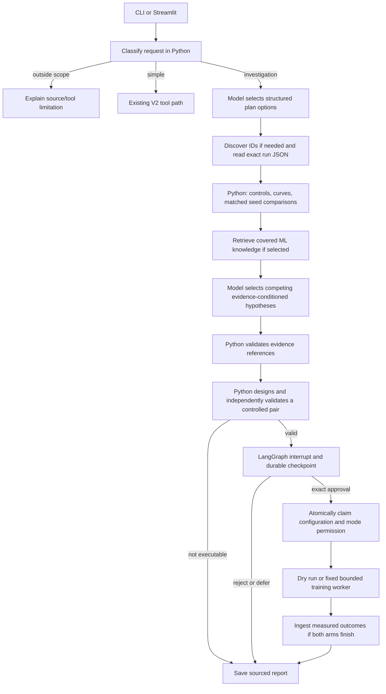

# V3 architecture — Agentic Research Investigator

V3 adds a persistent research workflow to the existing local experiment assistant. The user asks an investigation question; the model selects bounded planning options and competing hypotheses; Python retrieves and measures evidence, validates citations and proposals, then suspends at a human approval gate. An explicitly approved proposal can run as a dry run or a bounded live experiment. Live results can be ingested, compared, and included in the updated investigation.

The working implementation remains local: Windows, the existing Python environment, Ollama `qwen3:1.7b`, cached MiniLM, cached Fashion-MNIST, SQLite, and Streamlit. No paid API, new language model, vector database, cloud service, or multi-agent system is required. The small SQLite adapter has an unused sqlite-vec dependency; this project does not create a vector database or use that extension.

## End-to-end graph

The graph arranges work. It does not calculate scientific evidence or supply an explanation by itself. There is no uncontrolled graph cycle: a run has a bounded sequence of nodes, a recursion limit of 24, and at most two model attempts for each decision. A user can deliberately resume an interrupt or revise a proposal. Model failures use visibly labeled Python fallbacks.

## Responsibility boundaries

| Operation | Responsible component | Decision source |
|---|---|---|
| Identify local scope and simple/investigation route | `planner.classify` | Python heuristic |
| Select optional note search, seed analysis, ML retrieval and topic | `planner.select` / `ask_decision` | Ollama structured schema, or APP POLICY fallback |
| Require discovery without a known ID or honor explicitly requested steps | `planner.make_plan` | APP POLICY, recorded separately |
| Read saved runs, calculate curves, check controls and seed blocks | `experiment_data`, `v3.analysis` | Deterministic Python |
| Embed text and rank notes/knowledge | Existing MiniLM functions plus `v3.retrieval` | Deterministic retrieval |
| Form evidence-conditioned candidate hypotheses | `hypothesis.generate` | Python templates conditioned on measurements |
| Select/order at least two competing candidates | `select_hypotheses` tool decision | Ollama native tool call, or fallback |
| Validate citations, configuration, new seeds and resource limits | Hypothesis/designer validators | Python |
| Suspend and resume work | LangGraph interrupt, `SqliteSaver` | Framework routing/checkpointing |
| Approve/reject/defer/modify the exact proposal | CLI/UI service methods | Human action; development demos explicitly labeled dry run |
| Launch the trainer and evaluate new results | Restricted executor and outcome node | User-authorized Python |
| Render measured numbers and source labels | `report.render_report` | Python |

The model can choose useful optional work and competing explanations within a bounded menu. It cannot invent arbitrary graph nodes, rewrite the trainer, issue shell commands, or approve an experiment. Hypothesis wording is deliberately supplied by Python, not unrestricted model prose; the trace labels model selection and wording origin separately.

## Source types

- `EXPERIMENT_JSON`: exact saved configuration and measurements.
- `EXPERIMENT_NOTE`: original human observation used for discovery.
- `DERIVED_ANALYSIS`: deterministic calculation or machine-generated summary, linked to its run JSON.
- `ML_KNOWLEDGE`: a curated attributed general explanation; never evidence that a mechanism caused a particular run.
- `HYPOTHESIS`: a possible explanation with explicit assumptions, missing evidence and a proposed test.
- `TEST_FIXTURE`: simulated outcomes in isolated tests; never saved as real experiment measurements.

## Runtime data and resource use

The default SQLite database is `D:\Agentic_ai_rag projects\investigations\investigations.sqlite3`. Application snapshots, approval audit events, proposals, and LangGraph checkpoints share the local database. Markdown/JSON exports live under `investigations/reports/`. That runtime folder is ignored by Git. The reproducible demonstration export under `reports/v3_demo/` is suitable for review.

Ollama remains in `D:\Ollama`, models in `D:\Ollama\models`, MiniLM/reranker in project `.model_cache`, pip downloads in project `.pip_cache`. No model or dataset was downloaded during V3 development. The new SQLite adapter and its small dependencies were installed into the existing D: environment. Python may still read pre-existing shared packages on C:; V3 does not relocate them.

Each proposed experiment has at most two runs, five epochs per run, 10,000 training images, 2,000 fixed validation images, hidden width 128, batch size 128, SGD, two CPU threads, and 600 seconds total parent-process timeout. The worker also checks elapsed time during training batches. Workload limits and timeout are enforced; there is no Windows OS memory quota. The optional reranker remains off by default. Cold model imports can take appreciably longer than warm requests on this machine; no general latency benchmark was measured.
