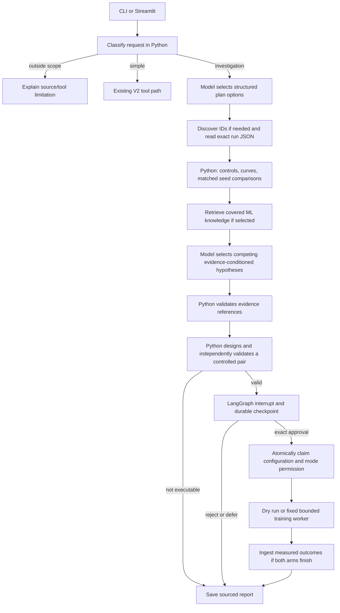

# V3 architecture — Agentic Research Investigator

V3 adds a persistent research workflow to the existing local experiment assistant. The user asks an investigation question; the model selects bounded planning options and competing hypotheses; Python retrieves and measures evidence, validates citations and proposals, then suspends at a human approval gate. An explicitly approved proposal can run as a dry run or a bounded live experiment. Live results can be ingested, compared, and included in the updated investigation.

The working implementation remains local: Windows, the existing Python environment, Ollama `qwen3:1.7b`, cached MiniLM, cached Fashion-MNIST, SQLite, and Streamlit. No paid API, new language model, vector database, cloud service, or multi-agent system is required. The small SQLite adapter has an unused sqlite-vec dependency; this project does not create a vector database or use that extension.

## End-to-end graph



The graph arranges work. It does not calculate scientific evidence or supply an explanation by itself. There is no uncontrolled graph cycle: a run has a bounded sequence of nodes, a recursion limit of 24, and at most two model attempts for each decision. A user can deliberately resume an interrupt or revise a proposal. Model failures use visibly labeled Python fallbacks.

## Responsibility boundaries

| Operation | Responsible component | Decision source |
|---|---|---|
| Identify local scope and simple/investigation route | `planner.classify` | Python heuristic |
| Select optional note search, seed analysis, ML retrieval and topic | `planner.select` / `ask_decision` | Ollama structured schema, or APP POLICY fallback |
| Require discovery without a known ID or honor explicitly requested steps | `planner.make_plan` | APP POLICY, recorded separately |
| Read saved runs, calculate curves, check controls and seed blocks | `experiment_data`, `v3.analysis` | Deterministic Python |
| Embed text and rank notes/knowledge | Existing MiniLM functions plus `v3.retrieval` | Deterministic retrieval |
| Form evidence-conditioned candidate hypotheses | `hypothesis.generate` | Python templates conditioned on measurements |
| Select/order at least two competing candidates | `select_hypotheses` tool decision | Ollama native tool call, or fallback |
| Validate citations, configuration, new seeds and resource limits | Hypothesis/designer validators | Python |
| Suspend and resume work | LangGraph interrupt, `SqliteSaver` | Framework routing/checkpointing |
| Approve/reject/defer/modify the exact proposal | CLI/UI service methods | Human action; development demos explicitly labeled dry run |
| Launch the trainer and evaluate new results | Restricted executor and outcome node | User-authorized Python |
| Render measured numbers and source labels | `report.render_report` | Python |

The model can choose useful optional work and competing explanations within a bounded menu. It cannot invent arbitrary graph nodes, rewrite the trainer, issue shell commands, or approve an experiment. Hypothesis wording is deliberately supplied by Python, not unrestricted model prose; the trace labels model selection and wording origin separately.

## Source types

- `EXPERIMENT_JSON`: exact saved configuration and measurements.
- `EXPERIMENT_NOTE`: original human observation used for discovery.
- `DERIVED_ANALYSIS`: deterministic calculation or machine-generated summary, linked to its run JSON.
- `ML_KNOWLEDGE`: a curated attributed general explanation; never evidence that a mechanism caused a particular run.
- `HYPOTHESIS`: a possible explanation with explicit assumptions, missing evidence and a proposed test.
- `TEST_FIXTURE`: simulated outcomes in isolated tests; never saved as real experiment measurements.

## Runtime data and resource use

The default SQLite database is `D:\Agentic_ai_rag projects\investigations\investigations.sqlite3`. Application snapshots, approval audit events, proposals, and LangGraph checkpoints share the local database. Markdown/JSON exports live under `investigations/reports/`. That runtime folder is ignored by Git. The reproducible demonstration export under `reports/v3_demo/` is suitable for review.

Ollama remains in `D:\Ollama`, models in `D:\Ollama\models`, MiniLM/reranker in project `.model_cache`, pip downloads in project `.pip_cache`. No model or dataset was downloaded during V3 development. The new SQLite adapter and its small dependencies were installed into the existing D: environment. Python may still read pre-existing shared packages on C:; V3 does not relocate them.

Each proposed experiment has at most two runs, five epochs per run, 10,000 training images, 2,000 fixed validation images, hidden width 128, batch size 128, SGD, two CPU threads, and 600 seconds total parent-process timeout. The worker also checks elapsed time during training batches. Workload limits and timeout are enforced; there is no Windows OS memory quota. The optional reranker remains off by default. Cold model imports can take appreciably longer than warm requests on this machine; no general latency benchmark was measured.

# Actual file map and responsibilities

| File | Defined functions/classes |
|---|---|
| v3/__init__.py | package marker |
| v3/analysis.py | check_record, curve, compare_records, analyze |
| v3/cli.py | main |
| v3/demo.py | main |
| v3/experiment_designer.py | trainer_hash, validate_config, saved_configs, validate_proposal, design |
| v3/experiment_executor.py | ingest_record, evaluate_outcomes, execute |
| v3/hypothesis.py | build_evidence, generate, validate_evidence |
| v3/investigation_graph.py | ResearchState, investigation_graph |
| v3/investigation_state.py | now, digest, event, InvestigationStore |
| v3/planner.py | ask_decision, classify, unknown_run_ids, select, make_plan, mark |
| v3/report.py | render_report |
| v3/retrieval.py | tokens, derived_summary, documents, search_notes, knowledge |
| v3/service.py | Investigator |
| v3/training_worker.py | main |
| v3/ui.py | render_investigations |

Entry points: `app.py` research mode, `v3/cli.py`, `ui.py` workspace selector, `v3/ui.py`. Tests: `tests/test_v3.py`; runners: `evaluate_v3.py`, `evaluate_v3_retrieval.py`, `validate_v3_ui.py`, `validate_v3_live.py`. Training reuse: `phase0.py` with callable `run_training`; original CLI retained. Existing tools/retrieval/state/answers live in the root V2 modules. Runtime state is in ignored `investigations/`; reviewable executed artifacts are under `reports/v3_*`.

# Commands and operation

Run from PowerShell in the existing project directory. Ollama must already be running with the installed qwen3:1.7b; these commands do not download models.

```powershell
cd "D:\Agentic_ai_rag projects"
.\.venv\Scripts\streamlit.exe run ui.py
```

The default workspace is **Investigations (V3)**. Start a question, select a saved investigation, inspect its seven tabs, and use Resume. Approve dry run to inspect execution without training. The separate live-training checkbox plus approve button explicitly authorizes the displayed configuration. Reject or defer stops execution. Editing validates and invalidates approval. **Chat and runs (V1/V2)** retains manual, graph and simple modes.

```powershell
.\.venv\Scripts\python.exe app.py --agent research --question "Investigate why lr_01_seed3 was worse than lr_005_seed3."
.\.venv\Scripts\python.exe -m v3.cli list
.\.venv\Scripts\python.exe -m v3.cli show INV-9B53F0C759
.\.venv\Scripts\python.exe -m v3.cli resume INV-9B53F0C759
.\.venv\Scripts\python.exe -m v3.cli export INV-9B53F0C759
```

The displayed demonstration is already dry-run completed; resuming it does not re-execute it. For a **new pending** proposal, copy its displayed investigation ID and exact SHA-256 into this command template:

```powershell
.\.venv\Scripts\python.exe -m v3.cli decide "INV-ID-FROM-START" approved --hash "SHA256-FROM-SHOW" --mode dry_run
```

Use `rejected` or `deferred` instead of `approved` to stop/defer. `--mode live` is an explicit request for the displayed two-run training workload. No live-training command was executed during development. To edit via CLI, export/copy the displayed proposal JSON to a file and use `python -m v3.cli modify "INV-ID" "proposal.json"`; the UI provides the same operation. A changed proposal needs a new approval.

```powershell
.\.venv\Scripts\python.exe -m v3.cli start "Investigate why lr_01_seed3 was worse than lr_005_seed3" --offline --lexical
.\.venv\Scripts\python.exe evaluate_v3.py
.\.venv\Scripts\python.exe evaluate_v3_retrieval.py
.\.venv\Scripts\python.exe validate_v3_ui.py
.\.venv\Scripts\python.exe validate_v3_live.py
.\.venv\Scripts\python.exe -m v3.demo
.\.venv\Scripts\python.exe docs\build_v3_study.py
```

`--offline` means Python planning/hypothesis fallback with honest origins. `--lexical` additionally avoids embedding imports for lightweight investigation fixtures/debugging. These flags configure research nodes; simple questions delegated to the preserved V2 agent still require local Ollama. Ordinary investigations use existing Ollama and cached MiniLM. The demo explicitly grants development **dry-run only** permission and saves reviewable Markdown/JSON in `reports/v3_demo/`.

V1/V2 commands remain `app.py --agent simple`, `--agent manual`, and `--agent graph`. The old `validate_v2.py` and `evaluate_retrieval.py` remain available. The V2 validator's output location is unchanged; the V3 development regression output was copied to `reports/v3_v2_regression_traces.json` and the original historical artifact restored.

If the local server is stopped, run `& "D:\Ollama\ollama.exe" serve` in another PowerShell window. Its existing user environment sets `OLLAMA_MODELS=D:\Ollama\models`. Do not pull a new model for V3.

# V3 planning, state and resumption

## Five kinds of information

1. **LLM context:** the current prompt/schema and compact candidate evidence sent to Ollama. It is a bounded request, not durable memory.
2. **Conversation memory:** V2 `SessionState` remembers up to four turns, focused run IDs and reference resolution inside the current chat. Clearing it does not delete investigations.
3. **Persistent workflow state:** SQLite stores the objective, plan, exact evidence snapshots, hypotheses, proposal IDs, trace, execution outcome and report. LangGraph checkpoints store where execution stopped.
4. **Experiment knowledge:** `runs/*.json`, original `notes/*.md` and deterministically derived summaries. These survive independently of chat and investigation state.
5. **Retrieved external knowledge:** the five local `knowledge/*.md` chunks contain attributed material from external ML documentation. They are curated offline sources, not live web browsing.

## What the plan really is

`make_plan` stores a list of objects. Every step has `id`, `description`, `tool`, `depends_on`, `status` and `proposed_by`. Statuses include pending, completed, skipped, failed and waiting. A trace records the raw model decision and any Python-required additions. `optional_step_origins` distinguishes a model-selected step from one inserted to satisfy the question.

The initial model decision selects from `search_notes`, `compare_seed_pairs`, and `retrieve_knowledge`, plus one covered knowledge topic. Exact reading, deterministic checks, hypothesis grounding, independent proposal validation, and the approval gate are Python requirements. With no run ID, a note search discovers IDs, then the collection node records a visible REPLANNING event before inspecting their JSON. This is bounded evidence-driven replanning, not an open-ended autonomous research planner.

Reactive calling chooses the next tool after an observation. Planning chooses useful work before collecting evidence. Replanning changes the concrete run references after search. A deterministic workflow prescribes scientific checks and their ordering. Genuine LLM decisions select optional tools and hypothesis candidates. V3 combines these explicitly instead of calling every operation an agent decision.

## Persistence mechanics

`InvestigationStore` creates `investigations`, `proposals` and append-only `decisions` audit rows. `SqliteSaver` creates its own checkpoint tables in the same database. The store always closes SQLite connections, including on Windows. Each node saves its application document; LangGraph commits a checkpoint at the node boundary. The investigation ID is also the LangGraph `thread_id`.

An application snapshot answers “What do we know?” A checkpoint answers “Which node is next, and are we interrupted?” These are separate writes, not one transaction. Important replay behavior is therefore explicit: unchanged proposals preserve approval; execution permission is consumed atomically; a finished execution result is reused; a running execution discovered after restart is marked interrupted rather than relaunched.

`resume` opens a fresh graph/checkpointer, reads the saved snapshot, and checks `snapshot.next` and task interrupts. Loading a pending investigation does not imply approval. A stored human decision is required before sending `Command(resume=...)`. A process-restart validation closes one Python process and resumes from a completely new process.

The interrupt node restarts from its beginning when resumed. Code before `interrupt` can run twice. It can render/save the request again, but cannot launch training. Side effects that spend resources occur only after a persisted exact decision and atomic execution claim.

## Recovery limits

A failed evidence/model node can be resumed from its checkpoint; each model decision still has at most two attempts. The graph does not retry training by itself. If an app crashes while a worker might still exist, inspect the saved logs and process before making a new proposal. Partial run records remain intact; both arms are needed for post-experiment interpretation. V3 does not automatically attach a surviving Windows process, cancel it, or reconstruct a partially completed pair. Those are deliberate limits of this local implementation.

Opening a deferred/rejected proposal and explicitly approving it schedules the approval gate again. Modifying a proposal validates it, invalidates its previous approval, updates the graph state as the design node, and suspends at a fresh gate. Completed proposals cannot be edited into new experiments; create a new investigation.

# V3 evidence-backed hypothesis engine

## Observation, hypothesis, experiment

An observation is a saved measurement or a Python calculation over measurements. A hypothesis is a possible explanation. An experiment changes a specified variable to obtain new evidence that can discriminate explanations. The report keeps these types separate.

For the real seed-three pair, the lower rate ends at 75.90% accuracy and loss 0.6806; the higher rate ends at 71.45% and loss 0.8109. Python computes higher minus lower: -4.45 percentage points and +0.1303 loss. The lower-rate maximum consecutive-epoch positive loss rise is zero; the higher-rate rise is about 0.138654. These observations support considering instability but cannot show optimizer overshooting directly.

`analysis.compare_records` compares the union of recorded settings, reports missing controls, detects multiple changed variables, and omits final deltas when horizons/metrics are not comparable. Its matching claim applies to recorded fields. Historical JSON records hidden width and dropout settings but lacks exact model-class/trainer revision and hardware/software provenance; those remain explicit limitations. Old missing dropout/validation-start fields are not filled with assumed defaults.

`analysis.analyze` finds comparable recorded pairs for the learning rates in the question, groups by recorded controls and seed block, and deduplicates repeated configurations. The independent experimental units are distinct seed blocks, not every JSON filename. Historical pairs with missing controls remain usable as qualified descriptive evidence, never as fully verified interventions.

## Evidence registry

Exact run snapshots receive `RUN:<id>` references and content hashes. Comparisons receive `PAIR:<index>` and list both source paths. Retrieved notes receive `NOTE:<index>`; knowledge receives `ML:<chunk-id>`. A hypothesis holds references into this registry. Its experiment-support/opposition fields cannot point to general ML knowledge. Snapshot integrity is checked before proposal design.

## Competing candidates

- H1 considers learning-rate instability when comparable rate changes exist. Larger higher-rate loss rises support it; equal or smaller rises oppose that specific directional prediction. The statement remains a mechanism hypothesis.
- H2 considers seed-dependent accuracy variability. Differently signed accuracy changes across observed blocks support considering it. One positive higher-rate seed block opposes a universal “higher learning rate always lowers accuracy” claim; it does not contradict the separate loss-rise prediction.
- H3 considers a limited training horizon and endpoint sensitivity. The saved short curves motivate an evidence limitation; they do not prove that longer training reverses the outcome.
- H4 is included only when saved intervals meet the explicit falling-training-loss/rising-validation-loss rule. That is a candidate generalization warning, not a diagnosis.

If there is no rate comparison, H1 becomes a qualified configuration/unrecorded-condition candidate rather than a learning-rate assertion. At least two candidates are required. Ollama selects/orders candidates with `select_hypotheses`; Python provides grounded wording, assumptions, support, opposition and tests. This scope avoids publishing arbitrary model-generated factual claims.

Every hypothesis has `hypothesis_id`, `statement`, supporting/opposing experiment references, relevant knowledge, assumptions, missing evidence, proposed test, descriptive status, selection origin and wording origin. There are no numerical confidence percentages. “Consistent with current evidence” and “Supported by new controlled observations” do not mean a causal or statistical proof.

## Follow-up design and evaluation

The executable designer currently handles a two-arm learning-rate experiment using the existing Fashion-MNIST MLP. It starts from a complete saved reference configuration; holds all other recorded controls fixed; picks shared new model/shuffle seeds beyond recorded and reserved legacy plans; checks duplicates and unique IDs; and records the trainer hash. It does not resume the paused legacy seed-four plan.

The primary metric is each arm's largest positive consecutive-epoch validation-loss rise. Secondary metrics are final validation accuracy and loss. A larger higher-rate rise is consistent with the directional prediction; a smaller one opposes it; equality is inconclusive. A single new block cannot establish general causation. H2/H3/H4 can need different separately approved follow-ups; the current executor does not silently claim one LR pair tests every mechanism.

After both approved arms complete, output configurations and metrics are validated, run JSONs enter the same backward-compatible format, predefined metrics are computed, H1's descriptive status can update, and a new report is saved. Errors and partial completion do not produce a causal conclusion. Fixture simulations are tagged `TEST_FIXTURE` throughout, including report status, and never become saved real measurements.

# V3 human-in-the-loop execution

## The permission boundary

The LLM menu contains planning/hypothesis decisions and existing read/analysis tools. It contains no approve, subprocess, arbitrary Python, or shell tool. Human-facing `Investigator.decide` is called by CLI/Streamlit, not by model text.

The proposal payload includes both exact run configurations, hypotheses, primary/secondary metrics, expected observations, limitations, resource limits and training-code SHA-256. A canonical JSON hash binds approval to that complete payload. The mode is stored separately as dry_run or live. A dry-run decision cannot authorize live training.

## Exact sequence

1. Python creates and independently validates the proposal.
2. `approval_node` saves a report and invokes LangGraph `interrupt` with proposal ID/hash.
3. The UI displays the full configuration, resources and hash.
4. The user approves dry run, explicitly checks live training and approves it, rejects, defers, or edits.
5. SQLite records actor, decision, exact hash, mode, reason and timestamp.
6. Resumption checks its token against the current proposal and the persisted decision.
7. The executor revalidates configuration and trainer hash, then atomically changes approved to running using `BEGIN IMMEDIATE`.
8. Only that branch can reach the fixed training worker. Permission is consumed once.

Changing epochs, seeds, learning rates or any other payload field changes the hash and invalidates approval. Approving a stale hash fails. Rejected/pending/deferred proposals cannot execute. The resume token is a reference to the reviewed object, not a permission credential. Tests explicitly attempt bypasses at each boundary.

This is a trusted local application boundary, not multi-user authentication or an operating-system security sandbox. Someone who can edit the database or Python code already controls the local machine. The `actor` label is an audit field; the safety property is that LLM tool calls cannot reach the human decision API.

## Dry run versus live execution

A dry run passes proposal validation, approval verification and the atomic claim, then records planned configurations and a completion message. It launches no trainer, creates no run JSON, and invents no measurements. Development demonstrations use actor `development_dry_run`; they are not claims that the user clicked a live approval button.

Live execution invokes a fixed `[sys.executable, '-u', '-m', 'v3.training_worker', input_path]` argument list with `shell=False`. The worker reuses `phase0.run_training`, which retains the original model, loss, optimizer, shuffle/split generators and evaluation code. V3 passes `download=False`, fixed `train=True`, and the fixed training-partition validation slice. The official test set is never read for proposal evaluation.

The executor requires cached training-partition files, sets two CPU threads, enforces 600 seconds total, writes logs and provenance, and validates outputs. Output files use exclusive creation, so old runs are never overwritten. The original `phase0.py` CLI remains available and was verified with `--dry-run`.

## Interrupt and recovery

SQLite checkpoints allow a fresh app process to resume the suspended graph. Completed results are reused after node replay. A running execution found after restart is marked interrupted and is not retried automatically. No live training was performed during V3 development; subprocess failures/timeouts and successful result ingestion were checked with clearly labeled fixtures/mocks. End-to-end live training therefore remains an explicit unverified limitation.

# Important actual code and why it exists

## v3/planner.py: select

This function bounds model attempts, validates the selected object, records raw requests, and marks fallbacks as APP POLICY. It never executes model-written code.

```python
def select(state, name, description, properties, fallback, validator):
    schema = {"type": "function", "function": {"name": name, "description": description,
              "parameters": {"type": "object", "properties": properties,
                             "required": list(properties), "additionalProperties": False}}}
    event(state, "TOOL MENU", schema)
    if state["model_enabled"]:
        for attempt in range(2):
            try:
                message = ask_decision([
                    {"role": "system", "content": "Call the offered function once. Choose only from its enumerated values. Do not invent measurements or launch training."},
                    {"role": "user", "content": description}], schema)
                event(state, "AGENT REQUEST", {"attempt": attempt + 1, "response": message}, "LLM")
                function = (message.get("tool_calls") or [{"function": {"name": name, "arguments": message.get("structured_decision")}}])[0]["function"]
                args = function["arguments"]
                if isinstance(args, str):
                    args = json.loads(args)
                if function["name"] != name or not isinstance(args, dict) or set(args) != set(properties):
                    raise ValueError("Wrong tool, absent call, or invalid fields")
                validator(args)
                return args, "LLM"
            except (OSError, RuntimeError, ValueError, TypeError, KeyError, IndexError) as exc:
                event(state, "APP POLICY", {"model_failure": str(exc), "attempt": attempt + 1,
                                            "maximum_attempts": 2})
    event(state, "APP POLICY", {"fallback": fallback, "reason": "model disabled or exhausted bounded attempts"})
    return fallback, "APP POLICY"
```
## v3/investigation_state.py: claim_execution

The SQL transaction serializes concurrent execution claims. Hash, status and mode must match. The consumed approval cannot be reused.

```python
    def claim_execution(self, proposal_id, expected_hash, mode):
        with self.connection() as db:
            db.execute("BEGIN IMMEDIATE")
            row = db.execute("SELECT * FROM proposals WHERE id=?", (proposal_id,)).fetchone()
            if not row or row["hash"] != expected_hash or row["status"] != "approved" or row["mode"] != mode:
                raise PermissionError("Execution requires unused approval for this exact proposal hash and mode")
            db.execute("UPDATE proposals SET status='running' WHERE id=?", (proposal_id,))
```
## v3/experiment_designer.py: validate_proposal

This is an independent validator: matched controls, supported variable, trainer hash, limits, IDs and duplicate configurations are checked before approval and again before execution.

```python
def validate_proposal(proposal, *, check_duplicates=True):
    if proposal.get("changed_variable") != "learning_rate" or len(proposal.get("runs", [])) != 2:
        raise ValueError("Only a two-run, single learning-rate intervention is supported")
    if proposal.get("training_code_sha256") != trainer_hash():
        raise ValueError("Training code changed; regenerate and approve the proposal again")
    if proposal.get("limits") != {"max_total_seconds": 600, "max_runs": 2, "cpu_threads": 2}:
        raise ValueError("Execution resource limits cannot be increased")
    a, b = proposal["runs"]
    for config in (a, b):
        validate_config(config)
    if a["run_id"] == b["run_id"] or not a["learning_rate"] < b["learning_rate"]:
        raise ValueError("Require distinct IDs and lower-rate control followed by higher-rate intervention")
    if any(a[k] != b[k] for k in CONTROLS):
        raise ValueError("All recorded controls, including both seeds, must match")
    existing = saved_configs()
    for config in (a, b):
        if (RUNS_DIR / f"{config['run_id']}.json").exists():
            raise ValueError("A proposed run ID already exists; overwriting is forbidden")
        if check_duplicates and any(all(old.get(k) == v for k, v in config.items() if k != "run_id") for old in existing):
            raise ValueError("Duplicate recorded/planned configuration")
    return {"valid": True, "checks": ["single_variable", "matched_controls", "new_configurations", "resource_limits", "trainer_hash", "unique_run_ids"]}
```
## v3/investigation_graph.py: approval_node

LangGraph persists the interrupt. Resuming requires both a current token and a persistent user decision. A returned model string cannot authorize this branch.

```python
    def approval_node(s):
        d = s["doc"]
        p = store.proposal(d["proposal_id"])
        validate_proposal(p["payload"])
        d["status"] = "awaiting_approval"
        mark(d, "approval", "waiting")
        event(d, "APPROVAL REQUEST", {"proposal_id": p["id"], "hash": p["hash"], "payload": p["payload"]}, "APP POLICY")
        d["report"] = render_report(d, p, store.decisions(p["id"]))
        store.save(d)
        # LangGraph persists this suspension. A resume token alone cannot grant permission.
        token = interrupt({"proposal_id": p["id"], "hash": p["hash"], "message": "Inspect the proposal and explicitly approve dry_run/live, reject, modify, or defer."})
        p = store.proposal(d["proposal_id"])
        if not isinstance(token, dict) or token.get("proposal_id") != p["id"] or token.get("hash") != p["hash"]:
            raise PermissionError("Resume token does not match the current proposal")
        if p["status"] not in {"approved", "rejected", "deferred"}:
            raise PermissionError("No persisted human decision is available")
        d["status"] = p["status"]
        decision = store.decisions(p["id"])[-1]
        event(d, "USER DECISION", decision, "USER" if decision["actor"] == "user" else "DEVELOPMENT_DRY_RUN")
        mark(d, "approval")
        if p["status"] != "approved":
            mark(d, "execute", "skipped", f"User decision: {p['status']}")
            mark(d, "outcome", "skipped", "No training executed")
        return save(d)
```
## v3/service.py: resume

A fresh graph opens the durable thread, distinguishes interrupted from runnable state, and refuses to treat reopening as approval.

```python
    def resume(self, identifier):
        d = self.store.load(identifier)
        with investigation_graph(self.store) as graph:
            snapshot = graph.get_state(self._config(identifier))
            if not snapshot.next:
                return d
            interrupted = any(t.interrupts for t in snapshot.tasks)
            if interrupted:
                p = self.store.proposal(d["proposal_id"])
                if p["status"] not in {"approved", "rejected", "deferred"}:
                    return d  # Loading/resuming does not imply approval.
                graph.invoke(Command(resume={"proposal_id": p["id"], "hash": p["hash"]}), self._config(identifier))
            else:
                graph.invoke(None, self._config(identifier))
        return self.store.load(identifier)
```
## v3/experiment_executor.py: evaluate_outcomes

The predefined metric determines consistent/opposing/inconclusive after two completed arms. One block never turns a mechanism into a proven fact.

```python
def evaluate_outcomes(records):
    if len(records) != 2:
        return {"status": "incomplete", "interpretation": "Both approved arms must finish before comparison."}
    comparison = compare_records(records[0], records[1])
    rise = comparison.get("rise_delta")
    outcome = "inconclusive" if rise is None or rise == 0 else "consistent" if rise > 0 else "opposing"
    return {"status": outcome, "predefined_primary_metric": "largest_positive_consecutive_epoch_validation_loss_rise",
            "comparison": comparison,
            "interpretation": {"consistent": "The new loss-rise ordering is consistent with the instability hypothesis; one block cannot prove causation.",
                               "opposing": "This block opposes the expected loss-rise ordering; it does not conclusively disprove the mechanism.",
                               "inconclusive": "The primary metric does not distinguish the proposed explanation in this block."}[outcome],
            "competing_explanations": "Seed variability, short horizons, unmeasured optimization details, and shared-split limits remain possible."}
```

# Exact decision schemas and existing tool schemas

The V3 planner is a schema-constrained completion, not a free-form LLM plan. The hypothesis selector is a native Ollama tool call. Their actual schemas offered during this verified demonstration follow. Python implements the read-only collection/calculation nodes; no training/approval tool is offered to the model.

```json
{
  "type": "function",
  "function": {
    "name": "create_investigation_plan",
    "description": "Objective: Investigate why lr_01_seed3 had worse final validation accuracy than lr_005_seed3. Examine the curves, retrieve relevant ML knowledge, compare possible explanations, and propose a controlled follow-up.. Known mentioned runs: ['lr_01_seed3', 'lr_005_seed3']. Choose useful optional research tools. Choose compare_seed_pairs to check replication/counterevidence; search_notes to find previous observations; retrieve_knowledge for mechanisms. Return a topic from the menu.",
    "parameters": {
      "type": "object",
      "properties": {
        "steps": {
          "type": "array",
          "items": {
            "type": "string",
            "enum": [
              "search_notes",
              "compare_seed_pairs",
              "retrieve_knowledge"
            ]
          },
          "maxItems": 3
        },
        "knowledge_topic": {
          "type": "string",
          "enum": [
            "high learning rate optimization instability",
            "dropout overfitting validation loss",
            "training validation loss curves"
          ]
        }
      },
      "required": [
        "steps",
        "knowledge_topic"
      ],
      "additionalProperties": false
    }
  }
}
```

```json
{
  "type": "function",
  "function": {
    "name": "select_hypotheses",
    "description": "Select and order competing hypotheses for the objective. These are candidate mechanisms, never facts. [{'hypothesis_id': 'H1', 'statement': 'A higher learning rate may contribute to larger validation-loss rises through unstable optimization.', 'supporting_experiment_evidence': ['PAIR:0', 'PAIR:1', 'PAIR:2', 'PAIR:3'], 'contradicting_experiment_evidence': []}, {'hypothesis_id': 'H2', 'statement': 'Seed-dependent training variability may contribute to differences in final validation accuracy.', 'supporting_experiment_evidence': ['PAIR:0', 'PAIR:1', 'PAIR:2', 'PAIR:3'], 'contradicting_experiment_evidence': []}, {'hypothesis_id': 'H3', 'statement': 'The short recorded training horizon may leave the final-epoch ranking sensitive to transient behavior.', 'supporting_experiment_evidence': ['RUN:lr_005_seed3', 'RUN:lr_01_seed3', 'RUN:lr_005_gap_001', 'RUN:baseline_001', 'RUN:lr_005_seed2', 'RUN:lr_01_seed2'], 'contradicting_experiment_evidence': []}, {'hypothesis_id': 'H4', 'statement': 'A generalization gap may contribute during intervals where training loss improves and validation loss rises.', 'supporting_experiment_evidence': ['PAIR:2'], 'contradicting_experiment_evidence': []}]",
    "parameters": {
      "type": "object",
      "properties": {
        "hypothesis_ids": {
          "type": "array",
          "items": {
            "type": "string",
            "enum": [
              "H1",
              "H2",
              "H3",
              "H4"
            ]
          },
          "minItems": 2,
          "maxItems": 4
        }
      },
      "required": [
        "hypothesis_ids"
      ],
      "additionalProperties": false
    }
  }
}
```

## Preserved V2 callable tool menu

```json
[
  {
    "type": "function",
    "function": {
      "name": "get_experiment",
      "description": "Read one saved experiment. Use only for a question about one run; for two run IDs, use compare_experiments instead.",
      "parameters": {
        "type": "object",
        "properties": {
          "run_id": {
            "type": "string",
            "description": "Exact saved run ID"
          }
        },
        "required": [
          "run_id"
        ],
        "additionalProperties": false
      }
    }
  },
  {
    "type": "function",
    "function": {
      "name": "compare_experiments",
      "description": "Preferred tool whenever a question mentions two run IDs. Compare their recorded settings and final metrics. Use baseline_run_id for the reference and target_run_id for the run being explained; differences are target minus baseline.",
      "parameters": {
        "type": "object",
        "properties": {
          "baseline_run_id": {
            "type": "string",
            "description": "Reference run ID"
          },
          "target_run_id": {
            "type": "string",
            "description": "Run ID being compared with the reference"
          }
        },
        "required": [
          "baseline_run_id",
          "target_run_id"
        ],
        "additionalProperties": false
      }
    }
  },
  {
    "type": "function",
    "function": {
      "name": "search_runs",
      "description": "Filter saved JSON by exact learning_rate, train_size or dropout; do not use for behavior wording.",
      "parameters": {
        "type": "object",
        "properties": {
          "learning_rate": {
            "type": "number"
          },
          "train_size": {
            "type": "integer"
          },
          "dropout": {
            "type": "number"
          }
        },
        "required": [],
        "additionalProperties": false
      }
    }
  },
  {
    "type": "function",
    "function": {
      "name": "search_notes",
      "description": "Hybrid keyword and MiniLM search over experiment notes. Returns run IDs and visible ranking stages; inspect a returned run for exact metrics.",
      "parameters": {
        "type": "object",
        "properties": {
          "query": {
            "type": "string"
          },
          "top_k": {
            "type": "integer"
          },
          "rerank": {
            "type": "boolean"
          }
        },
        "required": [
          "query"
        ],
        "additionalProperties": false
      }
    }
  },
  {
    "type": "function",
    "function": {
      "name": "summarize_run_curve",
      "description": "Compute best validation accuracy, minimum loss, largest rise and recoveries for one run.",
      "parameters": {
        "type": "object",
        "properties": {
          "run_id": {
            "type": "string"
          }
        },
        "required": [
          "run_id"
        ],
        "additionalProperties": false
      }
    }
  },
  {
    "type": "function",
    "function": {
      "name": "find_overfitting_candidates",
      "description": "Flag saved intervals where post-epoch training loss fell while validation loss rose. This is only a candidate rule.",
      "parameters": {
        "type": "object",
        "properties": {},
        "required": [],
        "additionalProperties": false
      }
    }
  },
  {
    "type": "function",
    "function": {
      "name": "compare_run_group",
      "description": "Describe counts and accuracy statistics for two exact learning-rate groups; no causal claim.",
      "parameters": {
        "type": "object",
        "properties": {
          "learning_rate_a": {
            "type": "number"
          },
          "learning_rate_b": {
            "type": "number"
          }
        },
        "required": [
          "learning_rate_a",
          "learning_rate_b"
        ],
        "additionalProperties": false
      }
    }
  },
  {
    "type": "function",
    "function": {
      "name": "plot_run_metrics",
      "description": "Return epoch, post-epoch train loss, validation loss and validation accuracy for a chart.",
      "parameters": {
        "type": "object",
        "properties": {
          "run_id": {
            "type": "string"
          }
        },
        "required": [
          "run_id"
        ],
        "additionalProperties": false
      }
    }
  },
  {
    "type": "function",
    "function": {
      "name": "search_ml_knowledge",
      "description": "Search the separate offline corpus of general ML documentation. It cannot prove a specific run's cause.",
      "parameters": {
        "type": "object",
        "properties": {
          "query": {
            "type": "string"
          },
          "top_k": {
            "type": "integer"
          }
        },
        "required": [
          "query"
        ],
        "additionalProperties": false
      }
    }
  }
]
```

# Actual investigation state and tool data flow

Input objective → classifier route → structured model plan → known/discovered IDs → exact JSON snapshots → control/curve/seed calculations → retrieved ML chunks → evidence registry → competing hypothesis selection → citation validation → controlled proposal → durable interrupt → exact persisted decision → atomic execution claim → dry/live execution → optional outcome analysis → Python report.


```json
{
  "investigation_id": "INV-9B53F0C759",
  "objective": "Investigate why lr_01_seed3 had worse final validation accuracy than lr_005_seed3. Examine the curves, retrieve relevant ML knowledge, compare possible explanations, and propose a controlled follow-up.",
  "status": "dry_run_completed",
  "selected_steps": [
    "compare_seed_pairs",
    "search_notes",
    "retrieve_knowledge"
  ],
  "knowledge_topic": "training validation loss curves",
  "plan": [
    {
      "id": "collect",
      "description": "Read exact experiment evidence",
      "tool": "get_experiment",
      "depends_on": [],
      "status": "completed",
      "proposed_by": "PYTHON"
    },
    {
      "id": "notes",
      "description": "Find earlier experiment observations",
      "tool": "search_notes",
      "depends_on": [],
      "status": "completed",
      "proposed_by": "LLM"
    },
    {
      "id": "analyze",
      "description": "Compute curves, controls and seed comparisons",
      "tool": "analyze_experiments",
      "depends_on": [
        "collect"
      ],
      "status": "completed",
      "proposed_by": "PYTHON"
    },
    {
      "id": "knowledge",
      "description": "Retrieve possible general mechanisms",
      "tool": "search_ml_knowledge",
      "depends_on": [
        "analyze"
      ],
      "status": "completed",
      "proposed_by": "LLM"
    },
    {
      "id": "hypotheses",
      "description": "Select competing evidence-backed hypotheses",
      "tool": "select_hypotheses",
      "depends_on": [
        "analyze"
      ],
      "status": "completed",
      "proposed_by": "PYTHON"
    },
    {
      "id": "validate",
      "description": "Validate citations and hypothesis evidence",
      "tool": "validate_evidence",
      "depends_on": [
        "hypotheses"
      ],
      "status": "completed",
      "proposed_by": "PYTHON"
    },
    {
      "id": "design",
      "description": "Design a new controlled experiment",
      "tool": "design_followup",
      "depends_on": [
        "validate"
      ],
      "status": "completed",
      "proposed_by": "PYTHON"
    },
    {
      "id": "approval",
      "description": "Wait for an exact human decision",
      "tool": "human_approval",
      "depends_on": [
        "design"
      ],
      "status": "completed",
      "proposed_by": "APP POLICY"
    },
    {
      "id": "execute",
      "description": "Execute only an approved configuration",
      "tool": "restricted_executor",
      "depends_on": [
        "approval"
      ],
      "status": "completed",
      "proposed_by": "APP POLICY"
    },
    {
      "id": "outcome",
      "description": "Analyze new measured outcomes",
      "tool": "analyze_outcome",
      "depends_on": [
        "execute"
      ],
      "status": "skipped",
      "proposed_by": "PYTHON",
      "detail": "No complete new measured pair; dry runs contain no measurements"
    },
    {
      "id": "report",
      "description": "Save sourced investigation report",
      "tool": "render_report",
      "depends_on": [
        "validate"
      ],
      "status": "completed",
      "proposed_by": "PYTHON"
    }
  ],
  "run_ids": [
    "lr_005_seed3",
    "lr_01_seed3"
  ],
  "uncertainties": [
    "Independent replication and optimizer-step/gradient measurements are absent.",
    "Validation-loss rises cannot directly demonstrate overshooting; gradients and optimizer trajectories were not recorded.",
    "A small number of observed seed blocks cannot establish a distribution or separate all sources of randomness.",
    "Longer independently approved training and predeclared stopping criteria are unavailable.",
    "This interval rule is a diagnostic candidate, not proof of overfitting."
  ],
  "evidence_validation": {
    "valid": true,
    "errors": [],
    "unsupported_structured_citations": 0,
    "scope": "Structured evidence links and recorded snapshots; not a proof of causal mechanisms."
  },
  "proposal_id": "INV-9B53F0C759-P1",
  "execution": {
    "status": "dry_run_completed",
    "mode": "dry_run",
    "started": "2026-10-26T06:20:09.223413+00:00",
    "run_ids": [],
    "logs": [],
    "ingested": [],
    "planned_configs": [
      {
        "run_id": "v3_inv_9b53f0c759_control",
        "dataset": "FashionMNIST",
        "source_partition": "train",
        "preprocessing": "ToTensor",
        "train_size": 10000,
        "val_size": 2000,
        "validation_start": 10000,
        "split_seed": 42,
        "shuffle_seed": 443,
        "model_seed": 444,
        "batch_size": 128,
        "hidden_units": 128,
        "dropout": 0.0,
        "optimizer": "SGD",
        "learning_rate": 0.05,
        "epochs": 5
      },
      {
        "run_id": "v3_inv_9b53f0c759_target",
        "dataset": "FashionMNIST",
        "source_partition": "train",
        "preprocessing": "ToTensor",
        "train_size": 10000,
        "val_size": 2000,
        "validation_start": 10000,
        "split_seed": 42,
        "shuffle_seed": 443,
        "model_seed": 444,
        "batch_size": 128,
        "hidden_units": 128,
        "dropout": 0.0,
        "optimizer": "SGD",
        "learning_rate": 0.1,
        "epochs": 5
      }
    ],
    "message": "Approval and resource checks passed. No trainer was launched; no metrics or run files were created.",
    "finished": "2026-10-26T06:20:09.239851+00:00"
  },
  "outcome": null
}
```

## Evidence-conditioned hypotheses from the real investigation

```json
[
  {
    "source_type": "HYPOTHESIS",
    "relevant_ml_knowledge": [
      "ML:validation",
      "ML:overfitting"
    ],
    "assumptions": [
      "Recorded configurations and epoch metrics accurately describe the runs."
    ],
    "missing_evidence": [
      "Independent replication and optimizer-step/gradient measurements are absent.",
      "Validation-loss rises cannot directly demonstrate overshooting; gradients and optimizer trajectories were not recorded."
    ],
    "status": "Consistent with current evidence",
    "hypothesis_id": "H1",
    "statement": "A higher learning rate may contribute to larger validation-loss rises through unstable optimization.",
    "supporting_experiment_evidence": [
      "PAIR:0",
      "PAIR:1",
      "PAIR:2",
      "PAIR:3"
    ],
    "contradicting_experiment_evidence": [],
    "proposed_test": "Compare maximum positive consecutive-epoch validation-loss rises under matched new seeds and different learning rates.",
    "selected_by": "LLM",
    "statement_origin": "PYTHON evidence-conditioned candidate"
  },
  {
    "source_type": "HYPOTHESIS",
    "relevant_ml_knowledge": [
      "ML:validation",
      "ML:overfitting"
    ],
    "assumptions": [
      "Recorded configurations and epoch metrics accurately describe the runs."
    ],
    "missing_evidence": [
      "Independent replication and optimizer-step/gradient measurements are absent.",
      "A small number of observed seed blocks cannot establish a distribution or separate all sources of randomness."
    ],
    "status": "Consistent with current evidence",
    "hypothesis_id": "H2",
    "statement": "Seed-dependent training variability may contribute to differences in final validation accuracy.",
    "supporting_experiment_evidence": [
      "PAIR:0",
      "PAIR:1",
      "PAIR:2",
      "PAIR:3"
    ],
    "contradicting_experiment_evidence": [],
    "proposed_test": "Repeat a controlled learning-rate comparison under a new shared model/shuffle seed block; predefine accuracy and loss-rise comparisons.",
    "selected_by": "LLM",
    "statement_origin": "PYTHON evidence-conditioned candidate"
  },
  {
    "source_type": "HYPOTHESIS",
    "relevant_ml_knowledge": [
      "ML:validation",
      "ML:overfitting"
    ],
    "assumptions": [
      "Recorded configurations and epoch metrics accurately describe the runs."
    ],
    "missing_evidence": [
      "Independent replication and optimizer-step/gradient measurements are absent.",
      "Longer independently approved training and predeclared stopping criteria are unavailable."
    ],
    "status": "Consistent with current evidence",
    "hypothesis_id": "H3",
    "statement": "The short recorded training horizon may leave the final-epoch ranking sensitive to transient behavior.",
    "supporting_experiment_evidence": [
      "RUN:lr_005_seed3",
      "RUN:lr_01_seed3",
      "RUN:lr_005_gap_001",
      "RUN:baseline_001",
      "RUN:lr_005_seed2",
      "RUN:lr_01_seed2"
    ],
    "contradicting_experiment_evidence": [],
    "proposed_test": "Replicate the existing horizon first; consider a separately approved longer-horizon study if ambiguity remains.",
    "selected_by": "LLM",
    "statement_origin": "PYTHON evidence-conditioned candidate"
  },
  {
    "source_type": "HYPOTHESIS",
    "relevant_ml_knowledge": [
      "ML:validation",
      "ML:overfitting"
    ],
    "assumptions": [
      "Recorded configurations and epoch metrics accurately describe the runs."
    ],
    "missing_evidence": [
      "Independent replication and optimizer-step/gradient measurements are absent.",
      "This interval rule is a diagnostic candidate, not proof of overfitting."
    ],
    "status": "Consistent with current evidence",
    "hypothesis_id": "H4",
    "statement": "A generalization gap may contribute during intervals where training loss improves and validation loss rises.",
    "supporting_experiment_evidence": [
      "PAIR:2"
    ],
    "contradicting_experiment_evidence": [],
    "proposed_test": "Inspect matched train/validation curves and test one regularization change in a separate controlled proposal.",
    "selected_by": "LLM",
    "statement_origin": "PYTHON evidence-conditioned candidate"
  }
]
```

## Exact source registry

```json
{
  "RUN:lr_005_seed3": {
    "source_type": "EXPERIMENT_JSON",
    "source": "runs/lr_005_seed3.json",
    "sha256": "a556e93fa4019bbdbb8778b1f6db4d87b26ed8a2728f922b9a12ea5749b4d644",
    "value": {
      "config": {
        "run_id": "lr_005_seed3",
        "dataset": "FashionMNIST",
        "source_partition": "train",
        "preprocessing": "ToTensor",
        "train_size": 10000,
        "val_size": 2000,
        "validation_start": 10000,
        "split_seed": 42,
        "shuffle_seed": 243,
        "model_seed": 244,
        "batch_size": 128,
        "hidden_units": 128,
        "dropout": 0.0,
        "optimizer": "SGD",
        "learning_rate": 0.05,
        "epochs": 5
      },
      "metrics": [
        {
          "epoch": 1,
          "train_loss_during_epoch": 1.5768690871238709,
          "train_loss_after_epoch": 1.0953938115119934,
          "train_accuracy_after_epoch": 0.612,
          "val_loss": 1.077092869758606,
          "val_accuracy": 0.626
        },
        {
          "epoch": 2,
          "train_loss_during_epoch": 0.9157467240333557,
          "train_loss_after_epoch": 0.8976822423934937,
          "train_accuracy_after_epoch": 0.6745,
          "val_loss": 0.8978471145629883,
          "val_accuracy": 0.6775
        },
        {
          "epoch": 3,
          "train_loss_during_epoch": 0.7648744816780091,
          "train_loss_after_epoch": 0.8522588306427002,
          "train_accuracy_after_epoch": 0.6881,
          "val_loss": 0.8446058855056763,
          "val_accuracy": 0.687
        },
        {
          "epoch": 4,
          "train_loss_during_epoch": 0.6941012891769409,
          "train_loss_after_epoch": 0.6855860265254974,
          "train_accuracy_after_epoch": 0.7522,
          "val_loss": 0.6975534653663635,
          "val_accuracy": 0.7305
        },
        {
          "epoch": 5,
          "train_loss_during_epoch": 0.6385964094161988,
          "train_loss_after_epoch": 0.6929299505233765,
          "train_accuracy_after_epoch": 0.7534,
          "val_loss": 0.680600378036499,
          "val_accuracy": 0.759
        }
      ]
    }
  },
  "RUN:lr_01_seed3": {
    "source_type": "EXPERIMENT_JSON",
    "source": "runs/lr_01_seed3.json",
    "sha256": "7ab5a52aca144db118b16afda54a4dc73cd9e3621faed9b468849fd7a5c1a066",
    "value": {
      "config": {
        "run_id": "lr_01_seed3",
        "dataset": "FashionMNIST",
        "source_partition": "train",
        "preprocessing": "ToTensor",
        "train_size": 10000,
        "val_size": 2000,
        "validation_start": 10000,
        "split_seed": 42,
        "shuffle_seed": 243,
        "model_seed": 244,
        "batch_size": 128,
        "hidden_units": 128,
        "dropout": 0.0,
        "optimizer": "SGD",
        "learning_rate": 0.1,
        "epochs": 5
      },
      "metrics": [
        {
          "epoch": 1,
          "train_loss_during_epoch": 1.2794325910568238,
          "train_loss_after_epoch": 0.9111308251380921,
          "train_accuracy_after_epoch": 0.6495,
          "val_loss": 0.8865399732589722,
          "val_accuracy": 0.6645
        },
        {
          "epoch": 2,
          "train_loss_during_epoch": 0.7691367017745971,
          "train_loss_after_epoch": 1.0264610683441162,
          "train_accuracy_after_epoch": 0.6864,
          "val_loss": 1.0251937484741211,
          "val_accuracy": 0.6875
        },
        {
          "epoch": 3,
          "train_loss_during_epoch": 0.6635693133354187,
          "train_loss_after_epoch": 0.8690615137100219,
          "train_accuracy_after_epoch": 0.6762,
          "val_loss": 0.8684509625434875,
          "val_accuracy": 0.674
        },
        {
          "epoch": 4,
          "train_loss_during_epoch": 0.6114804370880127,
          "train_loss_after_epoch": 0.6598312929391861,
          "train_accuracy_after_epoch": 0.7469,
          "val_loss": 0.6828413162231445,
          "val_accuracy": 0.732
        },
        {
          "epoch": 5,
          "train_loss_during_epoch": 0.5592419065475464,
          "train_loss_after_epoch": 0.8131413830757142,
          "train_accuracy_after_epoch": 0.7162,
          "val_loss": 0.810864956855774,
          "val_accuracy": 0.7145
        }
      ]
    }
  },
  "RUN:lr_005_gap_001": {
    "source_type": "EXPERIMENT_JSON",
    "source": "runs/lr_005_gap_001.json",
    "sha256": "01f1dad9208b75c43ea30e833ed2dfb2a781fc44b0a05bb9b58bc445631ddbb8",
    "value": {
      "config": {
        "run_id": "lr_005_gap_001",
        "dataset": "FashionMNIST",
        "source_partition": "train",
        "preprocessing": "ToTensor",
        "train_size": 10000,
        "val_size": 2000,
        "split_seed": 42,
        "shuffle_seed": 43,
        "model_seed": 44,
        "batch_size": 128,
        "hidden_units": 128,
        "optimizer": "SGD",
        "learning_rate": 0.05,
        "epochs": 5
      },
      "metrics": [
        {
          "epoch": 1,
          "train_loss_during_epoch": 1.5666301128387452,
          "train_loss_after_epoch": 1.073829147720337,
          "train_accuracy_after_epoch": 0.6476,
          "val_loss": 1.0545751457214356,
          "val_accuracy": 0.649
        },
        {
          "epoch": 2,
          "train_loss_during_epoch": 0.9119185653686523,
          "train_loss_after_epoch": 0.9968783388137817,
          "train_accuracy_after_epoch": 0.6515,
          "val_loss": 1.0082858295440673,
          "val_accuracy": 0.6565
        },
        {
          "epoch": 3,
          "train_loss_during_epoch": 0.7680734439849853,
          "train_loss_after_epoch": 0.7941052691459656,
          "train_accuracy_after_epoch": 0.693,
          "val_loss": 0.763293098449707,
          "val_accuracy": 0.709
        },
        {
          "epoch": 4,
          "train_loss_during_epoch": 0.6890689352989197,
          "train_loss_after_epoch": 0.7420328899860382,
          "train_accuracy_after_epoch": 0.7306,
          "val_loss": 0.7394451971054077,
          "val_accuracy": 0.727
        },
        {
          "epoch": 5,
          "train_loss_during_epoch": 0.6421152505874633,
          "train_loss_after_epoch": 0.6849735041618347,
          "train_accuracy_after_epoch": 0.7493,
          "val_loss": 0.6875842409133911,
          "val_accuracy": 0.7515
        }
      ]
    }
  },
  "RUN:baseline_001": {
    "source_type": "EXPERIMENT_JSON",
    "source": "runs/baseline_001.json",
    "sha256": "a19bdf843389358351494df4cf4c077941c25c98cd093b0f4e040a215ce6367b",
    "value": {
      "config": {
        "run_id": "baseline_001",
        "dataset": "FashionMNIST",
        "source_partition": "train",
        "preprocessing": "ToTensor",
        "train_size": 10000,
        "val_size": 2000,
        "split_seed": 42,
        "shuffle_seed": 43,
        "model_seed": 44,
        "batch_size": 128,
        "hidden_units": 128,
        "optimizer": "SGD",
        "learning_rate": 0.1,
        "epochs": 5
      },
      "metrics": [
        {
          "epoch": 1,
          "train_loss_during_epoch": 1.2743709097385407,
          "val_loss": 0.8696367411613465,
          "val_accuracy": 0.6635
        },
        {
          "epoch": 2,
          "train_loss_during_epoch": 0.7620800113677979,
          "val_loss": 1.4185610065460206,
          "val_accuracy": 0.615
        },
        {
          "epoch": 3,
          "train_loss_during_epoch": 0.6735970516681671,
          "val_loss": 0.6662915515899658,
          "val_accuracy": 0.751
        },
        {
          "epoch": 4,
          "train_loss_during_epoch": 0.6022407117843628,
          "val_loss": 0.7384269852638244,
          "val_accuracy": 0.731
        },
        {
          "epoch": 5,
          "train_loss_during_epoch": 0.5674220984458923,
          "val_loss": 0.8207873892784119,
          "val_accuracy": 0.7125
        }
      ]
    }
  },
  "RUN:lr_005_seed2": {
    "source_type": "EXPERIMENT_JSON",
    "source": "runs/lr_005_seed2.json",
    "sha256": "93b0acce8209e41fa6783db2e079f8a2e9c267c24beefab2848d3c1d7e628ac2",
    "value": {
      "config": {
        "run_id": "lr_005_seed2",
        "dataset": "FashionMNIST",
        "source_partition": "train",
        "preprocessing": "ToTensor",
        "train_size": 10000,
        "val_size": 2000,
        "split_seed": 42,
        "shuffle_seed": 143,
        "model_seed": 144,
        "batch_size": 128,
        "hidden_units": 128,
        "optimizer": "SGD",
        "learning_rate": 0.05,
        "epochs": 5
      },
      "metrics": [
        {
          "epoch": 1,
          "train_loss_during_epoch": 1.5315584199905397,
          "train_loss_after_epoch": 1.0901034973144532,
          "train_accuracy_after_epoch": 0.6104,
          "val_loss": 1.0847976474761962,
          "val_accuracy": 0.6245
        },
        {
          "epoch": 2,
          "train_loss_during_epoch": 0.9101661073684693,
          "train_loss_after_epoch": 0.9570370040893554,
          "train_accuracy_after_epoch": 0.6502,
          "val_loss": 0.9494747867584229,
          "val_accuracy": 0.656
        },
        {
          "epoch": 3,
          "train_loss_during_epoch": 0.7630627304077149,
          "train_loss_after_epoch": 0.7550262860298157,
          "train_accuracy_after_epoch": 0.7568,
          "val_loss": 0.7456555824279785,
          "val_accuracy": 0.7655
        },
        {
          "epoch": 4,
          "train_loss_during_epoch": 0.6889050116539002,
          "train_loss_after_epoch": 0.7424132695198059,
          "train_accuracy_after_epoch": 0.7367,
          "val_loss": 0.7468963384628295,
          "val_accuracy": 0.732
        },
        {
          "epoch": 5,
          "train_loss_during_epoch": 0.6398591944694519,
          "train_loss_after_epoch": 0.6934895318031311,
          "train_accuracy_after_epoch": 0.7545,
          "val_loss": 0.6847728147506714,
          "val_accuracy": 0.7605
        }
      ]
    }
  },
  "RUN:lr_01_seed2": {
    "source_type": "EXPERIMENT_JSON",
    "source": "runs/lr_01_seed2.json",
    "sha256": "d70d761a0007ddfbf5e2606e140e17c792ec6956cc2f3a8bece11bdaa5690c60",
    "value": {
      "config": {
        "run_id": "lr_01_seed2",
        "dataset": "FashionMNIST",
        "source_partition": "train",
        "preprocessing": "ToTensor",
        "train_size": 10000,
        "val_size": 2000,
        "split_seed": 42,
        "shuffle_seed": 143,
        "model_seed": 144,
        "batch_size": 128,
        "hidden_units": 128,
        "optimizer": "SGD",
        "learning_rate": 0.1,
        "epochs": 5
      },
      "metrics": [
        {
          "epoch": 1,
          "train_loss_during_epoch": 1.2585902948379517,
          "train_loss_after_epoch": 1.1092852766036987,
          "train_accuracy_after_epoch": 0.6343,
          "val_loss": 1.1125362911224366,
          "val_accuracy": 0.6415
        },
        {
          "epoch": 2,
          "train_loss_during_epoch": 0.771264350605011,
          "train_loss_after_epoch": 0.9085725147247314,
          "train_accuracy_after_epoch": 0.6757,
          "val_loss": 0.9025846681594849,
          "val_accuracy": 0.674
        },
        {
          "epoch": 3,
          "train_loss_during_epoch": 0.6569976014137268,
          "train_loss_after_epoch": 0.7324729803562164,
          "train_accuracy_after_epoch": 0.7359,
          "val_loss": 0.7136394624710083,
          "val_accuracy": 0.754
        },
        {
          "epoch": 4,
          "train_loss_during_epoch": 0.6016732814788819,
          "train_loss_after_epoch": 0.7922292562484741,
          "train_accuracy_after_epoch": 0.732,
          "val_loss": 0.8141668553352356,
          "val_accuracy": 0.7205
        },
        {
          "epoch": 5,
          "train_loss_during_epoch": 0.5686421188354492,
          "train_loss_after_epoch": 0.6916582312107086,
          "train_accuracy_after_epoch": 0.7575,
          "val_loss": 0.6792771730422974,
          "val_accuracy": 0.7635
        }
      ]
    }
  },
  "PAIR:0": {
    "source_type": "DERIVED_ANALYSIS",
    "sources": [
      "runs/lr_005_seed3.json",
      "runs/lr_01_seed3.json"
    ],
    "value": {
      "baseline_run_id": "lr_005_seed3",
      "target_run_id": "lr_01_seed3",
      "sources": [
        "runs/lr_005_seed3.json",
        "runs/lr_01_seed3.json"
      ],
      "source_type": "DERIVED_ANALYSIS",
      "changed_settings": {
        "learning_rate": {
          "baseline": 0.05,
          "target": 0.1
        }
      },
      "missing_controls": [],
      "curves": {
        "lr_005_seed3": {
          "final_accuracy_percent": 75.9,
          "final_loss": 0.6806,
          "final_epoch": 5,
          "best_accuracy_percent": 75.9,
          "best_epoch": 5,
          "minimum_loss": 0.6806,
          "minimum_loss_epoch": 5,
          "largest_loss_rise": 0.0,
          "recoveries": [],
          "final_loss_gap_val_minus_train": -0.01233,
          "candidate_generalization_intervals": []
        },
        "lr_01_seed3": {
          "final_accuracy_percent": 71.45,
          "final_loss": 0.810865,
          "final_epoch": 5,
          "best_accuracy_percent": 73.2,
          "best_epoch": 4,
          "minimum_loss": 0.682841,
          "minimum_loss_epoch": 4,
          "largest_loss_rise": 0.138654,
          "recoveries": [
            {
              "epochs": [
                1,
                2,
                3
              ],
              "losses": [
                0.8865,
                1.0252,
                0.8685
              ]
            }
          ],
          "final_loss_gap_val_minus_train": -0.002276,
          "candidate_generalization_intervals": []
        }
      },
      "matching_scope": "All recorded configuration fields; hidden_units and dropout describe architecture settings, not complete architecture provenance.",
      "missing_provenance": [
        "Exact model-class/trainer revision was not recorded in historical JSON.",
        "Hardware and software versions were not recorded in historical JSON."
      ],
      "controlled_learning_rate_pair": true,
      "confounded": false,
      "accuracy_delta_pp": -4.45,
      "loss_delta": 0.130265,
      "rise_delta": 0.138654
    }
  },
  "PAIR:1": {
    "source_type": "DERIVED_ANALYSIS",
    "sources": [
      "runs/lr_005_gap_001.json",
      "runs/baseline_001.json"
    ],
    "value": {
      "baseline_run_id": "lr_005_gap_001",
      "target_run_id": "baseline_001",
      "sources": [
        "runs/lr_005_gap_001.json",
        "runs/baseline_001.json"
      ],
      "source_type": "DERIVED_ANALYSIS",
      "changed_settings": {
        "learning_rate": {
          "baseline": 0.05,
          "target": 0.1
        }
      },
      "missing_controls": [
        "validation_start",
        "dropout"
      ],
      "curves": {
        "lr_005_gap_001": {
          "final_accuracy_percent": 75.15,
          "final_loss": 0.687584,
          "final_epoch": 5,
          "best_accuracy_percent": 75.15,
          "best_epoch": 5,
          "minimum_loss": 0.687584,
          "minimum_loss_epoch": 5,
          "largest_loss_rise": 0.0,
          "recoveries": [],
          "final_loss_gap_val_minus_train": 0.002611,
          "candidate_generalization_intervals": []
        },
        "baseline_001": {
          "final_accuracy_percent": 71.25,
          "final_loss": 0.820787,
          "final_epoch": 5,
          "best_accuracy_percent": 75.1,
          "best_epoch": 3,
          "minimum_loss": 0.666292,
          "minimum_loss_epoch": 3,
          "largest_loss_rise": 0.548924,
          "recoveries": [
            {
              "epochs": [
                1,
                2,
                3
              ],
              "losses": [
                0.8696,
                1.4186,
                0.6663
              ]
            }
          ],
          "final_loss_gap_val_minus_train": null,
          "candidate_generalization_intervals": []
        }
      },
      "matching_scope": "All recorded configuration fields; hidden_units and dropout describe architecture settings, not complete architecture provenance.",
      "missing_provenance": [
        "Exact model-class/trainer revision was not recorded in historical JSON.",
        "Hardware and software versions were not recorded in historical JSON."
      ],
      "controlled_learning_rate_pair": false,
      "confounded": false,
      "accuracy_delta_pp": -3.9,
      "loss_delta": 0.133203,
      "rise_delta": 0.548924
    }
  },
  "PAIR:2": {
    "source_type": "DERIVED_ANALYSIS",
    "sources": [
      "runs/lr_005_seed2.json",
      "runs/lr_01_seed2.json"
    ],
    "value": {
      "baseline_run_id": "lr_005_seed2",
      "target_run_id": "lr_01_seed2",
      "sources": [
        "runs/lr_005_seed2.json",
        "runs/lr_01_seed2.json"
      ],
      "source_type": "DERIVED_ANALYSIS",
      "changed_settings": {
        "learning_rate": {
          "baseline": 0.05,
          "target": 0.1
        }
      },
      "missing_controls": [
        "validation_start",
        "dropout"
      ],
      "curves": {
        "lr_005_seed2": {
          "final_accuracy_percent": 76.05,
          "final_loss": 0.684773,
          "final_epoch": 5,
          "best_accuracy_percent": 76.55,
          "best_epoch": 3,
          "minimum_loss": 0.684773,
          "minimum_loss_epoch": 5,
          "largest_loss_rise": 0.001241,
          "recoveries": [
            {
              "epochs": [
                3,
                4,
                5
              ],
              "losses": [
                0.7457,
                0.7469,
                0.6848
              ]
            }
          ],
          "final_loss_gap_val_minus_train": -0.008717,
          "candidate_generalization_intervals": [
            [
              3,
              4
            ]
          ]
        },
        "lr_01_seed2": {
          "final_accuracy_percent": 76.35,
          "final_loss": 0.679277,
          "final_epoch": 5,
          "best_accuracy_percent": 76.35,
          "best_epoch": 5,
          "minimum_loss": 0.679277,
          "minimum_loss_epoch": 5,
          "largest_loss_rise": 0.100527,
          "recoveries": [
            {
              "epochs": [
                3,
                4,
                5
              ],
              "losses": [
                0.7136,
                0.8142,
                0.6793
              ]
            }
          ],
          "final_loss_gap_val_minus_train": -0.012381,
          "candidate_generalization_intervals": []
        }
      },
      "matching_scope": "All recorded configuration fields; hidden_units and dropout describe architecture settings, not complete architecture provenance.",
      "missing_provenance": [
        "Exact model-class/trainer revision was not recorded in historical JSON.",
        "Hardware and software versions were not recorded in historical JSON."
      ],
      "controlled_learning_rate_pair": false,
      "confounded": false,
      "accuracy_delta_pp": 0.3,
      "loss_delta": -0.005496,
      "rise_delta": 0.099287
    }
  },
  "PAIR:3": {
    "source_type": "DERIVED_ANALYSIS",
    "sources": [
      "runs/lr_005_seed3.json",
      "runs/lr_01_seed3.json"
    ],
    "value": {
      "baseline_run_id": "lr_005_seed3",
      "target_run_id": "lr_01_seed3",
      "sources": [
        "runs/lr_005_seed3.json",
        "runs/lr_01_seed3.json"
      ],
      "source_type": "DERIVED_ANALYSIS",
      "changed_settings": {
        "learning_rate": {
          "baseline": 0.05,
          "target": 0.1
        }
      },
      "missing_controls": [],
      "curves": {
        "lr_005_seed3": {
          "final_accuracy_percent": 75.9,
          "final_loss": 0.6806,
          "final_epoch": 5,
          "best_accuracy_percent": 75.9,
          "best_epoch": 5,
          "minimum_loss": 0.6806,
          "minimum_loss_epoch": 5,
          "largest_loss_rise": 0.0,
          "recoveries": [],
          "final_loss_gap_val_minus_train": -0.01233,
          "candidate_generalization_intervals": []
        },
        "lr_01_seed3": {
          "final_accuracy_percent": 71.45,
          "final_loss": 0.810865,
          "final_epoch": 5,
          "best_accuracy_percent": 73.2,
          "best_epoch": 4,
          "minimum_loss": 0.682841,
          "minimum_loss_epoch": 4,
          "largest_loss_rise": 0.138654,
          "recoveries": [
            {
              "epochs": [
                1,
                2,
                3
              ],
              "losses": [
                0.8865,
                1.0252,
                0.8685
              ]
            }
          ],
          "final_loss_gap_val_minus_train": -0.002276,
          "candidate_generalization_intervals": []
        }
      },
      "matching_scope": "All recorded configuration fields; hidden_units and dropout describe architecture settings, not complete architecture provenance.",
      "missing_provenance": [
        "Exact model-class/trainer revision was not recorded in historical JSON.",
        "Hardware and software versions were not recorded in historical JSON."
      ],
      "controlled_learning_rate_pair": true,
      "confounded": false,
      "accuracy_delta_pp": -4.45,
      "loss_delta": 0.130265,
      "rise_delta": 0.138654
    }
  },
  "ML:validation": {
    "source_type": "ML_KNOWLEDGE",
    "source": "knowledge/validation.md",
    "url": "https://developers.google.com/machine-learning/crash-course/overfitting/interpreting-loss-curves",
    "value": "Loss curves can oscillate or rise for several reasons. Reducing a learning rate can be useful when debugging an oscillating training-loss curve. When training loss improves but validation loss rises, overfitting is one possible interpretation. These are general diagnostic ideas, not proof of a cause for any particular saved run."
  },
  "ML:overfitting": {
    "source_type": "ML_KNOWLEDGE",
    "source": "knowledge/overfitting.md",
    "url": "https://scikit-learn.org/stable/modules/learning_curve.html",
    "value": "Training and validation scores together can help identify possible overfitting. A high training score paired with a lower validation score is a warning that performance may not generalize as well to unseen data. A pattern in one short saved curve is only a candidate signal; other explanations and repeated checks remain possible."
  },
  "NOTE:0": {
    "source_type": "DERIVED_ANALYSIS",
    "source": "runs/lr_005_seed3.json",
    "value": "DERIVED_ANALYSIS machine-generated summary from runs/lr_005_seed3.json. Run lr_005_seed3. Learning rate 0.05, dropout 0.0, train size 10000, model seed 244, shuffle seed 243. Final validation accuracy 75.9 percent; final loss 0.6806; largest validation loss rise 0.0. no recorded rise followed by recovery; validation loss decreased or stayed flat every epoch."
  },
  "NOTE:1": {
    "source_type": "DERIVED_ANALYSIS",
    "source": "runs/lr_01_seed3.json",
    "value": "DERIVED_ANALYSIS machine-generated summary from runs/lr_01_seed3.json. Run lr_01_seed3. Learning rate 0.1, dropout 0.0, train size 10000, model seed 244, shuffle seed 243. Final validation accuracy 71.45 percent; final loss 0.810865; largest validation loss rise 0.138654. validation loss spike and recovery."
  },
  "NOTE:2": {
    "source_type": "EXPERIMENT_NOTE",
    "source": "notes/lr_005_gap_001.md",
    "value": "With learning rate 0.05, validation loss decreased in each of five epochs, from 1.0546 to 0.6876. Final training accuracy was 74.93% and validation accuracy was 75.15%."
  },
  "NOTE:5": {
    "source_type": "DERIVED_ANALYSIS",
    "source": "runs/lr_001.json",
    "value": "DERIVED_ANALYSIS machine-generated summary from runs/lr_001.json. Run lr_001. Learning rate 0.01, dropout unknown, train size 10000, model seed 44, shuffle seed 43. Final validation accuracy 66.4 percent; final loss 1.030395; largest validation loss rise 0.0. no recorded rise followed by recovery; validation loss decreased or stayed flat every epoch."
  }
}
```

## Complete saved-run inventory

| Source | LR | Model/shuffle seed | Train size | Epochs | Dropout | Final validation accuracy | Final loss |
|---|---:|---|---:|---:|---|---:|---:|
| runs/baseline_001.json | 0.1 | 44/43 | 10000 | 5 | not recorded | 71.25% | 0.820787 |
| runs/baseline_gap_001.json | 0.1 | 44/43 | 10000 | 5 | not recorded | 71.25% | 0.820787 |
| runs/lr_001.json | 0.01 | 44/43 | 10000 | 5 | not recorded | 66.40% | 1.030395 |
| runs/lr_005_gap_001.json | 0.05 | 44/43 | 10000 | 5 | not recorded | 75.15% | 0.687584 |
| runs/lr_005_seed2.json | 0.05 | 144/143 | 10000 | 5 | not recorded | 76.05% | 0.684773 |
| runs/lr_005_seed3.json | 0.05 | 244/243 | 10000 | 5 | 0.0 | 75.90% | 0.680600 |
| runs/lr_01_seed2.json | 0.1 | 144/143 | 10000 | 5 | not recorded | 76.35% | 0.679277 |
| runs/lr_01_seed3.json | 0.1 | 244/243 | 10000 | 5 | 0.0 | 71.45% | 0.810865 |
| runs/lr_gap_001.json | 0.01 | 44/43 | 10000 | 5 | not recorded | 66.40% | 1.030395 |
| runs/small_dropout_05_001.json | 0.05 | 44/43 | 1000 | 40 | 0.5 | 76.45% | 0.712126 |
| runs/small_no_dropout_001.json | 0.05 | 44/43 | 1000 | 40 | 0.0 | 76.85% | 0.689055 |

## Original human-note corpus and separate ML knowledge

The following source files remain unmodified. Human observations are discovery aids; JSON supplies exact measurements. Knowledge documents describe possible mechanisms and carry their original source attribution.

### notes/baseline_gap_001.md

```text
# baseline_gap_001

Source: [run record](../runs/baseline_gap_001.json)
Provenance: This note paraphrases saved metrics; it is not an independent log.

Observation: Validation loss rose from 0.8696 at epoch 1 to 1.4186 at epoch 2, then fell to 0.6663 at epoch 3. At epoch 5, post-epoch training loss was 0.8092 and validation loss was 0.8208.
```

### notes/lr_005_gap_001.md

```text
# lr_005_gap_001

Source: [run record](../runs/lr_005_gap_001.json)
Provenance: This note paraphrases saved metrics; it is not an independent log.

Observation: With learning rate 0.05, validation loss decreased in each of five epochs, from 1.0546 to 0.6876. Final training accuracy was 74.93% and validation accuracy was 75.15%.
```

### notes/lr_01_seed2.md

```text
# lr_01_seed2

Source: [run record](../runs/lr_01_seed2.json)
Provenance: This note paraphrases saved metrics; it is not an independent log.

Observation: With alternate model and shuffle seeds, validation loss rose from 0.7136 at epoch 3 to 0.8142 at epoch 4, then fell to 0.6793 at epoch 5. Final validation accuracy was 76.35%.
```

### notes/small_dropout_05_001.md

```text
# small_dropout_05_001

Sources: [dropout run](../runs/small_dropout_05_001.json), [matched no-dropout run](../runs/small_no_dropout_001.json)
Provenance: This note paraphrases saved metrics; it is not an independent log.

Observation: With 1,000 training images and dropout 0.5, training accuracy was 81.00% and validation accuracy was 76.45% after 40 epochs. The matched no-dropout run had 76.85% validation accuracy at epoch 40.
```

### notes/small_no_dropout_001.md

```text
# small_no_dropout_001

Source: [run record](../runs/small_no_dropout_001.json)
Provenance: This note paraphrases saved metrics; it is not an independent log.

Observation: With 1,000 training images and no dropout, training accuracy reached 80.70% and validation accuracy reached 76.85% after 40 epochs. Validation loss fell from 0.7260 at epoch 30 to 0.6891 at epoch 40.
```

### knowledge/dropout.md

```text
Title: torch.nn.Dropout
URL: https://docs.pytorch.org/docs/stable/generated/torch.nn.Dropout
Topic: dropout regularization
Source-Type: official documentation (PyTorch)
Text:
During training, dropout randomly sets some input elements to zero with the configured probability. During evaluation, the dropout module acts as an identity operation. Therefore a saved dropout setting affects training behavior, while evaluation uses the model in its evaluation mode; comparing runs still requires checking all other recorded settings.
```

### knowledge/learning_rates.md

```text
Title: Linear regression: Hyperparameters
URL: https://developers.google.com/machine-learning/crash-course/linear-regression/hyperparameters
Topic: learning rates and optimization
Source-Type: official educational material (Google Machine Learning Crash Course)
Text:
The learning rate controls the size of a gradient-descent parameter update. A rate that is too high can make optimization bounce around a minimum or fail to converge; a rate that is too low can make progress slow. The useful rate depends on the model and data. This general mechanism does not establish why any specific Fashion-MNIST run changed.
```

### knowledge/optimization.md

```text
Title: Optimizing Model Parameters
URL: https://docs.pytorch.org/tutorials/beginner/basics/optimization_tutorial.html
Topic: SGD, loss, and weight updates
Source-Type: official documentation (PyTorch)
Text:
Optimization changes model parameters to reduce error. In PyTorch's training loop, zero_grad clears accumulated gradients, backward computes gradients of loss, and optimizer.step updates parameters. The SGD optimizer receives a learning-rate setting. A saved validation-loss curve records outcomes after those updates; it does not reveal every internal step.
```

### knowledge/overfitting.md

```text
Title: Validation curves: plotting scores to evaluate models
URL: https://scikit-learn.org/stable/modules/learning_curve.html
Topic: overfitting and validation behavior
Source-Type: official documentation (scikit-learn)
Text:
Training and validation scores together can help identify possible overfitting. A high training score paired with a lower validation score is a warning that performance may not generalize as well to unseen data. A pattern in one short saved curve is only a candidate signal; other explanations and repeated checks remain possible.
```

### knowledge/validation.md

```text
Title: Overfitting: Interpreting loss curves
URL: https://developers.google.com/machine-learning/crash-course/overfitting/interpreting-loss-curves
Topic: training and validation loss curves
Source-Type: official educational material (Google Machine Learning Crash Course)
Text:
Loss curves can oscillate or rise for several reasons. Reducing a learning rate can be useful when debugging an oscillating training-loss curve. When training loss improves but validation loss rises, overfitting is one possible interpretation. These are general diagnostic ideas, not proof of a cause for any particular saved run.
```

# Real trace: every event, with repeated evidence snapshots referenced

## Event 1: APP POLICY — PYTHON

```json
{
  "classification": "investigation"
}
```
## Event 2: TOOL MENU — PYTHON

```json
{
  "type": "function",
  "function": {
    "name": "create_investigation_plan",
    "description": "Objective: Investigate why lr_01_seed3 had worse final validation accuracy than lr_005_seed3. Examine the curves, retrieve relevant ML knowledge, compare possible explanations, and propose a controlled follow-up.. Known mentioned runs: ['lr_01_seed3', 'lr_005_seed3']. Choose useful optional research tools. Choose compare_seed_pairs to check replication/counterevidence; search_notes to find previous observations; retrieve_knowledge for mechanisms. Return a topic from the menu.",
    "parameters": {
      "type": "object",
      "properties": {
        "steps": {
          "type": "array",
          "items": {
            "type": "string",
            "enum": [
              "search_notes",
              "compare_seed_pairs",
              "retrieve_knowledge"
            ]
          },
          "maxItems": 3
        },
        "knowledge_topic": {
          "type": "string",
          "enum": [
            "high learning rate optimization instability",
            "dropout overfitting validation loss",
            "training validation loss curves"
          ]
        }
      },
      "required": [
        "steps",
        "knowledge_topic"
      ],
      "additionalProperties": false
    }
  }
}
```
## Event 3: AGENT REQUEST — LLM

```json
{
  "attempt": 1,
  "response": {
    "structured_decision": {
      "steps": [
        "compare_seed_pairs",
        "search_notes",
        "retrieve_knowledge"
      ],
      "knowledge_topic": "training validation loss curves"
    },
    "format": "Ollama JSON schema"
  }
}
```
## Event 4: PLANNER DECISION — LLM

```json
{
  "choice": {
    "steps": [
      "compare_seed_pairs",
      "search_notes",
      "retrieve_knowledge"
    ],
    "knowledge_topic": "training validation loss curves"
  },
  "plan": [
    {
      "id": "collect",
      "description": "Read exact experiment evidence",
      "tool": "get_experiment",
      "depends_on": [],
      "status": "completed",
      "proposed_by": "PYTHON"
    },
    {
      "id": "notes",
      "description": "Find earlier experiment observations",
      "tool": "search_notes",
      "depends_on": [],
      "status": "completed",
      "proposed_by": "LLM"
    },
    {
      "id": "analyze",
      "description": "Compute curves, controls and seed comparisons",
      "tool": "analyze_experiments",
      "depends_on": [
        "collect"
      ],
      "status": "completed",
      "proposed_by": "PYTHON"
    },
    {
      "id": "knowledge",
      "description": "Retrieve possible general mechanisms",
      "tool": "search_ml_knowledge",
      "depends_on": [
        "analyze"
      ],
      "status": "completed",
      "proposed_by": "LLM"
    },
    {
      "id": "hypotheses",
      "description": "Select competing evidence-backed hypotheses",
      "tool": "select_hypotheses",
      "depends_on": [
        "analyze"
      ],
      "status": "completed",
      "proposed_by": "PYTHON"
    },
    {
      "id": "validate",
      "description": "Validate citations and hypothesis evidence",
      "tool": "validate_evidence",
      "depends_on": [
        "hypotheses"
      ],
      "status": "completed",
      "proposed_by": "PYTHON"
    },
    {
      "id": "design",
      "description": "Design a new controlled experiment",
      "tool": "design_followup",
      "depends_on": [
        "validate"
      ],
      "status": "completed",
      "proposed_by": "PYTHON"
    },
    {
      "id": "approval",
      "description": "Wait for an exact human decision",
      "tool": "human_approval",
      "depends_on": [
        "design"
      ],
      "status": "pending",
      "proposed_by": "APP POLICY"
    },
    {
      "id": "execute",
      "description": "Execute only an approved configuration",
      "tool": "restricted_executor",
      "depends_on": [
        "approval"
      ],
      "status": "pending",
      "proposed_by": "APP POLICY"
    },
    {
      "id": "outcome",
      "description": "Analyze new measured outcomes",
      "tool": "analyze_outcome",
      "depends_on": [
        "execute"
      ],
      "status": "pending",
      "proposed_by": "PYTHON"
    },
    {
      "id": "report",
      "description": "Save sourced investigation report",
      "tool": "render_report",
      "depends_on": [
        "validate"
      ],
      "status": "pending",
      "proposed_by": "PYTHON"
    }
  ],
  "distinction": "Model selects optional tools; Python prescribes scientific checks and the approval boundary."
}
```
## Event 5: TOOL EXECUTION — PYTHON

```json
{
  "tool": "search_notes",
  "result": {
    "query": "Investigate why lr_01_seed3 had worse final validation accuracy than lr_005_seed3. Examine the curves, retrieve relevant ML knowledge, compare possible explanations, and propose a controlled follow-up.",
    "mode": "keyword + cached MiniLM RRF",
    "source_policy": "human_first",
    "reranker": "disabled",
    "matches": [
      {
        "run_id": "lr_005_seed3",
        "source_type": "DERIVED_ANALYSIS",
        "source": "runs/lr_005_seed3.json",
        "run_source": "runs/lr_005_seed3.json",
        "observation": "DERIVED_ANALYSIS machine-generated summary from runs/lr_005_seed3.json. Run lr_005_seed3. Learning rate 0.05, dropout 0.0, train size 10000, model seed 244, shuffle seed 243. Final validation accuracy 75.9 percent; final loss 0.6806; largest validation loss rise 0.0. no recorded rise followed by recovery; validation loss decreased or stayed flat every epoch.",
        "keyword_rank": 1,
        "semantic_rank": 1,
        "cosine_similarity": 0.5925,
        "exact_run_id_match": true,
        "rrf_score": 0.032787
      },
      {
        "run_id": "lr_01_seed3",
        "source_type": "DERIVED_ANALYSIS",
        "source": "runs/lr_01_seed3.json",
        "run_source": "runs/lr_01_seed3.json",
        "observation": "DERIVED_ANALYSIS machine-generated summary from runs/lr_01_seed3.json. Run lr_01_seed3. Learning rate 0.1, dropout 0.0, train size 10000, model seed 244, shuffle seed 243. Final validation accuracy 71.45 percent; final loss 0.810865; largest validation loss rise 0.138654. validation loss spike and recovery.",
        "keyword_rank": 2,
        "semantic_rank": 5,
        "cosine_similarity": 0.575,
        "exact_run_id_match": true,
        "rrf_score": 0.031514
      },
      {
        "run_id": "lr_005_gap_001",
        "source_type": "EXPERIMENT_NOTE",
        "source": "notes/lr_005_gap_001.md",
        "run_source": "runs/lr_005_gap_001.json",
        "observation": "With learning rate 0.05, validation loss decreased in each of five epochs, from 1.0546 to 0.6876. Final training accuracy was 74.93% and validation accuracy was 75.15%.",
        "keyword_rank": 1,
        "semantic_rank": 2,
        "cosine_similarity": 0.509,
        "exact_run_id_match": false,
        "rrf_score": 0.032522
      }
    ],
    "supplementary_derived_matches": [
      {
        "run_id": "lr_005_seed3",
        "source_type": "DERIVED_ANALYSIS",
        "source": "runs/lr_005_seed3.json",
        "run_source": "runs/lr_005_seed3.json",
        "observation": "DERIVED_ANALYSIS machine-generated summary from runs/lr_005_seed3.json. Run lr_005_seed3. Learning rate 0.05, dropout 0.0, train size 10000, model seed 244, shuffle seed 243. Final validation accuracy 75.9 percent; final loss 0.6806; largest validation loss rise 0.0. no recorded rise followed by recovery; validation loss decreased or stayed flat every epoch.",
        "keyword_rank": 1,
        "semantic_rank": 1,
        "cosine_similarity": 0.5925,
        "exact_run_id_match": true,
        "rrf_score": 0.032787
      },
      {
        "run_id": "lr_01_seed3",
        "source_type": "DERIVED_ANALYSIS",
        "source": "runs/lr_01_seed3.json",
        "run_source": "runs/lr_01_seed3.json",
        "observation": "DERIVED_ANALYSIS machine-generated summary from runs/lr_01_seed3.json. Run lr_01_seed3. Learning rate 0.1, dropout 0.0, train size 10000, model seed 244, shuffle seed 243. Final validation accuracy 71.45 percent; final loss 0.810865; largest validation loss rise 0.138654. validation loss spike and recovery.",
        "keyword_rank": 2,
        "semantic_rank": 5,
        "cosine_similarity": 0.575,
        "exact_run_id_match": true,
        "rrf_score": 0.031514
      },
      {
        "run_id": "lr_001",
        "source_type": "DERIVED_ANALYSIS",
        "source": "runs/lr_001.json",
        "run_source": "runs/lr_001.json",
        "observation": "DERIVED_ANALYSIS machine-generated summary from runs/lr_001.json. Run lr_001. Learning rate 0.01, dropout unknown, train size 10000, model seed 44, shuffle seed 43. Final validation accuracy 66.4 percent; final loss 1.030395; largest validation loss rise 0.0. no recorded rise followed by recovery; validation loss decreased or stayed flat every epoch.",
        "keyword_rank": 3,
        "semantic_rank": 3,
        "cosine_similarity": 0.5884,
        "exact_run_id_match": false,
        "rrf_score": 0.031746
      }
    ],
    "stages": {
      "keyword": [
        "lr_005_seed3",
        "lr_01_seed3",
        "lr_001",
        "lr_005_seed2",
        "lr_gap_001",
        "baseline_001",
        "lr_005_gap_001",
        "lr_01_seed2",
        "small_dropout_05_001",
        "small_no_dropout_001",
        "baseline_gap_001"
      ],
      "semantic": [
        "lr_005_seed3",
        "lr_gap_001",
        "lr_001",
        "lr_005_seed2",
        "lr_01_seed3",
        "lr_01_seed2",
        "lr_005_gap_001",
        "baseline_001",
        "small_no_dropout_001",
        "small_dropout_05_001",
        "baseline_gap_001"
      ],
      "hybrid": [
        "lr_005_seed3",
        "lr_01_seed3",
        "lr_005_gap_001",
        "lr_01_seed2",
        "small_dropout_05_001",
        "small_no_dropout_001",
        "baseline_gap_001",
        "lr_001",
        "lr_gap_001",
        "lr_005_seed2",
        "baseline_001"
      ]
    },
    "corpus": {
      "human_notes": 5,
      "derived_summaries": 6
    }
  }
}
```
## Event 6: EXPERIMENT EVIDENCE — PYTHON

```json
{
  "tool": "get_experiment",
  "run_id": "lr_005_seed3",
  "record_reference": "RUN:lr_005_seed3 (full JSON in source registry above)"
}
```
## Event 7: EXPERIMENT EVIDENCE — PYTHON

```json
{
  "tool": "get_experiment",
  "run_id": "lr_01_seed3",
  "record_reference": "RUN:lr_01_seed3 (full JSON in source registry above)"
}
```
## Event 8: TOOL EXECUTION — PYTHON

```json
{
  "tool": "analyze_experiments",
  "result": {
    "comparisons": [
      {
        "baseline_run_id": "lr_005_seed3",
        "target_run_id": "lr_01_seed3",
        "sources": [
          "runs/lr_005_seed3.json",
          "runs/lr_01_seed3.json"
        ],
        "source_type": "DERIVED_ANALYSIS",
        "changed_settings": {
          "learning_rate": {
            "baseline": 0.05,
            "target": 0.1
          }
        },
        "missing_controls": [],
        "curves": {
          "lr_005_seed3": {
            "final_accuracy_percent": 75.9,
            "final_loss": 0.6806,
            "final_epoch": 5,
            "best_accuracy_percent": 75.9,
            "best_epoch": 5,
            "minimum_loss": 0.6806,
            "minimum_loss_epoch": 5,
            "largest_loss_rise": 0.0,
            "recoveries": [],
            "final_loss_gap_val_minus_train": -0.01233,
            "candidate_generalization_intervals": []
          },
          "lr_01_seed3": {
            "final_accuracy_percent": 71.45,
            "final_loss": 0.810865,
            "final_epoch": 5,
            "best_accuracy_percent": 73.2,
            "best_epoch": 4,
            "minimum_loss": 0.682841,
            "minimum_loss_epoch": 4,
            "largest_loss_rise": 0.138654,
            "recoveries": [
              {
                "epochs": [
                  1,
                  2,
                  3
                ],
                "losses": [
                  0.8865,
                  1.0252,
                  0.8685
                ]
              }
            ],
            "final_loss_gap_val_minus_train": -0.002276,
            "candidate_generalization_intervals": []
          }
        },
        "matching_scope": "All recorded configuration fields; hidden_units and dropout describe architecture settings, not complete architecture provenance.",
        "missing_provenance": [
          "Exact model-class/trainer revision was not recorded in historical JSON.",
          "Hardware and software versions were not recorded in historical JSON."
        ],
        "controlled_learning_rate_pair": true,
        "confounded": false,
        "accuracy_delta_pp": -4.45,
        "loss_delta": 0.130265,
        "rise_delta": 0.138654
      }
    ],
    "seed_pairs": [
      {
        "baseline_run_id": "lr_005_gap_001",
        "target_run_id": "baseline_001",
        "sources": [
          "runs/lr_005_gap_001.json",
          "runs/baseline_001.json"
        ],
        "source_type": "DERIVED_ANALYSIS",
        "changed_settings": {
          "learning_rate": {
            "baseline": 0.05,
            "target": 0.1
          }
        },
        "missing_controls": [
          "validation_start",
          "dropout"
        ],
        "curves": {
          "lr_005_gap_001": {
            "final_accuracy_percent": 75.15,
            "final_loss": 0.687584,
            "final_epoch": 5,
            "best_accuracy_percent": 75.15,
            "best_epoch": 5,
            "minimum_loss": 0.687584,
            "minimum_loss_epoch": 5,
            "largest_loss_rise": 0.0,
            "recoveries": [],
            "final_loss_gap_val_minus_train": 0.002611,
            "candidate_generalization_intervals": []
          },
          "baseline_001": {
            "final_accuracy_percent": 71.25,
            "final_loss": 0.820787,
            "final_epoch": 5,
            "best_accuracy_percent": 75.1,
            "best_epoch": 3,
            "minimum_loss": 0.666292,
            "minimum_loss_epoch": 3,
            "largest_loss_rise": 0.548924,
            "recoveries": [
              {
                "epochs": [
                  1,
                  2,
                  3
                ],
                "losses": [
                  0.8696,
                  1.4186,
                  0.6663
                ]
              }
            ],
            "final_loss_gap_val_minus_train": null,
            "candidate_generalization_intervals": []
          }
        },
        "matching_scope": "All recorded configuration fields; hidden_units and dropout describe architecture settings, not complete architecture provenance.",
        "missing_provenance": [
          "Exact model-class/trainer revision was not recorded in historical JSON.",
          "Hardware and software versions were not recorded in historical JSON."
        ],
        "controlled_learning_rate_pair": false,
        "confounded": false,
        "accuracy_delta_pp": -3.9,
        "loss_delta": 0.133203,
        "rise_delta": 0.548924
      },
      {
        "baseline_run_id": "lr_005_seed2",
        "target_run_id": "lr_01_seed2",
        "sources": [
          "runs/lr_005_seed2.json",
          "runs/lr_01_seed2.json"
        ],
        "source_type": "DERIVED_ANALYSIS",
        "changed_settings": {
          "learning_rate": {
            "baseline": 0.05,
            "target": 0.1
          }
        },
        "missing_controls": [
          "validation_start",
          "dropout"
        ],
        "curves": {
          "lr_005_seed2": {
            "final_accuracy_percent": 76.05,
            "final_loss": 0.684773,
            "final_epoch": 5,
            "best_accuracy_percent": 76.55,
            "best_epoch": 3,
            "minimum_loss": 0.684773,
            "minimum_loss_epoch": 5,
            "largest_loss_rise": 0.001241,
            "recoveries": [
              {
                "epochs": [
                  3,
                  4,
                  5
                ],
                "losses": [
                  0.7457,
                  0.7469,
                  0.6848
                ]
              }
            ],
            "final_loss_gap_val_minus_train": -0.008717,
            "candidate_generalization_intervals": [
              [
                3,
                4
              ]
            ]
          },
          "lr_01_seed2": {
            "final_accuracy_percent": 76.35,
            "final_loss": 0.679277,
            "final_epoch": 5,
            "best_accuracy_percent": 76.35,
            "best_epoch": 5,
            "minimum_loss": 0.679277,
            "minimum_loss_epoch": 5,
            "largest_loss_rise": 0.100527,
            "recoveries": [
              {
                "epochs": [
                  3,
                  4,
                  5
                ],
                "losses": [
                  0.7136,
                  0.8142,
                  0.6793
                ]
              }
            ],
            "final_loss_gap_val_minus_train": -0.012381,
            "candidate_generalization_intervals": []
          }
        },
        "matching_scope": "All recorded configuration fields; hidden_units and dropout describe architecture settings, not complete architecture provenance.",
        "missing_provenance": [
          "Exact model-class/trainer revision was not recorded in historical JSON.",
          "Hardware and software versions were not recorded in historical JSON."
        ],
        "controlled_learning_rate_pair": false,
        "confounded": false,
        "accuracy_delta_pp": 0.3,
        "loss_delta": -0.005496,
        "rise_delta": 0.099287
      },
      {
        "baseline_run_id": "lr_005_seed3",
        "target_run_id": "lr_01_seed3",
        "sources": [
          "runs/lr_005_seed3.json",
          "runs/lr_01_seed3.json"
        ],
        "source_type": "DERIVED_ANALYSIS",
        "changed_settings": {
          "learning_rate": {
            "baseline": 0.05,
            "target": 0.1
          }
        },
        "missing_controls": [],
        "curves": {
          "lr_005_seed3": {
            "final_accuracy_percent": 75.9,
            "final_loss": 0.6806,
            "final_epoch": 5,
            "best_accuracy_percent": 75.9,
            "best_epoch": 5,
            "minimum_loss": 0.6806,
            "minimum_loss_epoch": 5,
            "largest_loss_rise": 0.0,
            "recoveries": [],
            "final_loss_gap_val_minus_train": -0.01233,
            "candidate_generalization_intervals": []
          },
          "lr_01_seed3": {
            "final_accuracy_percent": 71.45,
            "final_loss": 0.810865,
            "final_epoch": 5,
            "best_accuracy_percent": 73.2,
            "best_epoch": 4,
            "minimum_loss": 0.682841,
            "minimum_loss_epoch": 4,
            "largest_loss_rise": 0.138654,
            "recoveries": [
              {
                "epochs": [
                  1,
                  2,
                  3
                ],
                "losses": [
                  0.8865,
                  1.0252,
                  0.8685
                ]
              }
            ],
            "final_loss_gap_val_minus_train": -0.002276,
            "candidate_generalization_intervals": []
          }
        },
        "matching_scope": "All recorded configuration fields; hidden_units and dropout describe architecture settings, not complete architecture provenance.",
        "missing_provenance": [
          "Exact model-class/trainer revision was not recorded in historical JSON.",
          "Hardware and software versions were not recorded in historical JSON."
        ],
        "controlled_learning_rate_pair": true,
        "confounded": false,
        "accuracy_delta_pp": -4.45,
        "loss_delta": 0.130265,
        "rise_delta": 0.138654
      }
    ],
    "seed_summary": {
      "distinct_recorded_blocks": 3,
      "mean_accuracy_delta_pp": -2.6833,
      "population_sd_delta_pp": 2.1215,
      "limit": "Descriptive observed blocks; missing controls and reuse of one split limit causal interpretation."
    },
    "incomplete_records": []
  },
  "selected_records_reference": "Exact RUN source registry above"
}
```
## Event 9: KNOWLEDGE RETRIEVAL — PYTHON

```json
{
  "query": "training validation loss curves",
  "source_category": "general ML knowledge",
  "embedding_model": "sentence-transformers/all-MiniLM-L6-v2",
  "ranking_method": "keyword + MiniLM reciprocal rank fusion",
  "matches": [
    {
      "id": "validation",
      "path": "knowledge/validation.md",
      "source_title": "Overfitting: Interpreting loss curves",
      "source_url": "https://developers.google.com/machine-learning/crash-course/overfitting/interpreting-loss-curves",
      "topic": "training and validation loss curves",
      "source_type": "ML_KNOWLEDGE",
      "text": "Loss curves can oscillate or rise for several reasons. Reducing a learning rate can be useful when debugging an oscillating training-loss curve. When training loss improves but validation loss rises, overfitting is one possible interpretation. These are general diagnostic ideas, not proof of a cause for any particular saved run.",
      "semantic_rank": 2,
      "keyword_rank": 1,
      "cosine_similarity": 0.5254,
      "hybrid_score": 0.032522,
      "rank": 1
    },
    {
      "id": "overfitting",
      "path": "knowledge/overfitting.md",
      "source_title": "Validation curves: plotting scores to evaluate models",
      "source_url": "https://scikit-learn.org/stable/modules/learning_curve.html",
      "topic": "overfitting and validation behavior",
      "source_type": "ML_KNOWLEDGE",
      "text": "Training and validation scores together can help identify possible overfitting. A high training score paired with a lower validation score is a warning that performance may not generalize as well to unseen data. A pattern in one short saved curve is only a candidate signal; other explanations and repeated checks remain possible.",
      "semantic_rank": 1,
      "keyword_rank": 3,
      "cosine_similarity": 0.5255,
      "hybrid_score": 0.032266,
      "rank": 2
    }
  ]
}
```
## Event 10: TOOL MENU — PYTHON

```json
{
  "type": "function",
  "function": {
    "name": "select_hypotheses",
    "description": "Select and order competing hypotheses for the objective. These are candidate mechanisms, never facts. [{'hypothesis_id': 'H1', 'statement': 'A higher learning rate may contribute to larger validation-loss rises through unstable optimization.', 'supporting_experiment_evidence': ['PAIR:0', 'PAIR:1', 'PAIR:2', 'PAIR:3'], 'contradicting_experiment_evidence': []}, {'hypothesis_id': 'H2', 'statement': 'Seed-dependent training variability may contribute to differences in final validation accuracy.', 'supporting_experiment_evidence': ['PAIR:0', 'PAIR:1', 'PAIR:2', 'PAIR:3'], 'contradicting_experiment_evidence': []}, {'hypothesis_id': 'H3', 'statement': 'The short recorded training horizon may leave the final-epoch ranking sensitive to transient behavior.', 'supporting_experiment_evidence': ['RUN:lr_005_seed3', 'RUN:lr_01_seed3', 'RUN:lr_005_gap_001', 'RUN:baseline_001', 'RUN:lr_005_seed2', 'RUN:lr_01_seed2'], 'contradicting_experiment_evidence': []}, {'hypothesis_id': 'H4', 'statement': 'A generalization gap may contribute during intervals where training loss improves and validation loss rises.', 'supporting_experiment_evidence': ['PAIR:2'], 'contradicting_experiment_evidence': []}]",
    "parameters": {
      "type": "object",
      "properties": {
        "hypothesis_ids": {
          "type": "array",
          "items": {
            "type": "string",
            "enum": [
              "H1",
              "H2",
              "H3",
              "H4"
            ]
          },
          "minItems": 2,
          "maxItems": 4
        }
      },
      "required": [
        "hypothesis_ids"
      ],
      "additionalProperties": false
    }
  }
}
```
## Event 11: AGENT REQUEST — LLM

```json
{
  "attempt": 1,
  "response": {
    "role": "assistant",
    "content": "",
    "tool_calls": [
      {
        "id": "call_luzh1exq",
        "function": {
          "index": 0,
          "name": "select_hypotheses",
          "arguments": {
            "hypothesis_ids": [
              "H1",
              "H2",
              "H3",
              "H4"
            ]
          }
        }
      }
    ]
  }
}
```
## Event 12: HYPOTHESIS GENERATED — LLM

```json
[
  {
    "source_type": "HYPOTHESIS",
    "relevant_ml_knowledge": [
      "ML:validation",
      "ML:overfitting"
    ],
    "assumptions": [
      "Recorded configurations and epoch metrics accurately describe the runs."
    ],
    "missing_evidence": [
      "Independent replication and optimizer-step/gradient measurements are absent.",
      "Validation-loss rises cannot directly demonstrate overshooting; gradients and optimizer trajectories were not recorded."
    ],
    "status": "Consistent with current evidence",
    "hypothesis_id": "H1",
    "statement": "A higher learning rate may contribute to larger validation-loss rises through unstable optimization.",
    "supporting_experiment_evidence": [
      "PAIR:0",
      "PAIR:1",
      "PAIR:2",
      "PAIR:3"
    ],
    "contradicting_experiment_evidence": [],
    "proposed_test": "Compare maximum positive consecutive-epoch validation-loss rises under matched new seeds and different learning rates.",
    "selected_by": "LLM",
    "statement_origin": "PYTHON evidence-conditioned candidate"
  },
  {
    "source_type": "HYPOTHESIS",
    "relevant_ml_knowledge": [
      "ML:validation",
      "ML:overfitting"
    ],
    "assumptions": [
      "Recorded configurations and epoch metrics accurately describe the runs."
    ],
    "missing_evidence": [
      "Independent replication and optimizer-step/gradient measurements are absent.",
      "A small number of observed seed blocks cannot establish a distribution or separate all sources of randomness."
    ],
    "status": "Consistent with current evidence",
    "hypothesis_id": "H2",
    "statement": "Seed-dependent training variability may contribute to differences in final validation accuracy.",
    "supporting_experiment_evidence": [
      "PAIR:0",
      "PAIR:1",
      "PAIR:2",
      "PAIR:3"
    ],
    "contradicting_experiment_evidence": [],
    "proposed_test": "Repeat a controlled learning-rate comparison under a new shared model/shuffle seed block; predefine accuracy and loss-rise comparisons.",
    "selected_by": "LLM",
    "statement_origin": "PYTHON evidence-conditioned candidate"
  },
  {
    "source_type": "HYPOTHESIS",
    "relevant_ml_knowledge": [
      "ML:validation",
      "ML:overfitting"
    ],
    "assumptions": [
      "Recorded configurations and epoch metrics accurately describe the runs."
    ],
    "missing_evidence": [
      "Independent replication and optimizer-step/gradient measurements are absent.",
      "Longer independently approved training and predeclared stopping criteria are unavailable."
    ],
    "status": "Consistent with current evidence",
    "hypothesis_id": "H3",
    "statement": "The short recorded training horizon may leave the final-epoch ranking sensitive to transient behavior.",
    "supporting_experiment_evidence": [
      "RUN:lr_005_seed3",
      "RUN:lr_01_seed3",
      "RUN:lr_005_gap_001",
      "RUN:baseline_001",
      "RUN:lr_005_seed2",
      "RUN:lr_01_seed2"
    ],
    "contradicting_experiment_evidence": [],
    "proposed_test": "Replicate the existing horizon first; consider a separately approved longer-horizon study if ambiguity remains.",
    "selected_by": "LLM",
    "statement_origin": "PYTHON evidence-conditioned candidate"
  },
  {
    "source_type": "HYPOTHESIS",
    "relevant_ml_knowledge": [
      "ML:validation",
      "ML:overfitting"
    ],
    "assumptions": [
      "Recorded configurations and epoch metrics accurately describe the runs."
    ],
    "missing_evidence": [
      "Independent replication and optimizer-step/gradient measurements are absent.",
      "This interval rule is a diagnostic candidate, not proof of overfitting."
    ],
    "status": "Consistent with current evidence",
    "hypothesis_id": "H4",
    "statement": "A generalization gap may contribute during intervals where training loss improves and validation loss rises.",
    "supporting_experiment_evidence": [
      "PAIR:2"
    ],
    "contradicting_experiment_evidence": [],
    "proposed_test": "Inspect matched train/validation curves and test one regularization change in a separate controlled proposal.",
    "selected_by": "LLM",
    "statement_origin": "PYTHON evidence-conditioned candidate"
  }
]
```
## Event 13: HYPOTHESIS VALIDATION — PYTHON

```json
{
  "valid": true,
  "errors": [],
  "unsupported_structured_citations": 0,
  "scope": "Structured evidence links and recorded snapshots; not a proof of causal mechanisms."
}
```
## Event 14: APPROVAL REQUEST — APP POLICY

```json
{
  "proposal_id": "INV-9B53F0C759-P1",
  "hash": "f7b95c2b8908ea4fc8a4005b969a52a9c7c9516f99c1afb3ec21ee03c6aa7b51",
  "payload": {
    "proposal_id": "INV-9B53F0C759-P1",
    "investigation_id": "INV-9B53F0C759",
    "hypothesis_ids": [
      "H1",
      "H2"
    ],
    "changed_variable": "learning_rate",
    "controlled_variables": [
      "dataset",
      "source_partition",
      "preprocessing",
      "train_size",
      "val_size",
      "validation_start",
      "split_seed",
      "shuffle_seed",
      "model_seed",
      "batch_size",
      "hidden_units",
      "optimizer",
      "epochs",
      "dropout"
    ],
    "runs": [
      {
        "run_id": "v3_inv_9b53f0c759_control",
        "dataset": "FashionMNIST",
        "source_partition": "train",
        "preprocessing": "ToTensor",
        "train_size": 10000,
        "val_size": 2000,
        "validation_start": 10000,
        "split_seed": 42,
        "shuffle_seed": 443,
        "model_seed": 444,
        "batch_size": 128,
        "hidden_units": 128,
        "dropout": 0.0,
        "optimizer": "SGD",
        "learning_rate": 0.05,
        "epochs": 5
      },
      {
        "run_id": "v3_inv_9b53f0c759_target",
        "dataset": "FashionMNIST",
        "source_partition": "train",
        "preprocessing": "ToTensor",
        "train_size": 10000,
        "val_size": 2000,
        "validation_start": 10000,
        "split_seed": 42,
        "shuffle_seed": 443,
        "model_seed": 444,
        "batch_size": 128,
        "hidden_units": 128,
        "dropout": 0.0,
        "optimizer": "SGD",
        "learning_rate": 0.1,
        "epochs": 5
      }
    ],
    "rationale": "A new shared seed block tests whether the observed loss-rise ordering replicates while all other recorded controls are matched.",
    "seed_rationale": "Seeds exceed recorded runs and reserved legacy plans. The same fresh seeds are used by both arms.",
    "primary_metric": "largest_positive_consecutive_epoch_validation_loss_rise",
    "secondary_metrics": [
      "final_validation_accuracy_percent",
      "final_validation_loss"
    ],
    "supported_if": "The higher-rate arm has a strictly larger maximum validation-loss rise.",
    "contradicted_if": "The higher-rate arm has a smaller maximum rise; equality is inconclusive.",
    "limitations": [
      "One new seed block does not establish general causation.",
      "The same fixed validation split is reused; the official test set is excluded.",
      "Validation metrics do not directly measure overshooting.",
      "Other hypotheses may require separately approved designs."
    ],
    "limits": {
      "max_total_seconds": 600,
      "max_runs": 2,
      "cpu_threads": 2
    },
    "training_code_sha256": "2f368c1d74005e8c32520a496614a123c297531789371d97748ce0a571750e66"
  }
}
```
## Event 15: USER DECISION — DEVELOPMENT_DRY_RUN

```json
{
  "id": 3,
  "proposal_id": "INV-9B53F0C759-P1",
  "hash": "f7b95c2b8908ea4fc8a4005b969a52a9c7c9516f99c1afb3ec21ee03c6aa7b51",
  "decision": "approved",
  "mode": "dry_run",
  "actor": "development_dry_run",
  "reason": "V3 development demonstration; no live training permission",
  "timestamp": "2026-10-26T06:20:09.095165+00:00"
}
```
## Event 16: EXECUTION RESULT — USER_AUTHORIZED

```json
{
  "status": "dry_run_completed",
  "mode": "dry_run",
  "started": "2026-10-26T06:20:09.223413+00:00",
  "run_ids": [],
  "logs": [],
  "ingested": [],
  "planned_configs": [
    {
      "run_id": "v3_inv_9b53f0c759_control",
      "dataset": "FashionMNIST",
      "source_partition": "train",
      "preprocessing": "ToTensor",
      "train_size": 10000,
      "val_size": 2000,
      "validation_start": 10000,
      "split_seed": 42,
      "shuffle_seed": 443,
      "model_seed": 444,
      "batch_size": 128,
      "hidden_units": 128,
      "dropout": 0.0,
      "optimizer": "SGD",
      "learning_rate": 0.05,
      "epochs": 5
    },
    {
      "run_id": "v3_inv_9b53f0c759_target",
      "dataset": "FashionMNIST",
      "source_partition": "train",
      "preprocessing": "ToTensor",
      "train_size": 10000,
      "val_size": 2000,
      "validation_start": 10000,
      "split_seed": 42,
      "shuffle_seed": 443,
      "model_seed": 444,
      "batch_size": 128,
      "hidden_units": 128,
      "dropout": 0.0,
      "optimizer": "SGD",
      "learning_rate": 0.1,
      "epochs": 5
    }
  ],
  "message": "Approval and resource checks passed. No trainer was launched; no metrics or run files were created.",
  "finished": "2026-10-26T06:20:09.239851+00:00"
}
```
## Event 17: FINAL REPORT — PYTHON

```json
{
  "status": "dry_run_completed",
  "sources": [
    "RUN:lr_005_seed3",
    "RUN:lr_01_seed3",
    "RUN:lr_005_gap_001",
    "RUN:baseline_001",
    "RUN:lr_005_seed2",
    "RUN:lr_01_seed2",
    "PAIR:0",
    "PAIR:1",
    "PAIR:2",
    "PAIR:3",
    "ML:validation",
    "ML:overfitting",
    "NOTE:0",
    "NOTE:1",
    "NOTE:2",
    "NOTE:5"
  ]
}
```

# Actual final investigation report

# Investigation report: INV-9B53F0C759

## 1. Research question

Investigate why lr_01_seed3 had worse final validation accuracy than lr_005_seed3. Examine the curves, retrieve relevant ML knowledge, compare possible explanations, and propose a controlled follow-up.

## 2. Relevant experiments

- `EXPERIMENT_JSON` runs/lr_005_seed3.json
- `EXPERIMENT_JSON` runs/lr_01_seed3.json
- `EXPERIMENT_JSON` runs/lr_005_gap_001.json
- `EXPERIMENT_JSON` runs/baseline_001.json
- `EXPERIMENT_JSON` runs/lr_005_seed2.json
- `EXPERIMENT_JSON` runs/lr_01_seed2.json

## 3. Measured observations

- lr_005_seed3: final validation accuracy **75.90%**, loss **0.6806**, epoch 5. [EXPERIMENT_JSON](../runs/lr_005_seed3.json)
- lr_01_seed3: final validation accuracy **71.45%**, loss **0.8109**, epoch 5. [EXPERIMENT_JSON](../runs/lr_01_seed3.json)
- lr_005_gap_001: final validation accuracy **75.15%**, loss **0.6876**, epoch 5. [EXPERIMENT_JSON](../runs/lr_005_gap_001.json)
- baseline_001: final validation accuracy **71.25%**, loss **0.8208**, epoch 5. [EXPERIMENT_JSON](../runs/baseline_001.json)
- lr_005_seed2: final validation accuracy **76.05%**, loss **0.6848**, epoch 5. [EXPERIMENT_JSON](../runs/lr_005_seed2.json)
- lr_01_seed2: final validation accuracy **76.35%**, loss **0.6793**, epoch 5. [EXPERIMENT_JSON](../runs/lr_01_seed2.json)

## 4. Controlled comparisons

### lr_01_seed3 minus lr_005_seed3

Controlled learning-rate pair: `True`. Confounded: `False`. Missing controls: `[]`.

- Accuracy difference: **-4.45 percentage points**; validation-loss difference: **+0.1303**.

```json
{
  "baseline_run_id": "lr_005_seed3",
  "target_run_id": "lr_01_seed3",
  "sources": [
    "runs/lr_005_seed3.json",
    "runs/lr_01_seed3.json"
  ],
  "source_type": "DERIVED_ANALYSIS",
  "changed_settings": {
    "learning_rate": {
      "baseline": 0.05,
      "target": 0.1
    }
  },
  "missing_controls": [],
  "curves": {
    "lr_005_seed3": {
      "final_accuracy_percent": 75.9,
      "final_loss": 0.6806,
      "final_epoch": 5,
      "best_accuracy_percent": 75.9,
      "best_epoch": 5,
      "minimum_loss": 0.6806,
      "minimum_loss_epoch": 5,
      "largest_loss_rise": 0.0,
      "recoveries": [],
      "final_loss_gap_val_minus_train": -0.01233,
      "candidate_generalization_intervals": []
    },
    "lr_01_seed3": {
      "final_accuracy_percent": 71.45,
      "final_loss": 0.810865,
      "final_epoch": 5,
      "best_accuracy_percent": 73.2,
      "best_epoch": 4,
      "minimum_loss": 0.682841,
      "minimum_loss_epoch": 4,
      "largest_loss_rise": 0.138654,
      "recoveries": [
        {
          "epochs": [
            1,
            2,
            3
          ],
          "losses": [
            0.8865,
            1.0252,
            0.8685
          ]
        }
      ],
      "final_loss_gap_val_minus_train": -0.002276,
      "candidate_generalization_intervals": []
    }
  },
  "matching_scope": "All recorded configuration fields; hidden_units and dropout describe architecture settings, not complete architecture provenance.",
  "missing_provenance": [
    "Exact model-class/trainer revision was not recorded in historical JSON.",
    "Hardware and software versions were not recorded in historical JSON."
  ],
  "controlled_learning_rate_pair": true,
  "confounded": false,
  "accuracy_delta_pp": -4.45,
  "loss_delta": 0.130265,
  "rise_delta": 0.138654
}
```

## 5. Competing hypotheses

### H1 — Consistent with current evidence

`HYPOTHESIS` A higher learning rate may contribute to larger validation-loss rises through unstable optimization.

- Supporting experiment evidence: PAIR:0, PAIR:1, PAIR:2, PAIR:3
- Opposing experiment evidence: None found; absence is not proof
- General ML knowledge: ML:validation, ML:overfitting
- Assumptions: Recorded configurations and epoch metrics accurately describe the runs.
- Missing evidence: Independent replication and optimizer-step/gradient measurements are absent. Validation-loss rises cannot directly demonstrate overshooting; gradients and optimizer trajectories were not recorded.
- Proposed test: Compare maximum positive consecutive-epoch validation-loss rises under matched new seeds and different learning rates.
- Selected by: LLM; wording: PYTHON evidence-conditioned candidate

### H2 — Consistent with current evidence

`HYPOTHESIS` Seed-dependent training variability may contribute to differences in final validation accuracy.

- Supporting experiment evidence: PAIR:0, PAIR:1, PAIR:2, PAIR:3
- Opposing experiment evidence: None found; absence is not proof
- General ML knowledge: ML:validation, ML:overfitting
- Assumptions: Recorded configurations and epoch metrics accurately describe the runs.
- Missing evidence: Independent replication and optimizer-step/gradient measurements are absent. A small number of observed seed blocks cannot establish a distribution or separate all sources of randomness.
- Proposed test: Repeat a controlled learning-rate comparison under a new shared model/shuffle seed block; predefine accuracy and loss-rise comparisons.
- Selected by: LLM; wording: PYTHON evidence-conditioned candidate

### H3 — Consistent with current evidence

`HYPOTHESIS` The short recorded training horizon may leave the final-epoch ranking sensitive to transient behavior.

- Supporting experiment evidence: RUN:lr_005_seed3, RUN:lr_01_seed3, RUN:lr_005_gap_001, RUN:baseline_001, RUN:lr_005_seed2, RUN:lr_01_seed2
- Opposing experiment evidence: None found; absence is not proof
- General ML knowledge: ML:validation, ML:overfitting
- Assumptions: Recorded configurations and epoch metrics accurately describe the runs.
- Missing evidence: Independent replication and optimizer-step/gradient measurements are absent. Longer independently approved training and predeclared stopping criteria are unavailable.
- Proposed test: Replicate the existing horizon first; consider a separately approved longer-horizon study if ambiguity remains.
- Selected by: LLM; wording: PYTHON evidence-conditioned candidate

### H4 — Consistent with current evidence

`HYPOTHESIS` A generalization gap may contribute during intervals where training loss improves and validation loss rises.

- Supporting experiment evidence: PAIR:2
- Opposing experiment evidence: None found; absence is not proof
- General ML knowledge: ML:validation, ML:overfitting
- Assumptions: Recorded configurations and epoch metrics accurately describe the runs.
- Missing evidence: Independent replication and optimizer-step/gradient measurements are absent. This interval rule is a diagnostic candidate, not proof of overfitting.
- Proposed test: Inspect matched train/validation curves and test one regularization change in a separate controlled proposal.
- Selected by: LLM; wording: PYTHON evidence-conditioned candidate

## 6. Supporting evidence

Evidence identifiers resolve in the source registry below. Hypothesis status is descriptive, not a statistical proof.

## 7. Contradicting evidence

- baseline_001 minus lr_005_gap_001: accuracy -3.9 pp; maximum validation-loss-rise difference 0.548924. Missing controls: ['validation_start', 'dropout']. `DERIVED_ANALYSIS`, sources: runs/lr_005_gap_001.json, runs/baseline_001.json
- lr_01_seed2 minus lr_005_seed2: accuracy 0.3 pp; maximum validation-loss-rise difference 0.099287. Missing controls: ['validation_start', 'dropout']. `DERIVED_ANALYSIS`, sources: runs/lr_005_seed2.json, runs/lr_01_seed2.json
- lr_01_seed3 minus lr_005_seed3: accuracy -4.45 pp; maximum validation-loss-rise difference 0.138654. Missing controls: []. `DERIVED_ANALYSIS`, sources: runs/lr_005_seed3.json, runs/lr_01_seed3.json

## 8. Relevant ML knowledge

- `ML_KNOWLEDGE` [Overfitting: Interpreting loss curves](https://developers.google.com/machine-learning/crash-course/overfitting/interpreting-loss-curves), local `knowledge/validation.md`: Loss curves can oscillate or rise for several reasons. Reducing a learning rate can be useful when debugging an oscillating training-loss curve. When training loss improves but validation loss rises, overfitting is one possible interpretation. These are general diagnostic ideas, not proof of a cause for any particular saved run.
- `ML_KNOWLEDGE` [Validation curves: plotting scores to evaluate models](https://scikit-learn.org/stable/modules/learning_curve.html), local `knowledge/overfitting.md`: Training and validation scores together can help identify possible overfitting. A high training score paired with a lower validation score is a warning that performance may not generalize as well to unseen data. A pattern in one short saved curve is only a candidate signal; other explanations and repeated checks remain possible.

General documentation supports possible mechanisms; it cannot prove the cause of a saved run.

## 9. Missing evidence

- Independent replication and optimizer-step/gradient measurements are absent.
- Validation-loss rises cannot directly demonstrate overshooting; gradients and optimizer trajectories were not recorded.
- A small number of observed seed blocks cannot establish a distribution or separate all sources of randomness.
- Longer independently approved training and predeclared stopping criteria are unavailable.
- This interval rule is a diagnostic candidate, not proof of overfitting.

## 10. Proposed experiments

```json
{
  "proposal_id": "INV-9B53F0C759-P1",
  "investigation_id": "INV-9B53F0C759",
  "hypothesis_ids": [
    "H1",
    "H2"
  ],
  "changed_variable": "learning_rate",
  "controlled_variables": [
    "dataset",
    "source_partition",
    "preprocessing",
    "train_size",
    "val_size",
    "validation_start",
    "split_seed",
    "shuffle_seed",
    "model_seed",
    "batch_size",
    "hidden_units",
    "optimizer",
    "epochs",
    "dropout"
  ],
  "runs": [
    {
      "run_id": "v3_inv_9b53f0c759_control",
      "dataset": "FashionMNIST",
      "source_partition": "train",
      "preprocessing": "ToTensor",
      "train_size": 10000,
      "val_size": 2000,
      "validation_start": 10000,
      "split_seed": 42,
      "shuffle_seed": 443,
      "model_seed": 444,
      "batch_size": 128,
      "hidden_units": 128,
      "dropout": 0.0,
      "optimizer": "SGD",
      "learning_rate": 0.05,
      "epochs": 5
    },
    {
      "run_id": "v3_inv_9b53f0c759_target",
      "dataset": "FashionMNIST",
      "source_partition": "train",
      "preprocessing": "ToTensor",
      "train_size": 10000,
      "val_size": 2000,
      "validation_start": 10000,
      "split_seed": 42,
      "shuffle_seed": 443,
      "model_seed": 444,
      "batch_size": 128,
      "hidden_units": 128,
      "dropout": 0.0,
      "optimizer": "SGD",
      "learning_rate": 0.1,
      "epochs": 5
    }
  ],
  "rationale": "A new shared seed block tests whether the observed loss-rise ordering replicates while all other recorded controls are matched.",
  "seed_rationale": "Seeds exceed recorded runs and reserved legacy plans. The same fresh seeds are used by both arms.",
  "primary_metric": "largest_positive_consecutive_epoch_validation_loss_rise",
  "secondary_metrics": [
    "final_validation_accuracy_percent",
    "final_validation_loss"
  ],
  "supported_if": "The higher-rate arm has a strictly larger maximum validation-loss rise.",
  "contradicted_if": "The higher-rate arm has a smaller maximum rise; equality is inconclusive.",
  "limitations": [
    "One new seed block does not establish general causation.",
    "The same fixed validation split is reused; the official test set is excluded.",
    "Validation metrics do not directly measure overshooting.",
    "Other hypotheses may require separately approved designs."
  ],
  "limits": {
    "max_total_seconds": 600,
    "max_runs": 2,
    "cpu_threads": 2
  },
  "training_code_sha256": "2f368c1d74005e8c32520a496614a123c297531789371d97748ce0a571750e66"
}
```

Exact proposal SHA-256: `f7b95c2b8908ea4fc8a4005b969a52a9c7c9516f99c1afb3ec21ee03c6aa7b51`.

## 11. Approval/execution status

Investigation: **dry_run_completed**.
Proposal: **dry_run_completed**, mode: `dry_run`.

```json
[
  {
    "id": 3,
    "proposal_id": "INV-9B53F0C759-P1",
    "hash": "f7b95c2b8908ea4fc8a4005b969a52a9c7c9516f99c1afb3ec21ee03c6aa7b51",
    "decision": "approved",
    "mode": "dry_run",
    "actor": "development_dry_run",
    "reason": "V3 development demonstration; no live training permission",
    "timestamp": "2026-10-26T06:20:09.095165+00:00"
  }
]
```

## 12. Follow-up results

```json
{
  "status": "dry_run_completed",
  "mode": "dry_run",
  "started": "2026-10-26T06:20:09.223413+00:00",
  "run_ids": [],
  "logs": [],
  "ingested": [],
  "planned_configs": [
    {
      "run_id": "v3_inv_9b53f0c759_control",
      "dataset": "FashionMNIST",
      "source_partition": "train",
      "preprocessing": "ToTensor",
      "train_size": 10000,
      "val_size": 2000,
      "validation_start": 10000,
      "split_seed": 42,
      "shuffle_seed": 443,
      "model_seed": 444,
      "batch_size": 128,
      "hidden_units": 128,
      "dropout": 0.0,
      "optimizer": "SGD",
      "learning_rate": 0.05,
      "epochs": 5
    },
    {
      "run_id": "v3_inv_9b53f0c759_target",
      "dataset": "FashionMNIST",
      "source_partition": "train",
      "preprocessing": "ToTensor",
      "train_size": 10000,
      "val_size": 2000,
      "validation_start": 10000,
      "split_seed": 42,
      "shuffle_seed": 443,
      "model_seed": 444,
      "batch_size": 128,
      "hidden_units": 128,
      "dropout": 0.0,
      "optimizer": "SGD",
      "learning_rate": 0.1,
      "epochs": 5
    }
  ],
  "message": "Approval and resource checks passed. No trainer was launched; no metrics or run files were created.",
  "finished": "2026-10-26T06:20:09.239851+00:00"
}
```
No new measured follow-up outcomes. A dry run never creates synthetic measurements.

## 13. Interpretation

The saved data can support or oppose candidate explanations; it does not establish a unique cause.

## 14. Limitations

- One fixed validation split and a small number of recorded seed blocks limit generalization.
- Missing historical metadata remains unknown; no default is silently inferred.
- The model selects bounded plan options and hypotheses; Python calculates, validates, and renders facts.
- The current executor supports only the existing bounded Fashion-MNIST MLP learning-rate comparison.
- Live training has not been run during V3 development.

## 15. Sources

- `RUN:lr_005_seed3` — `EXPERIMENT_JSON` — runs/lr_005_seed3.json
- `RUN:lr_01_seed3` — `EXPERIMENT_JSON` — runs/lr_01_seed3.json
- `RUN:lr_005_gap_001` — `EXPERIMENT_JSON` — runs/lr_005_gap_001.json
- `RUN:baseline_001` — `EXPERIMENT_JSON` — runs/baseline_001.json
- `RUN:lr_005_seed2` — `EXPERIMENT_JSON` — runs/lr_005_seed2.json
- `RUN:lr_01_seed2` — `EXPERIMENT_JSON` — runs/lr_01_seed2.json
- `PAIR:0` — `DERIVED_ANALYSIS` — runs/lr_005_seed3.json, runs/lr_01_seed3.json
- `PAIR:1` — `DERIVED_ANALYSIS` — runs/lr_005_gap_001.json, runs/baseline_001.json
- `PAIR:2` — `DERIVED_ANALYSIS` — runs/lr_005_seed2.json, runs/lr_01_seed2.json
- `PAIR:3` — `DERIVED_ANALYSIS` — runs/lr_005_seed3.json, runs/lr_01_seed3.json
- `ML:validation` — `ML_KNOWLEDGE` — knowledge/validation.md
- `ML:overfitting` — `ML_KNOWLEDGE` — knowledge/overfitting.md
- `NOTE:0` — `DERIVED_ANALYSIS` — runs/lr_005_seed3.json
- `NOTE:1` — `DERIVED_ANALYSIS` — runs/lr_01_seed3.json
- `NOTE:2` — `EXPERIMENT_NOTE` — notes/lr_005_gap_001.md
- `NOTE:5` — `DERIVED_ANALYSIS` — runs/lr_001.json

## Structured plan

```json
[
  {
    "id": "collect",
    "description": "Read exact experiment evidence",
    "tool": "get_experiment",
    "depends_on": [],
    "status": "completed",
    "proposed_by": "PYTHON"
  },
  {
    "id": "notes",
    "description": "Find earlier experiment observations",
    "tool": "search_notes",
    "depends_on": [],
    "status": "completed",
    "proposed_by": "LLM"
  },
  {
    "id": "analyze",
    "description": "Compute curves, controls and seed comparisons",
    "tool": "analyze_experiments",
    "depends_on": [
      "collect"
    ],
    "status": "completed",
    "proposed_by": "PYTHON"
  },
  {
    "id": "knowledge",
    "description": "Retrieve possible general mechanisms",
    "tool": "search_ml_knowledge",
    "depends_on": [
      "analyze"
    ],
    "status": "completed",
    "proposed_by": "LLM"
  },
  {
    "id": "hypotheses",
    "description": "Select competing evidence-backed hypotheses",
    "tool": "select_hypotheses",
    "depends_on": [
      "analyze"
    ],
    "status": "completed",
    "proposed_by": "PYTHON"
  },
  {
    "id": "validate",
    "description": "Validate citations and hypothesis evidence",
    "tool": "validate_evidence",
    "depends_on": [
      "hypotheses"
    ],
    "status": "completed",
    "proposed_by": "PYTHON"
  },
  {
    "id": "design",
    "description": "Design a new controlled experiment",
    "tool": "design_followup",
    "depends_on": [
      "validate"
    ],
    "status": "completed",
    "proposed_by": "PYTHON"
  },
  {
    "id": "approval",
    "description": "Wait for an exact human decision",
    "tool": "human_approval",
    "depends_on": [
      "design"
    ],
    "status": "completed",
    "proposed_by": "APP POLICY"
  },
  {
    "id": "execute",
    "description": "Execute only an approved configuration",
    "tool": "restricted_executor",
    "depends_on": [
      "approval"
    ],
    "status": "completed",
    "proposed_by": "APP POLICY"
  },
  {
    "id": "outcome",
    "description": "Analyze new measured outcomes",
    "tool": "analyze_outcome",
    "depends_on": [
      "execute"
    ],
    "status": "skipped",
    "proposed_by": "PYTHON",
    "detail": "No complete new measured pair; dry runs contain no measurements"
  },
  {
    "id": "report",
    "description": "Save sourced investigation report",
    "tool": "render_report",
    "depends_on": [
      "validate"
    ],
    "status": "completed",
    "proposed_by": "PYTHON"
  }
]
```

# V3 evaluation — executed results

The deterministic suite ran **56 scenarios: 56 passed, 0 failed/errors**. These are scenario checks and simulated failures, not an unrestricted live-model benchmark. Live training was not performed.

## Deterministic agent checks

```json
{
  "generated_at": "2026-10-26T06:29:22.570550+00:00",
  "type": "deterministic scenarios / simulated failures",
  "tests_run": 56,
  "passed": 56,
  "failed_or_errors": 0,
  "checks": {
    "numeric_correctness": {
      "passed": 8,
      "total": 8
    },
    "approval_bypass_attempts_blocked": {
      "passed": 9,
      "total": 9
    },
    "grounding_checks": {
      "passed": 5,
      "total": 5
    },
    "simulated_tool_selection_and_termination": {
      "passed": 8,
      "total": 8
    },
    "persistence_and_resume": {
      "passed": 7,
      "total": 7
    }
  },
  "unsupported_claim_count": "Not measured for unrestricted natural language. Structured citation checks are measured separately.",
  "scenarios": [
    {
      "scenario": "test_v3.InvestigatorTests.test_01_exact_numeric_difference",
      "passed": true
    },
    {
      "scenario": "test_v3.InvestigatorTests.test_02_controlled_pair_checks_every_field",
      "passed": true
    },
    {
      "scenario": "test_v3.InvestigatorTests.test_03_missing_historical_controls_not_assumed",
      "passed": true
    },
    {
      "scenario": "test_v3.InvestigatorTests.test_04_confounded_comparison",
      "passed": true
    },
    {
      "scenario": "test_v3.InvestigatorTests.test_05_incomplete_metrics",
      "passed": true
    },
    {
      "scenario": "test_v3.InvestigatorTests.test_06_unequal_epochs_do_not_compare_final",
      "passed": true
    },
    {
      "scenario": "test_v3.InvestigatorTests.test_07_pending_approval_blocks_execution",
      "passed": true
    },
    {
      "scenario": "test_v3.InvestigatorTests.test_08_rejection_blocks_execution",
      "passed": true
    },
    {
      "scenario": "test_v3.InvestigatorTests.test_09_dry_run_cannot_authorize_live_training",
      "passed": true
    },
    {
      "scenario": "test_v3.InvestigatorTests.test_10_stale_hash_cannot_approve",
      "passed": true
    },
    {
      "scenario": "test_v3.InvestigatorTests.test_11_modification_invalidates_approval",
      "passed": true
    },
    {
      "scenario": "test_v3.InvestigatorTests.test_12_arbitrary_command_field_rejected",
      "passed": true
    },
    {
      "scenario": "test_v3.InvestigatorTests.test_13_resource_limits_enforced",
      "passed": true
    },
    {
      "scenario": "test_v3.InvestigatorTests.test_14_changed_trainer_requires_new_proposal",
      "passed": true
    },
    {
      "scenario": "test_v3.InvestigatorTests.test_15_duplicate_configuration_rejected",
      "passed": true
    },
    {
      "scenario": "test_v3.InvestigatorTests.test_16_new_seed_block_and_exact_shared_controls",
      "passed": true
    },
    {
      "scenario": "test_v3.InvestigatorTests.test_17_structured_plan_dependencies",
      "passed": true
    },
    {
      "scenario": "test_v3.InvestigatorTests.test_18_offline_trace_never_claims_model_decisions",
      "passed": true
    },
    {
      "scenario": "test_v3.InvestigatorTests.test_19_hypothesis_grounding_and_competition",
      "passed": true
    },
    {
      "scenario": "test_v3.InvestigatorTests.test_20_forged_evidence_rejected",
      "passed": true
    },
    {
      "scenario": "test_v3.InvestigatorTests.test_21_knowledge_cannot_prove_run_outcome",
      "passed": true
    },
    {
      "scenario": "test_v3.InvestigatorTests.test_22_state_survives_new_store",
      "passed": true
    },
    {
      "scenario": "test_v3.InvestigatorTests.test_23_checkpoint_resume_dry_run_no_trainer",
      "passed": true
    },
    {
      "scenario": "test_v3.InvestigatorTests.test_24_resume_token_does_not_grant_permission",
      "passed": true
    },
    {
      "scenario": "test_v3.InvestigatorTests.test_25_reject_routes_to_report",
      "passed": true
    },
    {
      "scenario": "test_v3.InvestigatorTests.test_26_wrong_model_tool_bounded_fallback",
      "passed": true
    },
    {
      "scenario": "test_v3.InvestigatorTests.test_27_no_model_tool_call_bounded_fallback",
      "passed": true
    },
    {
      "scenario": "test_v3.InvestigatorTests.test_28_valid_model_decision_changes_plan",
      "passed": true
    },
    {
      "scenario": "test_v3.InvestigatorTests.test_29_unrelated_question_never_searches",
      "passed": true
    },
    {
      "scenario": "test_v3.InvestigatorTests.test_30_uncovered_ml_question_explains_limit",
      "passed": true
    },
    {
      "scenario": "test_v3.InvestigatorTests.test_31_wrong_run_id_fails_explicitly",
      "passed": true
    },
    {
      "scenario": "test_v3.InvestigatorTests.test_32_training_failure_captured_without_training",
      "passed": true
    },
    {
      "scenario": "test_v3.InvestigatorTests.test_33_fixture_ingestion_and_post_experiment_cycle",
      "passed": true
    },
    {
      "scenario": "test_v3.InvestigatorTests.test_34_fixture_label_and_config_mandatory",
      "passed": true
    },
    {
      "scenario": "test_v3.InvestigatorTests.test_35_evidence_snapshot_tampering_detected",
      "passed": true
    },
    {
      "scenario": "test_v3.InvestigatorTests.test_36_memory_is_separate_from_persistence",
      "passed": true
    },
    {
      "scenario": "test_v3.InvestigatorTests.test_37_derived_summaries_include_unnoted_run",
      "passed": true
    },
    {
      "scenario": "test_v3.InvestigatorTests.test_38_configuration_filter",
      "passed": true
    },
    {
      "scenario": "test_v3.InvestigatorTests.test_39_stopwords_removed_negation_retained",
      "passed": true
    },
    {
      "scenario": "test_v3.InvestigatorTests.test_40_simple_question_uses_v2_without_full_plan",
      "passed": true
    },
    {
      "scenario": "test_v3.InvestigatorTests.test_41_approval_consumed_once",
      "passed": true
    },
    {
      "scenario": "test_v3.InvestigatorTests.test_42_missing_file_reported",
      "passed": true
    },
    {
      "scenario": "test_v3.InvestigatorTests.test_43_defer_preserves_proposal",
      "passed": true
    },
    {
      "scenario": "test_v3.InvestigatorTests.test_44_retrieval_failure_falls_back_to_explicit_runs",
      "passed": true
    },
    {
      "scenario": "test_v3.InvestigatorTests.test_45_invalid_tool_arguments",
      "passed": true
    },
    {
      "scenario": "test_v3.InvestigatorTests.test_46_model_cannot_grant_live_permission",
      "passed": true
    },
    {
      "scenario": "test_v3.InvestigatorTests.test_47_outcome_incomplete_opposing_and_equal",
      "passed": true
    },
    {
      "scenario": "test_v3.InvestigatorTests.test_48_timeout_recorded_and_no_unbounded_retry",
      "passed": true
    },
    {
      "scenario": "test_v3.InvestigatorTests.test_49_report_numbers_and_source_attribution",
      "passed": true
    },
    {
      "scenario": "test_v3.InvestigatorTests.test_50_source_priority_protects_human_notes",
      "passed": true
    },
    {
      "scenario": "test_v3.InvestigatorTests.test_51_no_run_id_discovers_and_inspects_sources",
      "passed": true
    },
    {
      "scenario": "test_v3.InvestigatorTests.test_52_restart_during_execution_does_not_relaunch",
      "passed": true
    },
    {
      "scenario": "test_v3.InvestigatorTests.test_53_completed_execution_recovery_is_idempotent",
      "passed": true
    },
    {
      "scenario": "test_v3.InvestigatorTests.test_54_successful_fixture_execution_updates_report_and_hypothesis",
      "passed": true
    },
    {
      "scenario": "test_v3.InvestigatorTests.test_55_wrong_run_in_simple_comparison_is_not_ignored",
      "passed": true
    },
    {
      "scenario": "test_v3.InvestigatorTests.test_56_general_ml_mechanism_is_a_simple_question",
      "passed": true
    }
  ]
}
```

## Retrieval ablation on the preserved five V2 queries

| Method | Recall@2 | MRR@2 |
|---|---:|---:|
| v2_keyword | 0.90 | 0.80 |
| v2_semantic | 1.00 | 0.90 |
| v2_hybrid | 0.90 | 0.90 |
| v2_reranked | 0.80 | 0.70 |
| v3_normalized_human | 1.00 | 0.90 |
| v3_normalized_expanded | 0.60 | 0.60 |
| v3_original_keyword_expanded | 0.70 | 0.60 |
| v3_human_priority_expanded | 1.00 | 0.90 |

Removing stopwords improved the small benchmark. Flat mixing of generated summaries regressed, so it was rejected as the default. The selected human-priority policy computes within-source ranks, preserves human-note ordering, exposes derived summaries separately, and gives exact known run IDs priority. The six exact-ID queries for unnoted runs all succeeded in V3 and cannot succeed in V2's human-only corpus. This coverage test is deliberately distinct from semantic relevance on open-ended questions. No general performance claim is justified by five labels or six exact-ID queries.

## UI execution

```json
{
  "passed": 8,
  "checks": [
    "V3 empty investigation workspace renders",
    "New-investigation form executes and persists state",
    "Plan, evidence/charts, hypotheses, approval, execution, report, trace tabs render",
    "Resume preserves the pending approval gate",
    "Explicit UI approval reaches dry-run completion without training",
    "Markdown report export writes a real file",
    "V1/V2 workspace and saved-run charts still render",
    "V1 simple, V2 manual and V2 graph modes remain selectable"
  ],
  "limitation": "Streamlit AppTest execution; no screenshot or browser visual inspection and no live training."
}
```

## Live model and process restart

```json
{
  "passed": 4,
  "total": 4,
  "scope": "Small live Ollama sample and one process-restart demonstration; not a general model success-rate estimate."
}
```


```json
[
  {
    "case": "V1 simple agent live",
    "passed": true
  },
  {
    "case": "V3 simple route delegates to V2 live tools",
    "passed": true
  },
  {
    "case": "V3 no-ID live investigation discovers and inspects run IDs",
    "passed": true,
    "status": "evidence_collected"
  },
  {
    "case": "Actual app-process restart and SQLite interrupt resumption",
    "passed": true,
    "result": "dry_run_completed",
    "training": "not launched"
  }
]
```

## Existing V2 regression

All **17 original V2 checks** passed using local Ollama/cache. Their full new traces are in `reports/v3_v2_regression_traces.json`; the historical V2 artifact is preserved. V1's real single-run answer was also checked.

## Scientific and operational limits

Structured citation checks count invalid references; they do not measure every unsupported sentence in arbitrary model prose. An unrestricted unsupported-claim count was not measured. The renderer uses verified snapshots and Python calculations, while qualitative hypothesis candidates are explicitly labeled. Tool-selection checks are simulated named scenarios; the separate tiny live sample is not a statistically meaningful success-rate estimate. UI checks use Streamlit AppTest, not browser visual/screenshot inspection. Successful new-result ingestion and post-experiment reporting use labeled fixtures. Training failure/timeout tests mock subprocesses. Actual full training, OS memory quotas, process reattachment/cancellation, broad topic coverage and general causal validity remain unverified or outside scope.

## Historical failures found and resolved

The first Windows run exposed unclosed SQLite connections during test cleanup; the store now closes connections explicitly. The first seed grouping mixed different learning-rate pairs; analysis now restricts to the rates being investigated and deduplicates independent recorded blocks. The first free tool-call planner returned no calls; the planner now requests schema-constrained JSON, retains two-attempt bounds and visible fallbacks. Flat expanded retrieval degraded the old labels; the measured human-priority policy replaced it. These are development findings, not hidden successful trials.

## Acceptance evidence and stage scope

Stage A core investigator is implemented and exercised. Stage B approval/execution/checkpoint workflow is implemented and exercised through dry runs, mocked failures and fixture results; full live training remains unverified. Stage C UI/retrieval/evaluation/documentation is implemented and exercised within the small local corpus and Streamlit AppTest scope.

```json
{
  "checks": [
    {
      "requirement": "V1/V2 still run",
      "verified": true
    },
    {
      "requirement": "Original data unchanged",
      "verified": true,
      "original_files_checked": 22
    },
    {
      "requirement": "Persistent investigations survive restart",
      "verified": true
    },
    {
      "requirement": "Plans structured and traceable",
      "verified": true
    },
    {
      "requirement": "Hypotheses cite real evidence",
      "verified": true
    },
    {
      "requirement": "Controlled proposals valid",
      "verified": true
    },
    {
      "requirement": "Approval mandatory",
      "verified": true
    },
    {
      "requirement": "Rejected proposals blocked",
      "verified": true
    },
    {
      "requirement": "Dry run",
      "verified": true
    },
    {
      "requirement": "New-result ingestion",
      "verified": true,
      "scope": "Labeled fixtures; no actual new training output"
    },
    {
      "requirement": "Graph recovery",
      "verified": true
    },
    {
      "requirement": "UI investigation paths",
      "verified": true,
      "scope": "Streamlit AppTest, not browser screenshots"
    },
    {
      "requirement": "Unsupported questions",
      "verified": true
    },
    {
      "requirement": "Numeric accuracy and source grounding",
      "verified": true
    },
    {
      "requirement": "V3 evaluation suite",
      "verified": true
    },
    {
      "requirement": "D: local model/cache locations",
      "verified": true,
      "scope": "Existing D: folders and configured model path were inspected; no new models/datasets downloaded"
    },
    {
      "requirement": "Original model/evaluation algorithm preserved",
      "verified": true
    },
    {
      "requirement": "Full live training",
      "verified": false,
      "scope": "Not authorized or run; dry-run, failure mocks and fixture ingestion only"
    }
  ],
  "required_checks_passed": 17,
  "live_training_verified": false,
  "no_new_training_runs_created": true
}
```

# V2 versus V3

| Capability | V2 | V3 |
|---|---|---|
| One/two-run questions | Existing simple/manual/graph tools | Preserved; V3 simple route delegates to V2 |
| Notes and knowledge | Hybrid RRF, optional reranking | Reuses encoder; source-aware expanded retrieval with measured source policy |
| Conversation memory | Four recent turns and run references | Preserved separately from research state |
| Investigation plan | Next reactive tool choice | Structured selected steps, status, dependencies and origin |
| Persistent workflow | Process-local conversation | SQLite document + durable LangGraph checkpoints |
| Explanation | Source-aware tool answer | Competing evidence-conditioned hypotheses with opposing evidence |
| Comparisons | Exact recorded changes and final metrics | Explicit missing controls/provenance, confounding, seed-block deduplication |
| Follow-up | Historical plan artifacts | Validated machine-readable bounded pair with fresh seeds |
| Human approval | No agent training tool | Exact proposal hash and dry/live mode, persistent audit, graph interrupt |
| Execution | User-run trainer | Restricted approved worker reusing that trainer |
| New outcomes | User inspects saved runs | Validate, ingest, compare predefined metrics and update report |
| Evaluation | Five retrieval queries and V2 checks | Deterministic agent scenarios, restart/UI/live sample, retrieval ablations |

V3 is intentionally a bounded investigator. It does not claim a general autonomous scientist, arbitrary hypothesis invention, statistical inference, multi-user security, broad ML knowledge or a production job runner. Model decisions, Python reasoning rules, framework routing and human permissions remain visible. Historical V2 artifacts and original experiment data are preserved.

# Study V3 in this order

1. **Read the actual experiment data.** Open `runs/lr_005_seed3.json` and `runs/lr_01_seed3.json`. Identify configuration, epoch rows, fractions versus percent, and the fixed validation split. Read `experiment_data.py`.
2. **Review one V2 reactive loop.** Read `v2_tools.py`, `v2_agent.py`, `v2_state.py` and the preserved V2 trace. Follow model tool request → validation → Python execution → tool result → next request. Clearing a conversation does not delete any experiment.
3. **Review retrieval as a tool.** Read `note_retrieval.py`, `v2_retrieval.py`, then `v3/retrieval.py`. Compare keyword terms, cosine similarity, RRF rank, source priority and exact-ID handling. Similarity is not scientific confidence.
4. **Understand structured planning.** Read `v3/planner.py` and `V3_PLANNING_AND_STATE.md`. Identify what Ollama can select and what Python requires. The planner's JSON schema and hypothesis native-tool schema are different request formats.
5. **Understand persistent state.** Read `investigation_state.py` and `service.py`. Match a database snapshot to the investigation ID and proposal row. Learn why chat memory, evidence, database snapshots and graph checkpoints are separate.
6. **Recompute the observations.** Read `analysis.py`. Check the -4.45 pp delta, the maximum loss rises, missing old controls and the positive higher-rate accuracy delta in another seed block.
7. **Study competing hypotheses.** Read `hypothesis.py` and `V3_HYPOTHESIS_ENGINE.md`. Follow each evidence reference back to its exact source. Explain why documentation cannot prove a run's cause.
8. **Study controlled proposals.** Read `experiment_designer.py`. Identify changed variable, matched controls, shared fresh seeds, predefined primary metric, duplicate checks and limits. One seed block is not a universal conclusion.
9. **Study permission and interrupts.** Read `V3_HUMAN_IN_THE_LOOP.md`, then `approval_node` and `claim_execution`. Explain why model text or a resume token cannot approve a run. Use dry-run approval in the UI.
10. **Walk the graph and recovery paths.** Read `investigation_graph.py` and `service.resume`. Draw simple versus investigation routing, rejection, dry run, measured outcome and interrupted execution branches.
11. **Read the complete verified trace.** Use `V3_COMPLETE_TRACE.md`, its real report and exported state. Distinguish model requests, Python calculations, policy decisions and development dry-run authorization event by event.
12. **Study evaluation.** Read `tests/test_v3.py`, `evaluate_v3.py`, retrieval/UI/live validation artifacts and `V3_EVALUATION.md`. Explain what a mock proves, what a real local model sample proves, and what remains untested.

Use `V3_COMPLETE_IMPLEMENTATION_CONTEXT.md` as the single uploadable reference for a tutor. It includes architecture first, commands, schemas, real evidence, trace, evaluation, responsibilities and actual implementation source. No new development milestone is needed before studying this version.

# Complete core implementation source

The following source is copied from the actual working files. It supports studying all graph, persistence, model-choice, approval, execution, retrieval and reporting details without fetching additional files.

## v3/__init__.py

SHA-256: `7c3ce261778651c3ddda734d0092a89b0ae6a24539b722b07836578c8f1e759f`

```python
"""V3 investigator. V1/V2 remain independent entry points."""
```

## v3/analysis.py

SHA-256: `8b03fee4a3841b545569b5af8129bfed7d2158acd3f650cb2a4d29603c21eb36`

```python
"""Scientific observations are computed here, never supplied by a language model."""

from itertools import combinations
import math
from statistics import mean, pstdev

from experiment_data import RUNS_DIR, load_run, largest_rise, loss_recoveries

CONTROLS = ("dataset", "source_partition", "preprocessing", "train_size", "val_size",
            "validation_start", "split_seed", "shuffle_seed", "model_seed", "batch_size",
            "hidden_units", "optimizer", "epochs", "dropout")


def check_record(record):
    missing = []
    rows = record.get("metrics", [])
    if not rows or [x.get("epoch") for x in rows] != list(range(1, len(rows) + 1)):
        missing.append("nonempty consecutive epoch metrics")
    for row in rows:
        for key in ("val_loss", "val_accuracy"):
            v = row.get(key)
            if isinstance(v, bool) or not isinstance(v, (int, float)) or not math.isfinite(v):
                missing.append(f"epoch {row.get('epoch')}: {key}")
            elif v < 0 or (key == "val_accuracy" and v > 1):
                missing.append(f"out-of-range {key}")
    if record.get("config", {}).get("epochs") != len(rows):
        missing.append("recorded epoch count does not match configuration")
    return missing


def curve(record):
    errors = check_record(record)
    if errors:
        return {"incomplete": errors}
    rows = record["metrics"]
    last = rows[-1]
    best = max(rows, key=lambda x: x["val_accuracy"])
    low = min(rows, key=lambda x: x["val_loss"])
    training = last.get("train_loss_after_epoch")
    return {"final_accuracy_percent": round(100 * last["val_accuracy"], 2),
            "final_loss": round(last["val_loss"], 6), "final_epoch": last["epoch"],
            "best_accuracy_percent": round(100 * best["val_accuracy"], 2), "best_epoch": best["epoch"],
            "minimum_loss": round(low["val_loss"], 6), "minimum_loss_epoch": low["epoch"],
            "largest_loss_rise": round(largest_rise(rows)[0], 6),
            "recoveries": loss_recoveries(rows),
            "final_loss_gap_val_minus_train": round(last["val_loss"] - training, 6) if training is not None else None,
            "candidate_generalization_intervals": [
                [a["epoch"], b["epoch"]] for a, b in zip(rows, rows[1:])
                if a.get("train_loss_after_epoch") is not None and b.get("train_loss_after_epoch") is not None
                and b["train_loss_after_epoch"] < a["train_loss_after_epoch"] and b["val_loss"] > a["val_loss"]]}


def compare_records(baseline, target):
    a, b = baseline["config"], target["config"]
    differences = {k: {"baseline": a.get(k), "target": b.get(k)}
                   for k in sorted(set(a) | set(b)) if k != "run_id" and a.get(k) != b.get(k)}
    unknown = [k for k in (*CONTROLS, "learning_rate") if k not in a or k not in b]
    ca, cb = curve(baseline), curve(target)
    result = {"baseline_run_id": a["run_id"], "target_run_id": b["run_id"],
              "sources": [f"runs/{a['run_id']}.json", f"runs/{b['run_id']}.json"],
              "source_type": "DERIVED_ANALYSIS", "changed_settings": differences,
              "missing_controls": unknown, "curves": {a["run_id"]: ca, b["run_id"]: cb},
              "matching_scope": "All recorded configuration fields; hidden_units and dropout describe architecture settings, not complete architecture provenance.",
              "missing_provenance": ["Exact model-class/trainer revision was not recorded in historical JSON.",
                                     "Hardware and software versions were not recorded in historical JSON."],
              "controlled_learning_rate_pair": not unknown and set(differences) == {"learning_rate"},
              "confounded": any(k != "learning_rate" for k in differences)}
    if "incomplete" not in ca and "incomplete" not in cb and ca["final_epoch"] == cb["final_epoch"]:
        result.update(accuracy_delta_pp=round(100 * (target["metrics"][-1]["val_accuracy"] - baseline["metrics"][-1]["val_accuracy"]), 2),
                      loss_delta=round(target["metrics"][-1]["val_loss"] - baseline["metrics"][-1]["val_loss"], 6),
                      rise_delta=round(largest_rise(target["metrics"])[0] - largest_rise(baseline["metrics"])[0], 6))
    else:
        result["missing_metrics"] = "Final deltas unavailable: incomplete records or different final epochs"
    return result


def analyze(run_ids, *, include_seed_pairs=True):
    records, errors = {}, []
    for path in sorted(RUNS_DIR.glob("*.json")):
        try:
            record = load_run(path.stem)
            if check_record(record):
                errors.append({"run_id": path.stem, "missing": check_record(record)})
            else:
                records[path.stem] = record
        except (ValueError, KeyError, TypeError) as exc:
            errors.append({"run_id": path.stem, "error": str(exc)})
    selected = [records[x] for x in run_ids if x in records]
    comparisons = [compare_records(a, b) for a, b in combinations(selected, 2)]
    pairs = []
    relevant_rates = {r["config"].get("learning_rate") for r in selected}
    if include_seed_pairs:
        for a, b in combinations(records.values(), 2):
            if a["config"].get("learning_rate", 0) > b["config"].get("learning_rate", 0):
                a, b = b, a
            comparison = compare_records(a, b)
            same_rate_question = len(relevant_rates) != 2 or {a["config"].get("learning_rate"), b["config"].get("learning_rate")} == relevant_rates
            if set(comparison["changed_settings"]) == {"learning_rate"} and same_rate_question:
                # Missing metadata remains unknown, even when both records omit it.
                pairs.append(comparison)
    # Repeated records with identical configurations are not independent seed blocks.
    blocks = {}
    for p in pairs:
        r = records[p["baseline_run_id"]]["config"]
        other = records[p["target_run_id"]]["config"]
        signature = tuple((k, r.get(k)) for k in CONTROLS) + (("rates", (r["learning_rate"], other["learning_rate"])),)
        blocks.setdefault(signature, p)
    deltas = [p["accuracy_delta_pp"] for p in blocks.values() if "accuracy_delta_pp" in p]
    return {"comparisons": comparisons, "seed_pairs": list(blocks.values()),
            "seed_summary": {"distinct_recorded_blocks": len(deltas),
                             "mean_accuracy_delta_pp": round(mean(deltas), 4) if deltas else None,
                             "population_sd_delta_pp": round(pstdev(deltas), 4) if deltas else None,
                             "limit": "Descriptive observed blocks; missing controls and reuse of one split limit causal interpretation."},
            "incomplete_records": errors, "selected_records": selected}
```

## v3/cli.py

SHA-256: `ffff1793674005d316ed7e9c37d6df9fcea6b8dbfc497b6f4fa35e9ceea6b2d1`

```python
"""python -m v3.cli: start, list, show, resume, decide, modify, export."""

import argparse
import json
from pathlib import Path

from v3.service import Investigator


def main(argv=None):
    p = argparse.ArgumentParser(description="V3 Agentic Research Investigator")
    p.add_argument("--db", help="optional local SQLite path")
    sub = p.add_subparsers(dest="command", required=True)
    start = sub.add_parser("start")
    start.add_argument("question")
    start.add_argument("--offline", action="store_true", help="use Python fallbacks for investigation planning and hypothesis selection")
    start.add_argument("--lexical", action="store_true", help="fixture/debug mode without embedding imports")
    sub.add_parser("list")
    for name in ("show", "resume", "export"):
        s = sub.add_parser(name)
        s.add_argument("investigation_id")
    dec = sub.add_parser("decide")
    dec.add_argument("investigation_id")
    dec.add_argument("decision", choices=("approved", "rejected", "deferred"))
    dec.add_argument("--hash", required=True, help="exact displayed proposal hash")
    dec.add_argument("--mode", choices=("dry_run", "live"), default="dry_run")
    dec.add_argument("--reason", default="")
    mod = sub.add_parser("modify")
    mod.add_argument("investigation_id")
    mod.add_argument("proposal_file")
    args = p.parse_args(argv)
    app = Investigator(args.db)
    if args.command == "list":
        print(json.dumps(app.store.list(), indent=2))
        return
    if args.command == "start":
        state = app.start(args.question, model_enabled=not args.offline, semantic=not args.lexical)
    elif args.command == "decide":
        state = app.decide(args.investigation_id, args.hash, args.decision, mode=args.mode, reason=args.reason)
    elif args.command == "modify":
        state = app.modify(args.investigation_id, json.loads(Path(args.proposal_file).read_text(encoding="utf-8")))
    elif args.command == "resume":
        state = app.resume(args.investigation_id)
    else:
        state = app.store.load(args.investigation_id)
    print(f"{state['investigation_id']} | {state['status']}")
    if state.get("last_error"):
        print(state["last_error"])
        raise SystemExit(1)
    if state.get("proposal_id"):
        row = app.store.proposal(state["proposal_id"])
        print("PROPOSAL:", row["id"], "|", row["status"], "| SHA256:", row["hash"])
        print(json.dumps(row["payload"], indent=2))
    if args.command == "show":
        print(json.dumps(state, indent=2))
    else:
        print(state.get("answer") or state.get("report", ""))
    print("SAVED REPORT:", app.export(state["investigation_id"]))


if __name__ == "__main__":
    main()
```

## v3/demo.py

SHA-256: `230ed53250f3e86afdbd5dc1bb2ce6ca13df952ab448e3781d61f6242f164a8f`

```python
"""Real saved-data demonstration. The only execution permission granted is dry_run."""

import argparse
import json

from v3.investigation_state import ROOT
from v3.service import Investigator

QUESTION = "Investigate why lr_01_seed3 had worse final validation accuracy than lr_005_seed3. Examine the curves, retrieve relevant ML knowledge, compare possible explanations, and propose a controlled follow-up."


def main():
    parser = argparse.ArgumentParser()
    parser.add_argument("--offline", action="store_true")
    args = parser.parse_args()
    app = Investigator()
    state = app.start(QUESTION, model_enabled=not args.offline)
    print(state["investigation_id"], state["status"], flush=True)
    if state["status"] != "awaiting_approval":
        raise RuntimeError(state.get("last_error", "Demonstration did not reach the approval gate"))
    row = app.store.proposal(state["proposal_id"])
    # The development request explicitly authorizes demonstrating dry execution only.
    state = app.decide(state["investigation_id"], row["hash"], "approved", mode="dry_run",
                       actor="development_dry_run", reason="V3 development demonstration; no live training permission")
    folder = ROOT / "reports" / "v3_demo"
    path = app.export(state["investigation_id"], folder)
    (folder / "latest.json").write_text(json.dumps({"investigation_id": state["investigation_id"],
        "report": path.name, "state": path.with_suffix(".json").name}, indent=2), encoding="utf-8")
    for event in state["trace"]:
        print(f"{event['kind']} [{event.get('origin', 'PYTHON')}]", flush=True)
    print("FINAL", state["status"], "| REPORT", path, flush=True)


if __name__ == "__main__":
    main()
```

## v3/experiment_designer.py

SHA-256: `8d4bd367a32d49def8b4c45a169b72eb43a5dbeb92471f6936532595eb178f1c`

```python
"""One independently validated, bounded, two-run learning-rate intervention."""

from pathlib import Path
import hashlib
import json
import math
import re

from experiment_data import RUNS_DIR, load_run
from v3.analysis import CONTROLS
from v3.investigation_state import ROOT

FIXED = {"dataset": "FashionMNIST", "source_partition": "train", "preprocessing": "ToTensor",
         "val_size": 2000, "validation_start": 10000, "split_seed": 42, "batch_size": 128,
         "hidden_units": 128, "optimizer": "SGD"}


def trainer_hash():
    paths = [ROOT / "phase0.py", ROOT / "v3" / "training_worker.py"]
    return hashlib.sha256(b"".join(p.read_bytes() for p in paths)).hexdigest()


def validate_config(config):
    expected = set(FIXED) | {"run_id", "learning_rate", "train_size", "epochs", "dropout", "model_seed", "shuffle_seed"}
    if not isinstance(config, dict) or set(config) != expected:
        raise ValueError("Configuration has missing or unsupported fields")
    if not isinstance(config["run_id"], str) or not re.fullmatch(r"v3_[a-z0-9_-]{1,80}", config["run_id"]):
        raise ValueError("V3 run ID must be a safe, unique v3_ identifier")
    for key, val in FIXED.items():
        if config[key] != val or type(config[key]) is not type(val):
            raise ValueError(f"Unsupported fixed training control: {key}")
    for key, low, high in (("train_size", 1, 10000), ("epochs", 1, 5), ("model_seed", 0, 2**31-1), ("shuffle_seed", 0, 2**31-1)):
        if type(config[key]) is not int or not low <= config[key] <= high:
            raise ValueError(f"Invalid or over-budget {key}")
    for key, low, high in (("learning_rate", 0.0001, 0.2), ("dropout", 0, 0.5)):
        v = config[key]
        if type(v) not in (float, int) or not math.isfinite(v) or not low <= v <= high:
            raise ValueError(f"Invalid or over-budget {key}")


def saved_configs():
    configs = [load_run(p.stem)["config"] for p in RUNS_DIR.glob("*.json")]
    # Existing unexecuted plans reserve seeds too; V3 does not resume the old seed-four branch.
    for path in (ROOT / "plans").glob("*.json"):
        configs.extend(x["config"] for x in json.loads(path.read_text(encoding="utf-8")).get("planned_runs", []) if "config" in x)
    return configs


def validate_proposal(proposal, *, check_duplicates=True):
    if proposal.get("changed_variable") != "learning_rate" or len(proposal.get("runs", [])) != 2:
        raise ValueError("Only a two-run, single learning-rate intervention is supported")
    if proposal.get("training_code_sha256") != trainer_hash():
        raise ValueError("Training code changed; regenerate and approve the proposal again")
    if proposal.get("limits") != {"max_total_seconds": 600, "max_runs": 2, "cpu_threads": 2}:
        raise ValueError("Execution resource limits cannot be increased")
    a, b = proposal["runs"]
    for config in (a, b):
        validate_config(config)
    if a["run_id"] == b["run_id"] or not a["learning_rate"] < b["learning_rate"]:
        raise ValueError("Require distinct IDs and lower-rate control followed by higher-rate intervention")
    if any(a[k] != b[k] for k in CONTROLS):
        raise ValueError("All recorded controls, including both seeds, must match")
    existing = saved_configs()
    for config in (a, b):
        if (RUNS_DIR / f"{config['run_id']}.json").exists():
            raise ValueError("A proposed run ID already exists; overwriting is forbidden")
        if check_duplicates and any(all(old.get(k) == v for k, v in config.items() if k != "run_id") for old in existing):
            raise ValueError("Duplicate recorded/planned configuration")
    return {"valid": True, "checks": ["single_variable", "matched_controls", "new_configurations", "resource_limits", "trainer_hash", "unique_run_ids"]}


def design(state):
    comparisons = state.get("analysis", {}).get("comparisons", [])
    if not comparisons or not state.get("evidence_validation", {}).get("valid"):
        return None, "A valid comparison and grounded hypotheses are required before proposing training."
    pair = comparisons[0]
    if "learning_rate" not in pair["changed_settings"]:
        return None, "The first executor supports learning-rate interventions; this investigation needs another design."
    base = state["records"][pair["baseline_run_id"]]["config"]
    if any(key not in base for key in (*CONTROLS, "learning_rate")):
        return None, "Missing baseline controls must be resolved before an executable proposal can be created."
    rates = sorted([base["learning_rate"], state["records"][pair["target_run_id"]]["config"]["learning_rate"]])
    existing = saved_configs()
    model_seed = max(c.get("model_seed", 0) for c in existing) + 100
    shuffle_seed = max(c.get("shuffle_seed", 0) for c in existing) + 100
    prefix = state["investigation_id"].lower().replace("-", "_")
    runs = [dict(base, run_id=f"v3_{prefix}_{label}", learning_rate=rate,
                 model_seed=model_seed, shuffle_seed=shuffle_seed) for label, rate in zip(("control", "target"), rates)]
    p = {"proposal_id": f"{state['investigation_id']}-P1", "investigation_id": state["investigation_id"],
         "hypothesis_ids": [h["hypothesis_id"] for h in state["hypotheses"] if h["hypothesis_id"] in {"H1", "H2"}],
         "changed_variable": "learning_rate", "controlled_variables": list(CONTROLS), "runs": runs,
         "rationale": "A new shared seed block tests whether the observed loss-rise ordering replicates while all other recorded controls are matched.",
         "seed_rationale": "Seeds exceed recorded runs and reserved legacy plans. The same fresh seeds are used by both arms.",
         "primary_metric": "largest_positive_consecutive_epoch_validation_loss_rise",
         "secondary_metrics": ["final_validation_accuracy_percent", "final_validation_loss"],
         "supported_if": "The higher-rate arm has a strictly larger maximum validation-loss rise.",
         "contradicted_if": "The higher-rate arm has a smaller maximum rise; equality is inconclusive.",
         "limitations": ["One new seed block does not establish general causation.", "The same fixed validation split is reused; the official test set is excluded.",
                         "Validation metrics do not directly measure overshooting.", "Other hypotheses may require separately approved designs."],
         "limits": {"max_total_seconds": 600, "max_runs": 2, "cpu_threads": 2},
         "training_code_sha256": trainer_hash()}
    validate_proposal(p)
    return p, None
```

## v3/experiment_executor.py

SHA-256: `452d868a4e4dbbbc71bceb7b61359ca864514d491aa35c8b2f7877e845b6e08d`

```python
"""Restricted subprocess execution with an atomic, exact-configuration approval claim."""

import json
import os
from pathlib import Path
import subprocess
import sys
import time

from v3.analysis import check_record, compare_records
from v3.experiment_designer import validate_proposal
from v3.investigation_state import ROOT, digest, now


def ingest_record(record, config, *, investigation_id, proposal_id, fixture=False):
    """Validate real output or labeled fixtures without silently publishing fixture data."""
    if record.get("config") != config or check_record(record):
        raise ValueError("Training output is incomplete or does not match the approved configuration")
    if fixture and not record.get("provenance", {}).get("test_fixture"):
        raise ValueError("Fixture ingestion requires an explicit test_fixture provenance label")
    return {"run_id": config["run_id"], "source_type": "TEST_FIXTURE" if fixture else "EXPERIMENT_JSON",
            "investigation_id": investigation_id, "proposal_id": proposal_id, "record": record}


def evaluate_outcomes(records):
    if len(records) != 2:
        return {"status": "incomplete", "interpretation": "Both approved arms must finish before comparison."}
    comparison = compare_records(records[0], records[1])
    rise = comparison.get("rise_delta")
    outcome = "inconclusive" if rise is None or rise == 0 else "consistent" if rise > 0 else "opposing"
    return {"status": outcome, "predefined_primary_metric": "largest_positive_consecutive_epoch_validation_loss_rise",
            "comparison": comparison,
            "interpretation": {"consistent": "The new loss-rise ordering is consistent with the instability hypothesis; one block cannot prove causation.",
                               "opposing": "This block opposes the expected loss-rise ordering; it does not conclusively disprove the mechanism.",
                               "inconclusive": "The primary metric does not distinguish the proposed explanation in this block."}[outcome],
            "competing_explanations": "Seed variability, short horizons, unmeasured optimization details, and shared-split limits remain possible."}


def execute(store, proposal_id, expected_hash, mode):
    row = store.proposal(proposal_id)
    proposal = row["payload"]
    if digest(proposal) != expected_hash or row["hash"] != expected_hash:
        raise PermissionError("Proposal hash mismatch")
    validate_proposal(proposal)
    store.claim_execution(proposal_id, expected_hash, mode)
    result = {"status": "running", "mode": mode, "started": now(), "run_ids": [], "logs": [], "ingested": []}
    store.execution_result(proposal_id, result)
    try:
        if mode == "dry_run":
            result.update(status="dry_run_completed", planned_configs=proposal["runs"],
                          message="Approval and resource checks passed. No trainer was launched; no metrics or run files were created.")
        elif mode == "live":
            data = ROOT / "data" / "FashionMNIST" / "raw"
            if not all((data / name).is_file() for name in ("train-images-idx3-ubyte", "train-labels-idx1-ubyte")):
                raise FileNotFoundError("Cached Fashion-MNIST training partition is unavailable; downloads are disabled")
            folder = store.path.parent / "executions" / proposal_id
            folder.mkdir(parents=True, exist_ok=True)
            started = time.monotonic()
            for config in proposal["runs"]:
                remaining = proposal["limits"]["max_total_seconds"] - (time.monotonic() - started)
                if remaining <= 0:
                    raise TimeoutError("Total approved execution time exhausted")
                output = ROOT / "runs" / f"{config['run_id']}.json"
                if output.exists():
                    raise FileExistsError("Existing experiment cannot be overwritten")
                payload_path = folder / f"{config['run_id']}.input.json"
                payload_path.write_text(json.dumps({"config": config, "output_path": str(output),
                    "provenance": {"investigation_id": proposal["investigation_id"], "proposal_id": proposal_id,
                                   "approved_sha256": expected_hash, "created_at": now(), "executor": "v3"}}), encoding="utf-8")
                log = folder / f"{config['run_id']}.log"
                result["logs"].append(str(log))
                environment = dict(os.environ, OMP_NUM_THREADS="2", MKL_NUM_THREADS="2", PYTHONUTF8="1",
                                   HF_HOME=str(ROOT / ".model_cache" / "hub"), HF_HUB_OFFLINE="1")
                with log.open("x", encoding="utf-8") as stream:
                    # Fixed executable/module + data path; no shell and no LLM-written command.
                    subprocess.run([sys.executable, "-u", "-m", "v3.training_worker", str(payload_path)],
                                   cwd=ROOT, env=environment, shell=False, stdout=stream,
                                   stderr=subprocess.STDOUT, timeout=remaining, check=True)
                record = json.loads(output.read_text(encoding="utf-8"))
                result["ingested"].append(ingest_record(record, config,
                    investigation_id=proposal["investigation_id"], proposal_id=proposal_id))
                result["run_ids"].append(config["run_id"])
                store.execution_result(proposal_id, result)
            result["status"] = "completed"
        else:
            raise ValueError("Unknown execution mode")
    except Exception as exc:
        result.update(status="failed", error=f"{type(exc).__name__}: {exc}")
    result["finished"] = now()
    store.execution_result(proposal_id, result)
    return result
```

## v3/hypothesis.py

SHA-256: `0958c5959a9a8af9c9116258d3516ea5f6608f5f218881ccde32d22f14ea79be`

```python
"""Competing mechanisms grounded in an explicit evidence registry."""

from v3.investigation_state import digest, event
from v3.planner import select


def build_evidence(state):
    registry = {}
    for rid, record in state.get("records", {}).items():
        registry[f"RUN:{rid}"] = {"source_type": "EXPERIMENT_JSON", "source": f"runs/{rid}.json",
                                  "sha256": digest(record), "value": record}
    analysis = state.get("analysis", {})
    for i, pair in enumerate(analysis.get("comparisons", []) + analysis.get("seed_pairs", [])):
        registry[f"PAIR:{i}"] = {"source_type": "DERIVED_ANALYSIS", "sources": pair["sources"], "value": pair}
    for item in state.get("knowledge", {}).get("matches", []):
        registry[f"ML:{item['id']}"] = {"source_type": "ML_KNOWLEDGE", "source": item["path"],
                                       "url": item["source_url"], "value": item["text"]}
    all_notes = state.get("notes", {}).get("matches", []) + state.get("notes", {}).get("supplementary_derived_matches", [])
    seen = set()
    for i, item in enumerate(all_notes):
        if item["run_id"] in seen:
            continue
        seen.add(item["run_id"])
        registry[f"NOTE:{i}"] = {"source_type": item["source_type"], "source": item["source"],
                                 "value": item["observation"]}
    state["evidence"] = registry


def generate(state):
    registry = state["evidence"]
    pairs = [(k, v["value"]) for k, v in registry.items() if k.startswith("PAIR:")]
    ml = [k for k in registry if k.startswith("ML:")]
    rate_pairs = [(k, p) for k, p in pairs if set(p["changed_settings"]) == {"learning_rate"} and "rise_delta" in p]
    # All comparisons here are reoriented from lower to higher rate before assigning evidence signs.
    oriented = []
    for key, p in rate_pairs:
        change = p["changed_settings"]["learning_rate"]
        sign = 1 if change["target"] > change["baseline"] else -1
        oriented.append((key, p, sign))
    common = {"source_type": "HYPOTHESIS", "relevant_ml_knowledge": ml,
              "assumptions": ["Recorded configurations and epoch metrics accurately describe the runs."],
              "missing_evidence": ["Independent replication and optimizer-step/gradient measurements are absent."],
              "status": "Inconclusive"}
    def candidate(identifier, statement, support, opposing, missing, test):
        return {**common, "hypothesis_id": identifier, "statement": statement,
                "supporting_experiment_evidence": list(dict.fromkeys(support)),
                "contradicting_experiment_evidence": list(dict.fromkeys(opposing)),
                "missing_evidence": common["missing_evidence"] + missing,
                "proposed_test": test,
                "status": "Consistent with current evidence" if support and not opposing else "Inconclusive"}
    candidates = []
    if oriented:
        candidates.append(candidate("H1", "A higher learning rate may contribute to larger validation-loss rises through unstable optimization.",
            [k for k, p, s in oriented if s * p["rise_delta"] > 0],
            [k for k, p, s in oriented if s * p["rise_delta"] <= 0],
            ["Validation-loss rises cannot directly demonstrate overshooting; gradients and optimizer trajectories were not recorded."],
            "Compare maximum positive consecutive-epoch validation-loss rises under matched new seeds and different learning rates."))
        signs = {1 if s * p["accuracy_delta_pp"] > 0 else -1 if s * p["accuracy_delta_pp"] < 0 else 0 for _, p, s in oriented}
        candidates.append(candidate("H2", "Seed-dependent training variability may contribute to differences in final validation accuracy.",
            [k for k, _, _ in oriented] if len(signs) > 1 else [], [],
            ["A small number of observed seed blocks cannot establish a distribution or separate all sources of randomness."],
            "Repeat a controlled learning-rate comparison under a new shared model/shuffle seed block; predefine accuracy and loss-rise comparisons."))
    else:
        candidates.append(candidate("H1", "Recorded configuration differences or unrecorded conditions may contribute to the observed outcome.",
            [k for k, p in pairs if p["confounded"] or p["missing_controls"]], [],
            ["A fully matched comparison is missing."], "Choose one variable and record all other controls before comparing."))
    run_refs = [key for key in registry if key.startswith("RUN:")]
    candidates.append(candidate("H3", "The short recorded training horizon may leave the final-epoch ranking sensitive to transient behavior.",
        run_refs, [], ["Longer independently approved training and predeclared stopping criteria are unavailable."],
        "Replicate the existing horizon first; consider a separately approved longer-horizon study if ambiguity remains."))
    intervals = [k for k, v in registry.items() if k.startswith("PAIR:") and any(
        c.get("candidate_generalization_intervals") for c in v["value"]["curves"].values())]
    if intervals:
        candidates.append(candidate("H4", "A generalization gap may contribute during intervals where training loss improves and validation loss rises.",
            intervals, [], ["This interval rule is a diagnostic candidate, not proof of overfitting."],
            "Inspect matched train/validation curves and test one regularization change in a separate controlled proposal."))
    ids = [x["hypothesis_id"] for x in candidates]
    def validate(args):
        selected = args["hypothesis_ids"]
        if not isinstance(selected, list) or len(selected) < 2 or len(selected) != len(set(selected)) or set(selected) - set(ids):
            raise ValueError("Choose at least two distinct measured candidate hypotheses")
    choice, origin = select(state, "select_hypotheses",
        "Select and order competing hypotheses for the objective. These are candidate mechanisms, never facts. "
        + str([{k: h[k] for k in ("hypothesis_id", "statement", "supporting_experiment_evidence", "contradicting_experiment_evidence")} for h in candidates]),
        {"hypothesis_ids": {"type": "array", "items": {"type": "string", "enum": ids}, "minItems": 2, "maxItems": len(ids)}},
        {"hypothesis_ids": ids}, validate)
    by_id = {h["hypothesis_id"]: h for h in candidates}
    state["hypotheses"] = [dict(by_id[x], selected_by=origin, statement_origin="PYTHON evidence-conditioned candidate") for x in choice["hypothesis_ids"]]
    state["uncertainties"] = list(dict.fromkeys(state.get("uncertainties", []) + [x for h in state["hypotheses"] for x in h["missing_evidence"]]))
    event(state, "HYPOTHESIS GENERATED", state["hypotheses"], origin)


def validate_evidence(state):
    errors = []
    registry = state["evidence"]
    for h in state["hypotheses"]:
        for field in ("supporting_experiment_evidence", "contradicting_experiment_evidence", "relevant_ml_knowledge"):
            for key in h[field]:
                if key not in registry:
                    errors.append(f"Unknown citation {key}")
                elif field != "relevant_ml_knowledge" and registry[key]["source_type"] == "ML_KNOWLEDGE":
                    errors.append("General knowledge cannot establish an experiment observation")
    for key, evidence in registry.items():
        if evidence["source_type"] == "EXPERIMENT_JSON" and digest(evidence["value"]) != evidence["sha256"]:
            errors.append(f"Evidence changed after collection: {key}")
    if len(state["hypotheses"]) < 2:
        errors.append("Competing hypotheses missing")
    state["evidence_validation"] = {"valid": not errors, "errors": errors,
                                    "unsupported_structured_citations": len(errors),
                                    "scope": "Structured evidence links and recorded snapshots; not a proof of causal mechanisms."}
    event(state, "HYPOTHESIS VALIDATION", state["evidence_validation"])
    return not errors
```

## v3/investigation_graph.py

SHA-256: `36e043b2770c499487a3790bba680c7d6cfac090821fd452eda9141fff2f1d68`

```python
"""Durable LangGraph nodes. Only the approval branch reaches the executor."""

from contextlib import contextmanager
import json
from typing import TypedDict

from langgraph.checkpoint.sqlite import SqliteSaver
from langgraph.graph import END, START, StateGraph
from langgraph.types import interrupt

from experiment_data import load_run
from v3.analysis import analyze
from v3.experiment_designer import design, validate_proposal
from v3.experiment_executor import evaluate_outcomes, execute, ingest_record
from v3.hypothesis import build_evidence, generate, validate_evidence
from v3.investigation_state import ROOT, event
from v3.planner import classify, make_plan, mark, unknown_run_ids, UNSUPPORTED
from v3.report import render_report
from v3.retrieval import knowledge, search_notes


class ResearchState(TypedDict):
    doc: dict


@contextmanager
def investigation_graph(store):
    def save(d):
        store.save(d)
        return {"doc": d}

    def classify_node(s):
        d = s["doc"]
        unknown = unknown_run_ids(d["objective"])
        if unknown:
            raise ValueError(f"Unknown run IDs: {unknown}")
        d["route"] = classify(d["objective"])
        event(d, "APP POLICY", {"classification": d["route"]})
        return save(d)

    def direct_node(s):
        d = s["doc"]
        if d["route"] == "unsupported":
            d["answer"] = UNSUPPORTED
        else:
            # Uncovered general ML questions should not be redirected to unrelated notes.
            from v2_state import mentioned_run_ids
            from v3.retrieval import knowledge
            import re
            if not mentioned_run_ids(d["objective"]) and re.search(r"\b(what|why|explain|how)\b", d["objective"], re.I):
                covered = knowledge(d["objective"], semantic=False)
                if not covered["matches"]:
                    d["answer"] = "This ML topic is not covered by the small local knowledge base. I cannot provide a grounded answer from the available sources."
                    d["status"] = "completed"
                    return save(d)
            from v2_agent import run_manual
            result = run_manual(d["objective"])
            d["answer"] = result["answer"]
            d["trace"].extend(result["trace"])
        d["status"] = "completed"
        d["report"] = d["answer"]
        return save(d)

    def plan_node(s):
        d = s["doc"]
        make_plan(d)
        d["status"] = "investigating"
        return save(d)

    def collect_node(s):
        d = s["doc"]
        if "search_notes" in d["selected_steps"]:
            try:
                d["notes"] = search_notes(d["objective"], semantic=d.get("semantic", True))
                event(d, "TOOL EXECUTION", {"tool": "search_notes", "result": d["notes"]})
                mark(d, "notes")
                if not d["run_ids"]:
                    candidates = d["notes"]["matches"][:2] + d["notes"].get("supplementary_derived_matches", [])[:1]
                    d["run_ids"] = list(dict.fromkeys(x["run_id"] for x in candidates))
                    event(d, "REPLANNING", {"reason": "Run IDs discovered through retrieval", "run_ids": d["run_ids"]}, "APP POLICY")
            except (ValueError, OSError, RuntimeError) as exc:
                mark(d, "notes", "failed", str(exc))
                d["uncertainties"].append(f"Note retrieval failed: {exc}")
        d["records"] = {}
        for rid in d["run_ids"]:
            try:
                record = load_run(rid)
                d["records"][rid] = record
                event(d, "EXPERIMENT EVIDENCE", {"tool": "get_experiment", "run_id": rid, "record": record})
            except (ValueError, KeyError, TypeError) as exc:
                d["uncertainties"].append(f"Missing experiment evidence {rid}: {exc}")
        mark(d, "collect", "completed" if d["records"] else "failed")
        return save(d)

    def analysis_node(s):
        d = s["doc"]
        d["analysis"] = analyze(list(d["records"]), include_seed_pairs="compare_seed_pairs" in d["selected_steps"])
        event(d, "TOOL EXECUTION", {"tool": "analyze_experiments", "result": d["analysis"]})
        # Include the exact source snapshots of all compared historical runs.
        for pair in d["analysis"]["seed_pairs"]:
            for rid in (pair["baseline_run_id"], pair["target_run_id"]):
                if rid not in d["records"]:
                    d["records"][rid] = load_run(rid)
        mark(d, "analyze")
        return save(d)

    def knowledge_node(s):
        d = s["doc"]
        if "retrieve_knowledge" in d["selected_steps"]:
            d["knowledge"] = knowledge(d["knowledge_topic"], semantic=d.get("semantic", True))
            mark(d, "knowledge", "completed" if d["knowledge"]["matches"] else "failed", None if d["knowledge"]["matches"] else "No covered local knowledge returned")
            event(d, "KNOWLEDGE RETRIEVAL", d["knowledge"])
        return save(d)

    def hypotheses_node(s):
        d = s["doc"]
        build_evidence(d)
        generate(d)
        mark(d, "hypotheses")
        return save(d)

    def validation_node(s):
        d = s["doc"]
        validate_evidence(d)
        mark(d, "validate", "completed" if d["evidence_validation"]["valid"] else "failed")
        return save(d)

    def design_node(s):
        d = s["doc"]
        proposal, limit = design(d)
        if proposal:
            store.put_proposal(d["investigation_id"], proposal)
            d["proposal_id"] = proposal["proposal_id"]
            d["status"] = "awaiting_approval"
            mark(d, "design")
        else:
            d["proposal_limitation"] = limit
            d["status"] = "evidence_collected"
            mark(d, "design", "skipped", limit)
            for key in ("approval", "execute", "outcome"):
                mark(d, key, "skipped", "No validated executable proposal")
        return save(d)

    def approval_node(s):
        d = s["doc"]
        p = store.proposal(d["proposal_id"])
        validate_proposal(p["payload"])
        d["status"] = "awaiting_approval"
        mark(d, "approval", "waiting")
        event(d, "APPROVAL REQUEST", {"proposal_id": p["id"], "hash": p["hash"], "payload": p["payload"]}, "APP POLICY")
        d["report"] = render_report(d, p, store.decisions(p["id"]))
        store.save(d)
        # LangGraph persists this suspension. A resume token alone cannot grant permission.
        token = interrupt({"proposal_id": p["id"], "hash": p["hash"], "message": "Inspect the proposal and explicitly approve dry_run/live, reject, modify, or defer."})
        p = store.proposal(d["proposal_id"])
        if not isinstance(token, dict) or token.get("proposal_id") != p["id"] or token.get("hash") != p["hash"]:
            raise PermissionError("Resume token does not match the current proposal")
        if p["status"] not in {"approved", "rejected", "deferred"}:
            raise PermissionError("No persisted human decision is available")
        d["status"] = p["status"]
        decision = store.decisions(p["id"])[-1]
        event(d, "USER DECISION", decision, "USER" if decision["actor"] == "user" else "DEVELOPMENT_DRY_RUN")
        mark(d, "approval")
        if p["status"] != "approved":
            mark(d, "execute", "skipped", f"User decision: {p['status']}")
            mark(d, "outcome", "skipped", "No training executed")
        return save(d)

    def execute_node(s):
        d = s["doc"]
        p = store.proposal(d["proposal_id"])
        if p["status"] == "approved":
            result = execute(store, p["id"], p["hash"], p["mode"])
        elif p["execution"] and p["status"] != "running":
            result = p["execution"]  # A finished execution is never launched twice after a crash.
        elif p["status"] == "running":
            # A process may still exist after an app crash. Do not start another trainer.
            result = dict(p["execution"] or {}, status="interrupted",
                          error="Application restarted during execution. Inspect existing logs/processes; automatic training retry is forbidden.")
            store.execution_result(p["id"], result)
        else:
            raise PermissionError("The execution branch has no usable approval")
        d["execution"] = result
        d["status"] = result["status"]
        mark(d, "execute", "completed" if result["status"] in {"completed", "dry_run_completed"} else "failed")
        event(d, "EXECUTION RESULT", result, "USER_AUTHORIZED")
        return save(d)

    def outcome_node(s):
        d = s["doc"]
        if d["execution"]["status"] == "completed":
            records = [x["record"] for x in d["execution"].get("ingested", [])]
            d["outcome"] = evaluate_outcomes(records)
            is_fixture = any(x.get("source_type") == "TEST_FIXTURE" for x in d["execution"].get("ingested", []))
            if is_fixture:
                d["outcome"]["test_fixture"] = True
                d["outcome"]["interpretation"] = "TEST_FIXTURE simulation only: " + d["outcome"]["interpretation"]
            for item in d["execution"].get("ingested", []):
                rid, record = item["run_id"], item["record"]
                d["records"][rid] = record
                from v3.investigation_state import digest
                d["evidence"][f"FOLLOWUP:{rid}"] = {"source_type": item["source_type"], "source": "in-memory TEST_FIXTURE" if is_fixture else f"runs/{rid}.json", "sha256": digest(record), "value": record}
            for h in d["hypotheses"]:
                if h["hypothesis_id"] == "H1":
                    h["status"] = "Supported by new controlled observations" if d["outcome"]["status"] == "consistent" else "Inconclusive"
                    if is_fixture:
                        h["status"] = "TEST_FIXTURE simulation: " + h["status"]
            mark(d, "outcome")
            event(d, "POST-EXPERIMENT ANALYSIS", d["outcome"])
        else:
            mark(d, "outcome", "skipped", "No complete new measured pair; dry runs contain no measurements")
        return save(d)

    def report_node(s):
        d = s["doc"]
        p = store.proposal(d["proposal_id"]) if d.get("proposal_id") else None
        mark(d, "report")
        d["report"] = render_report(d, p, store.decisions(p["id"]) if p else [])
        event(d, "FINAL REPORT", {"status": d["status"], "sources": list(d.get("evidence", {}))})
        return save(d)

    builder = StateGraph(ResearchState)
    for name, node in (("classify", classify_node), ("direct", direct_node), ("plan", plan_node),
                       ("collect", collect_node), ("analyze", analysis_node), ("knowledge", knowledge_node),
                       ("hypotheses", hypotheses_node), ("validate", validation_node), ("design", design_node),
                       ("approval", approval_node), ("execute", execute_node), ("outcome", outcome_node), ("report", report_node)):
        builder.add_node(name, node)
    builder.add_edge(START, "classify")
    builder.add_conditional_edges("classify", lambda s: "plan" if s["doc"]["route"] == "investigation" else "direct")
    builder.add_edge("direct", END)
    for a, b in (("plan", "collect"), ("collect", "analyze"), ("analyze", "knowledge"),
                 ("knowledge", "hypotheses"), ("hypotheses", "validate"), ("validate", "design")):
        builder.add_edge(a, b)
    builder.add_conditional_edges("design", lambda s: "approval" if s["doc"].get("proposal_id") else "report")
    builder.add_conditional_edges("approval", lambda s: "execute" if s["doc"]["status"] == "approved" else "report")
    builder.add_edge("execute", "outcome")
    builder.add_edge("outcome", "report")
    builder.add_edge("report", END)
    with SqliteSaver.from_conn_string(str(store.path)) as checkpoints:
        yield builder.compile(checkpointer=checkpoints)
```

## v3/investigation_state.py

SHA-256: `f11f709e52699a27e4c659523b63bae77257e1c7716677d0593f9c7b4253112a`

```python
"""Local workflow state, proposal revisions and atomic execution permissions."""

from contextlib import contextmanager
from datetime import datetime, timezone
import hashlib
import json
from pathlib import Path
import sqlite3
import uuid

ROOT = Path(__file__).resolve().parents[1]
DEFAULT_DB = ROOT / "investigations" / "investigations.sqlite3"


def now():
    return datetime.now(timezone.utc).isoformat()


def digest(value):
    return hashlib.sha256(json.dumps(value, sort_keys=True, allow_nan=False).encode()).hexdigest()


def event(state, kind, data, origin="PYTHON"):
    state.setdefault("trace", []).append({"kind": kind, "origin": origin, "data": data})


class InvestigationStore:
    def __init__(self, path=DEFAULT_DB):
        self.path = Path(path).resolve()
        self.path.parent.mkdir(parents=True, exist_ok=True)
        with self.connection() as db:
            db.executescript("""
                CREATE TABLE IF NOT EXISTS investigations
                (id TEXT PRIMARY KEY, objective TEXT, status TEXT, updated TEXT, state TEXT);
                CREATE TABLE IF NOT EXISTS proposals
                (id TEXT PRIMARY KEY, investigation_id TEXT, hash TEXT, payload TEXT,
                 status TEXT, mode TEXT, execution TEXT);
                CREATE TABLE IF NOT EXISTS decisions
                (id INTEGER PRIMARY KEY, proposal_id TEXT, hash TEXT, decision TEXT,
                 mode TEXT, actor TEXT, reason TEXT, timestamp TEXT);
            """)

    @contextmanager
    def connection(self):
        db = sqlite3.connect(self.path, timeout=30)
        db.row_factory = sqlite3.Row
        try:
            with db:
                yield db
        finally:
            db.close()

    def create(self, objective, model_enabled=True):
        identifier = "INV-" + uuid.uuid4().hex[:10].upper()
        state = {"investigation_id": identifier, "objective": objective,
                 "status": "created", "model_enabled": model_enabled,
                 "plan": [], "trace": [], "evidence": {}, "hypotheses": [],
                 "uncertainties": [], "proposal_id": None, "report": ""}
        self.save(state)
        return state

    def save(self, state):
        with self.connection() as db:
            db.execute("INSERT OR REPLACE INTO investigations VALUES (?,?,?,?,?)",
                       (state["investigation_id"], state["objective"], state["status"],
                        now(), json.dumps(state, allow_nan=False)))

    def load(self, identifier):
        with self.connection() as db:
            row = db.execute("SELECT state FROM investigations WHERE id=?", (identifier,)).fetchone()
        if row is None:
            raise ValueError(f"Unknown investigation: {identifier}")
        return json.loads(row[0])

    def list(self):
        with self.connection() as db:
            return [dict(row) for row in db.execute(
                "SELECT id,objective,status,updated FROM investigations ORDER BY updated DESC")]

    def put_proposal(self, identifier, proposal):
        hashed = digest(proposal)
        with self.connection() as db:
            old = db.execute("SELECT * FROM proposals WHERE id=?", (proposal["proposal_id"],)).fetchone()
            if old and old["investigation_id"] != identifier:
                raise ValueError("Proposal belongs to another investigation")
            if old and old["hash"] == hashed:
                return hashed  # Idempotent node replay must not erase an existing decision.
            if old and old["status"] in {"running", "completed", "dry_run_completed"}:
                raise ValueError("Create a new investigation to replace an executed proposal")
            db.execute("INSERT OR REPLACE INTO proposals VALUES (?,?,?,?,?,?,?)",
                       (proposal["proposal_id"], identifier, hashed, json.dumps(proposal), "pending", None, None))
            if old:
                db.execute("INSERT INTO decisions VALUES (NULL,?,?,?,?,?,?,?)",
                           (proposal["proposal_id"], hashed, "modified", "none", "user",
                            "Configuration changed; previous approval invalidated", now()))
        return hashed

    def proposal(self, proposal_id):
        with self.connection() as db:
            row = db.execute("SELECT * FROM proposals WHERE id=?", (proposal_id,)).fetchone()
        if row is None:
            raise ValueError("Unknown proposal")
        result = dict(row)
        result["payload"] = json.loads(result["payload"])
        result["execution"] = json.loads(result["execution"]) if result["execution"] else None
        return result

    def decide(self, proposal_id, expected_hash, decision, mode="dry_run", reason="", actor="user"):
        if decision not in {"approved", "rejected", "deferred"} or mode not in {"dry_run", "live"}:
            raise ValueError("Invalid decision or execution mode")
        if actor not in {"user", "development_dry_run"} or (actor == "development_dry_run" and mode != "dry_run"):
            raise PermissionError("Only the user can approve live training")
        with self.connection() as db:
            db.execute("BEGIN IMMEDIATE")
            row = db.execute("SELECT * FROM proposals WHERE id=?", (proposal_id,)).fetchone()
            if not row or row["hash"] != expected_hash:
                raise PermissionError("Stale proposal: inspect the exact current configuration again")
            if row["status"] in {"running", "completed", "dry_run_completed"}:
                raise PermissionError("This permission has already been consumed")
            db.execute("UPDATE proposals SET status=?,mode=? WHERE id=?", (decision, mode, proposal_id))
            db.execute("INSERT INTO decisions VALUES (NULL,?,?,?,?,?,?,?)",
                       (proposal_id, expected_hash, decision, mode, actor, reason, now()))

    def decisions(self, proposal_id):
        with self.connection() as db:
            return [dict(row) for row in db.execute(
                "SELECT * FROM decisions WHERE proposal_id=? ORDER BY id", (proposal_id,))]

    def claim_execution(self, proposal_id, expected_hash, mode):
        with self.connection() as db:
            db.execute("BEGIN IMMEDIATE")
            row = db.execute("SELECT * FROM proposals WHERE id=?", (proposal_id,)).fetchone()
            if not row or row["hash"] != expected_hash or row["status"] != "approved" or row["mode"] != mode:
                raise PermissionError("Execution requires unused approval for this exact proposal hash and mode")
            db.execute("UPDATE proposals SET status='running' WHERE id=?", (proposal_id,))

    def execution_result(self, proposal_id, result):
        with self.connection() as db:
            db.execute("UPDATE proposals SET status=?,execution=? WHERE id=?",
                       (result["status"], json.dumps(result), proposal_id))
```

## v3/planner.py

SHA-256: `e8aadcce60faefa4efe4b573dcf4cbaf904caf9a6a9ea34a0c9fce718326f63f`

```python
"""Bounded model choices plus explicit Python requirements and fallbacks."""

import json
import re
from urllib.request import Request, urlopen

from experiment_data import RUNS_DIR
from v2_agent import ask_ollama
from v2_state import mentioned_run_ids
from v3.investigation_state import event

UNSUPPORTED = "This assistant specializes in saved ML experiments and their analysis. I don't have an appropriate tool or source for that question."


def ask_decision(messages, schema):
    """Planning uses Ollama JSON-schema output; hypothesis selection uses native tool calls."""
    if schema["function"]["name"] != "create_investigation_plan":
        return ask_ollama(messages, [schema])
    body = {"model": "qwen3:1.7b", "stream": False, "think": False,
            "messages": messages, "format": schema["function"]["parameters"],
            "options": {"temperature": 0, "num_ctx": 4096, "num_predict": 400}}
    request = Request("http://127.0.0.1:11434/api/chat", data=json.dumps(body).encode(),
                      headers={"Content-Type": "application/json"}, method="POST")
    with urlopen(request, timeout=180) as response:
        result = json.load(response)
    if not result.get("done") or result.get("done_reason") != "stop":
        raise RuntimeError("Planner did not complete its structured response")
    return {"structured_decision": json.loads(result["message"]["content"]), "format": "Ollama JSON schema"}


def classify(question):
    if not isinstance(question, str) or not question.strip():
        raise ValueError("Question must not be empty")
    q = question.lower()
    # Saved IDs and domain terms are the local scope. No retrieval for unrelated topics.
    domain = bool(mentioned_run_ids(question)) or bool(re.search(
        r"\b(experiment|experiments|validation|training|learning|dropout|overfitting|optimizer|sgd|ml|model|models|neural|gradient|transformer|transformers|accuracy|loss|run|runs)\b", q))
    if not domain:
        return "unsupported"
    if re.search(r"investigat|hypothes|follow.up|research|why.*(worse|underperform)|why.*learning.rate.*saved.experiments", q):
        return "investigation"
    return "simple"


def unknown_run_ids(question):
    return [x for x in re.findall(r"\b(?:lr_|baseline_|small_)[a-zA-Z0-9_-]+", question)
            if not (RUNS_DIR / f"{x}.json").is_file()]


def select(state, name, description, properties, fallback, validator):
    schema = {"type": "function", "function": {"name": name, "description": description,
              "parameters": {"type": "object", "properties": properties,
                             "required": list(properties), "additionalProperties": False}}}
    event(state, "TOOL MENU", schema)
    if state["model_enabled"]:
        for attempt in range(2):
            try:
                message = ask_decision([
                    {"role": "system", "content": "Call the offered function once. Choose only from its enumerated values. Do not invent measurements or launch training."},
                    {"role": "user", "content": description}], schema)
                event(state, "AGENT REQUEST", {"attempt": attempt + 1, "response": message}, "LLM")
                function = (message.get("tool_calls") or [{"function": {"name": name, "arguments": message.get("structured_decision")}}])[0]["function"]
                args = function["arguments"]
                if isinstance(args, str):
                    args = json.loads(args)
                if function["name"] != name or not isinstance(args, dict) or set(args) != set(properties):
                    raise ValueError("Wrong tool, absent call, or invalid fields")
                validator(args)
                return args, "LLM"
            except (OSError, RuntimeError, ValueError, TypeError, KeyError, IndexError) as exc:
                event(state, "APP POLICY", {"model_failure": str(exc), "attempt": attempt + 1,
                                            "maximum_attempts": 2})
    event(state, "APP POLICY", {"fallback": fallback, "reason": "model disabled or exhausted bounded attempts"})
    return fallback, "APP POLICY"


def make_plan(state):
    ids = mentioned_run_ids(state["objective"])
    unknown = unknown_run_ids(state["objective"])
    if unknown:
        raise ValueError(f"Unknown run IDs: {unknown}")
    optional = ["search_notes", "compare_seed_pairs", "retrieve_knowledge"]
    fallback = {"steps": optional, "knowledge_topic": "high learning rate optimization instability"}
    topics = ["high learning rate optimization instability", "dropout overfitting validation loss", "training validation loss curves"]
    def validate(args):
        if not isinstance(args["steps"], list) or len(args["steps"]) != len(set(args["steps"])) or set(args["steps"]) - set(optional):
            raise ValueError("Invalid or repeated plan steps")
        if args["knowledge_topic"] not in topics:
            raise ValueError("Unknown knowledge topic")
    choice, origin = select(state, "create_investigation_plan",
        f"Objective: {state['objective']}. Known mentioned runs: {ids}. Choose useful optional research tools. "
        "Choose compare_seed_pairs to check replication/counterevidence; search_notes to find previous observations; "
        "retrieve_knowledge for mechanisms. Return a topic from the menu.",
        {"steps": {"type": "array", "items": {"type": "string", "enum": optional}, "maxItems": 3},
         "knowledge_topic": {"type": "string", "enum": topics}}, fallback, validate)
    prescribed_steps = []
    if not ids and "search_notes" not in choice["steps"]:
        choice["steps"].insert(0, "search_notes")
        prescribed_steps.append("search_notes")
        event(state, "APP POLICY", "Search is required to discover run IDs absent from the question")
    for phrase, required in ((r"retrieve.*knowledge|ml knowledge", "retrieve_knowledge"),
                             (r"previous experiments|across seeds|seed blocks", "compare_seed_pairs")):
        if re.search(phrase, state["objective"], re.I) and required not in choice["steps"]:
            choice["steps"].append(required)
            prescribed_steps.append(required)
            event(state, "APP POLICY", {"required_by_objective": required})
    state["selected_steps"] = choice["steps"]
    state["knowledge_topic"] = choice["knowledge_topic"]
    state["optional_step_origins"] = {name: "APP POLICY" if name in prescribed_steps else origin for name in choice["steps"]}
    state["run_ids"] = ids[:4]
    # 'A worse than B' and 'A worse ... than B' orient differences as A minus B.
    if len(ids) >= 2 and re.search(r"worse|underperform", state["objective"], re.I):
        state["run_ids"] = [ids[1], ids[0], *ids[2:4]]
    definitions = [
        ("collect", "Read exact experiment evidence", "get_experiment", [], "PYTHON"),
        ("notes", "Find earlier experiment observations", "search_notes", [], state["optional_step_origins"].get("search_notes", origin)),
        ("analyze", "Compute curves, controls and seed comparisons", "analyze_experiments", ["collect"], "PYTHON"),
        ("knowledge", "Retrieve possible general mechanisms", "search_ml_knowledge", ["analyze"], state["optional_step_origins"].get("retrieve_knowledge", origin)),
        ("hypotheses", "Select competing evidence-backed hypotheses", "select_hypotheses", ["analyze"], "PYTHON"),
        ("validate", "Validate citations and hypothesis evidence", "validate_evidence", ["hypotheses"], "PYTHON"),
        ("design", "Design a new controlled experiment", "design_followup", ["validate"], "PYTHON"),
        ("approval", "Wait for an exact human decision", "human_approval", ["design"], "APP POLICY"),
        ("execute", "Execute only an approved configuration", "restricted_executor", ["approval"], "APP POLICY"),
        ("outcome", "Analyze new measured outcomes", "analyze_outcome", ["execute"], "PYTHON"),
        ("report", "Save sourced investigation report", "render_report", ["validate"], "PYTHON")]
    state["plan"] = [{"id": key, "description": desc, "tool": tool, "depends_on": deps,
                       "status": "pending", "proposed_by": proposed} for key, desc, tool, deps, proposed in definitions]
    for step in state["plan"]:
        if (step["id"] == "notes" and "search_notes" not in choice["steps"]) or (step["id"] == "knowledge" and "retrieve_knowledge" not in choice["steps"]):
            step["status"] = "skipped"
    event(state, "PLANNER DECISION", {"choice": choice, "plan": state["plan"],
          "distinction": "Model selects optional tools; Python prescribes scientific checks and the approval boundary."}, origin)


def mark(state, step_id, status="completed", detail=None):
    for step in state.get("plan", []):
        if step["id"] == step_id:
            step["status"] = status
            if detail:
                step["detail"] = detail
```

## v3/report.py

SHA-256: `ccc3c858deb6e97d59a0dfab7c9abbd339a3c7a12a79e58c125e7bd5de823182`

```python
"""Source-aware Markdown: all measured numbers are rendered from Python data."""

import json


def render_report(state, proposal=None, decisions=None):
    lines = [f"# Investigation report: {state['investigation_id']}", "", "## 1. Research question", "", state["objective"], "",
             "## 2. Relevant experiments", "", *[f"- `EXPERIMENT_JSON` runs/{x}.json" for x in state.get("records", {})], "",
             "## 3. Measured observations", ""]
    for rid, r in state.get("records", {}).items():
        last = r["metrics"][-1]
        lines.append(f"- {rid}: final validation accuracy **{100 * last['val_accuracy']:.2f}%**, loss **{last['val_loss']:.4f}**, epoch {last['epoch']}. [EXPERIMENT_JSON](../runs/{rid}.json)")
    lines += ["", "## 4. Controlled comparisons", ""]
    for pair in state.get("analysis", {}).get("comparisons", []):
        lines += [f"### {pair['target_run_id']} minus {pair['baseline_run_id']}", "",
                  f"Controlled learning-rate pair: `{pair['controlled_learning_rate_pair']}`. Confounded: `{pair['confounded']}`. Missing controls: `{pair['missing_controls']}`.", ""]
        if "accuracy_delta_pp" in pair:
            lines.append(f"- Accuracy difference: **{pair['accuracy_delta_pp']:+.2f} percentage points**; validation-loss difference: **{pair['loss_delta']:+.4f}**.")
        lines += ["", "```json", json.dumps(pair, indent=2), "```", ""]
    lines += ["## 5. Competing hypotheses", ""]
    for h in state.get("hypotheses", []):
        lines += [f"### {h['hypothesis_id']} — {h['status']}", "", f"`HYPOTHESIS` {h['statement']}", "",
                  f"- Supporting experiment evidence: {', '.join(h['supporting_experiment_evidence']) or 'None found'}",
                  f"- Opposing experiment evidence: {', '.join(h['contradicting_experiment_evidence']) or 'None found; absence is not proof'}",
                  f"- General ML knowledge: {', '.join(h['relevant_ml_knowledge']) or 'Unavailable / not selected'}",
                  f"- Assumptions: {' '.join(h['assumptions'])}", f"- Missing evidence: {' '.join(h['missing_evidence'])}",
                  f"- Proposed test: {h['proposed_test']}", f"- Selected by: {h['selected_by']}; wording: {h['statement_origin']}", ""]
    lines += ["## 6. Supporting evidence", "", "Evidence identifiers resolve in the source registry below. Hypothesis status is descriptive, not a statistical proof.", "",
              "## 7. Contradicting evidence", ""]
    for pair in state.get("analysis", {}).get("seed_pairs", []):
        lines.append(f"- {pair['target_run_id']} minus {pair['baseline_run_id']}: accuracy {pair.get('accuracy_delta_pp')} pp; maximum validation-loss-rise difference {pair.get('rise_delta')}. Missing controls: {pair['missing_controls']}. `DERIVED_ANALYSIS`, sources: {', '.join(pair['sources'])}")
    lines += ["", "## 8. Relevant ML knowledge", ""]
    for k in state.get("knowledge", {}).get("matches", []):
        lines += [f"- `ML_KNOWLEDGE` [{k['source_title']}]({k['source_url']}), local `{k['path']}`: {k['text']}"]
    if not state.get("knowledge", {}).get("matches"):
        lines.append("Knowledge retrieval was skipped, unavailable, or returned no covered evidence.")
    lines += ["", "General documentation supports possible mechanisms; it cannot prove the cause of a saved run.", "",
              "## 9. Missing evidence", "", *[f"- {x}" for x in state.get("uncertainties", [])], "",
              "## 10. Proposed experiments", ""]
    if proposal:
        lines += ["```json", json.dumps(proposal["payload"], indent=2), "```", "", f"Exact proposal SHA-256: `{proposal['hash']}`."]
    else:
        lines.append(state.get("proposal_limitation", "No executable follow-up proposal is available."))
    lines += ["", "## 11. Approval/execution status", "", f"Investigation: **{state['status']}**."]
    if proposal:
        lines += [f"Proposal: **{proposal['status']}**, mode: `{proposal['mode']}`.", "", "```json", json.dumps(decisions or [], indent=2), "```"]
    lines += ["", "## 12. Follow-up results", ""]
    if state.get("execution"):
        lines += ["```json", json.dumps(state["execution"], indent=2), "```"]
    if state.get("outcome"):
        lines += ["```json", json.dumps(state["outcome"], indent=2), "```"]
    else:
        lines.append("No new measured follow-up outcomes. A dry run never creates synthetic measurements.")
    lines += ["", "## 13. Interpretation", "", state.get("outcome", {}).get("interpretation", "The saved data can support or oppose candidate explanations; it does not establish a unique cause."), "",
              "## 14. Limitations", "", "- One fixed validation split and a small number of recorded seed blocks limit generalization.",
              "- Missing historical metadata remains unknown; no default is silently inferred.",
              "- The model selects bounded plan options and hypotheses; Python calculates, validates, and renders facts.",
              "- The current executor supports only the existing bounded Fashion-MNIST MLP learning-rate comparison.",
              "- Live training has not been run during V3 development.", "", "## 15. Sources", ""]
    for key, e in state.get("evidence", {}).items():
        source = e.get("source") or ", ".join(e.get("sources", []))
        lines.append(f"- `{key}` — `{e['source_type']}` — {source}")
    lines += ["", "## Structured plan", "", "```json", json.dumps(state.get("plan", []), indent=2), "```", ""]
    return "\n".join(lines)
```

## v3/retrieval.py

SHA-256: `ecdd2ff7d7974cb82eb0e043494b623fdd28e5eafd633dc903db7ce86024a910`

```python
"""V3 search reuses the cached MiniLM encoder; V2 ranking stays untouched."""

import re
from pathlib import Path

from experiment_data import RUNS_DIR, load_run
from note_retrieval import encode_queries_and_notes, keyword_rank, load_notes, semantic_rank, words
from v2_retrieval import RRF_K, search_ml_knowledge
from v3.analysis import curve

STOPWORDS = set("a an the is are was were be been being do does did have has had we i you our it its this that which what when where why how before with without of to in on at for from and or as by about than every some seen run runs experiment experiments".split())
STOPWORDS.discard("without")


def tokens(text):
    # Preserve negation ('no', 'not') and configuration numbers.
    return words(text) - STOPWORDS


def derived_summary(record):
    c, m = record["config"], curve(record)
    if "incomplete" in m:
        return f"DERIVED_ANALYSIS {c['run_id']}: incomplete metrics {m['incomplete']}"
    behavior = "validation loss spike and recovery" if m["recoveries"] else "no recorded rise followed by recovery"
    if not m["largest_loss_rise"]:
        behavior += "; validation loss decreased or stayed flat every epoch"
    return (f"DERIVED_ANALYSIS machine-generated summary from runs/{c['run_id']}.json. "
            f"Run {c['run_id']}. Learning rate {c.get('learning_rate')}, dropout {c.get('dropout', 'unknown')}, "
            f"train size {c.get('train_size')}, model seed {c.get('model_seed')}, shuffle seed {c.get('shuffle_seed')}. "
            f"Final validation accuracy {m['final_accuracy_percent']} percent; final loss {m['final_loss']}; "
            f"largest validation loss rise {m['largest_loss_rise']}. {behavior}.")


def documents(include_derived=True, filters=None):
    filters = filters or {}
    if set(filters) - {"learning_rate", "dropout", "train_size", "run_id"}:
        raise ValueError("Unsupported retrieval filter")
    docs = []
    human = {path.stem: (path, text) for path, text in load_notes()}
    for path in sorted(RUNS_DIR.glob("*.json")):
        try:
            record = load_run(path.stem)
        except (ValueError, KeyError, TypeError):
            continue
        if any(record["config"].get(k) != v for k, v in filters.items()):
            continue
        if path.stem in human:
            p, text = human[path.stem]
            docs.append({"run_id": path.stem, "path": p, "text": text,
                         "source_type": "EXPERIMENT_NOTE", "source": f"notes/{p.name}"})
        elif include_derived:
            docs.append({"run_id": path.stem, "path": path, "text": derived_summary(record),
                         "source_type": "DERIVED_ANALYSIS", "source": f"runs/{path.name}"})
    return docs


def search_notes(query, top_k=3, *, include_derived=True, normalized=True, filters=None, semantic=True, source_policy="human_first"):
    if not isinstance(query, str) or not query.strip() or type(top_k) is not int or not 1 <= top_k <= 11:
        raise ValueError("Search needs a nonempty query and top_k between 1 and 11")
    docs = documents(include_derived, filters)
    pairs = [(x["path"], x["text"]) for x in docs]
    if not docs:
        return {"matches": [], "stages": {}, "mode": "empty"}
    if normalized:
        kw = [(len(tokens(query) & tokens(text)), path, [], text) for path, text in pairs]
        kw = sorted([x for x in kw if x[0]], key=lambda x: (-x[0], x[1].stem))
    else:
        kw = keyword_rank(query, pairs)
    mode = "keyword + cached MiniLM RRF"
    sem = []
    if semantic:
        try:
            embeddings = encode_queries_and_notes([query], pairs, local_only=True)
            sem = semantic_rank(embeddings[0], embeddings[1:], pairs)
        except (OSError, RuntimeError, ImportError) as exc:
            mode = f"APP POLICY: keyword fallback; MiniLM unavailable: {type(exc).__name__}"
    else:
        mode = "deterministic lexical fixture mode (no embeddings)"
    kr = {x[1].stem: i for i, x in enumerate(kw, 1)}
    sr = {x[1].stem: i for i, x in enumerate(sem, 1)}
    cos = {x[1].stem: float(x[0]) for x in sem}
    if source_policy not in {"human_first", "mixed"}:
        raise ValueError("Unknown source policy")
    if source_policy == "human_first":
        # Keep within-source ranks: adding derived documents must not perturb human-note order.
        groups = {d["run_id"]: d["source_type"] for d in docs}
        def within_source(ranks):
            counts, result = {}, {}
            for rid in sorted(ranks, key=ranks.get):
                source = groups[rid]
                counts[source] = counts.get(source, 0) + 1
                result[rid] = counts[source]
            return result
        kr, sr = within_source(kr), within_source(sr)
    exact = set(re.findall(r"[a-zA-Z0-9_-]+", query))
    rows = []
    for d in docs:
        rid = d["run_id"]
        score = (1 / (RRF_K + kr[rid]) if rid in kr else 0) + (1 / (RRF_K + sr[rid]) if rid in sr else 0)
        # Exact existing identifiers outrank text similarity, with the reason exposed.
        if score or rid in exact:
            rows.append({"run_id": rid, "source_type": d["source_type"], "source": d["source"],
                         "run_source": f"runs/{rid}.json", "observation": d["text"],
                         "keyword_rank": kr.get(rid), "semantic_rank": sr.get(rid),
                         "cosine_similarity": round(cos[rid], 4) if rid in cos else None,
                         "exact_run_id_match": rid in exact, "rrf_score": round(score, 6)})
    rows.sort(key=lambda x: (-int(x["exact_run_id_match"]),
              -int(source_policy == "human_first" and x["source_type"] == "EXPERIMENT_NOTE"), -x["rrf_score"], x["run_id"]))
    return {"query": query, "mode": mode, "source_policy": source_policy, "reranker": "disabled", "matches": rows[:top_k],
            "supplementary_derived_matches": [r for r in rows if r["source_type"] == "DERIVED_ANALYSIS"][:top_k],
            "stages": {"keyword": list(kr), "semantic": list(sr), "hybrid": [r["run_id"] for r in rows]},
            "corpus": {"human_notes": sum(x["source_type"] == "EXPERIMENT_NOTE" for x in docs),
                       "derived_summaries": sum(x["source_type"] == "DERIVED_ANALYSIS" for x in docs)}}


def knowledge(query, *, semantic=True):
    covered = re.search(r"learning.?rate|optimiz|gradient|sgd|dropout|overfit|validation|loss curve", query, re.I)
    if not covered:
        return {"matches": [], "limitation": "This topic is not covered by the small local ML knowledge base."}
    if semantic:
        try:
            result = search_ml_knowledge(query, top_k=2)
            result["matches"] = [dict(x, source_type="ML_KNOWLEDGE") for x in result["matches"]
                                 if tokens(query) & tokens(x["text"] + " " + x["topic"])]
            return result
        except (OSError, RuntimeError, ImportError) as exc:
            reason = f"APP POLICY: lexical knowledge fallback: {type(exc).__name__}"
    else:
        reason = "deterministic lexical fixture mode (no embeddings)"
    from v2_retrieval import _knowledge_chunks
    chunks = _knowledge_chunks()
    chunks.sort(key=lambda x: -len(tokens(query) & tokens(x["text"] + " " + x["topic"])))
    return {"matches": [dict(x, source_type="ML_KNOWLEDGE") for x in chunks
                        if tokens(query) & tokens(x["text"] + " " + x["topic"])][:2], "mode": reason}
```

## v3/service.py

SHA-256: `ef92a99895a71d4e8dddb5912554b4d6648914643c64bd5dd5976401b784deaf`

```python
"""CLI/UI operations; human approval is deliberately absent from the LLM tool menu."""

import json
from pathlib import Path

from langgraph.types import Command

from v3.experiment_designer import validate_proposal
from v3.investigation_graph import investigation_graph
from v3.investigation_state import InvestigationStore, event
from v3.report import render_report


class Investigator:
    def __init__(self, db=None):
        self.store = InvestigationStore(db) if db else InvestigationStore()

    def _config(self, identifier):
        return {"configurable": {"thread_id": identifier}, "recursion_limit": 24}

    def start(self, objective, *, model_enabled=True, semantic=True):
        d = self.store.create(objective, model_enabled)
        d["semantic"] = semantic
        try:
            with investigation_graph(self.store) as graph:
                graph.invoke({"doc": d}, self._config(d["investigation_id"]))
        except Exception as exc:
            d = self.store.load(d["investigation_id"])
            d.update(status="failed", last_error=f"{type(exc).__name__}: {exc}")
            event(d, "WORKFLOW ERROR", d["last_error"])
            self.store.save(d)
        return self.store.load(d["investigation_id"])

    def resume(self, identifier):
        d = self.store.load(identifier)
        with investigation_graph(self.store) as graph:
            snapshot = graph.get_state(self._config(identifier))
            if not snapshot.next:
                return d
            interrupted = any(t.interrupts for t in snapshot.tasks)
            if interrupted:
                p = self.store.proposal(d["proposal_id"])
                if p["status"] not in {"approved", "rejected", "deferred"}:
                    return d  # Loading/resuming does not imply approval.
                graph.invoke(Command(resume={"proposal_id": p["id"], "hash": p["hash"]}), self._config(identifier))
            else:
                graph.invoke(None, self._config(identifier))
        return self.store.load(identifier)

    def decide(self, identifier, expected_hash, decision, *, mode="dry_run", reason="", actor="user"):
        d = self.store.load(identifier)
        p = self.store.proposal(d["proposal_id"])
        validate_proposal(p["payload"])
        if p["investigation_id"] != identifier:
            raise PermissionError("Proposal does not belong to this investigation")
        with investigation_graph(self.store) as graph:
            if not graph.get_state(self._config(identifier)).next:
                graph.update_state(self._config(identifier), {"doc": d}, as_node="design")
                graph.invoke(None, self._config(identifier))
        self.store.decide(p["id"], expected_hash, decision, mode, reason, actor)
        return self.resume(identifier)

    def modify(self, identifier, payload):
        d = self.store.load(identifier)
        if payload.get("proposal_id") != d["proposal_id"] or payload.get("investigation_id") != identifier:
            raise ValueError("Cannot change investigation or proposal identity")
        validate_proposal(payload)
        self.store.put_proposal(identifier, payload)
        d["status"] = "awaiting_approval"
        event(d, "USER DECISION", {"decision": "modified", "approval": "invalidated"}, "USER")
        with investigation_graph(self.store) as graph:
            graph.update_state(self._config(identifier), {"doc": d}, as_node="design")
            graph.invoke(None, self._config(identifier))
        return self.store.load(identifier)

    def export(self, identifier, folder=None):
        d = self.store.load(identifier)
        p = self.store.proposal(d["proposal_id"]) if d.get("proposal_id") else None
        # Reflect current decisions even before graph resumption.
        d["report"] = render_report(d, p, self.store.decisions(p["id"]) if p else []) if d.get("plan") else d.get("answer", d.get("report", ""))
        self.store.save(d)
        out = Path(folder) if folder else self.store.path.parent / "reports"
        out.mkdir(parents=True, exist_ok=True)
        report = out / f"{identifier}.md"
        report.write_text(d["report"], encoding="utf-8")
        (out / f"{identifier}.json").write_text(json.dumps(d, indent=2), encoding="utf-8")
        return report
```

## v3/training_worker.py

SHA-256: `34ab64a38d758985c53fb677e4d30ccfff4961f8b16b01eaf4db40ba84480d04`

```python
"""Fixed worker entry point; never accepts a shell command or model-written code."""

import json
from pathlib import Path
import sys

from v3.experiment_designer import validate_config
from v3.investigation_state import ROOT


def main():
    payload = json.loads(Path(sys.argv[1]).read_text(encoding="utf-8"))
    config = payload["config"]
    validate_config(config)
    expected = ROOT / "runs" / f"{config['run_id']}.json"
    if Path(payload["output_path"]).resolve() != expected.resolve():
        raise ValueError("Worker output must be the fixed run-ID-derived JSON path")
    from phase0 import run_training
    import torch
    torch.set_num_threads(2)
    run_training(config, expected, download=False, provenance=payload["provenance"], max_seconds=600)


if __name__ == "__main__":
    main()
```

## v3/ui.py

SHA-256: `7ef7aec46d2b72716116e4bf6707a334a208cec115b003718d69b95d91040a4e`

```python
"""Streamlit investigation workspace; human actions call the service, not an LLM."""

import json
from pathlib import Path

import pandas as pd
import streamlit as st

from v3.service import Investigator

EXAMPLE = "Investigate why lr_01_seed3 had worse final validation accuracy than lr_005_seed3. Examine the curves, retrieve relevant ML knowledge, compare possible explanations, and propose a controlled follow-up."


def render_investigations():
    app = Investigator()
    st.title("ML Experiment Detective V3")
    st.caption("Investigate saved evidence, compare explanations, and review controlled follow-ups. Training requires your explicit approval.")
    with st.expander("Start a new investigation", expanded=not bool(app.store.list())):
        with st.form("new_investigation"):
            question = st.text_area("Research question", value=EXAMPLE)
            model = st.checkbox("Use local Ollama for planning and hypothesis selection", value=True)
            semantic = st.checkbox("Use cached MiniLM semantic retrieval", value=True)
            start = st.form_submit_button("Start investigation")
        if start:
            try:
                with st.spinner("Collecting evidence and checking competing explanations..."):
                    state = app.start(question, model_enabled=model, semantic=semantic)
                st.session_state.v3_selected = state["investigation_id"]
                st.rerun()
            except (ValueError, RuntimeError, OSError) as exc:
                st.error(str(exc))
    items = app.store.list()
    if not items:
        st.info("Start an investigation to save its plan, evidence, proposals, and report locally.")
        return
    ids = [x["id"] for x in items]
    if st.session_state.get("v3_selected") not in ids:
        st.session_state.v3_selected = ids[0]
    labels = {x["id"]: f"{x['id']} — {x['status']} — {x['objective'][:70]}" for x in items}
    identifier = st.selectbox("Saved investigations", ids, format_func=lambda x: labels[x], key="v3_selected")
    state = app.store.load(identifier)
    st.write(state["objective"])
    st.write(f"Status: **{state['status']}**")
    if state.get("last_error"):
        st.error(state["last_error"])
    if st.button("Resume saved investigation"):
        try:
            with st.spinner("Resuming saved workflow..."):
                app.resume(identifier)
            st.rerun()
        except (ValueError, PermissionError, RuntimeError, OSError) as exc:
            st.error(str(exc))
    tabs = st.tabs(["Plan", "Evidence and curves", "Hypotheses", "Proposals and approval", "Execution", "Report", "Educational trace"])
    with tabs[0]:
        st.caption("The plan records selected tools, dependencies, status, and who proposed each step.")
        st.dataframe(pd.DataFrame(state.get("plan", [])), hide_index=True, width="stretch")
        st.write("Remaining uncertainties")
        for uncertainty in state.get("uncertainties", []):
            st.write("• " + uncertainty)
    with tabs[1]:
        for rid, record in state.get("records", {}).items():
            with st.expander(rid):
                st.caption(f"EXPERIMENT_JSON: runs/{rid}.json")
                st.json(record["config"])
                data = pd.DataFrame(record["metrics"])
                if "val_loss" in data:
                    losses = [x for x in ("train_loss_after_epoch", "val_loss") if x in data]
                    st.line_chart(data, x="epoch", y=losses)
                if "val_accuracy" in data:
                    data["validation_accuracy_percent"] = data["val_accuracy"] * 100
                    st.line_chart(data, x="epoch", y="validation_accuracy_percent")
                st.dataframe(data, hide_index=True)
        with st.expander("Retrieved notes, knowledge and deterministic comparisons"):
            st.json({k: state.get(k, {}) for k in ("notes", "knowledge", "analysis", "evidence_validation")})
    with tabs[2]:
        for h in state.get("hypotheses", []):
            st.subheader(f"{h['hypothesis_id']}: {h['status']}")
            st.write(h["statement"])
            st.json(h)
        st.caption("A hypothesis status is descriptive. General ML documentation does not establish what caused a particular run.")
    with tabs[3]:
        if not state.get("proposal_id"):
            st.info(state.get("proposal_limitation", "No training proposal was needed for this request."))
        else:
            row = app.store.proposal(state["proposal_id"])
            st.write(f"Proposal **{row['id']}** — **{row['status']}**")
            st.code(row["hash"], language=None)
            st.json(row["payload"])
            if row["status"] in {"pending", "approved", "rejected", "deferred", "failed", "interrupted"}:
                st.caption("Dry runs validate the execution path without training. Live approval authorizes this exact two-run configuration for up to 600 seconds total.")
                live = st.checkbox("I explicitly authorize live training for this exact proposal", key=f"live_{identifier}")
                columns = st.columns(3)
                actions = [("Approve and train" if live else "Approve dry run", "approved"), ("Reject proposal", "rejected"), ("Defer proposal", "deferred")]
                for column, (label, decision) in zip(columns, actions):
                    if column.button(label, key=f"{decision}_{identifier}"):
                        try:
                            with st.spinner("Applying your decision..."):
                                app.decide(identifier, row["hash"], decision, mode="live" if live else "dry_run")
                            st.rerun()
                        except (ValueError, PermissionError, RuntimeError, OSError) as exc:
                            st.error(str(exc))
                with st.expander("Modify proposal parameters"):
                    st.caption("Saving a change validates the entire proposal and invalidates previous approval.")
                    payload = st.text_area("Proposal JSON", value=json.dumps(row["payload"], indent=2), key=f"edit_{identifier}", height=300)
                    if st.button("Validate and save modification", key=f"modify_{identifier}"):
                        try:
                            app.modify(identifier, json.loads(payload))
                            st.rerun()
                        except (ValueError, PermissionError, RuntimeError, OSError) as exc:
                            st.error(str(exc))
            st.json(app.store.decisions(row["id"]))
    with tabs[4]:
        st.json(state.get("execution", {"status": "No execution"}))
        if state.get("outcome"):
            st.json(state["outcome"])
        for log in state.get("execution", {}).get("logs", []):
            path = Path(log)
            if path.is_file():
                with st.expander(path.name):
                    st.code(path.read_text(encoding="utf-8", errors="replace")[-20000:])
        if state.get("execution", {}).get("status") == "dry_run_completed":
            st.info("No trainer ran and no new metric values were generated.")
    with tabs[5]:
        report = state.get("report", "") or state.get("answer", "")
        st.markdown(report)
        st.download_button("Download investigation report", report, file_name=f"{identifier}.md", mime="text/markdown")
        if st.button("Save report locally"):
            st.success(str(app.export(identifier)))
    with tabs[6]:
        for i, e in enumerate(state.get("trace", [])):
            with st.expander(f"{i + 1}. {e['kind']} — {e.get('origin', 'V2 trace')}"):
                st.json(e["data"])
```

## phase0.py

SHA-256: `f57480b419782893c01eb410d7e97fb41f9859f788597f113ab58cae034ce6ff`

```python
import argparse
import json
import math
import re
import time
from pathlib import Path

import torch
from torch import nn
from torchvision import datasets, transforms
from torch.utils.data import DataLoader, Subset


class SimpleMLP(nn.Module):
    def __init__(self, hidden_units, dropout):
        super().__init__()
        self.hidden = nn.Linear(28 * 28, hidden_units)
        self.output = nn.Linear(hidden_units, 10)
        self.dropout = nn.Dropout(dropout)

    def forward(self, images):
        pixels = images.flatten(start_dim=1)
        hidden = torch.relu(self.hidden(pixels))
        hidden = self.dropout(hidden)
        return self.output(hidden)


def evaluate(model, loader, loss_fn):
    model.eval()
    total_loss = 0.0
    correct_predictions = 0
    with torch.no_grad():
        for images, labels in loader:
            logits = model(images)
            loss = loss_fn(logits, labels)
            total_loss += loss.item() * len(labels)
            correct_predictions += (logits.argmax(dim=1) == labels).sum().item()
    count = len(loader.dataset)
    return total_loss / count, correct_predictions / count


def run_training(config, output_path, *, download=True, provenance=None, max_seconds=None):
    started = time.monotonic()
    # Convert images into PyTorch tensors
    transform = transforms.ToTensor()

    # Download Fashion-MNIST training data
    dataset = datasets.FashionMNIST(
        root=str(Path(__file__).resolve().parent / "data"),
        train=True,
        download=download,
        transform=transform
    )

    # Make the random selection reproducible
    generator = torch.Generator().manual_seed(config["split_seed"])

    # Generate a random ordering of all 60,000 image indices
    indices = torch.randperm(len(dataset), generator=generator)

    # Use the requested number from the fixed training pool
    train_indices = indices[:config["train_size"]]

    # Keep validation images fixed when the training subset size changes
    val_indices = indices[
        config["validation_start"]:config["validation_start"] + config["val_size"]
    ]

    # Create subsets using those indices
    train_dataset = Subset(dataset, train_indices)
    val_dataset = Subset(dataset, val_indices)

    # Keep the training shuffle reproducible and separate from the data split
    shuffle_generator = torch.Generator().manual_seed(config["shuffle_seed"])
    train_loader = DataLoader(
        train_dataset, batch_size=config["batch_size"], shuffle=True,
        generator=shuffle_generator
    )
    train_eval_loader = DataLoader(
        train_dataset, batch_size=config["batch_size"], shuffle=False
    )
    val_loader = DataLoader(val_dataset, batch_size=config["batch_size"], shuffle=False)

    torch.manual_seed(config["model_seed"])
    model = SimpleMLP(config["hidden_units"], config["dropout"])
    loss_fn = nn.CrossEntropyLoss()
    optimizer = torch.optim.SGD(model.parameters(), lr=config["learning_rate"])

    print("Training images:", len(train_dataset))
    print("Validation images:", len(val_dataset))
    print("First 5 training indices:", train_indices[:5].tolist())
    print("Training batches per epoch:", len(train_loader))

    history = []
    for epoch in range(1, config["epochs"] + 1):
        model.train()
        total_loss = 0.0
        for images, labels in train_loader:
            if max_seconds is not None and time.monotonic() - started > max_seconds:
                raise TimeoutError("Approved training runtime exceeded")
            logits = model(images)
            loss = loss_fn(logits, labels)
            optimizer.zero_grad()
            loss.backward()
            optimizer.step()
            total_loss += loss.item() * len(labels)
        average_train_loss = total_loss / len(train_dataset)

        train_eval_loss, train_eval_accuracy = evaluate(model, train_eval_loader, loss_fn)
        average_val_loss, val_accuracy = evaluate(model, val_loader, loss_fn)
        history.append({
            "epoch": epoch,
            "train_loss_during_epoch": average_train_loss,
            "train_loss_after_epoch": train_eval_loss,
            "train_accuracy_after_epoch": train_eval_accuracy,
            "val_loss": average_val_loss,
            "val_accuracy": val_accuracy,
        })

        print(
            f"Epoch {epoch}: train loss during = {average_train_loss:.4f}, "
            f"train loss after = {train_eval_loss:.4f}, val loss = {average_val_loss:.4f}, "
            f"train accuracy = {100 * train_eval_accuracy:.2f}%, "
            f"val accuracy = {100 * val_accuracy:.2f}%"
        )

    output_path = Path(output_path)
    output_path.parent.mkdir(parents=True, exist_ok=True)
    record = {"config": config, "metrics": history}
    if provenance is not None:
        record["provenance"] = provenance
    with output_path.open("x", encoding="utf-8") as output:
        json.dump(record, output, indent=2)
        output.write("\n")
    print("Saved run record:", output_path)


def main():
    parser = argparse.ArgumentParser()
    parser.add_argument("--run-id", required=True)
    parser.add_argument("--learning-rate", type=float, default=0.1)
    parser.add_argument("--shuffle-seed", type=int, default=43)
    parser.add_argument("--model-seed", type=int, default=44)
    parser.add_argument("--train-size", type=int, default=10000)
    parser.add_argument("--epochs", type=int, default=5)
    parser.add_argument("--dropout", type=float, default=0.0)
    parser.add_argument("--dry-run", action="store_true", help="print configuration without training")
    args = parser.parse_args()
    if not re.fullmatch(r"[A-Za-z0-9_-]+", args.run_id):
        parser.error("--run-id must use letters, digits, underscores, or hyphens")
    if not math.isfinite(args.learning_rate) or args.learning_rate <= 0:
        parser.error("--learning-rate must be positive")
    if not 1 <= args.train_size <= 10000:
        parser.error("--train-size must be between 1 and 10000")
    if args.epochs < 1:
        parser.error("--epochs must be positive")
    if not math.isfinite(args.dropout) or not 0 <= args.dropout < 1:
        parser.error("--dropout must be between 0 and 1, excluding 1")

    config = {
        "run_id": args.run_id,
        "dataset": "FashionMNIST",
        "source_partition": "train",
        "preprocessing": "ToTensor",
        "train_size": args.train_size,
        "val_size": 2000,
        "validation_start": 10000,
        "split_seed": 42,
        "shuffle_seed": args.shuffle_seed,
        "model_seed": args.model_seed,
        "batch_size": 128,
        "hidden_units": 128,
        "dropout": args.dropout,
        "optimizer": "SGD",
        "learning_rate": args.learning_rate,
        "epochs": args.epochs,
    }

    output_dir = Path(__file__).resolve().parent / "runs"
    output_path = output_dir / f"{config['run_id']}.json"
    if output_path.exists():
        parser.error(f"run record already exists: {output_path}")
    if args.dry_run:
        print(json.dumps(config, indent=2))
        print("Run record would be:", output_path)
        raise SystemExit(0)

    run_training(config, output_path)


if __name__ == "__main__":
    main()
```

## app.py

SHA-256: `5839175d8f3d3cf57970f855122d5b55305892823df3db2b7cc6bd315c92d123`

```python
"""Interactive CLI for V2 manual/graph agents; V1 simple mode is preserved."""

import argparse

from simple_agent import answer_question as answer_simple
from v2_agent import print_trace, run_manual
from v2_state import SessionState


def main() -> None:
    parser = argparse.ArgumentParser(description="Ask questions about saved ML experiments")
    parser.add_argument("--question", help="ask one question and exit")
    parser.add_argument("--no-trace", action="store_true", help="hide tool requests and results")
    parser.add_argument("--agent", choices=("manual", "graph", "simple", "research"), default="manual")
    parser.add_argument("--rerank", action="store_true", help="opt in to the cached cross-encoder reranker")
    args = parser.parse_args()

    if args.agent == "research":
        from v3.cli import main as research_cli
        if args.question:
            research_cli(["start", args.question])
        else:
            print('Use: python -m v3.cli start "Investigate ..."; list/show/resume/decide/export manage saved work.')
        return

    print(f"ML Experiment Detective V2 ({args.agent} agent, local Ollama)")
    if args.question is None:
        print("Ask about runs, observations, or ML knowledge. Type clear to reset memory; exit to quit.")
    session = SessionState()

    while True:
        if args.question is not None:
            question = args.question
        else:
            try:
                question = input("\n> ").strip()
            except (EOFError, KeyboardInterrupt):
                print("\nGoodbye.")
                return
            if question.lower() in {"exit", "quit"}:
                print("Goodbye.")
                return
            if question.lower() == "clear":
                session.clear()
                print("Session memory cleared.")
                continue
            if not question:
                continue

        print(f"\nUSER -> {question}")
        try:
            if args.agent == "simple":
                answer = answer_simple(question, trace=not args.no_trace)
            else:
                if args.agent == "manual":
                    result = run_manual(question, session, rerank=args.rerank)
                else:
                    from graph_agent import run_graph

                    result = run_graph(question, session, rerank=args.rerank)
                if not args.no_trace:
                    print_trace(result["trace"])
                answer = result["answer"]
            print("\nANSWER")
            print(answer)
        except (OSError, ValueError, RuntimeError) as exc:
            print(f"Could not answer: {exc}")
        if args.question is not None:
            return


if __name__ == "__main__":
    main()
```

## ui.py

SHA-256: `7a5f2a6513e642a3539c6e56604f92d5873a9833860db58e80326ef40a32cd2d`

```python
"""Small local learning UI for the V2 Experiment Detective."""

import re

import pandas as pd
import streamlit as st

from experiment_data import RUNS_DIR, get_experiment
from v2_agent import run_manual
from v2_analysis import plot_run_metrics
from v2_state import SessionState


st.set_page_config(page_title="ML Experiment Detective V3", page_icon="🔎", layout="wide")


def display_answer(text: str) -> str:
    """Show local file paths as paths, since Streamlit cannot serve them as links."""
    return re.sub(r"\[([^\]]+)\]\(((?:runs|notes)/[^)]+)\)", r"`\2`", text)


def render_v2():
    if "detective_session" not in st.session_state:
        st.session_state.detective_session = SessionState()
    if "chat_entries" not in st.session_state:
        st.session_state.chat_entries = []

    run_ids = sorted(path.stem for path in RUNS_DIR.glob("*.json"))
    with st.sidebar:
        st.title("Experiment Detective")
        st.caption("Local V2 learning interface")
        st.metric("Saved run records", len(run_ids))
        mode = st.radio("Agent", ("manual", "graph", "simple"), help="Both modes use the same Python tools.")
        rerank = st.checkbox("Optional cross-encoder reranking", value=False,
                            help="Hybrid order is the default. The reranker can make some searches worse.")
        selected = st.selectbox("Inspect a saved run", run_ids, index=run_ids.index("lr_01_seed3") if "lr_01_seed3" in run_ids else 0)
        chosen = get_experiment(selected)
        st.caption("Selected run settings")
        st.json({key: chosen["config"].get(key) for key in
                 ("learning_rate", "train_size", "epochs", "batch_size", "dropout", "split_seed", "shuffle_seed", "model_seed")})
        st.markdown("**Try asking**")
        st.caption("Have we seen unstable validation behavior before?\n\nCompare that run with lr_005_seed3.\n\nWhy might a high learning rate create unstable training?")
        if st.button("Clear conversation", width="stretch"):
            st.session_state.detective_session.clear()
            st.session_state.chat_entries = []
            st.rerun()

    st.title("ML Experiment Detective V2")
    st.caption("Ask about saved runs and general ML ideas. Expand a response to see memory, tool calls, retrieval stages, and sources.")

    for entry in st.session_state.chat_entries:
        with st.chat_message("user"):
            st.write(entry["question"])
        with st.chat_message("assistant"):
            st.markdown(display_answer(entry["answer"]))
            with st.expander("How did the agent answer this?"):
                for event in entry["trace"]:
                    if event["kind"] == "FINAL":
                        continue
                    st.markdown(f"**{event['kind']}**")
                    st.json(event["data"])

    question = st.chat_input("Ask about an experiment or a possible ML mechanism")
    if question:
        try:
            with st.spinner("Inspecting saved evidence..."):
                if mode == "simple":
                    from simple_agent import answer_question
                    result = {"answer": answer_question(question, trace=False), "trace": []}
                elif mode == "manual":
                    result = run_manual(question, st.session_state.detective_session, rerank=rerank)
                else:
                    from graph_agent import run_graph

                    result = run_graph(question, st.session_state.detective_session, rerank=rerank)
            st.session_state.chat_entries.append({
                "question": question, "answer": result["answer"], "trace": result["trace"],
            })
            st.rerun()
        except (OSError, ValueError, RuntimeError) as exc:
            st.error(f"Could not answer: {exc}")

    st.divider()
    st.subheader(f"Run detail: {selected}")
    st.caption(f"Exact source: runs/{selected}.json")
    left, right = st.columns(2)
    with left:
        st.metric("Final validation accuracy", f"{chosen['final_validation_accuracy_percent']:.2f}%")
    with right:
        st.metric("Final validation loss", f"{chosen['final_validation_loss']:.4f}")
    points = pd.DataFrame(plot_run_metrics(selected)["points"])
    tab_curve, tab_table, tab_memory = st.tabs(("Training and validation curves", "Epoch table", "Current session memory"))
    with tab_curve:
        st.line_chart(points, x="epoch", y=["train_loss", "validation_loss"])
        st.line_chart(points, x="epoch", y="validation_accuracy_percent")
        st.caption("Training loss is measured after each epoch. Accuracy is shown in percent on a separate chart.")
    with tab_table:
        st.dataframe(points, hide_index=True, width="stretch")
    with tab_memory:
        st.json(st.session_state.detective_session.snapshot())


area = st.sidebar.radio("Workspace", ("Investigations (V3)", "Chat and runs (V1/V2)"))
if area == "Investigations (V3)":
    from v3.ui import render_investigations
    render_investigations()
else:
    render_v2()
```

## experiment_data.py

SHA-256: `1f36b0db397b3ae0edb98bf88ab09ebc71394d58a552813fdb1611d127773fa8`

```python
"""Read and compare saved experiment records without an LLM."""

import json
import re
from pathlib import Path


PROJECT_DIR = Path(__file__).resolve().parent
RUNS_DIR = PROJECT_DIR / "runs"
RUN_ID = re.compile(r"[a-z0-9_-]+")


def load_run(run_id: str) -> dict:
    if not isinstance(run_id, str) or not RUN_ID.fullmatch(run_id):
        raise ValueError(f"Invalid run ID: {run_id!r}")
    path = RUNS_DIR / f"{run_id}.json"
    if not path.is_file():
        raise ValueError(f"Unknown run ID: {run_id}")
    record = json.loads(path.read_text(encoding="utf-8"))
    if record["config"].get("run_id") != run_id:
        raise ValueError(f"Run ID does not match JSON record: {run_id}")
    epochs = [row["epoch"] for row in record["metrics"]]
    if not epochs or epochs != list(range(1, len(epochs) + 1)):
        raise ValueError(f"Epochs are missing or not consecutive in {run_id}")
    return record


def largest_rise(metrics: list[dict]) -> tuple[float, int | None, int | None]:
    rises = [
        (after["val_loss"] - before["val_loss"], before["epoch"], after["epoch"])
        for before, after in zip(metrics, metrics[1:])
        if after["val_loss"] > before["val_loss"]
    ]
    return max(rises) if rises else (0.0, None, None)


def loss_recoveries(metrics: list[dict]) -> list[dict]:
    """List consecutive validation-loss rises followed by falls."""
    patterns = []
    for before, peak, after in zip(metrics, metrics[1:], metrics[2:]):
        if before["val_loss"] < peak["val_loss"] > after["val_loss"]:
            patterns.append({
                "epochs": [before["epoch"], peak["epoch"], after["epoch"]],
                "losses": [round(row["val_loss"], 4) for row in (before, peak, after)],
            })
    return patterns


def get_experiment(run_id: str) -> dict:
    record = load_run(run_id)
    final = record["metrics"][-1]
    return {
        "run_id": run_id,
        "source": f"runs/{run_id}.json",
        "config": record["config"],
        "final_epoch": final["epoch"],
        "final_validation_loss": round(final["val_loss"], 4),
        "final_validation_accuracy_percent": round(100 * final["val_accuracy"], 2),
        "epoch_metrics": [
            {
                "epoch": row["epoch"],
                "validation_loss": round(row["val_loss"], 4),
                "validation_accuracy_percent": round(100 * row["val_accuracy"], 2),
            }
            for row in record["metrics"]
        ],
        "validation_loss_recoveries": loss_recoveries(record["metrics"]),
    }


def compare_experiments(baseline_run_id: str, target_run_id: str) -> dict:
    baseline, target = load_run(baseline_run_id), load_run(target_run_id)
    left, right = baseline["metrics"][-1], target["metrics"][-1]
    if left["epoch"] != right["epoch"]:
        raise ValueError("Cannot compare final metrics from different epochs")
    left_config, right_config = baseline["config"], target["config"]
    changes = {
        key: {"baseline": left_config.get(key), "target": right_config.get(key)}
        for key in sorted(set(left_config) | set(right_config))
        if key != "run_id" and left_config.get(key) != right_config.get(key)
    }
    return {
        "baseline_run_id": baseline_run_id,
        "target_run_id": target_run_id,
        "baseline_source": f"runs/{baseline_run_id}.json",
        "target_source": f"runs/{target_run_id}.json",
        "changed_settings": changes,
        "final_epoch": left["epoch"],
        "baseline_validation_accuracy_percent": round(100 * left["val_accuracy"], 2),
        "target_validation_accuracy_percent": round(100 * right["val_accuracy"], 2),
        "accuracy_change_target_minus_baseline_pp": round(
            100 * (right["val_accuracy"] - left["val_accuracy"]), 2
        ),
        "baseline_validation_loss": round(left["val_loss"], 4),
        "target_validation_loss": round(right["val_loss"], 4),
        "loss_change_target_minus_baseline": round(right["val_loss"] - left["val_loss"], 4),
        "largest_one_epoch_validation_loss_rise": {
            baseline_run_id: round(largest_rise(baseline["metrics"])[0], 4),
            target_run_id: round(largest_rise(target["metrics"])[0], 4),
        },
    }


def search_runs(learning_rate=None, train_size=None, dropout=None) -> dict:
    """Filter exact recorded configuration values; absent fields stay unknown."""
    filters = {
        key: value for key, value in {
            "learning_rate": learning_rate,
            "train_size": train_size,
            "dropout": dropout,
        }.items() if value is not None
    }
    matches = []
    for path in sorted(RUNS_DIR.glob("*.json")):
        record = load_run(path.stem)
        config = record["config"]
        if any(config.get(key) != wanted for key, wanted in filters.items()):
            continue
        final = record["metrics"][-1]
        matches.append({
            "run_id": path.stem,
            "source": f"runs/{path.name}",
            "learning_rate": config.get("learning_rate"),
            "train_size": config.get("train_size"),
            "dropout": config.get("dropout"),
            "final_epoch": final["epoch"],
            "final_validation_accuracy_percent": round(100 * final["val_accuracy"], 2),
            "final_validation_loss": round(final["val_loss"], 4),
        })
    return {"filters": filters, "matches": matches}
```

## note_retrieval.py

SHA-256: `d604a0c1a440acaab5af4bc15321fe5549f5d8658da5cc9843364de8553d6b1b`

```python
import json
import re
from functools import lru_cache
from pathlib import Path


PROJECT_DIR = Path(__file__).resolve().parent
MODEL_ID = "sentence-transformers/all-MiniLM-L6-v2"
MODEL_REVISION = "1110a243fdf4706b3f48f1d95db1a4f5529b4d41"


def words(text):
    return set(re.findall(r"[a-z0-9]+", text.lower()))


def load_notes():
    notes = []
    for path in sorted((PROJECT_DIR / "notes").glob("*.md")):
        text = path.read_text(encoding="utf-8")
        if "Observation: " in text:
            notes.append((path, text.split("Observation: ", 1)[1].strip()))
    return notes


def filter_notes(notes, *, dropout=None, train_size=None, run_id=None):
    if dropout is None and train_size is None and run_id is None:
        return notes

    filtered = []
    for path, observation in notes:
        if run_id is not None and path.stem != run_id:
            continue
        run_path = PROJECT_DIR / "runs" / f"{path.stem}.json"
        config = json.loads(run_path.read_text(encoding="utf-8"))["config"]
        if dropout is not None and config.get("dropout") != dropout:
            continue
        if train_size is not None and config.get("train_size") != train_size:
            continue
        filtered.append((path, observation))
    return filtered


def keyword_rank(query, notes):
    query_words = words(query)
    matches = []
    for path, observation in notes:
        shared_words = query_words & words(observation)
        if shared_words:
            matches.append((len(shared_words), path, sorted(shared_words), observation))
    return sorted(matches, key=lambda match: (-match[0], match[1].stem))


@lru_cache(maxsize=2)
def _embedding_model(local_only):
    from sentence_transformers import SentenceTransformer

    return SentenceTransformer(
        MODEL_ID,
        revision=MODEL_REVISION,
        cache_folder=str(PROJECT_DIR / ".model_cache"),
        local_files_only=local_only,
    )


def encode_queries_and_notes(queries, notes, *, local_only=False):
    return _embedding_model(local_only).encode(
        queries + [observation for _, observation in notes]
    )


def cosine_similarity(first, second):
    import numpy as np

    return float(np.dot(first, second) / (np.linalg.norm(first) * np.linalg.norm(second)))


def semantic_rank(query_embedding, note_embeddings, notes):
    matches = [
        (cosine_similarity(query_embedding, embedding), path, observation)
        for (path, observation), embedding in zip(notes, note_embeddings)
    ]
    return sorted(matches, key=lambda match: (-match[0], match[1].stem))
```

## v2_retrieval.py

SHA-256: `2315ff27195624f8d52eee912a63b8fdc1fbf7cc34b741b36aff3c4a929b9aee`

```python
"""Hybrid experiment-note search and separate offline ML-knowledge search."""

from functools import lru_cache
from pathlib import Path

from note_retrieval import (
    PROJECT_DIR, MODEL_ID, encode_queries_and_notes, keyword_rank,
    load_notes, semantic_rank,
)


RRF_K = 60
RERANKER_ID = "cross-encoder/ms-marco-MiniLM-L2-v2"
RERANKER_DIR = PROJECT_DIR / ".model_cache" / "reranker-ms-marco-MiniLM-L2-v2"


@lru_cache(maxsize=1)
def _reranker():
    if not (RERANKER_DIR / "config.json").is_file():
        raise FileNotFoundError(f"Reranker is not cached at {RERANKER_DIR}")
    from sentence_transformers import CrossEncoder

    return CrossEncoder(
        str(RERANKER_DIR), local_files_only=True, device="cpu",
    )


def hybrid_search_notes(query: str, top_k: int = 2, rerank: bool = False) -> dict:
    if not query.strip():
        raise ValueError("Search query must not be empty")
    if not 1 <= top_k <= 5:
        raise ValueError("top_k must be from 1 to 5")
    notes = load_notes()
    if not notes:
        return {"query": query, "matches": [], "stages": {}, "rerank_status": "no notes"}

    keyword = keyword_rank(query, notes)
    embeddings = encode_queries_and_notes([query], notes, local_only=True)
    semantic = semantic_rank(embeddings[0], embeddings[1:], notes)
    keyword_by_id = {
        path.stem: {"rank": rank, "score": score, "shared_words": shared}
        for rank, (score, path, shared, _) in enumerate(keyword, 1)
    }
    semantic_by_id = {
        path.stem: {"rank": rank, "cosine": round(score, 4)}
        for rank, (score, path, _) in enumerate(semantic, 1)
    }
    rows = []
    for path, observation in notes:
        kw = keyword_by_id.get(path.stem)
        sem = semantic_by_id[path.stem]
        score = (1 / (RRF_K + kw["rank"]) if kw else 0) + 1 / (RRF_K + sem["rank"])
        rows.append({
            "run_id": path.stem,
            "note_source": f"notes/{path.name}",
            "run_source": f"runs/{path.stem}.json",
            "observation": observation,
            "keyword_rank": kw["rank"] if kw else None,
            "keyword_score": kw["score"] if kw else 0,
            "keyword_shared_words": kw["shared_words"] if kw else [],
            "semantic_rank": sem["rank"],
            "cosine_similarity": sem["cosine"],
            "hybrid_score": round(score, 6),
        })
    rows.sort(key=lambda row: (-row["hybrid_score"], row["run_id"]))
    for rank, row in enumerate(rows, 1):
        row["hybrid_rank"] = rank
    hybrid_order = [dict(row) for row in rows]

    status = "disabled"
    if rerank:
        try:
            scores = _reranker().predict([(query, row["observation"]) for row in rows])
            for row, score in zip(rows, scores):
                row["reranker_score"] = round(float(score), 4)
            rows.sort(key=lambda row: (-row["reranker_score"], row["hybrid_rank"]))
            status = f"{RERANKER_ID} (local cache)"
        except FileNotFoundError:
            status = "model not cached; hybrid order used"
    for rank, row in enumerate(rows, 1):
        row["final_rank"] = rank
    return {
        "query": query,
        "embedding_model": MODEL_ID,
        "rrf_k": RRF_K,
        "rerank_status": status,
        "stages": {
            "KEYWORD RESULTS": [
                {"run_id": path.stem, "rank": i, "shared_word_count": score, "shared_words": shared}
                for i, (score, path, shared, _) in enumerate(keyword, 1)
            ],
            "SEMANTIC RESULTS": [
                {"run_id": path.stem, "rank": i, "cosine_similarity": round(score, 4)}
                for i, (score, path, _) in enumerate(semantic, 1)
            ],
            "HYBRID RESULTS": [
                {"run_id": row["run_id"], "rank": row["hybrid_rank"], "rrf_score": row["hybrid_score"]}
                for row in hybrid_order
            ],
            "RERANKED RESULTS": [
                {"run_id": row["run_id"], "rank": row["final_rank"], "reranker_score": row.get("reranker_score")}
                for row in rows
            ] if status.startswith(RERANKER_ID) else [],
        },
        "matches": rows[:top_k],
    }


def _knowledge_chunks() -> list[dict]:
    chunks = []
    for path in sorted((PROJECT_DIR / "knowledge").glob("*.md")):
        metadata, text = path.read_text(encoding="utf-8").split("Text:\n", 1)
        fields = dict(line.split(": ", 1) for line in metadata.splitlines() if ": " in line)
        chunks.append({
            "id": path.stem,
            "path": f"knowledge/{path.name}",
            "source_title": fields["Title"],
            "source_url": fields["URL"],
            "topic": fields["Topic"],
            "source_type": fields["Source-Type"],
            "text": text.strip(),
        })
    return chunks


def search_ml_knowledge(query: str, top_k: int = 2) -> dict:
    """Only curated general ML documentation; never experiment notes or run facts."""
    if not query.strip():
        raise ValueError("Search query must not be empty")
    chunks = _knowledge_chunks()
    if not 1 <= top_k <= max(1, len(chunks)):
        raise ValueError(f"top_k must be from 1 to {len(chunks)}")
    if not chunks:
        return {"query": query, "matches": []}
    note_pairs = [(Path(item["path"]), item["text"]) for item in chunks]
    embeddings = encode_queries_and_notes([query], note_pairs, local_only=True)
    ranked = semantic_rank(embeddings[0], embeddings[1:], note_pairs)
    keyword = keyword_rank(query, note_pairs)
    keyword_ranks = {path.stem: rank for rank, (_, path, _, _) in enumerate(keyword, 1)}
    by_id = {item["id"]: item for item in chunks}
    candidates = []
    for semantic_rank_number, (score, path, _) in enumerate(ranked, 1):
        keyword_rank_number = keyword_ranks.get(path.stem)
        rrf = 1 / (RRF_K + semantic_rank_number)
        if keyword_rank_number is not None:
            rrf += 1 / (RRF_K + keyword_rank_number)
        candidates.append({
            **by_id[path.stem],
            "semantic_rank": semantic_rank_number,
            "keyword_rank": keyword_rank_number,
            "cosine_similarity": round(score, 4),
            "hybrid_score": round(rrf, 6),
        })
    candidates.sort(key=lambda item: (-item["hybrid_score"], item["id"]))
    for rank, item in enumerate(candidates, 1):
        item["rank"] = rank
    return {
        "query": query,
        "source_category": "general ML knowledge",
        "embedding_model": MODEL_ID,
        "ranking_method": "keyword + MiniLM reciprocal rank fusion",
        "matches": candidates[:top_k],
    }
```

## v2_tools.py

SHA-256: `57c201f39d607518af6ea996a1bca52b16b94c64627a6ab6c6bf976702b1fd50`

```python
"""The one tool registry used by both V2 manual and graph agents."""

import math

from experiment_data import compare_experiments, get_experiment, search_runs
from v2_analysis import (
    compare_run_group, find_overfitting_candidates, plot_run_metrics, summarize_run_curve,
)
from v2_retrieval import hybrid_search_notes, search_ml_knowledge


def _schema(name, description, properties, required=()):
    return {
        "type": "function",
        "function": {
            "name": name,
            "description": description,
            "parameters": {
                "type": "object",
                "properties": properties,
                "required": list(required),
                "additionalProperties": False,
            },
        },
    }


TEXT = {"type": "string"}
NUMBER = {"type": "number"}
INTEGER = {"type": "integer"}
TOOLS = [
    _schema("get_experiment", "Read one saved experiment. Use only for a question about one run; for two run IDs, use compare_experiments instead.",
            {"run_id": {"type": "string", "description": "Exact saved run ID"}}, ("run_id",)),
    _schema("compare_experiments", "Preferred tool whenever a question mentions two run IDs. Compare their recorded settings and final metrics. Use baseline_run_id for the reference and target_run_id for the run being explained; differences are target minus baseline.",
            {"baseline_run_id": {"type": "string", "description": "Reference run ID"},
             "target_run_id": {"type": "string", "description": "Run ID being compared with the reference"}},
            ("baseline_run_id", "target_run_id")),
    _schema("search_runs", "Filter saved JSON by exact learning_rate, train_size or dropout; do not use for behavior wording.",
            {"learning_rate": NUMBER, "train_size": INTEGER, "dropout": NUMBER}),
    _schema("search_notes", "Hybrid keyword and MiniLM search over experiment notes. Returns run IDs and visible ranking stages; inspect a returned run for exact metrics.",
            {"query": TEXT, "top_k": INTEGER, "rerank": {"type": "boolean"}}, ("query",)),
    _schema("summarize_run_curve", "Compute best validation accuracy, minimum loss, largest rise and recoveries for one run.",
            {"run_id": TEXT}, ("run_id",)),
    _schema("find_overfitting_candidates", "Flag saved intervals where post-epoch training loss fell while validation loss rose. This is only a candidate rule.", {}),
    _schema("compare_run_group", "Describe counts and accuracy statistics for two exact learning-rate groups; no causal claim.",
            {"learning_rate_a": NUMBER, "learning_rate_b": NUMBER}, ("learning_rate_a", "learning_rate_b")),
    _schema("plot_run_metrics", "Return epoch, post-epoch train loss, validation loss and validation accuracy for a chart.",
            {"run_id": TEXT}, ("run_id",)),
    _schema("search_ml_knowledge", "Search the separate offline corpus of general ML documentation. It cannot prove a specific run's cause.",
            {"query": TEXT, "top_k": INTEGER}, ("query",)),
]

HANDLERS = {
    "get_experiment": get_experiment,
    "compare_experiments": compare_experiments,
    "search_runs": search_runs,
    "search_notes": hybrid_search_notes,
    "summarize_run_curve": summarize_run_curve,
    "find_overfitting_candidates": find_overfitting_candidates,
    "compare_run_group": compare_run_group,
    "plot_run_metrics": plot_run_metrics,
    "search_ml_knowledge": search_ml_knowledge,
}
PARAMETERS = {x["function"]["name"]: x["function"]["parameters"] for x in TOOLS}


def execute_tool(name: str, arguments: dict) -> dict:
    if name not in HANDLERS:
        raise ValueError(f"Tool is not allowed: {name}")
    schema = PARAMETERS[name]
    if not isinstance(arguments, dict):
        raise ValueError("Tool arguments must be an object")
    allowed, required = set(schema["properties"]), set(schema["required"])
    if not required <= set(arguments) or set(arguments) - allowed:
        raise ValueError(f"{name} requires {sorted(required)} and allows only {sorted(allowed)}")
    for key, value in arguments.items():
        kind = schema["properties"][key]["type"]
        if kind == "string" and (not isinstance(value, str) or not value.strip()):
            raise ValueError(f"{key} must be nonempty text")
        if kind == "integer" and (not isinstance(value, int) or isinstance(value, bool) or value < 1):
            raise ValueError(f"{key} must be a positive integer")
        if kind == "number" and (not isinstance(value, (int, float)) or isinstance(value, bool) or not math.isfinite(value)):
            raise ValueError(f"{key} must be a finite number")
        if kind == "boolean" and not isinstance(value, bool):
            raise ValueError(f"{key} must be true or false")
    return HANDLERS[name](**arguments)


def tool_menu(names: list[str]) -> list[dict]:
    return [schema for schema in TOOLS if schema["function"]["name"] in names]
```

## v2_state.py

SHA-256: `f69e5c988ee6fe984e8530df6b48580eb50dda89db35bdc738c6154eda02bfbb`

```python
"""Small, process-local conversation state for V2.

The saved runs and notes are experiment knowledge. This object only remembers a
bounded number of user/assistant turns and run references within one session.
"""

from dataclasses import dataclass, field
import re

from experiment_data import RUNS_DIR


MAX_TURNS = 4


def mentioned_run_ids(text: str) -> list[str]:
    known = {path.stem for path in RUNS_DIR.glob("*.json")}
    return list(dict.fromkeys(token for token in re.findall(r"[A-Za-z0-9_-]+", text) if token in known))


@dataclass
class SessionState:
    turns: list[dict] = field(default_factory=list)
    focused_run_id: str | None = None
    referenced_run_ids: list[str] = field(default_factory=list)

    def resolve(self, question: str) -> tuple[str, dict]:
        """Resolve simple singular references using an explicit, visible focus ID."""
        found = mentioned_run_ids(question)
        resolved = question
        used = None
        if self.focused_run_id and re.search(r"\b(that run|this run|its|it)\b", question, re.I):
            resolved = re.sub(
                r"\b(that run|this run|its|it)\b",
                self.focused_run_id,
                question,
                count=1,
                flags=re.I,
            )
            used = self.focused_run_id
        return resolved, {
            "focused_run_id_before": self.focused_run_id,
            "explicit_run_ids": found,
            "resolved_reference": used,
            "resolved_question": resolved,
            "recent_turns": len(self.turns),
        }

    def history_messages(self) -> list[dict]:
        """Only compact summaries of the last four turns enter the next LLM call."""
        messages = []
        for turn in self.turns[-MAX_TURNS:]:
            messages.append({"role": "user", "content": turn["resolved_question"][:400]})
            decisions = ", ".join(
                f"{call['tool']}({call['arguments']})" for call in turn["tool_decisions"]
            )
            messages.append({
                "role": "assistant",
                "content": f"Tools used: {decisions[:300]}\n{turn['answer'][:700]}",
            })
        return messages

    def remember(self, question: str, resolved: str, answer: str, calls: list[dict], results: list[tuple[str, dict]]) -> None:
        ids = mentioned_run_ids(resolved)
        for name, result in results:
            if name == "search_runs" and "worst" in resolved.lower() and result.get("matches"):
                worst = min(result["matches"], key=lambda item: item["final_validation_accuracy_percent"])
                self.focused_run_id = worst["run_id"]
                ids.append(worst["run_id"])
            elif name == "get_experiment":
                ids.append(result["run_id"])
            elif name == "compare_experiments":
                ids.extend((result["baseline_run_id"], result["target_run_id"]))
            elif name == "plot_run_metrics":
                ids.append(result["run_id"])
        ids = list(dict.fromkeys(ids))
        if self.focused_run_id not in ids:
            if len(mentioned_run_ids(resolved)) == 1:
                self.focused_run_id = mentioned_run_ids(resolved)[0]
            elif len(ids) == 1:
                self.focused_run_id = ids[0]
        self.referenced_run_ids = list(dict.fromkeys((self.referenced_run_ids + ids)[-8:]))
        self.turns.append({
            "question": question,
            "resolved_question": resolved,
            "answer": answer,
            "tool_decisions": calls,
            "run_ids": ids,
        })
        del self.turns[:-MAX_TURNS]

    def snapshot(self) -> dict:
        return {
            "focused_run_id": self.focused_run_id,
            "referenced_run_ids": list(self.referenced_run_ids),
            "recent_turns": [
                {k: turn[k] for k in ("question", "resolved_question", "tool_decisions", "run_ids")}
                for turn in self.turns
            ],
            "history_bound": MAX_TURNS,
        }

    def clear(self) -> None:
        self.turns.clear()
        self.focused_run_id = None
        self.referenced_run_ids.clear()
```

## v2_agent.py

SHA-256: `38417581cd1a9b73c1cd8d426aa741f89aafa35382d30ab0b0f43de284362879`

```python
"""V2 manual agent. The choose -> execute -> observe loop stays explicit."""

import json
import re
from urllib.request import Request, urlopen

from simple_agent import explicit_run_filters
from v2_answers import render_answer
from v2_state import SessionState, mentioned_run_ids
from v2_tools import execute_tool, tool_menu


MODEL = "qwen3:1.7b"
MAX_TOOL_CALLS = 6
SYSTEM = (
    "You are ML Experiment Detective. Use a tool before answering a question about saved runs. "
    "For a behavior question without a run ID, search_notes first, then inspect one or "
    "more returned run IDs with get_experiment. Do not guess a run ID. "
    "For a question asking which runs match an exact learning rate, train size, or dropout value, "
    "use search_runs with that numeric filter. "
    "For a question about two runs, call compare_experiments first, with the reference as baseline "
    "and the run being explained as target. Example: 'Why was runB worse than runA?' requires "
    "compare_experiments(baseline_run_id='runA', target_run_id='runB'). "
    "Do not replace that call with two get_experiment calls. Use get_experiment for questions about one run. "
    "Use only measured facts returned by tools. Never call a changed setting the cause of a metric difference. "
    "For accuracy differences, say percentage points (pp), never percent. "
    "Use search_ml_knowledge for general mechanisms after collecting any relevant run evidence. "
    "Do not invent runs, measurements, filters, or citations. After enough evidence, answer briefly."
)


def _learning_rates(question: str) -> list[float]:
    return [float(value) for value in re.findall(
        r"learning[- ]rate\s*(?:-|=|:|of)?\s*(\d+(?:\.\d+)?)", question, flags=re.I
    )]


def _first_tool_names(question: str) -> list[str]:
    lower = question.lower()
    ids = mentioned_run_ids(question)
    rates = _learning_rates(question)
    if "overfit" in lower:
        return ["find_overfitting_candidates"]
    if len(rates) >= 2 and ("compare" in lower or "group" in lower):
        return ["compare_run_group"]
    if ("curve" in lower or "chart" in lower or "plot" in lower) and len(ids) == 1:
        return ["plot_run_metrics"]
    if len(ids) == 1 and any(term in lower for term in (
        "best validation", "minimum validation loss", "largest loss rise", "summarize the curve",
    )):
        return ["summarize_run_curve"]
    if "seen" in lower or "similar" in lower or "before" in lower:
        return ["search_notes"]
    if len(ids) >= 2:
        return ["compare_experiments"]
    if "worst" in lower and rates:
        return ["search_runs"]
    if len(ids) == 1:
        return ["get_experiment"]
    if re.search(r"\b(learning[- ]rate|train[- ]size|dropout)\b", lower) and not re.search(r"\b(why|might|explain)\b", lower):
        return ["search_runs"]
    if re.search(r"\b(why|might|explain|what is)\b", lower):
        return ["search_ml_knowledge"]
    return ["search_notes"]


def _fallback_arguments(name: str, state: dict) -> dict:
    question = state["resolved_question"]
    ids = mentioned_run_ids(question)
    if name == "compare_experiments":
        if len(ids) < 2:
            raise ValueError("Two saved run IDs are required for comparison")
        if "worse than" in question.lower() or "behaved worse than" in question.lower():
            return {"baseline_run_id": ids[1], "target_run_id": ids[0]}
        return {"baseline_run_id": ids[0], "target_run_id": ids[1]}
    if name in {"get_experiment", "summarize_run_curve", "plot_run_metrics"}:
        if not ids:
            raise ValueError("A saved run ID is required")
        return {"run_id": ids[0]}
    if name == "search_runs":
        filters = explicit_run_filters(question)
        if not filters:
            rates = _learning_rates(question)
            if rates:
                filters = {"learning_rate": rates[0]}
        return filters
    if name == "compare_run_group":
        rates = _learning_rates(question)
        if len(rates) < 2:
            raise ValueError("Two learning rates are required")
        return {"learning_rate_a": rates[0], "learning_rate_b": rates[1]}
    if name == "search_notes":
        return {"query": question, "top_k": 2, "rerank": state["rerank"]}
    if name == "search_ml_knowledge":
        comparisons = [result for tool, result in state["tool_results"] if tool == "compare_experiments"]
        if comparisons and "learning_rate" in comparisons[-1]["changed_settings"]:
            query = "high learning rate optimization instability"
        else:
            query = question
        return {"query": query, "top_k": 2}
    return {}


def prepare_turn(question: str, session: SessionState | None = None, *, rerank: bool = False) -> dict:
    session = session if session is not None else SessionState()
    if not question.strip():
        raise ValueError("Question must not be empty")
    resolved, memory = session.resolve(question)
    first_names = _first_tool_names(resolved)
    ids = mentioned_run_ids(resolved)
    id_context = ", ".join(ids) if ids else "none"
    messages = [{"role": "system", "content": SYSTEM + f" Exact saved run IDs in this question: {id_context}."}]
    messages.extend(session.history_messages())
    messages.append({"role": "user", "content": resolved})
    return {
        "question": question,
        "resolved_question": resolved,
        "session": session,
        "messages": messages,
        "first_names": first_names,
        "rerank": rerank,
        "tool_results": [],
        "decisions": [],
        "trace": [
            {"kind": "USER", "data": question},
            {"kind": "MEMORY BEFORE", "data": memory},
        ],
        "tool_count": 0,
        "pending_calls": [],
        "answer": None,
    }


def available_tool_names(state: dict) -> list[str]:
    results = state["tool_results"]
    names = [name for name, _ in results]
    if not results:
        return state["first_names"]
    if "search_notes" in names and "get_experiment" not in names:
        return ["get_experiment"]
    if re.search(r"\b(why|might|explain)\b", state["resolved_question"], re.I) and "search_ml_knowledge" not in names:
        return ["search_ml_knowledge"]
    return []


def ask_ollama(messages: list[dict], available_tools: list[dict]) -> dict:
    body = {
        "model": MODEL, "stream": False, "think": False,
        "messages": messages, "tools": available_tools,
        "options": {"temperature": 0, "num_ctx": 4096, "num_predict": 400},
    }
    request = Request(
        "http://127.0.0.1:11434/api/chat",
        data=json.dumps(body).encode("utf-8"),
        headers={"Content-Type": "application/json"}, method="POST",
    )
    with urlopen(request, timeout=300) as response:
        result = json.load(response)
    if not result.get("done") or result.get("done_reason") != "stop":
        raise RuntimeError("Ollama did not complete its response")
    return result["message"]


def policy_call(state: dict) -> tuple[str, dict] | None:
    names = [name for name, _ in state["tool_results"]]
    if not names:
        name = state["first_names"][0]
        return name, _fallback_arguments(name, state)
    if "search_notes" in names and "get_experiment" not in names:
        search = next(result for name, result in reversed(state["tool_results"]) if name == "search_notes")
        if search["matches"]:
            return "get_experiment", {"run_id": search["matches"][0]["run_id"]}
    if re.search(r"\b(why|might|explain)\b", state["resolved_question"], re.I) and "search_ml_knowledge" not in names:
        return "search_ml_knowledge", _fallback_arguments("search_ml_knowledge", state)
    return None


def execute_call(state: dict, name: str, arguments: dict, *, origin: str) -> None:
    available = available_tool_names(state)
    if name not in available:
        raise ValueError(f"{name} was not in the offered tool menu: {available}")
    corrected = dict(arguments)
    if name in {"get_experiment", "compare_experiments", "search_runs", "compare_run_group", "plot_run_metrics", "summarize_run_curve"}:
        if name == "get_experiment" and any(tool == "search_notes" for tool, _ in state["tool_results"]):
            search = next(result for tool, result in reversed(state["tool_results"]) if tool == "search_notes")
            returned_ids = [item["run_id"] for item in search["matches"]]
            expected = {"run_id": returned_ids[0]} if returned_ids and corrected.get("run_id") not in returned_ids else {}
        else:
            expected = _fallback_arguments(name, state)
        # Match only constraints/IDs explicitly present in the question.
        if expected and corrected != expected:
            corrected = expected
    if name == "search_notes":
        corrected["rerank"] = state["rerank"]
    if name == "find_overfitting_candidates":
        corrected = {}
    if name in {"search_notes", "search_ml_knowledge"} and not re.search(r"\btop\s*[1-5]\b", state["question"], re.I):
        if corrected.get("top_k", 2) > 2:
            corrected["top_k"] = 2
    if name == "search_ml_knowledge" and any(
        run_id in str(corrected.get("query", "")) for run_id in mentioned_run_ids(state["resolved_question"])
    ):
        corrected = _fallback_arguments(name, state)
    if corrected != arguments:
        state["trace"].append({"kind": "APP FILTER", "data": {"from": arguments, "to": corrected}})
    state["trace"].append({"kind": origin, "data": {"tool": name, "arguments": corrected}})
    state["decisions"].append({"origin": origin, "tool": name, "arguments": corrected})
    try:
        result = execute_tool(name, corrected)
    except (ValueError, KeyError, TypeError, FileNotFoundError) as exc:
        result = {"error": str(exc)}
    state["trace"].append({"kind": "TOOL RESULT", "data": {"tool": name, "result": result}})
    if "stages" in result:
        for stage, rows in result["stages"].items():
            state["trace"].append({"kind": stage, "data": rows})
    if "error" not in result:
        state["tool_results"].append((name, result))
    state["messages"].append({
        "role": "assistant", "content": "",
        "tool_calls": [{"function": {"name": name, "arguments": corrected}}],
    })
    # Keep the model's context compact; the full result remains in the visible trace.
    model_result = result
    if name == "search_notes" and "matches" in result:
        model_result = {"matches": [
            {key: match[key] for key in ("run_id", "observation", "hybrid_rank", "final_rank", "cosine_similarity")}
            for match in result["matches"]
        ]}
    elif name == "find_overfitting_candidates" and "matches" in result:
        model_result = {"rule": result["rule"], "candidate_ids": [x["run_id"] for x in result["matches"]]}
    state["messages"].append({"role": "tool", "tool_name": name, "content": json.dumps(model_result)})
    state["tool_count"] += 1


def finish_turn(state: dict) -> dict:
    answer = render_answer(state["resolved_question"], state["tool_results"])
    state["session"].remember(
        state["question"], state["resolved_question"], answer,
        state["decisions"], state["tool_results"],
    )
    state["trace"].append({"kind": "MEMORY AFTER", "data": state["session"].snapshot()})
    state["trace"].append({"kind": "FINAL", "data": answer})
    state["answer"] = answer
    return {"answer": answer, "trace": state["trace"], "session": state["session"], "tool_results": state["tool_results"]}


def run_manual(question: str, session: SessionState | None = None, *, rerank: bool = False) -> dict:
    state = prepare_turn(question, session, rerank=rerank)

    # The educational manual loop: decide -> execute -> observe -> decide again.
    for _ in range(MAX_TOOL_CALLS + 1):
        names = available_tool_names(state)
        state["trace"].append({"kind": "TOOL MENU", "data": names})
        message = ask_ollama(state["messages"], tool_menu(names))
        calls = message.get("tool_calls") or []
        if not calls:
            needed = policy_call(state)
            if needed and state["tool_count"] < MAX_TOOL_CALLS:
                execute_call(state, needed[0], needed[1], origin="APP POLICY")
                continue
            if not state["tool_results"]:
                raise RuntimeError("The model stopped before evidence was collected")
            return finish_turn(state)
        if state["tool_count"] >= MAX_TOOL_CALLS:
            raise RuntimeError("V2 agent reached its tool-call limit")
        # Reconsider the menu after each observation; a multi-call model response
        # cannot assume that later calls still belong to the next menu.
        function = calls[0]["function"]
        execute_call(state, function["name"], function["arguments"], origin="AGENT")
    raise RuntimeError("V2 agent did not stop within its step limit")


def print_trace(events: list[dict]) -> None:
    for event in events:
        if event["kind"] == "FINAL":
            continue
        print(f"{event['kind']} -> {json.dumps(event['data'], ensure_ascii=False, sort_keys=True)}")
```

## v2_answers.py

SHA-256: `3bbe12369c1aa5dde60a6f8df0cfd20cfefb50ea78ce19d6def2f9a926781c40`

```python
"""Source-aware final text. Only successful Python tool results supply numbers."""


def render_answer(question: str, tool_results: list[tuple[str, dict]]) -> str:
    by_name = {}
    for name, result in tool_results:
        by_name.setdefault(name, []).append(result)
    observations = []
    experiment_sources = set()
    knowledge_sources = {}

    for result in by_name.get("compare_experiments", []):
        changes = ", ".join(
            f"{key}: {values['baseline']} -> {values['target']}"
            for key, values in result["changed_settings"].items()
        ) or "none recorded"
        observations.append(
            f"- **{result['baseline_run_id']} -> {result['target_run_id']}** at epoch {result['final_epoch']}: "
            f"validation accuracy {result['baseline_validation_accuracy_percent']:.2f}% -> "
            f"{result['target_validation_accuracy_percent']:.2f}% "
            f"({result['accuracy_change_target_minus_baseline_pp']:+.2f} percentage points); "
            f"validation loss {result['baseline_validation_loss']:.4f} -> "
            f"{result['target_validation_loss']:.4f} "
            f"({result['loss_change_target_minus_baseline']:+.4f}). "
            f"Changed recorded settings: {changes}."
        )
        experiment_sources.update((result["baseline_source"], result["target_source"]))

    inspections = {item["run_id"]: item for item in by_name.get("get_experiment", [])}
    for search in by_name.get("search_notes", []):
        for match in search["matches"]:
            record = inspections.get(match["run_id"])
            if record is None:
                continue
            observations.append(
                f"- **{match['run_id']}** (note rank {match['final_rank']}, "
                f"cosine {match['cosine_similarity']:.4f}): {match['observation']}"
            )
            for pattern in record["validation_loss_recoveries"]:
                epochs, losses = pattern["epochs"], pattern["losses"]
                observations.append(
                    f"  - Saved validation loss, epochs {epochs[0]}->{epochs[1]}->{epochs[2]}: "
                    f"{losses[0]:.4f} -> {losses[1]:.4f} -> {losses[2]:.4f}."
                )
            experiment_sources.update((match["note_source"], record["source"]))
    noted_ids = {
        match["run_id"] for result in by_name.get("search_notes", []) for match in result["matches"]
    }
    compared_ids = {
        run_id for result in by_name.get("compare_experiments", [])
        for run_id in (result["baseline_run_id"], result["target_run_id"])
    }
    for run_id, result in inspections.items():
        if run_id in noted_ids or run_id in compared_ids:
            continue
        observations.append(
            f"- **{run_id}**: final validation accuracy {result['final_validation_accuracy_percent']:.2f}% "
            f"and loss {result['final_validation_loss']:.4f} at epoch {result['final_epoch']}."
        )
        experiment_sources.add(result["source"])

    for result in by_name.get("search_runs", []):
        matches = result["matches"]
        filter_text = ", ".join(f"{k}={v}" for k, v in result["filters"].items()) or "all saved records"
        if "worst" in question.lower() and matches:
            worst = min(matches, key=lambda row: row["final_validation_accuracy_percent"])
            observations.append(
                f"- Among {len(matches)} saved records matching {filter_text}, "
                f"**{worst['run_id']}** has the lowest final validation accuracy: "
                f"{worst['final_validation_accuracy_percent']:.2f}% at epoch {worst['final_epoch']}."
            )
        else:
            observations.append(f"- {len(matches)} saved records match {filter_text}.")
            for row in matches:
                observations.append(
                    f"  - {row['run_id']}: final validation accuracy "
                    f"{row['final_validation_accuracy_percent']:.2f}% at epoch {row['final_epoch']}."
                )
        experiment_sources.update(item["source"] for item in matches)

    for result in by_name.get("summarize_run_curve", []):
        observations.append(
            f"- **{result['run_id']} curve**: final accuracy {result['final_validation_accuracy_percent']:.2f}%; "
            f"best accuracy {result['best_validation_accuracy_percent']:.2f}% at epoch {result['best_accuracy_epoch']}; "
            f"minimum validation loss {result['minimum_validation_loss']:.4f} at epoch {result['minimum_loss_epoch']}; "
            f"largest one-epoch loss rise {result['largest_one_epoch_validation_loss_rise']:.4f}. "
            f"Rise-then-fall patterns: {len(result['validation_loss_recoveries'])}."
        )
        experiment_sources.add(result["source"])

    for result in by_name.get("find_overfitting_candidates", []):
        observations.append(
            f"- **{len(result['matches'])} possible overfitting candidate records** by this rule: "
            f"{result['rule']}."
        )
        for match in result["matches"]:
            first = match["intervals"][0]
            observations.append(
                f"  - {match['run_id']}, epochs {first['epochs'][0]}->{first['epochs'][1]}: "
                f"training loss {first['train_loss'][0]:.4f}->{first['train_loss'][1]:.4f}; "
                f"validation loss {first['validation_loss'][0]:.4f}->{first['validation_loss'][1]:.4f}."
            )
            experiment_sources.add(match["source"])

    for result in by_name.get("compare_run_group", []):
        for rate, group in result["groups"].items():
            mean = f"{group['mean_validation_accuracy_percent']}%" if group['count'] else "n/a"
            median = f"{group['median_validation_accuracy_percent']}%" if group['count'] else "n/a"
            observations.append(
                f"- Learning rate {rate}: {group['count']} saved records; "
                f"mean final validation accuracy {mean}; median {median}."
            )
            experiment_sources.update(row["source"] for row in group["runs"])

    for result in by_name.get("plot_run_metrics", []):
        observations.append(
            f"- **{result['run_id']}** has {len(result['points'])} saved epoch points for "
            "post-epoch training loss, validation loss, and validation accuracy. "
            "Select the run in the UI to view the chart."
        )
        experiment_sources.add(result["source"])

    knowledge = []
    for result in by_name.get("search_ml_knowledge", []):
        for match in result["matches"]:
            if match["source_url"] in knowledge_sources:
                continue
            knowledge.append(
                f"- **{match['source_title']}** ({match['topic']}): {match['text']}"
            )
            knowledge_sources[match["source_url"]] = match["source_title"]

    sections = []
    if observations:
        sections.append("### Observed experiment facts\n" + "\n".join(observations))
    if knowledge:
        sections.append("### Relevant ML knowledge\n" + "\n".join(knowledge))
    if observations and knowledge:
        sections.append(
            "### Possible interpretation\nThe observed pattern is compatible with one or more general "
            "mechanisms described above. The saved runs do not establish which mechanism, if any, caused it."
        )
    limits = []
    if any(name in {"search_notes", "search_ml_knowledge"} for name, _ in tool_results):
        limits.append("A similarity or reranker score ranks text; it is not a probability or proof.")
    if any(name == "find_overfitting_candidates" for name, _ in tool_results):
        limits.append("The overfitting flag is a descriptive heuristic, not a diagnosis.")
    if any(name in {"compare_experiments", "compare_run_group", "search_runs"} for name, _ in tool_results):
        limits.append("Saved records can repeat configurations or differ in other settings; differences do not prove causation.")
    if limits:
        sections.append("### Limitations\n" + "\n".join(f"- {line}" for line in limits))
    source_lines = []
    if experiment_sources:
        source_lines.append("**Experiment records and notes**")
        source_lines.extend(f"- [{path}]({path})" for path in sorted(experiment_sources))
    if knowledge_sources:
        source_lines.append("**General ML references**")
        source_lines.extend(f"- [{title}]({url})" for url, title in knowledge_sources.items())
    if source_lines:
        sections.append("### Sources\n" + "\n".join(source_lines))
    if not observations and not knowledge:
        sections.insert(0, "No successful evidence tool result was collected.")
    return "\n\n".join(sections)
```

## v2_analysis.py

SHA-256: `62bcddcdce4ade02f0cb75cad34bb239023ae5b2bf8b0a66873bf37cbf3c8ab6`

```python
"""Deterministic descriptions and aggregates over saved run JSON."""

from statistics import mean, median

from experiment_data import RUNS_DIR, largest_rise, load_run, loss_recoveries


def summarize_run_curve(run_id: str) -> dict:
    record = load_run(run_id)
    rows = record["metrics"]
    best_accuracy = max(rows, key=lambda row: row["val_accuracy"])
    lowest_loss = min(rows, key=lambda row: row["val_loss"])
    rise, from_epoch, to_epoch = largest_rise(rows)
    last = rows[-1]
    return {
        "run_id": run_id,
        "source": f"runs/{run_id}.json",
        "final_epoch": last["epoch"],
        "final_validation_accuracy_percent": round(100 * last["val_accuracy"], 2),
        "final_validation_loss": round(last["val_loss"], 4),
        "best_validation_accuracy_percent": round(100 * best_accuracy["val_accuracy"], 2),
        "best_accuracy_epoch": best_accuracy["epoch"],
        "minimum_validation_loss": round(lowest_loss["val_loss"], 4),
        "minimum_loss_epoch": lowest_loss["epoch"],
        "largest_one_epoch_validation_loss_rise": round(rise, 4),
        "largest_rise_epochs": [from_epoch, to_epoch] if from_epoch is not None else [],
        "validation_loss_recoveries": loss_recoveries(rows),
    }


def find_overfitting_candidates() -> dict:
    """A transparent warning: a training-loss fall with a validation-loss rise."""
    matches = []
    for path in sorted(RUNS_DIR.glob("*.json")):
        rows = load_run(path.stem)["metrics"]
        intervals = []
        for before, after in zip(rows, rows[1:]):
            a, b = before.get("train_loss_after_epoch"), after.get("train_loss_after_epoch")
            if a is None or b is None:
                continue
            if b < a and after["val_loss"] > before["val_loss"]:
                intervals.append({
                    "epochs": [before["epoch"], after["epoch"]],
                    "train_loss": [round(a, 4), round(b, 4)],
                    "validation_loss": [round(before["val_loss"], 4), round(after["val_loss"], 4)],
                })
        if intervals:
            matches.append({"run_id": path.stem, "source": f"runs/{path.name}", "intervals": intervals})
    return {
        "label": "possible overfitting candidate",
        "rule": "post-epoch training loss falls while validation loss rises over the same saved interval",
        "scope": "descriptive flag, not a diagnosis",
        "matches": matches,
    }


def compare_run_group(learning_rate_a: float, learning_rate_b: float) -> dict:
    if learning_rate_a == learning_rate_b:
        raise ValueError("Choose two distinct learning rates")
    groups = {}
    for rate in (learning_rate_a, learning_rate_b):
        rows = []
        for path in sorted(RUNS_DIR.glob("*.json")):
            record = load_run(path.stem)
            if record["config"].get("learning_rate") == rate:
                last = record["metrics"][-1]
                rows.append({
                    "run_id": path.stem,
                    "source": f"runs/{path.name}",
                    "final_epoch": last["epoch"],
                    "train_size": record["config"].get("train_size"),
                    "validation_accuracy_percent": round(100 * last["val_accuracy"], 2),
                })
        values = [row["validation_accuracy_percent"] for row in rows]
        groups[str(rate)] = {
            "count": len(rows),
            "mean_validation_accuracy_percent": round(mean(values), 2) if values else None,
            "median_validation_accuracy_percent": round(median(values), 2) if values else None,
            "runs": rows,
        }
    return {
        "groups": groups,
        "limit": "Saved records may repeat configurations and differ in training size or epoch; this is descriptive, not a causal comparison.",
    }


def plot_run_metrics(run_id: str) -> dict:
    rows = load_run(run_id)["metrics"]
    return {
        "run_id": run_id,
        "source": f"runs/{run_id}.json",
        "points": [
            {
                "epoch": row["epoch"],
                "train_loss": round(row["train_loss_after_epoch"], 4) if row.get("train_loss_after_epoch") is not None else None,
                "validation_loss": round(row["val_loss"], 4),
                "validation_accuracy_percent": round(100 * row["val_accuracy"], 2),
            }
            for row in rows
        ],
    }
```

## graph_agent.py

SHA-256: `b3807a79cd048535a0e6f1c7c02e65f715088a76a04ee21cbe876e6c46fbf4e3`

```python
"""The V2 agent loop expressed as a small LangGraph StateGraph.

The nodes call the same Ollama request, tool registry, policy, renderer, and
session state as v2_agent.py. LangGraph organizes transitions; it does not
replace the model or perform the experiment calculations.
"""

from typing import TypedDict

from langgraph.graph import END, START, StateGraph

from v2_agent import (
    MAX_TOOL_CALLS, ask_ollama, available_tool_names, execute_call,
    finish_turn, policy_call, prepare_turn,
)
from v2_state import SessionState
from v2_tools import tool_menu


class GraphState(TypedDict):
    payload: dict


def agent_node(state: GraphState) -> GraphState:
    payload = state["payload"]
    names = available_tool_names(payload)
    payload["trace"].append({"kind": "TOOL MENU", "data": names})
    message = ask_ollama(payload["messages"], tool_menu(names))
    calls = message.get("tool_calls") or []
    if calls:
        if payload["tool_count"] >= MAX_TOOL_CALLS:
            raise RuntimeError("V2 graph agent reached its tool-call limit")
        payload["pending_calls"] = [
            {"name": calls[0]["function"]["name"], "arguments": calls[0]["function"]["arguments"], "origin": "AGENT"}
        ]
    else:
        needed = policy_call(payload)
        if needed and payload["tool_count"] < MAX_TOOL_CALLS:
            payload["pending_calls"] = [{"name": needed[0], "arguments": needed[1], "origin": "APP POLICY"}]
        else:
            if not payload["tool_results"]:
                raise RuntimeError("The graph model stopped before evidence was collected")
            payload["pending_calls"] = []
    return {"payload": payload}


def route_after_agent(state: GraphState) -> str:
    return "tools" if state["payload"]["pending_calls"] else "final"


def tools_node(state: GraphState) -> GraphState:
    payload = state["payload"]
    calls = payload["pending_calls"]
    payload["pending_calls"] = []
    for call in calls:
        execute_call(payload, call["name"], call["arguments"], origin=call["origin"])
    return {"payload": payload}


def final_node(state: GraphState) -> GraphState:
    payload = state["payload"]
    finish_turn(payload)
    return {"payload": payload}


def build_graph():
    builder = StateGraph(GraphState)
    builder.add_node("agent", agent_node)
    builder.add_node("tools", tools_node)
    builder.add_node("final", final_node)
    builder.add_edge(START, "agent")
    builder.add_conditional_edges("agent", route_after_agent, {"tools": "tools", "final": "final"})
    builder.add_edge("tools", "agent")
    builder.add_edge("final", END)
    return builder.compile()


GRAPH = build_graph()


def run_graph(question: str, session: SessionState | None = None, *, rerank: bool = False) -> dict:
    initial = prepare_turn(question, session, rerank=rerank)
    final = GRAPH.invoke({"payload": initial}, config={"recursion_limit": 2 * MAX_TOOL_CALLS + 5})["payload"]
    return {
        "answer": final["answer"],
        "trace": final["trace"],
        "session": final["session"],
        "tool_results": final["tool_results"],
    }
```

## simple_agent.py

SHA-256: `6c1f111da7b7ad25669dfd3614d5eb377c8c06736a1ea775a3b7db827103b413`

```python
"""A small local tool-using agent for saved ML experiment runs."""

import argparse
import json
import math
import re
from urllib.request import Request, urlopen

from experiment_data import PROJECT_DIR, compare_experiments, get_experiment, search_runs
from note_retrieval import MODEL_ID, encode_queries_and_notes, load_notes, semantic_rank


MODEL = "qwen3:1.7b"
MAX_TOOL_CALLS = 5
TOOLS = [
    {
        "type": "function",
        "function": {
            "name": "get_experiment",
            "description": "Read one saved experiment. Use only for a question about one run; for two run IDs, use compare_experiments instead.",
            "parameters": {
                "type": "object",
                "properties": {"run_id": {"type": "string", "description": "Exact saved run ID"}},
                "required": ["run_id"],
                "additionalProperties": False,
            },
        },
    },
    {
        "type": "function",
        "function": {
            "name": "compare_experiments",
            "description": "Preferred tool whenever a question mentions two run IDs. Compare their recorded settings and final metrics. Use baseline_run_id for the reference and target_run_id for the run being explained; differences are target minus baseline.",
            "parameters": {
                "type": "object",
                "properties": {
                    "baseline_run_id": {"type": "string", "description": "Reference run ID"},
                    "target_run_id": {"type": "string", "description": "Run ID being compared with the reference"},
                },
                "required": ["baseline_run_id", "target_run_id"],
                "additionalProperties": False,
            },
        },
    },
    {
        "type": "function",
        "function": {
            "name": "search_notes",
            "description": "Semantic search over experiment observation notes. Use for questions about behavior without a known run ID. Returns candidate primary run IDs, note excerpts, and similarity scores. Inspect returned runs with get_experiment for exact metrics.",
            "parameters": {
                "type": "object",
                "properties": {
                    "query": {"type": "string", "description": "Observation question or search phrase"},
                    "top_k": {"type": "integer", "description": "Number of notes, 1 to 5; default 2"},
                },
                "required": ["query"],
                "additionalProperties": False,
            },
        },
    },
    {
        "type": "function",
        "function": {
            "name": "search_runs",
            "description": "Find saved runs by exact structured configuration values, such as learning rate, train size, or dropout. Use this for 'which experiments used' questions; it does not use embeddings.",
            "parameters": {
                "type": "object",
                "properties": {
                    "learning_rate": {"type": "number", "description": "Exact learning rate, e.g. 0.1"},
                    "train_size": {"type": "integer", "description": "Exact training image count"},
                    "dropout": {"type": "number", "description": "Exact recorded dropout value"},
                },
                "additionalProperties": False,
            },
        },
    },
]


def search_notes(query: str, top_k: int = 2) -> dict:
    if not query.strip():
        raise ValueError("Search query must not be empty")
    notes = load_notes()
    if not notes:
        return {"query": query, "embedding_model": MODEL_ID, "matches": []}
    embeddings = encode_queries_and_notes([query], notes, local_only=True)
    ranked = semantic_rank(embeddings[0], embeddings[1:], notes)
    return {
        "query": query,
        "embedding_model": MODEL_ID,
        "matches": [
            {
                "run_id": path.stem,
                "note_source": f"notes/{path.name}",
                "run_source": f"runs/{path.stem}.json",
                "similarity": round(score, 3),
                "observation": observation,
            }
            for score, path, observation in ranked[:top_k]
        ],
    }


HANDLERS = {
    "search_notes": (search_notes, {"query"}, {"top_k"}),
    "get_experiment": (get_experiment, {"run_id"}, set()),
    "compare_experiments": (
        compare_experiments, {"baseline_run_id", "target_run_id"}, set()
    ),
    "search_runs": (search_runs, set(), {"learning_rate", "train_size", "dropout"}),
}


def execute_tool(name: str, arguments: dict) -> dict:
    if name not in HANDLERS:
        raise ValueError(f"Tool is not allowed: {name}")
    function, required, optional = HANDLERS[name]
    if (
        not isinstance(arguments, dict)
        or not required <= set(arguments)
        or set(arguments) - required - optional
    ):
        raise ValueError(f"{name} requires {sorted(required)}; optional: {sorted(optional)}")
    if name in {"get_experiment", "compare_experiments"} and any(
        not isinstance(value, str) for value in arguments.values()
    ):
        raise ValueError("Run IDs must be strings")
    if name == "search_notes":
        if not isinstance(arguments["query"], str) or not arguments["query"].strip():
            raise ValueError("Search query must be nonempty text")
        top_k = arguments.get("top_k", 2)
        if not isinstance(top_k, int) or isinstance(top_k, bool) or not 1 <= top_k <= 5:
            raise ValueError("top_k must be an integer from 1 to 5")
    if name == "search_runs":
        for key, value in arguments.items():
            if key == "train_size":
                if not isinstance(value, int) or isinstance(value, bool) or value < 1:
                    raise ValueError("train_size must be a positive integer")
            elif not isinstance(value, (int, float)) or isinstance(value, bool) or not math.isfinite(value):
                raise ValueError(f"{key} must be a finite number")
    return function(**arguments)


def explicit_run_filters(question: str) -> dict:
    """Read simple exact filters stated by the user, not inferred by the model."""
    patterns = {
        "learning_rate": r"learning[- ]rate\s*(?:=|of|:)?\s*(\d+(?:\.\d+)?)",
        "train_size": r"train(?:ing)?[- ]size\s*(?:=|of|:)?\s*(\d+)",
        "dropout": r"dropout\s*(?:=|of|:)?\s*(\d+(?:\.\d+)?)",
    }
    filters = {}
    for key, pattern in patterns.items():
        found = re.search(pattern, question, re.IGNORECASE)
        if found:
            filters[key] = int(found[1]) if key == "train_size" else float(found[1])
    return filters


def ask_ollama(messages: list[dict], available_tools: list[dict]) -> dict:
    body = {
        "model": MODEL,
        "stream": False,
        "think": False,
        "messages": messages,
        "tools": available_tools,
        "options": {"temperature": 0, "num_ctx": 4096, "num_predict": 500},
    }
    request = Request(
        "http://127.0.0.1:11434/api/chat",
        data=json.dumps(body).encode("utf-8"),
        headers={"Content-Type": "application/json"},
        method="POST",
    )
    with urlopen(request, timeout=300) as response:
        result = json.load(response)
    if not result.get("done") or result.get("done_reason") != "stop":
        raise RuntimeError("Ollama did not complete its response")
    return result["message"]


def render_answer(tool_results: list[tuple[str, dict]]) -> str:
    """Render only retrieved notes and calculated run facts, with linked sources."""
    comparisons = [item for name, item in tool_results if name == "compare_experiments"]
    note_searches = [item for name, item in tool_results if name == "search_notes"]
    run_searches = [item for name, item in tool_results if name == "search_runs"]
    inspections = [item for name, item in tool_results if name == "get_experiment"]
    sources = set()
    lines = []

    if comparisons:
        lines.append("Observed differences:")
        for result in comparisons:
            changes = result["changed_settings"]
            settings = ", ".join(
                f"{key} {values['baseline']} -> {values['target']}"
                for key, values in changes.items()
            ) or "none recorded"
            lines.extend([
                f"- {result['baseline_run_id']} -> {result['target_run_id']} at epoch {result['final_epoch']}:",
                f"  validation accuracy {result['baseline_validation_accuracy_percent']:.2f}% -> "
                f"{result['target_validation_accuracy_percent']:.2f}% "
                f"({result['accuracy_change_target_minus_baseline_pp']:+.2f} percentage points); "
                f"validation loss {result['baseline_validation_loss']:.4f} -> "
                f"{result['target_validation_loss']:.4f} "
                f"({result['loss_change_target_minus_baseline']:+.4f}).",
                f"  Changed recorded settings: {settings}.",
            ])
            sources.update((result["baseline_source"], result["target_source"]))
        lines.extend(["", "Interpretation: These comparisons show measured differences. "
                      "A changed setting is worth investigating, but these runs do not prove a cause."])

    elif note_searches:
        matches = note_searches[-1]["matches"]
        by_id = {item["run_id"]: item for item in inspections}
        lines.append("Retrieved observations and inspected metrics:")
        for match in matches:
            run = by_id.get(match["run_id"])
            if run is None:
                continue
            sources.update((match["note_source"], run["source"]))
            lines.append(
                f"- {match['run_id']} (note similarity {match['similarity']:.3f}): "
                f"{match['observation']}"
            )
            patterns = run["validation_loss_recoveries"]
            if patterns:
                for pattern in patterns:
                    epochs = pattern["epochs"]
                    values = pattern["losses"]
                    lines.append(
                        f"  Saved validation loss, epochs {epochs[0]}->{epochs[1]}->{epochs[2]}: "
                        f"{values[0]:.4f} -> {values[1]:.4f} -> {values[2]:.4f}."
                    )
            else:
                lines.append("  No consecutive rise-then-fall pattern in this run's saved epochs.")
        if len(lines) == 1:
            lines.append("Search returned candidate notes; no matching run metrics were inspected.")
            for match in matches:
                lines.append(f"- {match['run_id']}: similarity {match['similarity']:.3f}.")
                sources.add(match["note_source"])
        lines.append("Similarity ranks notes; it is not a probability or diagnosis.")

    elif run_searches:
        for search in run_searches:
            filters = search["filters"]
            filter_text = ", ".join(f"{key}={value}" for key, value in filters.items()) or "none"
            lines.append(f"Saved runs matching {filter_text}: {len(search['matches'])}")
            if filters:
                for item in search["matches"]:
                    lines.append(
                        f"- {item['run_id']}: learning rate {item['learning_rate']}, "
                        f"train size {item['train_size']}, final validation accuracy "
                        f"{item['final_validation_accuracy_percent']:.2f}% "
                        f"at epoch {item['final_epoch']}."
                    )
                    sources.add(item["source"])
                lines.append("These are saved records; repeated configurations are not independent experiments.")
            else:
                rates = sorted({item["learning_rate"] for item in search["matches"]})
                for rate in rates:
                    group = [item for item in search["matches"] if item["learning_rate"] == rate]
                    lines.append(f"Learning rate {rate:g}: {len(group)} saved records")
                    for item in group:
                        lines.append(
                            f"- {item['run_id']}: {item['final_validation_accuracy_percent']:.2f}% "
                            f"validation accuracy, train size {item['train_size']}, "
                            f"epoch {item['final_epoch']}."
                        )
                        sources.add(item["source"])
                lines.append("These records can repeat configurations and use different training sizes or epochs; "
                             "this grouping alone is not a controlled comparison.")
        if inspections:
            lines.append("Inspected runs:")
            for run in inspections:
                lines.append(
                    f"- {run['run_id']}: final validation accuracy "
                    f"{run['final_validation_accuracy_percent']:.2f}%, "
                    f"validation loss {run['final_validation_loss']:.4f}."
                )
                sources.add(run["source"])

    elif inspections:
        lines.append("Observed run metrics:")
        for run in inspections:
            lines.append(
                f"- {run['run_id']}: final validation accuracy "
                f"{run['final_validation_accuracy_percent']:.2f}%, validation loss "
                f"{run['final_validation_loss']:.4f} at epoch {run['final_epoch']}."
            )
            sources.add(run["source"])
    else:
        lines.append("No experiment evidence was collected.")

    if sources:
        lines.extend(["", "Sources:"])
        lines.extend(f"- [{path}]({path})" for path in sorted(sources))
    return "\n".join(lines)


def answer_question(question: str, *, trace: bool = True) -> str:
    if not question.strip():
        raise ValueError("Question must not be empty")
    saved_ids = {path.stem for path in (PROJECT_DIR / "runs").glob("*.json")}
    mentioned_ids = list(dict.fromkeys(
        token for token in re.findall(r"[A-Za-z0-9_-]+", question) if token in saved_ids
    ))
    id_context = ", ".join(mentioned_ids) if mentioned_ids else "none"
    structured_question = not mentioned_ids and bool(
        re.search(r"\b(learning[- ]rate|train[- ]size|dropout)\b", question.lower())
    )
    if len(mentioned_ids) >= 2:
        first_tools = [tool for tool in TOOLS if tool["function"]["name"] == "compare_experiments"]
    elif len(mentioned_ids) == 1:
        first_tools = [tool for tool in TOOLS if tool["function"]["name"] == "get_experiment"]
    elif structured_question:
        first_tools = [tool for tool in TOOLS if tool["function"]["name"] == "search_runs"]
    else:
        first_tools = [tool for tool in TOOLS if tool["function"]["name"] == "search_notes"]
    messages = [
        {
            "role": "system",
            "content": (
                "You are ML Experiment Detective. Use a tool before answering a question about saved runs. "
                "For a behavior question without a run ID, search_notes first, then inspect one or "
                "more returned run IDs with get_experiment. Do not guess a run ID. "
                "For a question asking which runs match an exact learning rate, train size, or "
                "dropout value, use search_runs with that numeric filter. "
                "For a question about two runs, call compare_experiments first, with the reference "
                "as baseline and the run being explained as target. Example: 'Why was runB worse "
                "than runA?' requires compare_experiments(baseline_run_id='runA', "
                "target_run_id='runB'). Do not replace that call with two get_experiment calls. "
                "Use get_experiment for "
                "questions about one run. Use only measured facts returned by tools. "
                "Never call a changed setting the cause, explanation, primary factor, or reason "
                "for a metric difference. State only that it is the recorded setting that differs; "
                "these runs do not establish a cause. For accuracy differences, say percentage "
                "points (pp), never percent (%). In the final answer, report the final "
                "validation accuracy and loss of both runs, then the measured difference. "
                "Do not add general machine-learning theory. Cite source JSON paths from the tool result. "
                "After enough evidence, answer briefly instead of calling more tools. "
                f"Exact saved run IDs present in this question: {id_context}. "
                "If two are listed, compare them without searching notes; if one is listed, "
                "inspect it directly."
            ),
        },
        {"role": "user", "content": question},
    ]
    tool_count = 0
    tool_results = []
    for _ in range(MAX_TOOL_CALLS + 1):
        searched_notes = any(name == "search_notes" for name, _ in tool_results)
        inspected_run = any(name == "get_experiment" for name, _ in tool_results)
        if searched_notes and not inspected_run:
            available_tools = [tool for tool in TOOLS if tool["function"]["name"] == "get_experiment"]
        else:
            available_tools = first_tools if tool_count == 0 or len(mentioned_ids) >= 2 else TOOLS
        message = ask_ollama(messages, available_tools)
        calls = message.get("tool_calls") or []
        if not calls:
            if searched_notes and not inspected_run and tool_count < MAX_TOOL_CALLS:
                last_search = next(item for name, item in reversed(tool_results) if name == "search_notes")
                if last_search["matches"]:
                    run_id = last_search["matches"][0]["run_id"]
                    result = execute_tool("get_experiment", {"run_id": run_id})
                    if trace:
                        print(f"APP POLICY -> get_experiment({json.dumps({'run_id': run_id})})")
                        print("TOOL RESULT ->", json.dumps(result, sort_keys=True))
                    messages.append({
                        "role": "assistant", "content": "",
                        "tool_calls": [{"function": {
                            "name": "get_experiment", "arguments": {"run_id": run_id}
                        }}],
                    })
                    messages.append({
                        "role": "tool", "tool_name": "get_experiment",
                        "content": json.dumps(result),
                    })
                    tool_results.append(("get_experiment", result))
                    tool_count += 1
                    continue
            if not tool_results:
                raise RuntimeError("The model stopped without collecting experiment evidence")
            if trace:
                print(f"AGENT -> final answer after {tool_count} tool call(s)")
            return render_answer(tool_results)
        if tool_count + len(calls) > MAX_TOOL_CALLS:
            raise RuntimeError("Agent reached its tool-call limit")
        messages.append(message)  # Preserve the assistant's request for the next model turn.
        for call in calls:
            function = call["function"]
            name, arguments = function["name"], function["arguments"]
            if trace:
                print(f"AGENT -> {name}({json.dumps(arguments, sort_keys=True)})")
            if name == "search_runs" and structured_question:
                stated_filters = explicit_run_filters(question)
                if arguments != stated_filters:
                    arguments = stated_filters
                    if trace:
                        print("APP FILTER ->", json.dumps(arguments, sort_keys=True))
            try:
                result = execute_tool(name, arguments)
            except (ValueError, KeyError, TypeError) as exc:
                result = {"error": str(exc)}
            if trace:
                print("TOOL RESULT ->", json.dumps(result, sort_keys=True))
            if "error" not in result:
                tool_results.append((name, result))
            messages.append({
                "role": "tool", "tool_name": name,
                "content": json.dumps(result),
            })
            tool_count += 1
    raise RuntimeError("Agent did not produce a final answer within the step limit")


if __name__ == "__main__":
    parser = argparse.ArgumentParser(description="Ask a local tool-using experiment agent")
    parser.add_argument("question", help="question about saved experiment runs")
    args = parser.parse_args()
    print(answer_question(args.question))
```

## tests/test_v3.py

SHA-256: `e63c814fcfbadfec21348b152118aa75fe50a251db293aceef7ca2ad3bccefa5`

```python
"""Deterministic scenarios. All training outcomes here are labeled in-memory fixtures."""

from copy import deepcopy
import json
from pathlib import Path
import subprocess
import tempfile
import unittest
from unittest.mock import patch

from experiment_data import load_run
from langgraph.types import Command
from v2_state import SessionState
from v2_tools import execute_tool
from v3.analysis import check_record, compare_records
from v3.demo import QUESTION
from v3.experiment_designer import validate_config, validate_proposal
from v3.experiment_executor import evaluate_outcomes, execute, ingest_record
from v3.hypothesis import validate_evidence
from v3.investigation_graph import investigation_graph
from v3.investigation_state import ROOT, digest
from v3.planner import classify, make_plan
from v3.retrieval import knowledge, search_notes, tokens
from v3.service import Investigator


class InvestigatorTests(unittest.TestCase):
    def setUp(self):
        (ROOT / ".tmp").mkdir(exist_ok=True)
        self.temp = tempfile.TemporaryDirectory(prefix="v3-tests-", dir=ROOT / ".tmp")
        self.addCleanup(self.temp.cleanup)
        self.db = Path(self.temp.name) / "state.sqlite3"
        self.app = Investigator(self.db)

    def start(self):
        d = self.app.start(QUESTION, model_enabled=False, semantic=False)
        self.assertEqual(d["status"], "awaiting_approval", d.get("last_error"))
        return d

    def proposal(self):
        d = self.start()
        return d, self.app.store.proposal(d["proposal_id"])

    def test_01_exact_numeric_difference(self):
        pair = compare_records(load_run("lr_005_seed3"), load_run("lr_01_seed3"))
        self.assertEqual(pair["accuracy_delta_pp"], -4.45)
        self.assertEqual(round(pair["loss_delta"], 4), 0.1303)

    def test_02_controlled_pair_checks_every_field(self):
        pair = compare_records(load_run("lr_005_seed3"), load_run("lr_01_seed3"))
        self.assertTrue(pair["controlled_learning_rate_pair"])
        self.assertEqual(list(pair["changed_settings"]), ["learning_rate"])
        self.assertEqual(pair["missing_controls"], [])

    def test_03_missing_historical_controls_not_assumed(self):
        pair = compare_records(load_run("lr_005_seed2"), load_run("lr_01_seed2"))
        self.assertFalse(pair["controlled_learning_rate_pair"])
        self.assertIn("dropout", pair["missing_controls"])
        self.assertIn("validation_start", pair["missing_controls"])

    def test_04_confounded_comparison(self):
        a, b = load_run("lr_005_seed3"), load_run("lr_01_seed3")
        b["config"]["dropout"] = 0.5
        pair = compare_records(a, b)
        self.assertTrue(pair["confounded"])
        self.assertFalse(pair["controlled_learning_rate_pair"])

    def test_05_incomplete_metrics(self):
        record = load_run("lr_01_seed3")
        del record["metrics"][1]["val_loss"]
        self.assertTrue(check_record(record))
        pair = compare_records(load_run("lr_005_seed3"), record)
        self.assertNotIn("accuracy_delta_pp", pair)

    def test_06_unequal_epochs_do_not_compare_final(self):
        record = load_run("lr_01_seed3")
        record["metrics"].pop()
        record["config"]["epochs"] = 4
        self.assertNotIn("accuracy_delta_pp", compare_records(load_run("lr_005_seed3"), record))

    def test_07_pending_approval_blocks_execution(self):
        _, p = self.proposal()
        with self.assertRaises(PermissionError), patch("subprocess.run") as trainer:
            execute(self.app.store, p["id"], p["hash"], "dry_run")
        trainer.assert_not_called()

    def test_08_rejection_blocks_execution(self):
        _, p = self.proposal()
        self.app.store.decide(p["id"], p["hash"], "rejected")
        with self.assertRaises(PermissionError):
            execute(self.app.store, p["id"], p["hash"], "dry_run")

    def test_09_dry_run_cannot_authorize_live_training(self):
        _, p = self.proposal()
        self.app.store.decide(p["id"], p["hash"], "approved", "dry_run")
        with self.assertRaises(PermissionError):
            execute(self.app.store, p["id"], p["hash"], "live")

    def test_10_stale_hash_cannot_approve(self):
        _, p = self.proposal()
        with self.assertRaises(PermissionError):
            self.app.store.decide(p["id"], "wrong-hash", "approved")

    def test_11_modification_invalidates_approval(self):
        d, p = self.proposal()
        self.app.store.decide(p["id"], p["hash"], "approved")
        payload = p["payload"]
        for config in payload["runs"]:
            config["epochs"] = 4
        self.app.modify(d["investigation_id"], payload)
        updated = self.app.store.proposal(p["id"])
        self.assertEqual(updated["status"], "pending")
        self.assertNotEqual(updated["hash"], p["hash"])
        with self.assertRaises(PermissionError):
            execute(self.app.store, p["id"], updated["hash"], "dry_run")

    def test_12_arbitrary_command_field_rejected(self):
        _, p = self.proposal()
        p["payload"]["runs"][0]["shell_command"] = "echo forbidden"
        with self.assertRaises(ValueError):
            validate_proposal(p["payload"])
        with self.assertRaises(ValueError):
            execute_tool("execute_experiment", {"command": "anything"})

    def test_13_resource_limits_enforced(self):
        _, p = self.proposal()
        p["payload"]["runs"][0]["epochs"] = 1000
        with self.assertRaises(ValueError):
            validate_proposal(p["payload"])

    def test_14_changed_trainer_requires_new_proposal(self):
        _, p = self.proposal()
        p["payload"]["training_code_sha256"] = "old"
        with self.assertRaises(ValueError):
            validate_proposal(p["payload"])

    def test_15_duplicate_configuration_rejected(self):
        _, p = self.proposal()
        p["payload"]["runs"][0].update(model_seed=244, shuffle_seed=243)
        p["payload"]["runs"][1].update(model_seed=244, shuffle_seed=243)
        with self.assertRaisesRegex(ValueError, "Duplicate"):
            validate_proposal(p["payload"])

    def test_16_new_seed_block_and_exact_shared_controls(self):
        _, p = self.proposal()
        a, b = p["payload"]["runs"]
        self.assertGreater(a["model_seed"], 344)
        self.assertEqual(a["model_seed"], b["model_seed"])
        self.assertEqual(a["shuffle_seed"], b["shuffle_seed"])
        self.assertEqual({k for k in a if a[k] != b[k]}, {"run_id", "learning_rate"})

    def test_17_structured_plan_dependencies(self):
        d = self.start()
        by_id = {p["id"]: p for p in d["plan"]}
        self.assertEqual(by_id["approval"]["status"], "waiting")
        self.assertEqual(by_id["analyze"]["depends_on"], ["collect"])
        self.assertEqual(by_id["execute"]["status"], "pending")

    def test_18_offline_trace_never_claims_model_decisions(self):
        d = self.start()
        self.assertFalse(any(x.get("origin") == "LLM" for x in d["trace"]))
        self.assertEqual(next(x for x in d["trace"] if x["kind"] == "PLANNER DECISION")["origin"], "APP POLICY")

    def test_19_hypothesis_grounding_and_competition(self):
        d = self.start()
        self.assertGreaterEqual(len(d["hypotheses"]), 2)
        self.assertTrue(validate_evidence(d))
        self.assertTrue(all(k in d["evidence"] for h in d["hypotheses"] for k in h["supporting_experiment_evidence"]))

    def test_20_forged_evidence_rejected(self):
        d = self.start()
        d["hypotheses"][0]["supporting_experiment_evidence"].append("RUN:invented")
        self.assertFalse(validate_evidence(d))

    def test_21_knowledge_cannot_prove_run_outcome(self):
        d = self.start()
        key = next(k for k in d["evidence"] if k.startswith("ML:"))
        d["hypotheses"][0]["supporting_experiment_evidence"].append(key)
        self.assertFalse(validate_evidence(d))

    def test_22_state_survives_new_store(self):
        d = self.start()
        reopened = Investigator(self.db)
        self.assertEqual(reopened.store.load(d["investigation_id"]), d)
        self.assertEqual(reopened.resume(d["investigation_id"])["status"], "awaiting_approval")

    def test_23_checkpoint_resume_dry_run_no_trainer(self):
        d, p = self.proposal()
        reopened = Investigator(self.db)
        with patch("subprocess.run") as trainer:
            result = reopened.decide(d["investigation_id"], p["hash"], "approved")
        trainer.assert_not_called()
        self.assertEqual(result["status"], "dry_run_completed")
        self.assertNotIn("outcome", result)
        self.assertEqual(result["execution"]["ingested"], [])

    def test_24_resume_token_does_not_grant_permission(self):
        d, p = self.proposal()
        with investigation_graph(self.app.store) as graph:
            with self.assertRaises(PermissionError):
                graph.invoke(Command(resume={"proposal_id": p["id"], "hash": p["hash"]}), self.app._config(d["investigation_id"]))

    def test_25_reject_routes_to_report(self):
        d, p = self.proposal()
        with patch("v3.investigation_graph.execute") as trainer:
            result = self.app.decide(d["investigation_id"], p["hash"], "rejected")
        trainer.assert_not_called()
        self.assertEqual(result["status"], "rejected")
        self.assertIn("## 15. Sources", result["report"])

    def test_26_wrong_model_tool_bounded_fallback(self):
        d = self.app.store.create(QUESTION, True)
        bad = {"tool_calls": [{"function": {"name": "train", "arguments": {}}}]}
        with patch("v3.planner.ask_decision", return_value=bad) as model:
            make_plan(d)
        self.assertEqual(model.call_count, 2)
        self.assertEqual(next(x for x in d["trace"] if x["kind"] == "PLANNER DECISION")["origin"], "APP POLICY")

    def test_27_no_model_tool_call_bounded_fallback(self):
        d = self.app.store.create(QUESTION, True)
        with patch("v3.planner.ask_decision", return_value={"content": "I think..."}) as model:
            make_plan(d)
        self.assertEqual(model.call_count, 2)

    def test_28_valid_model_decision_changes_plan(self):
        d = self.app.store.create(QUESTION, True)
        good = {"tool_calls": [{"function": {"name": "create_investigation_plan", "arguments": {
            "steps": ["retrieve_knowledge"], "knowledge_topic": "training validation loss curves"}}}]}
        with patch("v3.planner.ask_decision", return_value=good):
            make_plan(d)
        self.assertEqual(d["selected_steps"], ["retrieve_knowledge"])
        self.assertEqual(next(x for x in d["plan"] if x["id"] == "notes")["status"], "skipped")
        self.assertEqual(next(x for x in d["trace"] if x["kind"] == "PLANNER DECISION")["origin"], "LLM")

    def test_29_unrelated_question_never_searches(self):
        with patch("v3.investigation_graph.search_notes") as notes, patch("v2_agent.run_manual") as v2:
            d = self.app.start("Who won the football World Cup?", model_enabled=False, semantic=False)
        notes.assert_not_called()
        v2.assert_not_called()
        self.assertIn("appropriate tool", d["answer"])

    def test_30_uncovered_ml_question_explains_limit(self):
        d = self.app.start("Explain transformer attention models", model_enabled=False, semantic=False)
        self.assertIn("not covered", d["answer"])

    def test_31_wrong_run_id_fails_explicitly(self):
        d = self.app.start("Investigate lr_not_real compared with lr_005_seed3", model_enabled=False, semantic=False)
        self.assertEqual(d["status"], "failed")
        self.assertIn("Unknown run", d["last_error"])

    def test_32_training_failure_captured_without_training(self):
        _, p = self.proposal()
        self.app.store.decide(p["id"], p["hash"], "approved", "live")
        with patch("v3.experiment_executor.subprocess.run", side_effect=subprocess.CalledProcessError(1, "FIXTURE")):
            result = execute(self.app.store, p["id"], p["hash"], "live")
        self.assertEqual(result["status"], "failed")
        self.assertIn("CalledProcessError", result["error"])
        self.assertTrue(Path(result["logs"][0]).is_file())

    def test_33_fixture_ingestion_and_post_experiment_cycle(self):
        _, p = self.proposal()
        fixtures = []
        for original, config in zip(("lr_005_seed3", "lr_01_seed3"), p["payload"]["runs"]):
            r = load_run(original)
            r["config"] = config
            r["provenance"] = {"test_fixture": True, "original_source": original}
            ingested = ingest_record(r, config, investigation_id="TEST", proposal_id=p["id"], fixture=True)
            self.assertEqual(ingested["source_type"], "TEST_FIXTURE")
            fixtures.append(ingested["record"])
        result = evaluate_outcomes(fixtures)
        self.assertEqual(result["status"], "consistent")
        self.assertEqual(result["comparison"]["accuracy_delta_pp"], -4.45)

    def test_34_fixture_label_and_config_mandatory(self):
        r = load_run("lr_01_seed3")
        with self.assertRaises(ValueError):
            ingest_record(r, r["config"], investigation_id="TEST", proposal_id="TEST", fixture=True)
        r["provenance"] = {"test_fixture": True}
        wrong = dict(r["config"], learning_rate=0.15)
        with self.assertRaises(ValueError):
            ingest_record(r, wrong, investigation_id="TEST", proposal_id="TEST", fixture=True)

    def test_35_evidence_snapshot_tampering_detected(self):
        d = self.start()
        key = next(k for k in d["evidence"] if k.startswith("RUN:"))
        d["evidence"][key]["value"]["metrics"][0]["val_loss"] = 999
        self.assertFalse(validate_evidence(d))

    def test_36_memory_is_separate_from_persistence(self):
        session = SessionState(focused_run_id="lr_01_seed3")
        resolved, _ = session.resolve("Compare that run with lr_005_seed3")
        self.assertIn("lr_01_seed3", resolved)
        self.start()
        session.clear()
        self.assertEqual(len(self.app.store.list()), 1)

    def test_37_derived_summaries_include_unnoted_run(self):
        result = search_notes("lr_01_seed3", semantic=False)
        self.assertEqual(result["matches"][0]["run_id"], "lr_01_seed3")
        self.assertEqual(result["matches"][0]["source_type"], "DERIVED_ANALYSIS")
        self.assertIn("runs/lr_01_seed3.json", result["matches"][0]["observation"])

    def test_38_configuration_filter(self):
        result = search_notes("validation loss", filters={"learning_rate": 0.05}, semantic=False)
        self.assertTrue(result["matches"])
        self.assertTrue(all(load_run(x["run_id"])["config"]["learning_rate"] == 0.05 for x in result["matches"]))

    def test_39_stopwords_removed_negation_retained(self):
        self.assertNotIn("the", tokens("the validation loss did not fall"))
        self.assertIn("not", tokens("the validation loss did not fall"))
        self.assertIn("without", tokens("training without dropout"))

    def test_40_simple_question_uses_v2_without_full_plan(self):
        with patch("v2_agent.run_manual", return_value={"answer": "MEASURED FIXTURE", "trace": []}) as v2:
            d = self.app.start("What is the accuracy of lr_01_seed3?", model_enabled=False, semantic=False)
        v2.assert_called_once()
        self.assertEqual(d["plan"], [])
        self.assertEqual(d["answer"], "MEASURED FIXTURE")

    def test_41_approval_consumed_once(self):
        d, p = self.proposal()
        self.app.decide(d["investigation_id"], p["hash"], "approved")
        with self.assertRaises(PermissionError):
            execute(self.app.store, p["id"], p["hash"], "dry_run")

    def test_42_missing_file_reported(self):
        from v3.analysis import analyze
        with patch("v3.analysis.load_run", side_effect=ValueError("missing record fixture")):
            result = analyze(["lr_01_seed3"])
        self.assertTrue(result["incomplete_records"])
        self.assertEqual(result["comparisons"], [])

    def test_43_defer_preserves_proposal(self):
        d, p = self.proposal()
        result = self.app.decide(d["investigation_id"], p["hash"], "deferred")
        self.assertEqual(result["status"], "deferred")
        result = self.app.decide(d["investigation_id"], p["hash"], "approved")
        self.assertEqual(result["status"], "dry_run_completed")

    def test_44_retrieval_failure_falls_back_to_explicit_runs(self):
        with patch("v3.investigation_graph.search_notes", side_effect=OSError("weak/unavailable retrieval fixture")):
            d = self.start()
        self.assertEqual(len(d["analysis"]["comparisons"]), 1)
        self.assertTrue(any("retrieval failed" in x for x in d["uncertainties"]))

    def test_45_invalid_tool_arguments(self):
        for name, args in (("get_experiment", {"run_id": "../secret"}), ("search_runs", {"learning_rate": float('nan')}),
                           ("get_experiment", {}), ("search_notes", {"query": "x", "top_k": True})):
            with self.subTest(name=name, args=args), self.assertRaises(ValueError):
                execute_tool(name, args)

    def test_46_model_cannot_grant_live_permission(self):
        _, p = self.proposal()
        with self.assertRaises(PermissionError):
            self.app.store.decide(p["id"], p["hash"], "approved", "live", actor="LLM")

    def test_47_outcome_incomplete_opposing_and_equal(self):
        self.assertEqual(evaluate_outcomes([])["status"], "incomplete")
        low, high = load_run("lr_005_seed3"), load_run("lr_01_seed3")
        self.assertEqual(evaluate_outcomes([high, low])["status"], "opposing")
        self.assertEqual(evaluate_outcomes([low, deepcopy(low)])["status"], "inconclusive")

    def test_48_timeout_recorded_and_no_unbounded_retry(self):
        _, p = self.proposal()
        self.app.store.decide(p["id"], p["hash"], "approved", "live")
        with patch("v3.experiment_executor.subprocess.run", side_effect=subprocess.TimeoutExpired("FIXTURE", 600)) as runner:
            result = execute(self.app.store, p["id"], p["hash"], "live")
        self.assertEqual(runner.call_count, 1)
        self.assertEqual(result["status"], "failed")
        self.assertIn("TimeoutExpired", result["error"])

    def test_49_report_numbers_and_source_attribution(self):
        d = self.start()
        self.assertIn("75.90%", d["report"])
        self.assertIn("71.45%", d["report"])
        self.assertIn("-4.45 percentage points", d["report"])
        self.assertIn("+0.1303", d["report"])
        self.assertIn("runs/lr_01_seed3.json", d["report"])
        self.assertNotIn("confidence", d["report"].lower())

    def test_50_source_priority_protects_human_notes(self):
        result = search_notes("validation loss spike recover", semantic=False)
        self.assertTrue(all(x["source_type"] == "EXPERIMENT_NOTE" for x in result["matches"]))
        self.assertTrue(result["supplementary_derived_matches"])

    def test_51_no_run_id_discovers_and_inspects_sources(self):
        d = self.app.start("Investigate unstable validation behavior and possible hypotheses", model_enabled=False, semantic=False)
        self.assertNotEqual(d["status"], "failed", d.get("last_error"))
        self.assertTrue(d["records"])
        kinds = [e["kind"] for e in d["trace"]]
        self.assertLess(kinds.index("TOOL EXECUTION"), kinds.index("EXPERIMENT EVIDENCE"))
        self.assertIn("REPLANNING", kinds)

    def test_52_restart_during_execution_does_not_relaunch(self):
        d, p = self.proposal()
        self.app.store.decide(p["id"], p["hash"], "approved", "live")
        self.app.store.claim_execution(p["id"], p["hash"], "live")
        self.app.store.execution_result(p["id"], {"status": "running", "mode": "live", "run_ids": []})
        d["status"] = "approved"
        self.app.store.save(d)
        with investigation_graph(self.app.store) as graph:
            graph.update_state(self.app._config(d["investigation_id"]), {"doc": d}, as_node="approval")
        with patch("v3.investigation_graph.execute") as trainer:
            result = Investigator(self.db).resume(d["investigation_id"])
        trainer.assert_not_called()
        self.assertEqual(result["status"], "interrupted")

    def test_53_completed_execution_recovery_is_idempotent(self):
        d, p = self.proposal()
        result = self.app.decide(d["investigation_id"], p["hash"], "approved")
        with investigation_graph(self.app.store) as graph:
            replay = dict(result, status="approved")
            graph.update_state(self.app._config(d["investigation_id"]), {"doc": replay}, as_node="approval")
        with patch("v3.investigation_graph.execute") as trainer:
            result = Investigator(self.db).resume(d["investigation_id"])
        trainer.assert_not_called()
        self.assertEqual(result["status"], "dry_run_completed")

    def test_54_successful_fixture_execution_updates_report_and_hypothesis(self):
        d, p = self.proposal()
        ingested = []
        for original, config in zip(("lr_005_seed3", "lr_01_seed3"), p["payload"]["runs"]):
            r = load_run(original)
            r["config"] = config
            r["provenance"] = {"test_fixture": True}
            ingested.append(ingest_record(r, config, investigation_id=d["investigation_id"], proposal_id=p["id"], fixture=True))
        fixture_result = {"status": "completed", "mode": "fixture", "ingested": ingested, "run_ids": [], "logs": []}
        with patch("v3.investigation_graph.execute", return_value=fixture_result):
            result = self.app.decide(d["investigation_id"], p["hash"], "approved", mode="dry_run")
        self.assertEqual(result["outcome"]["status"], "consistent")
        self.assertEqual(next(h for h in result["hypotheses"] if h["hypothesis_id"] == "H1")["status"], "TEST_FIXTURE simulation: Supported by new controlled observations")
        self.assertIn("## 12. Follow-up results", result["report"])

    def test_55_wrong_run_in_simple_comparison_is_not_ignored(self):
        with patch("v2_agent.run_manual") as v2:
            d = self.app.start("Compare lr_missing with lr_005_seed3", model_enabled=False, semantic=False)
        self.assertEqual(d["status"], "failed")
        self.assertIn("Unknown run IDs", d["last_error"])
        v2.assert_not_called()

    def test_56_general_ml_mechanism_is_a_simple_question(self):
        self.assertEqual(classify("Why might a high learning rate create unstable training?"), "simple")


if __name__ == "__main__":
    unittest.main(verbosity=2)
```

## evaluate_v3.py

SHA-256: `b181072ec9df773e62f6a0e725d2628ca022b9ab5ecf87d752111eb2e8ffa7a1`

```python
"""Reproducible scenario results; live Ollama is evaluated separately."""

from datetime import datetime, timezone
import io
import json
from pathlib import Path
import unittest


class ScenarioResult(unittest.TextTestResult):
    def __init__(self, *args, **kwargs):
        super().__init__(*args, **kwargs)
        self.scenarios = []

    def addSuccess(self, test):
        super().addSuccess(test)
        self.scenarios.append({"scenario": test.id(), "passed": True})

    def addFailure(self, test, err):
        super().addFailure(test, err)
        self.scenarios.append({"scenario": test.id(), "passed": False, "detail": self._exc_info_to_string(err, test)})

    def addError(self, test, err):
        super().addError(test, err)
        self.scenarios.append({"scenario": test.id(), "passed": False, "detail": self._exc_info_to_string(err, test)})


def main():
    suite = unittest.defaultTestLoader.discover("tests", pattern="test_v3.py")
    result = unittest.TextTestRunner(verbosity=2, resultclass=ScenarioResult).run(suite)
    rows = result.scenarios
    def subset(numbers):
        selected = [x for x in rows if any(f"test_{i:02d}_" in x["scenario"] for i in numbers)]
        return {"passed": sum(x["passed"] for x in selected), "total": len(selected)}
    report = {"generated_at": datetime.now(timezone.utc).isoformat(), "type": "deterministic scenarios / simulated failures",
              "tests_run": result.testsRun, "passed": sum(x["passed"] for x in rows),
              "failed_or_errors": len(result.failures) + len(result.errors),
              "checks": {"numeric_correctness": subset([1, 2, 5, 6, 33, 47, 49, 54]),
                         "approval_bypass_attempts_blocked": subset([7, 8, 9, 10, 11, 12, 24, 41, 46]),
                         "grounding_checks": subset([19, 20, 21, 35, 49]),
                         "simulated_tool_selection_and_termination": subset([26, 27, 28, 29, 30, 40, 45, 48]),
                         "persistence_and_resume": subset([22, 23, 24, 25, 43, 52, 53])},
              "unsupported_claim_count": "Not measured for unrestricted natural language. Structured citation checks are measured separately.",
              "scenarios": rows}
    path = Path("reports/v3_evaluation.json")
    path.parent.mkdir(exist_ok=True)
    path.write_text(json.dumps(report, indent=2), encoding="utf-8")
    print(json.dumps({k: v for k, v in report.items() if k != "scenarios"}, indent=2))
    raise SystemExit(0 if result.wasSuccessful() else 1)


if __name__ == "__main__":
    main()
```

## evaluate_v3_retrieval.py

SHA-256: `39f78e59d2ece560e7570687411c787be544306e09cc421880bf8a1e522efde1`

```python
"""Compare V2 and candidate V3 ranking on identical labels, then measure coverage."""

import json
from statistics import mean

from experiment_data import RUNS_DIR
from note_retrieval import PROJECT_DIR, load_notes
from v2_retrieval import hybrid_search_notes
from v3.retrieval import search_notes


def scores(ids, relevant, k=2):
    return {"recall_at_2": len(set(ids[:k]) & set(relevant)) / len(relevant),
            "mrr_at_2": next((1 / i for i, x in enumerate(ids[:k], 1) if x in relevant), 0)}


def main():
    cases = json.loads((PROJECT_DIR / "retrieval_eval_cases.json").read_text(encoding="utf-8"))
    rows = []
    for c in cases:
        baseline = hybrid_search_notes(c["query"], top_k=5, rerank=True)
        rankings = {f"v2_{key}": [x["run_id"] for x in baseline["stages"][stage]] for key, stage in (
            ("keyword", "KEYWORD RESULTS"), ("semantic", "SEMANTIC RESULTS"),
            ("hybrid", "HYBRID RESULTS"), ("reranked", "RERANKED RESULTS"))}
        for variant, opts in (("v3_normalized_human", {"include_derived": False, "normalized": True}),
                              ("v3_normalized_expanded", {"include_derived": True, "normalized": True, "source_policy": "mixed"}),
                              ("v3_original_keyword_expanded", {"include_derived": True, "normalized": False, "source_policy": "mixed"}),
                              ("v3_human_priority_expanded", {"include_derived": True, "normalized": True})):
            rankings[variant] = [x["run_id"] for x in search_notes(c["query"], top_k=5, **opts)["matches"]]
        rows.append({"id": c["id"], "query": c["query"], "relevant": c["relevant"],
                     "methods": {method: dict(scores(ids, c["relevant"]), top_ids=ids[:2]) for method, ids in rankings.items()}})
        print("DONE", c["id"], flush=True)
    methods = list(rows[0]["methods"])
    means = {method: {metric: round(mean(r["methods"][method][metric] for r in rows), 4)
                       for metric in ("recall_at_2", "mrr_at_2")} for method in methods}
    note_ids = {p.stem for p, _ in load_notes()}
    coverage = []
    for path in sorted(RUNS_DIR.glob("*.json")):
        if path.stem in note_ids:
            continue
        q = f"Show the recorded validation behavior of {path.stem}"
        old = hybrid_search_notes(q, top_k=2)
        new = search_notes(q, top_k=2)
        coverage.append({"query": q, "relevant": path.stem,
                         "v2_found": path.stem in [x["run_id"] for x in old["matches"]],
                         "v3_found": path.stem in [x["run_id"] for x in new["matches"]]})
    report = {"scope": "Five fixed V2 labels; expanded coverage separately tests exact IDs absent from human notes. This is not a broad retrieval benchmark.",
              "means": means, "cases": rows, "unnoted_run_coverage": coverage,
              "reranker_status": baseline["rerank_status"]}
    path = PROJECT_DIR / "reports" / "v3_retrieval_evaluation.json"
    path.write_text(json.dumps(report, indent=2), encoding="utf-8")
    print(json.dumps(means, indent=2))
    print("Coverage", sum(x["v3_found"] for x in coverage), "/", len(coverage))


if __name__ == "__main__":
    main()
```

## validate_v3_live.py

SHA-256: `771a7426e59ebffc34d0dffa014fbd725c72591214f64bca014b333f3b13c31f`

```python
"""Small live-model sample plus an actual two-process checkpoint-resume check."""

import json
from pathlib import Path
import subprocess
import sys
import tempfile

from simple_agent import answer_question
from v3.investigation_state import ROOT
from v3.service import Investigator


def main():
    results = []
    v1 = answer_question("What is the final validation accuracy of lr_01_seed3?", trace=False)
    assert "71.45" in v1, v1
    results.append({"case": "V1 simple agent live", "passed": True, "answer": v1})
    with tempfile.TemporaryDirectory(dir=ROOT / ".tmp", prefix="v3-live-") as folder:
        app = Investigator(Path(folder) / "live.sqlite3")
        simple = app.start("What is the final validation accuracy of lr_01_seed3?")
        assert simple["status"] == "completed" and "71.45" in simple["answer"], simple
        results.append({"case": "V3 simple route delegates to V2 live tools", "passed": True, "trace": simple["trace"]})
        discovery = app.start("Investigate whether we have seen unstable validation behavior before. Search notes, check previous experiments, and retrieve ML knowledge.")
        assert discovery["status"] != "failed", discovery.get("last_error")
        assert discovery["records"] and discovery["notes"]["matches"]
        kinds = [e["kind"] for e in discovery["trace"]]
        assert "REPLANNING" in kinds and "EXPERIMENT EVIDENCE" in kinds
        results.append({"case": "V3 no-ID live investigation discovers and inspects run IDs", "passed": True,
                        "status": discovery["status"], "trace": discovery["trace"]})
        # Close one Python process, then resume/approve in a completely new process.
        db = str(Path(folder) / "restart.sqlite3")
        create_code = "from v3.service import Investigator; import sys; a=Investigator(sys.argv[1]); d=a.start('Investigate why lr_01_seed3 was worse than lr_005_seed3',model_enabled=False,semantic=False); print(d['investigation_id']); assert d['status']=='awaiting_approval'"
        created = subprocess.run([sys.executable, "-X", "utf8", "-c", create_code, db], cwd=ROOT, capture_output=True, text=True, check=True)
        identifier = created.stdout.strip().splitlines()[-1]
        resume_code = "from v3.service import Investigator; import sys; a=Investigator(sys.argv[1]); d=a.store.load(sys.argv[2]); p=a.store.proposal(d['proposal_id']); d=a.decide(d['investigation_id'],p['hash'],'approved',mode='dry_run',actor='development_dry_run'); assert d['status']=='dry_run_completed'; print(d['status'])"
        resumed = subprocess.run([sys.executable, "-X", "utf8", "-c", resume_code, db, identifier], cwd=ROOT, capture_output=True, text=True, check=True)
        results.append({"case": "Actual app-process restart and SQLite interrupt resumption", "passed": True,
                        "result": resumed.stdout.strip(), "training": "not launched"})
    report = {"passed": len(results), "total": len(results), "scope": "Small live Ollama sample and one process-restart demonstration; not a general model success-rate estimate.", "cases": results}
    (ROOT / "reports" / "v3_live_validation.json").write_text(json.dumps(report, indent=2), encoding="utf-8")
    print("\n".join("PASS " + x["case"] for x in results))


if __name__ == "__main__":
    main()
```

## validate_v3_ui.py

SHA-256: `0997fd4de4d2dfd54fab70cafee7c90f0de766cddcae68fe22a578ab959c8218`

```python
"""Execute Streamlit widget paths with isolated SQLite state, no browser or trainer."""

import json
from pathlib import Path
import tempfile
from unittest.mock import patch

from streamlit.testing.v1 import AppTest

from v3.demo import QUESTION
from v3.investigation_state import ROOT
from v3.service import Investigator


def main():
    results = []
    (ROOT / ".tmp").mkdir(exist_ok=True)
    with tempfile.TemporaryDirectory(dir=ROOT / ".tmp", prefix="v3-ui-") as folder:
        app = Investigator(Path(folder) / "ui.sqlite3")
        with patch("v3.ui.Investigator", return_value=app):
            ui = AppTest.from_file(str(ROOT / "ui.py"), default_timeout=60).run()
            assert not ui.exception, ui.exception
            results.append("V3 empty investigation workspace renders")
            # Start through the actual form with deterministic planning/lexical retrieval.
            ui.checkbox[0].uncheck()
            ui.checkbox[1].uncheck()
            next(b for b in ui.button if b.label == "Start investigation").click().run()
            assert not ui.exception, ui.exception
            assert len(app.store.list()) == 1
            results.append("New-investigation form executes and persists state")
            assert len(ui.tabs) == 7
            results.append("Plan, evidence/charts, hypotheses, approval, execution, report, trace tabs render")
            next(b for b in ui.button if b.label == "Resume saved investigation").click().run()
            assert not ui.exception, ui.exception
            results.append("Resume preserves the pending approval gate")
            next(b for b in ui.button if b.label == "Approve dry run").click().run()
            assert not ui.exception, ui.exception
            self_state = app.store.load(app.store.list()[0]["id"])
            assert self_state["status"] == "dry_run_completed", self_state["status"]
            results.append("Explicit UI approval reaches dry-run completion without training")
            next(b for b in ui.button if b.label == "Save report locally").click().run()
            assert not ui.exception, ui.exception
            assert list((Path(folder) / "reports").glob("*.md"))
            results.append("Markdown report export writes a real file")
            ui.sidebar.radio[0].set_value("Chat and runs (V1/V2)").run()
            assert not ui.exception, ui.exception
            results.append("V1/V2 workspace and saved-run charts still render")
            assert set(ui.sidebar.radio[1].options) == {"manual", "graph", "simple"}
            results.append("V1 simple, V2 manual and V2 graph modes remain selectable")
    (ROOT / "reports" / "v3_ui_validation.json").write_text(json.dumps({"passed": len(results), "checks": results,
        "limitation": "Streamlit AppTest execution; no screenshot or browser visual inspection and no live training."}, indent=2), encoding="utf-8")
    print("\n".join("PASS " + r for r in results))


if __name__ == "__main__":
    main()
```

## validate_v3_acceptance.py

SHA-256: `15a0a73d1e7dec0fb152e2c5de78650f02ea7d1e511b53e8d9eed9a2e4ad5253`

```python
"""Record acceptance evidence without treating untested training as a success."""

import ast
import hashlib
import json
from pathlib import Path
import subprocess

from v3.investigation_state import ROOT


def main():
    manifest = json.loads((ROOT / "reports/v3_original_data_manifest.json").read_text())
    unchanged = all(hashlib.sha256((ROOT / x["path"]).read_bytes()).hexdigest() == x["sha256"] for x in manifest)
    deterministic = json.loads((ROOT / "reports/v3_evaluation.json").read_text())
    ui = json.loads((ROOT / "reports/v3_ui_validation.json").read_text())
    live = json.loads((ROOT / "reports/v3_live_validation.json").read_text())
    old = json.loads((ROOT / "reports/v3_v2_regression_traces.json").read_text())
    latest = json.loads((ROOT / "reports/v3_demo/latest.json").read_text())
    demo = json.loads((ROOT / "reports/v3_demo" / latest["state"]).read_text())
    original = subprocess.check_output(["git", "show", "HEAD:phase0.py"], cwd=ROOT).decode()
    current = (ROOT / "phase0.py").read_text()
    def syntax(source, name):
        return ast.dump(next(x for x in ast.parse(source).body if isinstance(x, (ast.ClassDef, ast.FunctionDef)) and x.name == name), include_attributes=False)
    preserved = all(syntax(original, n) == syntax(current, n) for n in ("SimpleMLP", "evaluate"))
    def test_passed(number):
        return any(f"test_{number:02d}_" in x["scenario"] and x["passed"] for x in deterministic["scenarios"])
    checks = [
        {"requirement": "V1/V2 still run", "verified": live["passed"] == live["total"] and len(old["cases"]) == 17},
        {"requirement": "Original data unchanged", "verified": unchanged, "original_files_checked": len(manifest)},
        {"requirement": "Persistent investigations survive restart", "verified": test_passed(22) and test_passed(23) and any("restart" in c["case"] for c in live["cases"])},
        {"requirement": "Plans structured and traceable", "verified": test_passed(17) and test_passed(18) and test_passed(28)},
        {"requirement": "Hypotheses cite real evidence", "verified": test_passed(19) and test_passed(20) and test_passed(21)},
        {"requirement": "Controlled proposals valid", "verified": test_passed(15) and test_passed(16)},
        {"requirement": "Approval mandatory", "verified": test_passed(7) and test_passed(9) and test_passed(24)},
        {"requirement": "Rejected proposals blocked", "verified": test_passed(8) and test_passed(25)},
        {"requirement": "Dry run", "verified": demo["status"] == "dry_run_completed" and not demo["execution"]["ingested"]},
        {"requirement": "New-result ingestion", "verified": test_passed(33) and test_passed(54), "scope": "Labeled fixtures; no actual new training output"},
        {"requirement": "Graph recovery", "verified": test_passed(52) and test_passed(53)},
        {"requirement": "UI investigation paths", "verified": ui["passed"] == 8, "scope": "Streamlit AppTest, not browser screenshots"},
        {"requirement": "Unsupported questions", "verified": test_passed(29) and test_passed(30) and test_passed(55)},
        {"requirement": "Numeric accuracy and source grounding", "verified": test_passed(1) and test_passed(35) and test_passed(49)},
        {"requirement": "V3 evaluation suite", "verified": deterministic["passed"] == deterministic["tests_run"] and deterministic["failed_or_errors"] == 0},
        {"requirement": "D: local model/cache locations", "verified": all(p.is_dir() for p in (ROOT / ".model_cache", ROOT / ".pip_cache", Path("D:/Ollama/models"))),
         "scope": "Existing D: folders and configured model path were inspected; no new models/datasets downloaded"},
        {"requirement": "Original model/evaluation algorithm preserved", "verified": preserved},
        {"requirement": "Full live training", "verified": False, "scope": "Not authorized or run; dry-run, failure mocks and fixture ingestion only"}]
    report = {"checks": checks, "required_checks_passed": sum(x["verified"] for x in checks),
              "live_training_verified": False, "no_new_training_runs_created": len(list((ROOT / "runs").glob("v3_*.json"))) == 0}
    (ROOT / "reports/v3_acceptance.json").write_text(json.dumps(report, indent=2), encoding="utf-8")
    print(json.dumps(report, indent=2))
    assert all(x["verified"] for x in checks if x["requirement"] != "Full live training")
    assert report["no_new_training_runs_created"]


if __name__ == "__main__":
    main()
```

## requirements.txt

SHA-256: `9191081a27a192f5b114ba7a71a74a87fd3f94278845b995960afa1949bc29dd`

```python
# Local V1/V2/V3 UI, retrieval, orchestration and the reused training implementation.
sentence-transformers==6.1.0
streamlit==1.65.0
langgraph==1.2.12
langgraph-checkpoint-sqlite==3.1.2
torchvision==0.29.1
```

# Completeness verification

Architecture, actual file map, commands, state/graph behavior, schemas, important excerpts, exact evidence, real event sequence, hypotheses, proposal/approval, report, evaluated results, limitations, study sequence, and complete core source are all included above. All numerical benchmark claims were loaded from executed report artifacts. Live training is explicitly untested.
